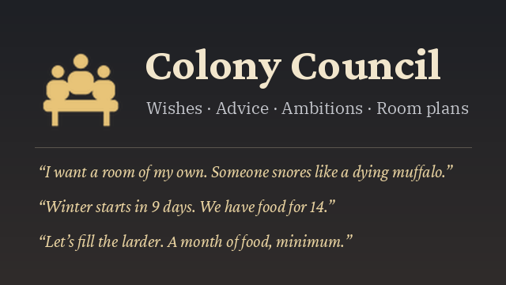

# Rimfolk

*Their wishes. Their bonds. Their council. Their story.*

A RimWorld 1.6 and 1.7 mod that turns your colonists into a society: people who want things, remember things, choose
sides, keep traditions and write it all down. You lead them through a council, and they let you know what they
think of it. (Formerly "Colony Council: Wishes & Plans". Existing saves and settings carry over.)



No other mods are required, and it works with any combination of DLCs (or none).

## Installing

**Recommended: install once with GitHub Desktop, then update with a double-click.**
1. Install [GitHub Desktop](https://desktop.github.com) (no account needed for this).
2. If you have an old `Rimfolk` (or `ColonyCouncil`) folder in your RimWorld `Mods` folder, delete it.
3. In GitHub Desktop: **File → Clone repository → URL**, enter `silvanalig95-cmd/Rimworld-Helper`, and set the
   **Local path** to your `Mods` folder plus `\Rimfolk`, for example
   `C:\Program Files (x86)\Steam\steamapps\common\RimWorld\Mods\Rimfolk`. Click **Clone**.
4. Start RimWorld, open **Mods**, enable **Rimfolk** and restart.

To update later, double-click **`Update Rimfolk.bat`** in the `Rimfolk` folder (or click **Fetch origin**, then
**Pull origin**, in GitHub Desktop). Restart RimWorld afterwards. Updating replaces anything changed by hand inside
the mod folder; your settings and saves are kept elsewhere and are safe.

**What changed?** [CHANGELOG.md](CHANGELOG.md) lists every update, newest first, and the same list is the "What's
new" page at the top of the in-game Almanac. The first save you load after an update brings one letter with the
newest round's highlights (the setting "A letter after each update" turns it off).

**Or: download a ZIP and run the installer.**
1. Download this repository as a ZIP (green **Code** button → **Download ZIP**; pick the branch you want in the
   branch menu first) and extract it anywhere, for example in Downloads.
2. Close RimWorld, then double-click **`Install Rimfolk.bat`** in the extracted folder. It finds RimWorld by itself
   on any computer, whatever the user name: through Steam (every Steam library, on any drive), the installed
   programs (Steam or GOG) and the usual game folders. With more than one RimWorld it asks which one; with none found
   it asks for the folder (or drag the RimWorld folder onto the file). It removes the old version from that
   RimWorld's `Mods\Rimworld Helper` and copies the mod's files there (only what the game needs: `About`, `1.6`,
   `Defs`, `Languages`, `Patches`, `Textures`). If Windows asks for administrator rights, say yes. It stops without
   changing anything if another copy of Rimfolk is already in `Mods`. RimWorld's folder is the one with `RimWorld.exe`
   (`RimWorldWin64.exe` before 1.7) or the game's `Data\Core` in it. Each computer remembers where it installed last
   (in the registry, `HKEY_CURRENT_USER\Software\Rimfolk`), so the next download goes to the same place without
   looking; drag another RimWorld folder onto the file to change it. To always install into one place, open the file
   in Notepad and set `MODS` at the top.
3. Start RimWorld, open **Mods**, enable **Rimfolk** and restart. Repeat steps 1 and 2 to update.

On a Mac, move the extracted folder into `Mods` yourself (right-click RimWorld.app → Show Package Contents →
`Mods/Rimfolk`).

The folder must contain `About/`, `1.6/`, `Defs/`, `Languages/` and `Textures/` directly (not nested
one level deeper). It is safe to add to an existing save. Removing it from a running save logs some
one-time errors about missing classes. They're harmless.

## What you get

Four buttons at the right end of the bottom bar (you can move them in the settings) open Rimfolk's four windows, one
each, with no window over them all: **council** (the colony's own life), **region** (the Rimfolk map and everything
beyond the colony; not "world", which the game's own button is called), **defense** and **planning** (it took the
rooms button's place). Each window has the four in its top right corner, so you can go from one to the next; one
switched off in the settings or put away under "more" is still a click away there. All four open the same size in the
same place: 1010 by 720, or with **Window size** set to Large in the settings, up to 1280 by 860 on a screen with the
room.

**Rimfolk's own look.** Every window of Rimfolk's (the council, the region, planning and defense, the Almanac, the trade
window and its market, the stall counter, letters, the journey planner, the camp, the founding window, a card and every
dialog) has a look of its own: a calm dark ground, rounded cards with a faint edge, flat buttons that light under the
mouse, tabs that read as tabs, one amber accent for what is chosen, and the stances in blue (allied, friendly) and
orange (hostile), always with their word. Drag one by its title bar, size it from any edge or corner, and make it large
(most of the screen) with the button in its title bar or a double-click on the title; each opens where you left it and
as large, also after a restart, and shows more when wider (This week in three columns, the journey planner's list of
who goes wider). The four main windows float beside the map, one at a time: a click on the map or a colonist picked
leaves them open, the corner turns from one to another, and their button, key or the close button in the title bar
shut them; a jump to someone or a plan put down on the map closes them. A name's preview takes the look inside them.
"Rimfolk's own look" and "Rimfolk's windows move and resize" in the settings (both on) bring back the game's look and
the four windows as tabs at the screen's foot; "Put Rimfolk's windows back" opens every window where it first did.

The **council** window, in four views along its top, each with its modes as small buttons under its title and a "?"
beside the title that opens its page of the Almanac:

| View | Modes | What's there |
|---|---|---|
| **This week** | | the one inbox: what you follow, what needs you, what is under way, what's coming, how people are and the plan |
| **People** | Table · Moods · Bonds · Ideoligions · Renown | all colonists in one sortable table, with a colonist's card (their whole story, their dreams and journal) in the drawer beside it; every mood added up; friendships, rivalries, groups, vendettas, secrets; with Ideology, the colony's ideoligions; each of its people by their one name, at home and beyond its walls |
| **Council** | Offices and decrees · Ambition · Our ways · Wishes · Dilemmas | decrees, petitions and the council's offices with their elections (five, up to fourteen seats in a bigger colony); the current ambition and meetings; what the colony is known for and its traditions; open wishes, promises kept and trust; questions waiting and how the answers went |
| **Colony** | Overview · Calendar · Chronicle | the colony at a glance (numbers, how they moved this week, graphs of mood, trust, wealth and people over the last weeks); the colony calendar; everything that happened since the first day, read from the one history, every answer with what came of it (filter by wishes, council, people, strangers, world events, losses, and every dream and journal) |

The **Almanac**, the knowledge base, has a window of its own: the book in every window's corner opens it, and so does
the "?" on every view, on that view's page. It moves and sizes like any window, so it can sit beside what it
explains, and a page you come back to opens where you left it.

The **region** window, in four views along its top:

| View | Modes and lenses | What's there |
|---|---|---|
| **Map** | Land · Stance and ties · Fortunes · Threats · Trade · Ours, each as Map or List | the region map (the land around the colony and its towns, see "The region" below) read six ways: the land; each town by how its people stand with the colony, its head's regard as a ring, and a line from home for each tie (a pact, a truce, a favour owed either way, protection, a grudge); each town by its fortune, with an arrow where it moved this season and the world's events where they are; hostile towns, raiders' camps and the homes they threaten, with a camp's raids drawn to its home; trading posts and the towns that trade; the colony's homes, hamlets and caravans. Each lens has its legend at the map's foot, and its List shows what it shows, nearest first, each row opening its card beside it |
| **Peoples** | Peoples · Faces | what is owed each way, then each people: how it stands with the colony, whom it is at war with, the world events about it, its head and its ties, and what it remembers; Faces: the people the colony knows by name with a way to write, its old foes, those who left, and the faces it keeps up with |
| **Here and away** | | who is here from outside (a camp on the land, guests), what's coming (questions waiting, debts and visits due, a story's next stage), letters and calls on the road, who of the colony's is away (the journey planned, the caravans out on the land), missions and the peoples the colony is bound to by marriage |
| **History** | this colony · the region · the world | the world's one history, newest first, with the world's events running in a strip at its top, the colony's letters lately, and filters for a people, a town or a kind of event |

Every name in it leads to its card in the drawer at the right, and the region's old pages (Neighbours, Letters and
calls, Journeys, World events, trading posts, raiders' camps, hamlets) still answer to their names, each in its view
or lens. The **defense** window is the Defenses page
(see "Defenses" below), read as the other windows are: a "?" beside its title to its page of the Almanac, its parts
as sections that fold with their counts, acts greyed with the reason when they can't be done, and a colonist or a
people named there opening its card in the drawer at the window's right. The **planning** window has four views: Plan (with the advisor's priorities as its second
mode), Base, Making and Rooms (the room plans as a list, or every room at a glance); see "Planning" below.

Tabs and modes show a count when something there wants your attention (what waits on you, open wishes, petitions,
the plan's steps, letters under way). Every window's corner has, beside back and forward, a **search** (a magnifying
glass, and a key you can bind): type a name and it finds colonists, people outside, places, peoples, the
windows' views ("Bonds") and the Almanac's pages, grouped by kind; Enter opens the first. Beside it, **This week's
inbox** with the number of things waiting on you (the same number as This week's tab and, by a setting on at first, the
council button on the bottom bar), and **what you follow**.
Each colonist also has a **Story** and a **Culture** tab in their inspect panel and a Rimfolk column in the game's own
**Social** tab (see "Story, Culture and Social" below), and clicking a colonist's portrait or name in the council
window opens their card in the drawer at the window's right, beside what you were looking at.

A name drawn in parchment with a dotted line under it is a link, in Rimfolk's windows and in the tabs and the column it
adds to the game's inspect panel (never in the game's own letters, messages or log). Rest the mouse on it for a moment
and a small preview says who or what it is; move into the preview to keep it, and a name inside it shows one more
preview beside it. A click opens the card: in the drawer of the window you are in, or from the inspect panel in a small
window of its own with a button to open it in its window. The settings under "Names and cards" set the pause or turn
previews off.

Every window reads the same way. A colour always means one thing, and always sits beside its word or its icon, never
alone: green for friendly or well, slate blue for neutral or under way, red for hostile or bad, orange for what needs
you soon, a brighter red with the warning sign for harm now, a muted green for what is done or kept, gold for the
colony's own and what it chose, pale blue for news from afar. A section's heading carries its count and folds, a tag is
a dot and a word, a filter is a small chip with its count, numbers line up on the right of their columns, a short line
of the last week (its area filled, today marked) sits beside the overview's numbers and the colony's mood, an empty
list says in one sentence what will show there, and an act that can't be done now is greyed with the reason as its
tooltip and, in a card, a line under it. On the on-screen panels (moods, health, work and idle, what you follow) a
colonist's name is a link too: a click on the name opens their card, and the rest of the row still takes you to them
on the map; the hover card's name is one when the card sits in the corner, where the mouse can reach it.

**This week** (the council window's first view) is the one inbox, where everything waiting on you is. **Following**:
what you follow, each with its newest change. **Needs you**: wishes and petitions (oldest first), dilemmas and other
letters waiting for an answer, a hamlet's ask, a raiders' camp's terms, a debt a people calls in, settlers at the gate,
and promises at risk (granted wishes gone missing, with the day by which to put it right), each with its act on the
right (Answer, Decide, Look, Pay). **Under way**: letters on the road, the journey planned, caravans, missions taken
on, settlers on the road to their hamlet and what an answer set going on the map, each by the step it is at (written,
on the road, arrived, answered), never with a time left. **Coming**: calendar days, the council meeting, fights,
missions offered, a post that may close and a raiders' camp, by the day they come. **How people are**: colonists under
strain or near a break, serious illness and convalescence, trust that moved this week, and the balance of Rimfolk's own
good and bad moods. **The plan**: the advisor's two most pressing steps. Each line is one sentence whose names open
their cards; a click on it opens its page or goes to the colonist or the place on the map, and "and 3 more" opens the
rest in place. The pin on any card's head follows it (up to twelve: a colonist, someone outside, a town, a people, a
family, a debt): it shows at the top of This week, in the corner's list, and in the optional **Following** panel on
the screen. The pin also shows on hover on a colonist's line, in the People table, and on a wish card for the wish,
and "Put away" on the news line puts the evenings' colony news away from the letter stack. **People**, **Table** is the people overview: a table of every colonist with mood and Rimfolk's
share of it, trust and its week, strain and the feeling on top, the setbacks and pressures weighing on them with what
helps, their open wish, personal story, health and quirks, office and epithet; sort by any column, hover for details,
click a row for the colonist's card beside the table. **Dilemmas** keeps every answer the council gives, with a "how it went" column (as answered,
went wrong, still to happen, took place, never came about). The pages remember their filters and sort orders, and
Options → Keyboard has optional shortcuts for the pages of Rimfolk's windows under "Rimfolk" (none set until you pick
a key).

The window reopens on the view you last looked at, also after a restart (it's kept with the mod settings); the
"Council window opens on" setting can make it always open on This week instead. A colony's
first session with Rimfolk brings one quiet **welcome letter**: what Rimfolk does, where the council button is, and a
button to the Almanac's **Start here** page. Saves that already had Rimfolk never get it, and it needs no setting.
The **Mood**, **Story** and **Culture** tabs fit the room above the inspect pane: on a small screen, at a big interface
scale or above RimHUD's taller pane they get shorter and scroll instead of running off the top of the screen. A click
on a section's heading (the heart, what weighs on them, their bonds...) folds it away, and each tab (and the Social
tab's column) remembers that for the session.

### Priorities: what the colony needs (Planning, then Plan, Priorities)
A ranked list of concerns (65 kinds of check), each with a short explanation, a rotating **"why it matters"** tip,
and buttons to jump to the problem, plan a fitting room, open the council page that deals with it, or read more in
the Almanac. Some take the first step for you: open the camp's letter or the mission's quest, open the Work tab, or
plan wall lamps and chairs where a room lacks them. Every button says on hover what it opens, places or orders. The
advisor never acts on its own, and it keeps the same rules as the rest of the council's advice (see "Planning"):
**Not this** sets a piece of advice aside, here and on the Plan page alike, until you bring it back from **Set
aside** at the end of the page; what a button does on the map is kept under **Done lately** with **Undo**, and a day
or two later the council looks whether it worked. Seats at the tables, the cold store, beds and the hospital are
counted as the Plan page's "Building ahead" counts them, guests and the prisoners being recruited included: the advice
comes before the colony runs short, with the same numbers on both pages, and the room is proposed once, by Building
ahead (the card's **Place the blueprints** is that same step, with the same Undo). It watches:
- food vs. the coming winter (forecast from your map's actual climate), spoiling food, blight, ripe crops before frost
- kitchen hygiene (butchering next to the stove, dirty kitchens), nobody cleaning, dirty hospitals
- cold or hot months ahead, and what to do during heat waves, cold snaps, toxic fallout, solar flares,
  volcanic winter, flashstorms, droughts, eclipses and psychic drones
- defenses vs. the raids your wealth attracts, fire risk from wooden walls around open flames, insects under
  overhead mountain
- beds and barracks, a place to eat, recreation variety, rooms without light, bodies lying around, mood breaks,
  expectations about to rise with your wealth
- rooms the colony has outgrown, gently: a dining room with fewer seats than people, a barracks that could become
  bedrooms now there's enough wall material in store, a hospital without the vitals monitor, hospital beds or sterile
  tile you've researched (with "Upgrade the room"), a rec room with too little to do for everyone; and rooms it
  could make better: a noble's bedroom short of the title (Royalty), a kitchen with one stove for too many, a full
  freezer with food spoiling outside, a dining room too cramped, a workshop with dark benches or no chairs at them,
  a prison cell without comfort
- doctor, medicine and medical beds, the only doctor with nobody to tend them; prisoners without a warden, food or
  bed; beds no light reaches; meals eaten without a table
- Rimfolk's own systems: a mission near its deadline with its goods not all there, a plague or famine in the region
  while the colony is short of what helps, a camp's question left waiting, a decree still costing moods after its
  reason has passed, an office empty when it matters (no physician with the sick in bed), a calendar day tomorrow
  with nothing laid by, a promise about to break
- a tribal or medieval colony before the cold: stores under the open sky, food that won't keep through a mild
  winter (smoke it, or make pemmican), firewood short of what the fires will burn by spring
- power shortages, jobs nobody is assigned to, items rotting outside, an idle research bench, ideas for what's next
- the herd, the walls and the year: hay and kibble short of the herd's winter, animals out in a cold they can't bear,
  a generator running dry with none of its fuel in store, plans waiting on stuff the stores don't hold, grown trees
  giving cover close outside the walls (a button marks them for the cutters), deep snow with nowhere set to clear (a
  button marks the paths), and with Ideology the colony's faith without a moral guide
- the quieter things, gently: a week without fruit or vegetables (before scurvy), someone with no friend here, a
  camp going hungry or growing tense, a calendar day coming round, graves left dirty or outside the home area,
  clothes worn to rags or taken from the dead, a schedule with no hour for recreation, strain near breaking,
  convalescents back at work, wishes about to lapse with nothing promised

Urgent ones also show up in the alerts on the right.

### Wishes: what your colonists want
Colonists voice wishes from who they are: their traits, passions, mood, relationships and what just happened
to them. A raid makes someone ask for defenses within hours; a cold night, a meal eaten off the floor, a
friend's death or food poisoning all set off matching wishes. Every wish arrives with a little scene and a line
in the colonist's own voice, chosen to fit the season, weather, time of day and their situation.

128 kinds of wish, most with variants (six kinds of work room, a dozen pieces of furniture, any
missing body part), so the same colony rarely hears the same request twice in a row: a wish the colony has
heard several times lately becomes much less likely, and one nobody here has ever made a little more likely. Among
the newer ones: cloth put by for mending before the cold months, steel and spare parts in the stores, milk for a
little one, shelves for the stores, the trees grown against the walls felled before a storm brings one down on a
roof, and the snow cleared from the doors; promised, the last two are marked for the game's own cutters and cleaners. The
wishes that come up most often (armor, a place to pray, a latrine, a seat at the table, a bath, warmth at night) have
three to five ways to be asked in every temperament, so the same colonist rarely asks the same way twice.
Every wish asks only for what the colony can do now, in its era: a tribe hears about healroot and pemmican, an
industrial colony about a deep drill or a comms console. The Almanac page "what colonists wish for" lists them all.
Wishes follow the land's year: clothes are asked for by the season coming (what someone wears has to keep them
comfortable in its usual cold, or on hot land its heat, never a coat for the stores), hot country wants a freezer
(and, with nothing yet that can keep food frozen, food that keeps), and cold land a sauna, Dubs Bad Hygiene's or a
small hot room of the colony's own, where people sit on cold days and talk.

| Wish | Who asks |
|---|---|
| **Home:** a room of their own, a bigger, roomier or nicer bedroom, a piece of furniture, a light, a plant, art for the bedroom, a fire in their room for winter, a real floor instead of bare earth, a bed for their pet | barracks sleepers, the greedy and jealous, night owls, rising expectations, the cold, the tidy |
| **Love and family:** to share a bed with their partner, not to sleep next to someone, a wedding, a birthday treat, a crib for the little one, somewhere for children to learn and play | couples, feuding roommates, parents (Biotech) |
| **Children and the old:** lessons from the colony's best, a pet to look after, new stories to read; a soft chair, a biosculpter pod, a resting place for when the time comes | children (Biotech); colonists of 50, 60 or 65 and over |
| **Work:** a workshop, kitchen, laboratory, hospital, greenhouse or barn; to do the work they love; lessons from the colony's best, or an apprentice to teach; somewhere to train; a weapon rack; a smokehouse; a beehive; a tool cabinet; stone blocks put by; a deep drill; a pen for the animals; a fishing spot (Odyssey, or Vanilla Fishing Expanded); a lamp at the bench they were seen working in the dark | passionate colonists, the old, fighters, cooks, keepers, anyone working in the dark |
| **Stores and fields:** better food, a freezer (in hot country, anyone), a brewery, a little something to drink, firewood for winter, fodder before winter, food that keeps, something fresh to eat, honey in the larder, more books, a stocked infirmary, healroot put by, a proper treasury; in spring, a small field of a crop from home the colony could sow and grows nowhere; before and through a real winter, a sun lamp over an indoor field | gourmands, cooks, the food-poisoned, keepers, readers, healers, the greedy, growers, anyone gone without fresh food |
| **Illness:** a bed for the sick, a pot of tea (Vanilla Brewing Expanded) | anyone down with a cold, flu or worse |
| **Gear:** new clothes, clothes warm enough for the season (or, on hot land, cool enough), a hat, something fine, a piece of jewelry, proper armor, a decent weapon, something a visiting trader has | tattered clothes, anyone dressed wrong for the season coming, the vain, fighters, anyone who saw the trader's wares |
| **Colony:** stronger defenses, a clean colony, music, art where people gather, another sculpture, flowers, a bath, a fountain, a banner, a place to pray, a bench to sit on outside, a fire to gather around, a table where everyone fits, a telescope, a cooler for the hottest days, a sauna for the cold months, in a wet land a roof over the way from their bed to the table | anyone shaken by a raid, the tidy, artists, the devout, everyone in spring, the lonely, curious minds, anyone in the heat, the cold and the old, anyone who came in soaked |
| **People:** a proper burial for a friend, a grave for a named or bonded animal that died (its person digs it near the colony and carries the animal in), a party, a day off, time outside, help quitting a drug or a steady supply of it, a prisoner recruited, executed or set free, a kidnapped friend brought home, an evening at the campers' fire, a council meeting (promising it calls one), a comms console, a bed kept for guests (Hospitality) | grieving friends and owners, the bored and overworked, addicts, the kind, the vengeful, the sociable |
| **Adventure:** to see something of the world (a caravan), a hunt, the beast that mauled someone hunted down | the restless, hunters, the beast's victims and their friends |
| **Body and status:** a prosthetic, an animal companion, a favourite kind of animal, a pack animal of their own, a hurt animal patched up, a room befitting their title | the maimed, animal lovers, haulers and the restless, Royalty nobles |

**Your answer matters:**
- **Grant it** and they're pleased and **motivated** (they work faster for a few days). The happier they already
  are, the likelier the wish turns into an **inspiration** that fits it: art, a work or shooting frenzy, recruiting.
  Some wishes do more: a burial eases everyone's grief, new defenses make the colony feel safer, a passion space
  gives a burst of practice, petitioners who stood together like each other more.
- **Promise** it: they wait half again as long and trust you a little more. Break the promise and it hurts far
  more than never promising.
- **Refuse** it: it stings now, but it's honest and over.
- **Not now**: set it aside quietly.
- **Let it slide**: they bring it up again halfway through, make a pointed last call near the end, and the
  hard-working ones may sort it out themselves (plan the lamp, switch their own work back on, mark out a
  grave, pick an animal to tame).

**Others are watching.** Friends are happy for the one who got their wish. The jealous, rivals and anyone who
has been waiting longer can feel passed over, and some will want the same thing.

**Asked together.** When a colonist wants something for themselves that someone else is already waiting for
(proper armor, a roomier bedroom), they join that request rather than ask on their own: the council hears one
petition with all their names ("Stace, Dukialgac and Harper want proper armor"), with one deadline (two days later
for each name), counted once among the open wishes and brought up again once. Promising, refusing or setting it aside
answers them all; if it lapses, it's told once. Each still gets their own on the map, says thanks as it comes, and the
letter comes with the last one, naming everyone. In the player's save, six wishes for armor in 45 days would have come
to the council as three.

**Beliefs and diets.** Nobody asks for what their ideoligion or their own nature forbids, read from the game's Ideology,
Vanilla Ideology Expanded - Memes and Alpha Memes (all optional): no shared bed before the wedding under an ideoligion that
keeps lovin for the married (an engaged couple asks for the wedding instead), no smokehouse or hunt for a vegetarian,
no beer or brewery for a teetotaler, an ideoligion that keeps drugs to medicine or an addict being weaned off, no clothes
for a nudist, a dark torch rather than a lamp for an ideoligion that prefers darklight, and so on. Food wishes count only
what the colonist may eat, and a wish that comes to clash with a changed ideoligion is let go quietly. Feasts and toasts
serve each colonist only what their food or drug policy allows, what leaves no bad "ate ..." memory, and nothing
Alpha Memes would make them sick for (only fungus or insect for its two required diets together, no forbidden
paste); with nothing fit in the stores they sit at the table without eating. Life goals and council projects
follow the same rules. With Ideology, a "cook fungus meal" bill at any stove makes fungus meals: simple meals that
always have fungus in them, a kind of their own, so one colonist's food policy can take only these while everyone
else's leaves them out. Every other meal bill starts with fungus unticked, so the fungus is kept for them.

**Promises kept.** 67 kinds of wish give something that stays, and the council is watched on it for about 60 days
after granting it (90 for rooms): a bed kept for guests, a room of their own, a nicer or roomier bedroom, a bed shared,
a workshop, kitchen or other room for their passion, a telescope, a sauna, a pen for the animals, a real floor, a
stocked infirmary, a pet, the work they love switched on, hours of rest, a decree they asked for. Take it away and you
get a message at once ("Hector's guest bed is no longer kept for guests. If it isn't back within a day, he will take
it as the council going back on its word."), and a grace period starts: a day by default, or none, half a day or
three days in the settings. Moving it doesn't count: a building packed up to be carried, stored or reinstalled, a
plan or frame of the same thing being built (for up to a week), a bed lent to a patient. Back in time, nothing
happens. Still gone after it: "the council took it back" (-3 to -6 for 5 days, the bigger the sooner
it happened, scaled by their standards), the trust a broken promise costs, a line in their journal, a little less
trust from their partner and close friends, and they may soon ask for it again. Put it back within 5 days and the
council made it right: the mood ends, half the trust comes back, and they feel grateful. A fire, a raid or a
collapse isn't the council's doing, and for two days after a raid nothing counts as missing. One-offs (a party, a
hunt, a visit, a lesson) aren't watched, and neither are clothes, weapons or stores meant to be eaten. The Wishes
page lists everything watched: kept, missing (with the time left) or taken back.

**Trust.** Each colonist's trust in the council (bitter, doubtful, neutral, trusting, devoted) rises and falls
with all of this. Trust isn't only mood: loyal colonists work and learn faster and hold together better, while
a grudge slows them down and shortens their temper (both show in the health tab). Bitter colonists grumble, stop
asking, and on Demanding stakes may sulk, go on an insulting spree, or announce they're leaving and walk out
three days later unless you win them back. The Wishes tab shows everyone's trust and its history.

**Rising standards.** Comfort breeds expectations. While a colonist is happy, their standards creep up from
*modest* to *comfortable*, *particular* and finally *spoiled*. Good things grow ordinary sooner for them (below),
letdowns sting more (the colony's own frictions, everyday pressures and setbacks, up to 40% more), their patience runs
shorter, and their wishes come more often and ask for more: the next impressiveness level after that, fine meals
instead of simple ones, luxuries. Hard times bring standards back down, and so does the austerity decree.

**Good things grow ordinary.** One rule, for every good mood a colonist has, the game's, other mods' and Rimfolk's
alike: they count in full up to a line their standards set (45 points for the modest, 35 for the comfortable, 25 for
the particular, 15 for the spoiled: a colony used to the good life asks more), and of what is above it, half of the
first 20 points and three quarters of the rest no longer lift them. It comes off the good moods themselves by how
ordinary each is: everyday comforts (a fine room, their beliefs, trust in the council, a kind of memory they've had
often lately) shrink most, something new (a wedding just attended) counts nearly in full and drifts down as the days
go by, and a life goal reached never counts for less. Each good mood shows what it counts for now, and one line in its
tooltip says why ("Grown ordinary: counts as +3 of +5, part of everyday life now"). Bad moods are never touched, every
good thing still helps (each point more adds at least a quarter), and in hard times it fades, to nothing near a break.
One setting, *good things grow ordinary*; until November 2026 four rules did this (standards shrinking the council's
rewards and the game's comforts, good times fading sooner, good moods adding up slowly, used to the good life), and a
settings file from then keeps the rule on if any of the four was on. It works through one of the deeper game hooks.

**Small letdowns and small joys.** Small things that go wrong (the same meal again, an idea turned down, rot in the
stores, a spat about the chores) and small things that go right (a laugh with a friend, a kindness, a varied table) are
each felt the way people feel them: a short, small mood at the moment, three points and half a day at most. On the Mood
tab each one has a row of its own under its own name (the same one twice shares a row), and hovering it says how much
it counts, why, and what it does to the heart. What each would weigh beyond its moment goes to the heart instead: strain for a letdown, relief for a
joy, at most 1.5 and 3 a day, so a single one passes and a run of them wears or eases. A letdown that lasts (days of
the same work, someone away, a wish still waiting) is felt when it begins, gets worse or holds another day, and wears on
the heart every hour it holds. The heart counts every small mood the same way, whoever made it: past 8 points of small
bad moods (the game's and other mods' too) they build a little strain, past 12 of small good ones they ease it, while
those moods stay just as the game and the mods made them. The heart's page names what wore on them and what eased them.
With the heart off, every letdown and joy is a mood of its own as before.

**Not every good moment is a good mood.** Rimfolk keeps mood for the moments that matter: weddings, wishes granted,
reunions, victories, recoveries, life goals reached, the end of a personal story, real celebrations and grief shared.
About half of its small good moments (248 of the 474 worth +3 or less) give something that fits instead:
- **opinion only** (58): a good talk, a friendly disagreement, a wound patched up. They think better of each other, and
  nobody's mood moves;
- **recreation** (44): a joke at work, dice with a traveler, snow falling, birdsong, music in the air;
- **rest or comfort** (17): a sweet dream, sleeping late, a friend covering a shift, a dry roof, a trick against the cold;
- **practice** (9): talking shop in a passion they share, a child learning from a grown-up, sparring forms, calming an
  animal in a storm;
- **a feeling** (37, with the heart on): awe at the lightning tree, pride in pilgrims fed, relief at the thaw,
  fellowship after having their say at a meeting, gratitude for a decree they asked for;
- **a rare inspiration** (5): a strange dream, a great beast at the tree line, a falling star, a little magic;
- **trust in the council** (5): a dilemma handled fairly, spoils shared out evenly, the council's precautions;
- **the road's gifts** (6): a little research from a traveler's star names or books, a little goodwill after tea
  with a trader or water for a wounded raider;
- **only the journal** (67): the smallest touches (lights over the marsh, a shape in the fog), and moments whose
  outcome already pays out in silver, skill or goodwill.

The moment itself still shows (a speech bubble, the social log, the news or the journal), and a small line over the
colonist says what they got ("+ recreation"). These follow reward strength like the moods they replace,
and give nothing on *Advisor only*. The heart still feels them at their old size, so feelings, belonging and the
strain friends ease work as before. Four habits trade their mood for their knack, too (see Quirks). A settled
colonist now carries about 4 of Rimfolk's good moods instead of about 10, and their total from Rimfolk comes out a
little lower than before (roughly +10 instead of +11), lower still when nothing big has happened lately.

None of this is a flat penalty, and nothing is taken away: a colony that lives well still feels it, it just doesn't
float at the top of the mood bar on a pile of small pleasures. A line in the Mood tab says what good things grown
ordinary take off right now, for example "Good times: good things grown ordinary, good moods +32 of +47".

**Everyday frictions.** People who live close together get on each other's nerves. Colonists argue about the dishes,
complain about a bunkmate's snoring, take the last good meal, keep a borrowed knife, correct each other at the table
and give each other the cold shoulder after a spat. Some natures grate: an annoying voice, creepy breathing, a
pyromaniac near the tinder, a nudist at supper, an ascetic lecturing a greedy one. So do the times: someone keeps away
from a sick colonist, two argue about a camp, a temper snaps. Some follow something that really happened: a cook
blamed by someone down with food poisoning, a bad day after a mental break turned into a joke, the proposer of a
finished council project taking all the credit, a shared tool handed back chipped. A messy or cramped home adds its
own (24 nuisances): a door that sticks, a leaking roof, smoke in a small room, a generator droning next to someone's
bed, a filthy room, a cold or stifling one, the dog asleep on the bed, building work right outside, vermin in the
stores, a bare earth floor, rotten food in the stockpile, work in the rain with no coat when the colony could make
one, junk left in a bedroom, a butcher's table or spot where people eat or sleep, and in the cold a bed a few steps
from a door straight outside (an anteroom stops the draught). Each names what it is about (the badly made parka, the
wood left lying in the way, the filthy dining room), and colonists grumble aloud now and then about bad clothes,
clutter, dirty rooms and hard beds. Each is a small letdown: a point or two of mood for half a day, and a little
strain on the heart when they keep coming. In an
ordinary colony they come about as often as the warm moments; less in a happy, roomy one, more in barracks or between
people who dislike each other. Abrasive, volatile and jealous colonists start more of them, kind ones none. After a
spat the two share no warm moments until it wears off or they clear the air. A setting turns them off.

**Everyday pressures.** A colony that has everything still has its everyday wear. Five small, fixable pressures,
each saying what caused it, with what helps in the Mood tab. Each is a small letdown (above): felt as a short mood when
it begins, gets worse or holds another day, and wearing on the heart every hour its cause lasts. The sizes below are as
they are felt:
- **the same meal again**: 6 of the last 8 meals the same kind, more after 10 or 12 of 12 (-1 to -3). A colony that
  can cook only one kind feels it least; ascetics and anyone whose ideoligion allows only one kind of food (a fungus diet)
  don't mind, gourmands mind it more, and fine or lavish meals never count. Three different foods in two
  days make **a varied table** (+2).
- **the same work for days**: most of each day on one kind of work, 4, 7 and 10 days running (-1 to -3). The
  industrious and hard-working, children and anyone with a burning passion for that work don't mind, and any passion
  for it makes it a step lighter.
- **missing someone**: a partner apart for 2, 5 and 10 days, or a close friend for 3 and 8 (-1 to -3). The
  homecoming is already celebrated when they're back.
- **a packed room**: a dining or rec room with too little space per person, or diners short of seats (-1 to -2, for
  half a day). Parties, rituals and meetings don't count.
- **half-built work**: frames left untouched for 2 days in the home area (-1 to -3). Plans (blueprints) never count;
  lazy colonists and slobs don't care.

None of them is a flat penalty: a second meal bill, a second job in the Work tab or a bigger dining room makes them go
away. They feed the heart's feelings (loneliness, restlessness, frustration, contentment). The **Life's ups and
downs** setting makes them gentle (half strength, no half-built work), normal (85%) or demanding (half again as
strong), and softens the colony's small frictions too (70% on gentle, 85% on normal). **Hard times**: as a colonist
nears breaking, Rimfolk's small letdowns weigh less (down to half at their minor-break line) and its pressures down to
three quarters, easing back to normal as they recover. Meals are noted through one of the deeper game hooks. The
Almanac's *everyday pressures* page has the details.

**Setbacks.** The other side of all the small rewards: about fifty letdowns that come from what actually happens in
play, each naming its cause and, in the Mood tab, what helps. As written most are -1 to -4 for a day or a few, and the
few bigger ones (-5 to -6) are for real losses; each is felt as a small letdown (at most -3 for half a day) and the
rest wears on the heart.
- **The council**: a wish still waiting while wishes voiced after it come true (-1 to -2), an idea turned down at a
  meeting (-2, -4 if the meeting backed it) or a vote lost (-1), a disliked decree dragging on past two days (-1 to
  -2), a promise broken to a close friend or someone they love (-3 to -5), a rival given a name or a council seat
  (-2), and answers that go against someone's nature: "not my choice" (-1 to -2), or "I said it would go wrong" (-2)
  when the answer's gamble failed. These follow the stakes' downsides.
- **Gatherings**: a gathering an answer called that went ahead without them (-1), a feast that ran out of meals before
  they ate (-2), a party or wedding rained on in the open (-1).
- **Work**: something they built torn down (-2) or wrecked (-4, -6 for their best work), a crop they sowed lost to
  blight or frost (-2, -4 for a whole field), a botched build, poor or awful work in their own passion, making do at a
  spot or campfire when a proper bench can be built, an operation that failed in their hands (-3 to -4), long hauls
  across the map, hours left hurt waiting for a doctor, and for keen researchers no research under way.
- **Home**: a meal eaten outside in the freezing cold or rain, their art or an animal they trained sold to a trader,
  envy of a room three grades better than theirs.
- **Between people and worries**: overtaken as the colony's best at their passion, a friendship gone cold, loud work
  through the wall at night, a partner, family member or close friend seriously ill, a loved one's caravan short of
  food, a nemesis still at large, a debt to a people unpaid (kind colonists), homesickness after a hard week, and long
  quiet days with less to do than they expect.
- **Camps, missions, the calendar and the world** (new): rain on a calendar day's own gathering (-2), its feast dish
  burned (-1, the cook -2 to -3; likelier the worse the colony's best cook), two rivals quarrelling at its table (-2),
  the first time a day is kept since someone died this year (-2 to -4), a camp they'd sat with that left on bad terms
  (-2) or left owing (-1 to -2), guests who stay on eating from stores that are running low (-1 to -2), a mission let
  slip or a harvest half brought in (-1 to -2), a world event's gamble gone wrong (-1), and for the kind, a world event
  the colony stood by through (-2).

None comes from nowhere, and most can be ended or avoided: answer the wish, lift the decree, build the bench, put a
stockpile near the work, defend what matters. The colony's life follows "Life's ups and downs" (never less than a
whole point), what happens between people follows the frictions setting (and envy the jealousy setting), and all of
them sting up to 40% more for spoiled colonists. Events are noticed where they already happen, through the deeper game
hooks; the lasting ones are worked out once an hour. The Almanac's *setbacks* page has the full table.

### Decrees: spend the good mood
When the colony is doing well, put that goodwill to work. The Decrees tab lets you declare up to two policies at a
time for a few days: **long hours** (work faster), **rationing** (eat less), **drills** (everyone who can fight
trains shooting and melee), **study hours** (learn and research faster), **austerity** (no new wishes, standards
come back down) or, the other way round, **festival days** (better mood, much slower work). Everyone reacts according
to their nature: the industrious like long hours and the lazy hate them, ascetics love austerity, the bloodthirsty
love drills, gourmands suffer under rationing. The tab shows who will love or hate each one before you decide, and
living under a decree you hate wears down your trust in the council. With feelings and strain on, the hard ones
(long hours, drills, on guard...) also build a little strain in those who resent them, and **days of rest** lets the
colony recover: 10% slower work for three days, while strain drains about twice as fast.

The everyday ones each trade a little work for something else: **quiet hours** (deeper
sleep, far fewer quarrels; night owls hate it), **shared meals** (talk and goodwill at one table), **rest when ill**
(wounds and illnesses mend faster while the well cover for the sick), **banked fires** (fires, torches and fueled
heaters burn a quarter less fuel, in colder, darker rooms), **apprenticeships** (everyone practices building,
crafting, cooking and growing every hour) and **a feast day** (one day of eating well and working half). Colonists
petition for them when someone is ill or many are hurt, in winter, or when a newcomer joins. Anyone still healing from
a wound or an illness likes rest when ill and a clean sweep, and asks for either when many are hurt. During a
**clean sweep**, everyone who can clean puts it before their other work, even those not set to clean; fires, the sick
and wounded, children, prisoners and cooking still come first, and so do sleep, meals and washing. This is one of the
deeper game hooks.

Thirty-six decrees in all. The five newest each mean one thing on the map: **a hunting season** (two head of safe game
marked for the hunters each morning), **wood for the winter** (the nearest wild trees marked for the cutters each
morning until the stores hold the winter's wood, more for a colony that heats with it), **foraging days** (wild plants
ripe for picking marked each morning), **saving the power** (for a colony on the grid: the lamps switched off from
eleven at night to five, never by a patient, and on again as they were) and, with Ideology, **every faith its evening**
(the largest ideoligion that isn't the colony's holds an evening of faith, and those of other ideoligions trust the
council more; never together with one ideoligion for the colony). Before them came a village's own year, doing something no stat can: **tithes** (a tenth
of the silver each morning to a people of the colony's ideoligion or the nearest village, for goodwill and, with Ideology,
the faithful's certainty), **a curfew** (everyone's night hours turned to sleep and put back after; night owls keep
the watch), **militia drills** (twelve days of light practice for everyone who can fight), **alms for the poor** (a
little food at the gate each morning, and the neighbors remember it), **holy days** (with Ideology: three days for
the colony's ideoligion), **a market day** (a trade caravan comes that day), **a fast**, **a work song** (recreation while working,
slower research), and **open gates** (more visitors). Two answer the region's hard times and can only be declared
while they last: a **quarantine** while sickness goes round (illness passes between roommates a fifth as often, and
visitors are turned away) and **famine bread** while a famine lies over the region (the colony eats a little less
and sends bread to the hungry people). A decree for another era or ideoligion isn't listed at all.

Decrees mean distinct things: where two are one idea, only the form it takes now is listed, the **drills** by the
colony's age (militia drills, the muster of a tribe or a village, for a tribal or medieval colony; drills all day for
an industrial or spacer one) and **rationing** by the moment (famine bread while the region goes hungry and the
colony's own stores aren't low). Two that overlap never run together: festival days and a feast day, quiet hours and
days of rest, on guard and a curfew (the card says why). Rest when ill and a quarantine may: one heals the sick, the
other keeps the well from catching it. In an older save, militia drills in force in an industrial colony carry on as
its drills for what was left of them.

There's no hard limit on repeating a decree, but there is a price. Enact the same one again within a month, or
**force it through** before its cooldown is over, and those against it lose more trust and resent it more each
time. Someone may even snap: the hot-tempered throw a tantrum, others wander off in a daze. The tab warns you how
many times a decree was used lately, how likely trouble is, and in how many days it's safe to enact again.

A decree the colony **needs and wants** now is let off some of that. It's needed when the moments it answers hold
(a dirty or filthy home, many or half the colony hurt, and for a clean sweep and a sick bay fight after fight), and
wanted as far as those who like it outnumber those against it, more when someone asked for it. Then its cooldown is
up to two thirds shorter and a repeat is minded up to 60% less, but never under a day or a third of its cooldown, and
once it has been declared twice in a month the need counts for half: after many fights, with the home filthy and the
wounded asking for it, a clean sweep can come again in about four days instead of eight. Its card says when and why.

### Our ways: the colony's character
The council's choices add up. Every dilemma answer, decree and many granted wishes nudge the colony's five ways:
**merciful or harsh**, **generous or thrifty**, **traditional or restless**, **open or guarded**, **hard-working or
easygoing**. Lean far enough and word spreads: a letter tells you the colony is now known (and later renowned) for
it. Colonists whose character fits are proud of it (up to +4 mood, grown ordinary like any good mood); those it
clashes with chafe (up to -4). It is read from their character, the eight sides their traits, skills and age set and
what happened to them moves: the warm hate harshness, the proud love thrift, the easy-going love an easygoing colony,
the set in their ways love tradition, and someone hardened by a hard year may come to mind mercy less. Neighbors warm to
a generous or open colony and cool towards a thrifty or guarded one, and some encounters and dilemmas only happen
for a colony with a certain name. Old deeds fade (about half in a year), so a colony can change. The **Our ways**
page in the council window opens on the colony's one name, the same card a home shows in the region window: what
people call it (its ways and what its work made it, in one list) and how far its name carries beyond its walls and for
what, in one sentence ("People call the colony traditional, generous and walled; beyond its walls it is known for good
doctors, its name talked about in the next town."), the deeds behind it, and a line for what each people remembers.
Below it, where you stand, who is proud, who chafes, and what shaped it. When the name changes, the chronicle has one
sentence for it. With more than one colony each has its own ways and names, and the page shows the colony in
view's (see Many colonies in play).

A colony also grows into what its people keep doing. A season of steady work earns it a name of its own:
**green-fingered**, **builders**, **learned**, **craftsfolk**, **hunters** or **delvers**, counted from the
colonists' own records as a rolling average per head. Those with a passion for the work take a small, lasting pride
in it (+2), and the name fades if the work stops for long (a winter alone won't undo a farming colony).

Three more names grow out of how the colony lives, counted from Rimfolk's own records for the colony as a whole and
worth no mood at all: **good hosts** (camps that stayed their time and left on good terms, people taken in, with
Hospitality its guests' nights), **devout** (with Ideology: the ideoligion's rituals held to their end, a chaplain, a moral
guide) and **long-memoried** (calendar days kept two years running, and traditions). What they change is what comes:
camps come sooner to good hosts, and refugees and exiles seek them out; pilgrims and processions find a devout colony;
players, minstrels and mourners a long-memoried one. Each has its own visitors on the road and lines in letters, and
each leans the colony's old hands when an answer goes against it.

Four more come from what visitors see. A visitor at the gate, or a guest staying with Hospitality, says so when the
colony has something worth remarking on, once per thing seen: a great hall, art of excellent quality, three graves or
more, a shrine, walls with turrets or a long run of wall, many animals, wide fields. When enough of them have remarked
on the same thing over the months, word spreads and the colony is known for it: a **famed hall** (tourists, the
celebrity, the players and guests of note come more often), **artful** (tourists, the celebrity, scholars and
scribes), **hallowed** (pilgrims) or **walled** (tourists). "Travellers speak of..." on the region window's Peoples, under Faces, says what the
colony is known for. Like the work names, these fade if the colony stops living up to them.

### Dilemmas: hard choices
Every week or so (sooner while everyone is content) the council has to settle something, and every answer costs
someone. A thief caught in the stores: forgive, make them work it off, or make an example of them? Two colonists
at each other's throats: take a side, force them to work together, or stay out of it and risk a brawl? A forgotten
stash of beer, a cook who wants to spend the stores on one magnificent feast, a colonist who quietly admits they
can't cope. Kind, greedy, industrious and teetotal colonists all react differently. Leave a dilemma unanswered and
the council's silence decides for you.

There are 227 of them, and many grow out of everyday life: a sick colonist when the medicine is nearly gone,
whether to keep someone with a fever apart, a cook with a cold, an old family remedy, a visitor's strange cure, the
camp on the colony's land asking for medicine, food or searchers for a lost child (and, new, one of them who wants to
stay, a purse gone from their stash with a colonist blamed, one of theirs caught in the storeroom, their beasts standing
in your ripe fields until the answer sends them home, riders with an old quarrel against them, a child of theirs and one
of yours who've become friends, their feast day, a fee they can't pay), a council meeting someone missed,
a worn-out colonist asking for days off at the worst time, a doctor who just lost a patient, someone convalescing who
wants to be back at work, family who want a say before an operation, a squabble that turned into a feud, an elder who wants to
put down the tools, a child's question, a broken promise, the same meal every day. The young and the old have their
own: a broken window and nobody owning up, a child frightened after a fight or grieving a parent, lessons or play,
a youngster who wants to see the world, an elder who wants one last walk in the hills, won't see the doctor, has a
tale to tell or feels the cold in their bones. Some come only when they fit the day: the mess after a fight, a sick
night, lessons in a busy time, seed for a neighbour in spring. Many answers call on whoever is
best placed (the doctor, a forager, a tracker, the best talker), and their skill decides how it goes. Many have
several openings and several ways to turn out, picked to fit the moment, and a letter doesn't repeat the text it used
last time when another fits.

**Banishment by the council.** Someone who keeps getting into fights over a month, whom most of the colony can't
stand and almost nobody stands by, comes before the council, read from the game's own fight and insult memories and
Rimfolk's note of who threw the first punch. The first time, banishment is never an answer: the speaker (or the
faith's leader) has a word with them face to face, their hours go to the night for five days, or the council lets it
be. If the trouble goes on, a later question offers to send them away in the colony's own words (cast out from the
fire, sent into exile, expelled, struck off the roster), with the council's voices, a partner's or friend's objection
and their own say in the letter, and hints naming who would grieve, the game's heavier mood if they'd be sent out to
die, and the skills the colony would lose. Told face to face, they gather their things in their room and walk out by
the edge through the game's own banishment; one sent away may come back one day, at the gate or, rarely, with raiders.
Never a child, a slave, a guest or anyone held under a tie with another people, never in a colony of fewer than six,
and off with "Banishment by the council" on the settings' What's on page.

**What each answer does.** Every answer in a dilemma's letter, and in the letters of Rimfolk's events and world
events, has a short line under it, and hovering it shows more, grouped by kind, with gains in green and costs in red.
The setting **What each answer does** (How you're told page) chooses how. **Flavour** (the default since 8 November
2026, the player's request: "more like flavour writing rather than exact descriptions") puts one short line under each
answer, how it would land as someone at the table might say it, never naming spirits, trust, opinion, a size or any
other mechanic: "It would mean a lot to Avila; Guido won't forget it.", "Guido and Avila may come to blows.", "Some
would call it fair; Guido won't.", "The stores would feel it." It says the biggest thing and at most one more (someone
who may be hurt always, a real gamble next, else someone else), by name, within about ninety characters, always the
way things really go for them; its words are picked from nearly three hundred in some fifty families
(`Dilemmas/ImpactFlavourMath.cs`, made from the same lines as the hints), the same for an answer each time its letter
opens and different between the answers of one letter. Hovering the answer shows the hints. **Hints in words** never
shows a number: what happens on the map and when, which way spirits and trust go and roughly how far ("a little",
"noticeably", "greatly"), who by name or group, what it costs ("uses some of the stores' beer", "costs a few hours of
work"), how likely ("may", "likely"), whether it's a gamble, and which way the colony leans
(`Dilemmas/ImpactHints.cs`, made from the same lines as the numbers). **Exact numbers** shows who feels what and for
how long, trust, what it takes from the stores or gives, what happens on the map, and the odds of a gamble going wrong
("1 in 4"): moods show their real size for each colonist (the reward and downside strengths and each colonist's
standards count) and goods are counted from the stores (an answer that would take the last medicine says so). **Off**
leaves the letters as they are. It is all read from the colony as it is when the letter opens. The Dilemmas page
shows, on hover, what each answer given was to do, as flavour, words or numbers as the setting has it. The dilemmas, the customs and the strangers' questions were rebalanced by the same reckoning:
every answer has its own upside and its own cost, and the safe or quiet answer gives the least (making a thief work it
off costs them a disciplined mood; the omen ceremony is a gamble).

**Answers that change the colony's own settings** do it the way you would by hand, and say so under the answer. Who
gets a new limb or eye lying in the stores puts the game's own operation on that colonist's medical tab. After a bad
batch from the kitchen (food poisoning in two or more), the colony scrubs the kitchen, or the cooking goes to the next
best cook for three days and back. Through a heat wave the timetables can turn round to sleep through the midday heat
and work by night, or to a rest in the shade at midday, until it breaks. A researcher close to finishing can have one
night at the bench and the morning after to sleep. When the only real doctor needs tending, self-tend can be switched
on, the best medicine used, or the next best can tend them while the doctor talks them through it. A drug bench
someone objects to can have its hard drug bills, or all but the medicine, suspended. A prisoner far better at a skill
a colonist loves can teach them in the cell, or the wardens can be set to recruiting first. With Ideology, a
slave a colonist has grown fond of can be freed into the colony by the game's own emancipation or walked to the edge
to go home, and someone who broke one of the faith's precepts can be given a quiet word, a penance at the altar or the
council's backing. The colony is also asked about what it meets in the game itself: through a cold snap, short days
until it ends (abed through the morning frost, to bed early) or a fire kept in the coldest bedroom; when the game's blight
reaches its fields, the blighted plants marked for cutting, or that and the rest of those fields brought in early; a
fine weapon in the stores two of the colony would be better armed with, taken up by the one chosen; and an animal
trained to obey whose person died, given a new master it follows. And more: someone **inspired** to make art given the
colony's finest material or its plain one (a bill at the bench for them alone), someone in **withdrawal** given one dose
from the stores or put on the colony's strictest drug policy to ride it out, **food that won't keep** cooked into meals
today (all of it, or one supper's), **the stores in the rain** roofed over where the walls can carry it or drawn in
under their roof, **the old walls** of a ruin near the colony pulled down for their stone or claimed and built on, **the
new room** given to one of two who sleep worse, **what to learn next** chosen when the study benches stand idle, and
**a hurt beast** lying on the land marked for a clean end or for taming once it's on its feet (the game's own risk of a
failed tame named first). And about the colony's own systems: **the empty field** in the growing season sown that
afternoon by a few hands or given up, **what the field grows** when medicine or cloth runs short and food is plenty
(the field, or its far half, turned to healroot or cotton), **snow on the paths** cleared all over or by the doors (the
game's own snow-clearing area), **the unfinished work** put up by a building party or its unpaid plans taken off, **the
trees by the wall** marked for the cutters (all, or the nearest half), **too many in the pens** when the hay won't last
the winter (the oldest and the spare males marked for slaughter, never one bonded or carrying young), **what to teach**
an animal (to guard or to haul, the game's own training), those **home from the road** given a day off or a listener,
and with Ideology **doubts in the faith** (an hour with its guide, or alone at its altar) and **the faith without a
guide** (the game's own moral guide named). Hours and work an answer changed go back by
themselves when their time is up or the heat wave or cold snap is over, with a message, but only where nobody changed
them since: whatever you set by hand stays as you set it.

**Answers play out on the map.** When an answer describes something people do, they do it (757 answers of 205
dilemmas and 207 Rimfolk events, stories and world events, plus calendar days, nine decrees and nine ambitions, 25
stages of 20 personal stories and 7 moments with visitors). A
victory feast is eaten at the dining table, each guest sent to eat a cooked meal, the finest first they may eat, and
the food the answer spends on it is cooked for it first, at the colony's stove by its organizer or best cook; a while in, its host raises a cup and the table raises theirs. Every feast is held this one way, an answer's, a calendar day's or one with guests from the neighbours. The midsummer bonfire is lit (with no campfire, one of the colony carries wood out and lays one first, burned down to ash
after), a toast is raised, an apology, a reading or a visiting scholar's lesson is heard round the table (the speaker
at its head, the listeners in the chairs round it), a friend sits with someone who is ill, a
colonist sits by a grave or at the camp's fire, an apprentice works at the teacher's side, a worn-out doctor is sent
to bed. A work party cleans, hauls, mends, builds, sows or brings in the harvest with the game's own jobs, on work the
colony really has; the colony walks out together to the graves or the gate and back; a few keep a vigil into the
night; searchers fan out over the land and bring back what was promised; real medicine, food or silver is carried out
of the stores to the visitor or the rider at the gate (strangers the words say ate it eat it there, and those who stayed the night
sleep by the colony's wall until first light), or silver paid to a colonist into their pack; the hunters go after the game an answer marked. Every answer
whose words say people do something has been read: the thief is punished in front of everyone at supper, the doctor
sits at the bedside with the last dose, the snow is shovelled (and a snowman built), the bees are smoked out, and the tribute, the bounty
and the envoy's price go out to the gate by hand, load after load. Two who sat down together take seats across a
table, someone leaving for good goes from the gate at the end of their send-off, and guests asked to the colony's
table come up and are served. A fight an answer risks comes during the supper or
the work party its words put it at. The answer's own words are told once it's over, and if it never came about, a
message says why instead. None of them
holds anyone in a gathering, so the game's own parties and rituals can always take them. Nobody is called from
danger, sleep, a meal or a sickbed, nothing starts with enemies about, and danger, drafting, hunger or exhaustion ends
it. The answer's good moods, and what it teaches, come to those who were there once it's over (the closing message
names who learned what); if it never happens within a few hours,
everyone gets them anyway, as before. This week lists what's coming, the dilemmas page says how each went, and those
who took part write about it. A setting (Events & world) turns it off.

What an answer says now exists is made real where that's safe, and made when the words say: the apology carving, a
broken keepsake's replacement and the gift that settles an old debt are signed sculptures (the last two any small
work of art of wood the colony knows how to make, a mod's statue or pottery as well as the game's), worked first at
the colony's bench for an hour or two, that the one who made them then carries over by hand and sets down at the
other's feet (the moods wait for it), an old crafter hands the student their old knife, a scribe's bound
copy is a real book with the scribe's name on it, a coffin made ready is a wooden sarcophagus in the corner of its
owner's room, assigned as their grave, the hat bought on the side is a real hat, a guest who cut wood goes and fells
real trees with the game's own cutting and leaves the logs by the stumps, each child walks out and plants their own
sapling at the edge of the fields with a stone beside it, a room staked out is placed as building plans through the
room planner when the walk out to it gets there, a fallen star is forged into a blade at the colony's smithy, and a relapsed colonist's stash, or a found
one the council won't keep, burns in the yard. Shearing day is a real shearing and milking party.

Some answers keep something on the map for a while. Lantern night sets real torches along the outside of the colony's
walls at dusk and takes them in at first light; the enemy dead are carried out by hand late in the afternoon to a pyre
beyond the gate, which one of the colony lights at dusk with wood from the stores, the bodies burning on it until
morning, or to the tree line and left there, or buried in graves the colony digs outside the wall, or burned in the
colony's crematorium; an old colonist who can't get warm gets a fire in their room that burns the wood the council set
aside; two colonists trade rooms when one gives up the warmer; a sleepwalker's door is bolted for three nights (only
once they're in bed, and never while anything is wrong); a doctor goes round to everyone in turn, and a cook takes a
pot round to those working outside; the first night watch walks the walls until dawn; a companion animal keeps at its
person's heels for a day and a half, and a secret told is said in front of whoever gathers to hear it. Only things of
the colony's own era and DLCs, and nobody is hurt.

**Goods and people come and go on the map.** What Rimfolk's events move between the colony and the outside world is
carried by people you can see. When a village buys 250 corn, two porters walk in from the edge a few hours later, by
day, take it from the stockpile with their own hands and walk off; when the silver comes back at the end of the year,
a runner brings it and sets it down at the gate. Payments, gifts, debts settled, rewards, a venture's or a fair's
takings, relief grain and lost cargo all come and go this way (106 answers' takings, tips and gifts marked as crossing
the colony's edge, the 77 errands carried out to the gate or a visitor, every world event's silver and sale, the story
chains' and missions' rewards, mission orders collected by their carts). A visitor's tip or a challenger's lost stake
is counted out in person, a find the colony sells is paid for by a neighbor's runner, a tithe paid in kind waits for
the lord's carters, and the hungry who keep coming to the gate are fed there by hand. A
purse brings one runner, a cart's worth of timber three porters and a pack animal from their own caravans; tribes send
runners, medieval folk porters, everyone later couriers, always from the event's own people or the nearest of a
fitting era. An errand carried out to the gate is handed to one of them waiting there; a prisoner sold to a neighbor
is fetched by their riders, a runaway animal handed back is led off by their herder, and a visitor who pays or brings
a gift carries it in and sets it down. Letters about a venture, a market or a fair come with the goods. They come only
when it's safe and leave at the first sign of danger; whatever they can't do is settled the old way, and if the colony
hurts one of them, the deal holds only as far as it got. A setting (Events & world, on by default) makes it all
instant again.

**Visitors on the map.** The people a world event's letter speaks of are there too. The rider waiting at the gate for
the colony's answer walks in with the letter and stands by the gate until you answer; what you send is carried out to
them, and what their people pay they set down themselves. The family asking to be taken in waits there with their
children and their dog, and if you take them in, those are the people who join. Fed and sent on, they sleep by the
wall (or, on a bitter night, in a corner of the dining room) and go at first light; snowbound travelers stay two nights, a stargazer three on the far hill. Drovers graze
their herd on the far meadow overnight, herders bring theirs down to the water, and mourners, a clan's band and a
lord's progress pass along the road and go on to the far side of the map. A smith or a merchant house's agent who
buys takes the goods from your hands and pays on the spot, pilgrims and prospectors you let stay camp by the water,
and a young man running from a blood feud waits at the gate (hidden, he stays two nights) while a rider of the other
family goes by on the road. A prophet waits at the gate to speak at dusk, a scavenger with crates from an old vault,
an unpaid driver looking for work, a caravan off the ice road wanting hot meals, the moot's delegates, horn hunters
asking leave and a girl left at the gate by the famine (88 beats of 41 world events, and a feud's warning rider, a debt
collector and a runaway mule's owner; 137 lines of their own). Only peoples at peace with the colony come, only when
it's safe, at most three groups at once; they go if hurt, if their people turn hostile, if raiders come, or if the
cold or hunger gets to them. With the same setting off, or when nobody can come, the letter tells it as before.

Visitors do what their letters say, and keep out of the colony's rooms and fields while they do. They sleep when
they're tired or night has come, on open ground near their spot; guests given a bed or a roof sleep in a corner
indoors, and with Hospitality in the colony's free guest beds, which they give back when they go. A camp out on the
land lays a campfire of its own wood, sits round it of an evening and puts it out when it leaves, and colonists at
leisure may walk out to sit with them. Prospectors pan the creek (a few pieces of silver now and then, rarely a flake
of gold, into their packs), gleaners carry home a sack of the field's own crop, and pilgrims sing after dark, one of
them walking over to play the colony's harp or piano if it has one. The other settlers' hunters take a real wild
beast that is fair game (nobody's, not marked by the colony, no predator, nothing bigger than a deer), dress it at
their camp and carry the meat and hide home, and the beast never turns on them; warned off, they go. Mourners carry
their dead in their arms, past the colony on the road or into their camp, where the body lies by their lamp until they
carry it home. The tinker mends the pile piece by piece where each lies (worn things on whoever wears them), the
travelling doctor doses each colonist in turn, the bonesetter spends the afternoon with the one they treat, and a
travelling cook given the kitchen cooks the feast at the colony's stove with a colonist at their elbow, leaving the
meals by the stove (and, called away, setting down whatever they carried from the stores). Each kind of visitor has
lines of its own for arriving, waiting, staying the night and leaving, with words for the weather, the night and the
season.

### Ideoligions and the council
With Ideology, a colony of many ideoligions gives the council something to work with (all of it off in classic mode,
and with "Ideoligions in the colony" off). Every move goes through the game's own certainty: Rimfolk takes some away
or gives some back, and when someone has none left the game converts them, with a message and a line in the chronicle.

- **An ideoligion evening.** The council calls a gathering where one ideoligion is spoken for, by its moral guide or
  else its most devout believer with the best Social skill, at its altar or ideogram if one stands (else round a fire
  or at the dining table). Its believers come; the others choose for themselves, by how open they are, how certain of
  their own ideoligion and what they think of the speaker, and those whose ideoligion frowns on being preached to stay
  away and say so. How it went (the speaker's Social skill and warmth, how many came, the altar) decides what it does:
  listeners of other ideoligions are swayed toward it (6% to 12% to start with, then their own openness, pride and
  opinion of the speaker), believers steadied, everyone given recreation and fellowship (a fine evening, a small good
  mood); a poor one changes nothing but a line. One every five days at most, the same ideoligion one every ten. Put it
  on the calendar as a day kept as an ideoligion evening, say yes when one of the devout asks the council for one, or
  call it from the ideoligions page.
- **A wavering colonist's wish.** Someone whose certainty is shaken may ask for an evening with a devout believer of
  another ideoligion they think well of. Promised, they walk over that evening and spend a couple of hours together;
  granted, they are swayed toward that ideoligion and the two remember it together.
- **Ideoligions at odds.** When the colony is split (two ideoligions of two believers or more, or half of everyone
  apart), the council is asked how its ideoligions should live together, more often after a quarrel between them or
  while an altar stands: share the altar and take turns (the open-minded approve, the devout less so), give each
  ideoligion its own corner (a letter suggests where; a little trust all round and everyone surer of their own), or
  name the largest ideoligion the colony's (its believers pleased, everyone else trusting the council less and drawn a
  little toward it, the devout of other ideoligions taking it hard). Each answer plays out on the map.
- **Leanings.** Beside the ideoligion they hold, each colonist is drawn to the others around them, shown under their
  certainty on the Culture tab. Each day a leaning fades a little and is fed by that ideoligion's believers in the
  colony (friends, lovers and family most), by talks and evenings that sway them, and by the decree below; the
  strongest wears on their certainty against the game's own daily recovery. When a leaning passes their certainty they
  take that ideoligion up, through the game's own conversion, and the one they leave becomes a leaning, so they may
  drift back. With the decree and friends among its believers, a content colonist comes round in about two months; a
  colony drifts toward its majority over seasons; a lone believer of a minority never pulls the rest over. The decree
  alone carries a leaning only so far (30%): the rest takes believers close to them. The set in their ways, the proud
  and those whose ideoligion frowns on preaching dig in while it holds, and whoever comes over under it stays drawn
  back to the ideoligion they left.
- **One ideoligion for the colony.** A decree for fifteen days, naming the ideoligion you choose. Each day everyone of
  another ideoligion leans a little more toward it, its believers speak of it more and open the council's
  meetings with a word from it, and those of other ideoligions trust the council a little less (the open-minded least,
  the devout most); the devout of other ideoligions petition to lift it. Lifting it ends all of it.

None of it adds a bad mood: what it costs is trust and certainty. The Almanac page "ideoligions and the council" has
the numbers.

### Social: friends, rivals, comrades and mentors
Colonists form lasting bonds out of how they feel about each other and what they live through, and those bonds
grow, sour and end over time:
- **Friends** and **rivals** form when two people keep liking (or loathing) each other, then drift with how
  they feel.
- Everyone who fights in the same battle becomes **comrades**: respect more than friendship, a few points of opinion.
  That fades slowly between battles.
- A skilled, passionate colonist may take a keen learner on as a **student**, teaching them each day the two spend
  some time side by side, until they graduate at level 11 (and the student goes to find the mentor to thank them).

Time together doesn't make everyone friends. How two people **get on** follows the game's own compatibility between
them: between two who don't click a deep talk or chitchat counts for less, a slight stings more, warm moments come up
less often and frictions more, and after a few days side by side they don't click, rub each other the wrong way or get
on each other's nerves (up to -10, deepening over a month). Two who get on easily grow closer the same way (up to +6).
Most pairs are in between, and what happens between them decides. Partners are left alone.

Most days something small happens between two people who are together at the time (123 kinds of social event): a
late talk, a shared joke, a prank that lands badly, a snub at dinner, a squabble over chores, war stories, a lesson,
a contest between rivals, a handmade gift, gossip that gets found out, an unexpected truce. Life brings its own: a
vigil at a friend's sickbed, an evening at a camp on the map, a quarrel over what the council decided, fears confided
in the night, grief carried together, a peace offering after a quarrel. What happens on the map brings more (25 of
them, the round of 6 November 2026): two who came to blows making it up, a debt remembered by someone tended under fire,
the heavy end taken for someone with an old injury, two at the same work racing it or keeping each other company, a
fine piece just finished shown to the teacher (or admired, or envied), a quiet word after a loss, asking after a hurt
from one of the land's dangers (or teasing about it), an old remedy, a newcomer shown the ropes, company at a meal for
someone low, rain, snow, heat and bitter cold out in the open, the last of the harvest, and the region's news (the
neighbors' war, the households on the road, a dry town, a great work, the summer that never came), each in the form of
the colony's age, and as a share of the day's small events, never more of them. Each one nudges their bond; most change how the two see each other
rather than anyone's mood (a shared joke is a little recreation, a lesson practice). In conversation they share smaller moments
too (about a hundred kinds, 44 of them frictions), shaped by who they are (night owls keeping each other company,
brawlers comparing scars, an iron-willed colonist steadying a nervous one) and by what's going on (visiting the sick,
talking over a council meeting, watching a camp's fires, confiding a worry). Moments, frictions and events keep to
one story between the same two: no compliment right after an insult, no warm evening the day after a falling-out.
Strong friendships hold people together in **groups** (see below), and people outside every group sometimes feel left
out.

Bonds change how people act. Friends and members of the same group back each other's wishes and petitions and vote for each
other; rivals object to each other's wishes and vote against each other. The council's own decisions feed back
into them: being passed over for a rival, losing an election, a fight, a grudge from a dilemma or arguing over a
decree can start a rivalry, while backing the same petition or making up after a quarrel builds a friendship. Some
dilemmas only come up between friends, rivals or comrades. When someone dies, the people closest to them (and their
rivals) write about it. The council's **Bonds** page shows every bond with its strength and history, and every group;
a colonist's own bonds, with the ones they lost, open Rimfolk's column in their **Social** tab, and hovering someone in
the game's list there says what is between the two of them (a bond, a group, memories, views they share or not).

### Personalities and social life
Colonists are people with a character of their own that changes with what happens to them, and they talk, gather and
talk about each other the way that character would. Four parts make one feature, under one setting ("Personalities
and social life", on by default; off, the colony goes back to the simpler circles of friends and nothing new is said):
- **Character** is the root: eight sides set by traits, the Social skill and age, and moved by what happens (a raid,
  a death, a kindness, a seat won); rarely, a long stretch of life changes a trait itself. It sets each colonist's
  voice, the tone of everything they say anywhere.
- **Conversations** are where one character meets another: what two people talk about, how it goes (they agree,
  debate, argue, tease or comfort) and the views each keeps. What they go through together becomes **shared
  memories** and in-jokes they bring up later.
- **Groups** grow out of those bonds, shared work, fights fought together and being alike, and the part someone plays
  in one follows from their character.
- **Reputation** is what everyone hears: what someone did spreads in gossip, coloured by who tells it, and becomes
  their name, which changes how the others treat them.

Each part feeds the others. A raid marks the bold and the timid differently, leaves a memory between those who fought
side by side, makes the brave's name and gives the colony something to argue about for days; a group's people speak
up for each other when stories go round; a newcomer finds a way in through talk and shared work. A happening is told
once: one journal line, one name for the fight in every part. Rimfolk's own talk stays a share of the colony's
conversation, about one exchange in four next to the game's own chitchat (the moments setting scales it), and nobody
starts two of them within an hour. The Almanac page "Social life: how it fits together" follows two colonists through
a year.

#### Character: who they are, and what shaped them
Every colonist has a character on eight sides (warmth, nerve, temper, humour, trust, pride, openness, outlook). Their
nature sets where they start: traits (the base game's and DLCs', and 74 from Vanilla Traits Expanded, RimTraits,
Medieval Overhaul, Vanilla Ideology Expanded - Memes, Alpha Memes and Alpha Genes), the Social skill, age and a small
lean of their own. Then life marks them, with 53 kinds of mark: downed in a raid, carried out of one, holding the
line or breaking under fire, a friend, lover, child or parent lost, nursed through an illness, forgiven after a
breakdown, a secret betrayed, a seat won or lost, a craft mastered, a child raised, a hungry season, an addiction
beaten, a new ideoligion, a crisis of faith (with Ideology), a brush with what lies past the world. Their nature picks the mark and how deep it goes: the
bold harden where the timid are shaken, the cold close up where others grieve, raid after raid hardens some and
wears others down. Part of each change stays for good and the rest fades over years; marks are kept rare (one small
mark per few days, each turning point once in a long while), and a turning point goes into their journal in their
own voice. Character shows in what they say and do: the lines they get and their tone, more warm moments from the
warm and more frictions from the hot-tempered, secrets confided sooner by the trusting, students taken on sooner by
the warm. The Story tab opens with their character in words, and its Character section has eight bars with where
their nature put them and where they are now (hover for every trait and mark that moved it), and under it "what
shaped them", turning points first.
The Almanac pages "character" and "what shapes a person" explain it.

#### Across the years
The game gives many people years in cryptosleep and builds families by calendar years, so a grandmother can be
younger than her grandson. A colonist's card shows their years asleep beside their age, their story has a
part, *Across the years*, that explains every parent, grandparent, child or grandchild whose age runs the wrong way
round (and whose sleep explains it), and two such relatives now and then say a word about it when they're together.

#### Family
A colonist's story shows their family tree, where everyone is, and who they were named after. Family by marriage
(in-laws, step-parents and step-children) counts for worry, grief, belonging and visits. A relative who joins the
colony is met by the family already here; one seen among the raiders is recognised, and one taken prisoner brings
the council a question. A new couple is noticed by those close to them (family glad, or doubtful of one they can't
stand), an engagement gets the parents' blessing, and a refused proposal means a walk alone and a friend's word after.
A pregnancy that begins to show is told to the partner and the grandparents to be; a child lost before birth is
grieved by the grandparents too, with a quiet day for the parents and someone to sit with the mother. Naming a baby
offers the family's own first names, and growth birthdays and the eighteenth end with a family toast at the table.
A child with nobody of their own here (orphaned, or a lost child taken in) brings the council a question a day
later: who raises them. The answer can name an adoptive parent (and their partner), a relation the game shows on the
Social tab, and from then on they are parent and child for everything above, the game's own grief included. A dead
colonist's heirloom prefers family, blood closest, and their own room goes a day later to the closest of their
family here without one. A husband, wife or betrothed who dies leaves the one left a long story of their own; their
wedding day comes round as the survivor's own, kept with an hour at the grave (or a long walk), and when a widowed
parent finds someone new, their children are glad for them, or hurt for the parent they lost. Two or more of the
colony with one last name who are family are known by it ("the Boyds"), their story says what the family's name
stands for, and gossip now and then brings the family into it; a couple with two names can be asked whether they
take one (at once, or at the wedding). A family of three or more sometimes sits down to supper at one table, grown
brothers and sisters have their own word about the old days (or their own digs), and a parent of sixty or more is
looked in on by a grown child, more often when ill. A colonist may ask to move on, never out of nowhere: always as a council
question with staying as the answer if nobody gives one, to go to family grown old or a child elsewhere, to be with a
visiting partner from another people, or to find room after sleeping crowded and unhappy. Keeping them always costs, by
how much they wanted to go: trust, and a longing that grows over weeks and lasts until their family is here, their
partner joins or they have a room (or they make their peace after a season). The relative can be sent for (silver and a
little goodwill), a promised room has to come within a fortnight, and someone still unhappy asks once more, where
keeping them costs more again.

#### Traits that change
Rarely, a long stretch of the same kind of life reaches the game's own traits. 49 rules: nerves steady to steadfast
and then iron-willed after raid after raid held, or fray to nervous and volatile after breaking under fire, captivity
and loss, and a volatile temper softens after two calm years; an optimist darkens after a year of graves and a
pessimist brightens after a good stretch; kindness appears after many kindnesses, abrasiveness, greed and a wimp's
weakness fade; an ascetic after hardship, jealousy after vote on lost vote, a brawler in a melee fighter, rare
bloodlust in a cold killer, an undergrounder who hardly sees the sky; harder work after two seasons of barely
stopping (by the game's record of time at recreation) and idleness after the opposite; an addiction beaten makes a
teetotaler; a recluse (Biotech), void fascination (Anomaly) and an ascetic drawn deeper into their ideoligion (Ideology); eight for Vanilla
Traits Expanded and RimTraits. Two traits of the body can be earned, never lost: tough after being downed or laid up
again and again, and a fast walker after a season of hauling. A habit lived for months grows into a trait: harder work
from humming through the days, kindness from remembering every birthday, a night owl from keeping late hours, and eight
traits of Rimfolk's own that are only ever earned, never on a new arrival (tidy, green thumb, born cook, animal friend,
healer's hands, trail-wise, scholar, mender); Vanilla Traits Expanded's neat and animal lover take the place of two of them when it's
loaded. The character page shows "where life is taking them": the changes a colonist is heading toward, with how many
of the things that lead there have happened, and hovering one lists them. A psychopath or a cannibal comes only from an extreme history (executions by their own
hand with warmth and trust driven down by loss and betrayal; human flesh eaten three separate times while starving),
once in a colony's life each. Every change brings a letter that tells what led to it, with the dates of the marks and
deeds behind it, a journal line in the colonist's voice and a chronicle entry, and it stays on the character page
under "Traits gained and lost". At most one change per colonist in 60 days and one in the colony in 10; sexuality,
the body and traits from genes or a backstory never change, and the game's trait conflicts always hold. Their
character doesn't jump: the trait takes the place of the change that earned it. A setting ("Traits can change")
turns it off; the Almanac page "traits that change" lists every rule.

#### Conversations: views that last, and memories they share
Two colonists who are together now and then talk about something real, in a short exchange over their heads (two to
four lines, taking turns): the last raid, the council and its decrees, the food, the work and who does too little, the
newest face in the colony, faith, the world outside and its traders, the animals, the weather, art, the future and
whether to stay, the dead, the prisoners, drink, new learning against the old ways, the children, the colony's project,
money, love, a day on the calendar coming up or just kept (a birthday, a tradition, a day of mourning nobody jokes
about), the world's latest news (good or bad, and whether the colony helped), the camp on the map (who they are, what
they take), the sick and the hurt (put to bed and nursed, or worked through; only while someone is ill or healing)
(24 topics). Children talk too, of growing up, with a grown-up or each other. What comes up follows the news
(a raid yesterday, a death, a new decree, a wedding, a newcomer, a harvest, a disaster, a day due tomorrow, a camp
walking in), what each of them cares about and who they are, and their tie: friends talk about anything, rivals find
what they disagree on.

Everyone holds a **view** on each topic, from their character, traits, passions and ideoligion (the bold want to fight back
and the timid want walls, the trusting back the council, the curious welcome newcomers), and it moves slowly with what
happens and with talk: a liked, trusted, self-assured speaker brings an open listener round a little. So two of them
**agree**, have a **friendly debate**, or a **heated argument** when tempers, opposed views and dislike meet; a joker
**teases**; someone low or grieving is **comforted**. Each sounds like themselves (a hothead snaps, a joker jokes, the
cold are curt, the gloomy see the worst), in about 6,900 lines, so a topic's reply comes round about once or twice a
year and every voice has its own lines for every turn. A talk leaves a small opinion of each other, not a
mood; arguing hardens a temper a little over time, and a long friendship warms.

Pairs also keep **shared memories** (43 kinds): fighting side by side (those really seen together in the fight), being patched up while down, a funeral, a feast,
a disaster come through, a caravan, something big built together, a long night shift, lessons, a quarrel made up, a
secret kept, an evening of faith; and from the newer systems, evenings at a camp's fire, a camp healer's last round, a
smith's mending, a lost child found, a pilgrim walked home, a neighbour's harvest, the colony's part in a world event,
a calendar day kept together, the dead carried out to the pyre, the night watch on the walls and lantern night; and an
illness nursed (the doctor and the patient), a close call with one of the land's dangers (the one hurt and whoever was
there), a colony founded together, and a debt remembered. Small
mishaps become **in-jokes** ("the stew", "the boomalope", "the alpaca", the little fire, the mud, the downpour, a
snowball fight, a short binge, a
day's gathering in the rain, a burned feast dish) once everyone's fine, funnier the first few times and then worn
thin, and a good one can be passed on once to a friend who wasn't there, who shares it from then on. The character page lists their
**views** (with what each rests on; in the Culture tab) and their **shared memories** (in the Social tab's column). Almanac: "Conversations and views", "Shared memories
and in-jokes".

#### Groups: they form, quarrel, split and merge
Groups replace the old circles of friends (which come back, simpler, with "Personalities and social life" off). They grow out of something real (friendship,
the same work, a fight fought together, the night hours, an ideoligion held hard, where people came from, age, being alike) and keep the
name they were given: **the hunters, the night shift, the old hands, the kitchen crowd, the faithful, the ones from the
ship, the fireside circle, the wardens** (26 kinds, with names for a tribe or a keep). They form around what binds some of the
colony more than the rest, not around what everyone shares (everyone fought side by side), and a group holds well under
half the colony. Someone outside every group shows as outside, with why (at odds with some who are in one, new here, or
their own way), on the People table, the Bonds page and their character page. Each has:
- **roles** that come from character and settle slowly, and never against it (no cold anchor, no dour joker): the
  anchor, the joker, the peacemaker (who steps into its quarrels), the firebrand, the worrier, the quiet one, the newcomer;
- **ways** it shares and expects (18: loud and merry, keep to themselves, suspicious of outsiders, brave to a fault...),
  which its people drift towards over the weeks, and **views** most of them hold;
- **habits** kept together when they're really together (13: an evening at the fire, a shared table, a game night, the
  small hours, an hour with a book, keeping the sick company, music of an evening, the night sky...), which ease strain
  and count for belonging rather than mood; now and then the anchor calls them all to one on the map (never to the four
  newest, which are only kept as they come);
- **cohesion** that grows with habits and shared memories and falls with quarrels, losses and time apart, and a history.

Newcomers are outsiders until a group takes them in, sooner in a warm, trusting group, while a wary one closes ranks.
Groups fall out over feuds, opposed views and clashing ways (digs at the other lot, votes against them), and a loose
group with a rift splits; two that overlap merge; an empty one ends and someone remembers it. Twelve group moments run
in the game's own conversations, with about 600 lines in all. **People → Bonds** shows each group as a card (its people
and their parts, ways, habits, quarrels and history) and as a coloured band on the web; a bond's details list what the
two went through together, and the character page has a "Groups and role" section (in the Social tab's column). Almanac: "Groups" and "Roles in a
group".

#### Reputation and gossip: what people say about each other
Colonists notice what the others do (51 kinds of deed): who carried a wounded friend out of a fight and who ran, who
held the line or brought many down, who sat with the wounded for days, a tantrum, a berserk rage, the first punch, a
binge while the stores ran low, a secret kept or let out, a masterwork, a great work seen through, a botched
operation, a contest or an election won, a kindness to a stranger, a cruelty to a prisoner, an affair or a breakup,
a week of idling while everyone else worked, a council meeting someone didn't bother with. Those who saw it know.
Everyone else hears it in **gossip**, a conversation like any other, when the one it's about isn't there: the teller
colours it by what they think of them and who they are (a friend talks it up or excuses it, a rival runs it down, a
joker makes it a joke, the proud boast of their own), the story grows a little in the telling but never into
fiction, and the listener believes it as far as their nature lets them (the wary believe the bad, the trusting the
good) and makes of it what their character does (the bold admire courage, the warm condemn cruelty). It's said over
their heads, in about 660 lines by deed, slant and character, and the listener answers. Deeds come from the newer
systems too: a friend made at a camp or a quarrel with one, a lost child found, a pilgrim walked home, a neighbour's
harvest worked or a mission let slip, a call for help answered in a world event, a calendar day seen to, a feast dish
burned or a quarrel at its table, the night watch walked, the dead carried out, the rounds of the sick; and from the
game's own moments: the prisoners let out of their cells, a binge on the colony's drugs, a body dug up, running off
into the wild.

What the colony knows of someone is their **name**: brave or a coward, kind or cruel, reliable or idle, skilled,
trustworthy or a gossip, a hothead or level-headed. A name is a small opinion either way, steadies those beside the
brave in a fight, leans a vote, means fewer secrets for a gossip and a colony name a little sooner, and brings its
own moments (the cruel given a wide berth, the coward jibed at, the brave asked how they do it). It fades as the talk
dies down; newcomers pick it up over their first weeks. The character page shows it under "What people say about
them" (in the Social tab's column), with the deeds behind it, who told whom, and who thinks what of them for it.

#### Ideoligions in the colony: who holds which, and what moves their certainty
With Ideology, the game's ideoligions and how firmly each colonist holds theirs (the game's own certainty) come into
their life, under their own setting ("Ideoligions in the colony", on by default). Rimfolk adds no belief system of its
own beside the game's. Conversions stay the game's own: someone takes up a new ideoligion when their certainty runs
out, and it's told the same way whatever led to it.
- **People → Ideoligions** shows each ideoligion in the colony as a card in its own colour and icon: its believers,
  each with a bar of how firmly they hold it, marked devout (from 85%) or wavering (under 60%); its leader and moral
  guide, or that the role is empty here; what it asks that weighs on someone right now (its believers' bad moods from
  its own precepts, with the mood and who feels it); and who is likely to sway whom (devout, well-liked speakers
  against wavering, open listeners). Under the cards, how to bring people together with the game's own tools: the
  moral guide's Convert ability, the conversion ritual, mood and certainty, roles. The advisor speaks up when half the
  colony or more is split between three ideoligions or more.
- **Talks about faith matter.** When two of different ideoligions agree, or have a friendly debate, the devout one who
  comes out of it well (by the game's conversion power, how devout and how liked) sways the other a little; the open
  and friends are moved more, the proud less. A heated argument sways nobody and both dig in; two of one ideoligion
  steady each other. A believer whose ideoligion frowns on preaching takes it badly: a small opinion of the preacher,
  not a mood. One move a pair in two days, a sway at most once a day per listener, and about a hundred lines that show
  it (the devout reaching out, the wavering giving ground or keeping it to themselves, both digging in).
- **A crisis of faith**, now and then, shakes someone's certainty for real (10 to 30%, by their nature): a loved one
  lost though their ideoligion had a funeral or a prayer to offer, being saved by someone of another ideoligion (who
  draws them a little toward theirs), the same demand of their ideoligion weighing on them five days running, a brush
  with death. Each is a turning point on the character page with a journal line in their own voice, rare (a chance, a
  long wait before the same again, never two within 20 days) and never announced.

The **Culture** tab opens with their **Ideoligion**: its icon and name, a certainty bar, a role they hold, what it
asks of them now, what moved their certainty lately and by how much, who is likeliest to sway them and the
ideoligions they held before; their view about faith keeps in step with their certainty. Almanac: "ideoligions in the
colony".

#### The character page
The character page has one section for each part, each folding away: **Character** (in words and on eight bars),
**What shaped them** (six marks, turning points first, the rest on hover), **Traits gained and lost**, **Views**,
**Ideoligion** (with Ideology), **Shared memories**, **Groups and role** and **What people say about them**. The council
window's People view shows it whole in their card. In the inspect pane each part sits where it belongs: who they are in the
**Story** tab (character, what shaped them, traits gained and lost), what they believe in the **Culture** tab (ideoligion
and views), and their life among others in Rimfolk's column of the **Social** tab (shared memories, groups and role,
what people say).

### Story, Culture and Social: a colonist's pages
Select a colonist and three places in their inspect panel tell Rimfolk's side of them:
- **Story**: who they are and what they've lived. Under their name and earned names, a card with what matters at a
  glance: their character in words; their trust, office and name as a doctor; their life goal with a bar for how far
  they've come; the personal story they're living, a dot for each stage; their quirks, heirlooms, vendettas and
  nemeses as tags (hover one for what it does and how long it lasts); and the family who are here as small portraits,
  the rest counted (hover the count for everyone). Under the card: their character on its eight bars, what shaped
  it, the traits life changed, their family tree a row each (face, what they are, age, where they are), the years
  across cryptosleep, their life so far (goals reached, stories lived through), their last dreams and the two newest
  lines of their journal. The long lists start folded; a click on a heading opens them for the session.
- **Culture** (just left of Social): what they believe and where they come from. Their ideoligion (with Ideology: its icon,
  how firmly they hold it, a role, what it asks of them, what moved it, who could sway them), the views they hold,
  how they sit with the colony's ways (a bar from ashamed to proud, and why), what they think of each decree in force
  and any decree they asked for, and their backstory, xenotype (Biotech), the people they came from and how long
  they've been here (a founder, born here, or won over while held here).
- **Social**: the game's own tab, a little wider, with a column of Rimfolk's on its right: their bonds (each with
  its strength, and the people they lost), their groups and role, what people say about them, the memories and
  in-jokes they share, their last few Rimfolk talks (from the game's own log) and the secrets the colony knows of.
  Hover someone in the game's list on the left for a line about the two of them. A colonist named in the column (a
  bond, a secret, a group, a shared memory) is a link to their card, as a relative, a nemesis or a people is in the
  Story and Culture tabs and the one a mood is about in the Mood tab's why line. The column only widens the tab and
  draws beside the game's card; with another mod keeping the tab at a width of its own, or a screen too narrow, it
  stays out of the way, and the Story tab shows those parts again. **Rimfolk in the Social tab** (How you're told
  page) turns it off.

### Life goals
A few days after settling in, each colonist sets their heart on something to do before they die: master a craft, marry
for love, have a child, find three true friends, train a student until they can stand alone, make peace with a rival,
earn a seat on the council or a name the colony remembers, a bedroom fit for a noble, bring down twenty-five enemies,
raise a hundred and fifty structures, tend a hundred wounds, bring in four hundred harvests, or simply live three more
years. Children have goals of their own (Biotech): a best friend, getting good at a skill they love, and for older
children growing up, which comes true when they come of age, so a grown-up's goal follows. The old may want a
grandchild, one more year or two students who can stand alone; believers a role in their ideoligion or the whole
colony sharing it (Ideology); some only want to feel at home or free again, the heart's need well met for ten days in
a row. Goals grow up with them: a child's dream of letters and numbers, a den of their own or an animal of their very
own becomes a grown-up's goal (a scholar's, a builder's, a tamer's) when they come of age, and a teenager wants a
grown-up's work, to be taken seriously, to see past the hills or a first love. The old have last wishes (to see a
young one grown, one last fine piece, no grudge to the grave, family set right) that a friend may finish after them;
the faithful want their faith found again or their ideoligion shared; a troubled heart wants to feel safe again, to
let a grief go, to forgive itself or to find a friend for life. A reader may set out on a reader's year: six different
books from the colony's shelves, each counted once as it's seen being read. Goals respect belief: nobody whose
ideoligion forbids books, pets, travel or love sets their heart on them. What the newer content brings sparks goals
too: after a hurt from everyday life someone wants thirty days without another, or to learn enough doctoring to nurse
the others (as does one who pulled through a serious illness); with the neighbours at war someone learns to shoot
straight enough to stand on the wall, or to answer the neighbours' calls; a new colony's first night makes someone want
to see it grow or its days kept, and a parting the journey to the other colony; an evening at a camp's fire, five more.
Others mend forty broken things, strike six deals with traders, mend three quarrels or lead three of the faith's rites.
97 in all, listed on the Almanac page "every life goal". Goals fit the person (their passions, traits and situation) and grow out of what happens to them: a battle
makes a warrior, a brush with death a healer, a wedding someone who wants to marry, a birth someone who wants a child,
a lost election someone who wants a seat, loneliness someone who wants friends, and seeing a friend reach their goal
can make them want the same. A fight can make a warrior of those who fought hardest in it (the three who brought down
the most, anyone downed in it, whoever carried someone out), about one goal in five in a colony that fights every week
or so; a goal someone at home already holds is less likely, and nobody takes up a fighting goal after a fight while
someone else at home who took it up after a fight is still at it. A goal holds: nothing changes it for twenty days,
then only a brush with death or a loss, and only once. When someone dies before reaching theirs, the
person who loved them most may take it up and finish it for them. The Social tab shows everyone's progress and why.
Achieving one is a big moment: a letter, a long good mood, trust, friends who are glad for them, and something that
stays: a cup raised to them at the colony's next gathering (or at supper, if none comes within two days), an inspiration that fits the goal, a mark on the skill it was about (it
never slips again and comes a little faster), a younger colonist with the same passion learning at their side, and a
title on their Story tab that the colony tells round in gossip. Dying before it is remembered: the chronicle notes
what they never got to do, and their friends write about it.

### Personal stories
A few times a year, one colonist's own story begins, and plays out in three to five stages over days to a season.
There are 33 of them: the long way home (away for days, missing someone; home; the road told), somewhere to belong (a
homesick newcomer finds a friendly face, a room, roots), a companion (an animal that follows its master about, until
they bond), grudging respect (rivals who are good at the same thing), old wounds (former lovers, family at odds, a
friend who let a secret slip), an old debt (a rescue or a kindness repaid with something made by hand), second chances
(a colonist who gave up on the council), the apprentice's masterwork, a calling (a child or teenager taken with what a
grown-up does well), passing it on (an elder's craft handed down), a long grief, the one left (a husband, wife or
betrothed dead: the empty side of the bed, their things, a first season), a secret told (to a friend first, then
everyone), a fear faced (an enemy who got away, a dread of the dark or of storms), the fear laid to rest (that enemy
in the cells or gone for good, and the fear not yet), the recurring dream, a grudge laid down, within reach (halfway
to a life goal and doubting it), getting clean (someone in drug withdrawal and a friend who sits with them of an
evening, stays through the worst night and raises a cup of tea at supper once it's over; a slip ends it without blame),
the new leg (the first steps on a fitted leg with a friend at their side, a frustrating day, the first full day's
work) and back to it (one of the land's dangers hurt them: a shaken day, a talk with the one closest to them, real
work again at what it happened at). Others grow out of the world and the colony's offices: the road calls (a friend made at a camp, and the itch to
go with them), the weight of office (a new seat on the council that sits heavy) and word from far away (family out in
the world when sickness, famine or war comes there). The young and the old have their own: bad nights (a child's
nightmares), not a child any more (a teenager and a grown-up who won't see it), a new parent (Biotech), one more
spring (an elder in poor health) and the last two of us (two old rivals, the last of their generation). Four are
**stories of three**: a rival in love (two people fond of the same one, who chooses, or doesn't), torn between two
students (a mentor with two learners), brothers and sisters (a parent and two children at odds) and caught in the
middle (someone between two friends who can't stand each other). Their talks need the two people together, they can
end with either one ahead, and the third keeps a journal of it too. With A RimWorld of Magic there's a 33rd, the long
discipline (a mage or a fighter hits a wall in their art and works through it). Each starts from what Rimfolk already
knows about the colonist (their losses, rivals, secrets, life goal, feelings, skills, animals, trust) and moves on
only when something happens in play: a skill reached, a talk between the two of them in the social log, a piece of
excellent quality made, a fight at home come through, days with a good mood or a room of their own. Every stage is
written in their journal in their own voice (and often in the other person's), and in the chronicle; the end brings a
letter that tells it all, modest earned moods, and sometimes something that lasts: a friendship, a mentorship, a
rivalry ended, an inspiration, a quirk or a name (the Wanderer, Steadyhand, the Unafraid). Stories can fizzle too,
gently, and a death mid-story is remembered by the one who shared it. At most one per colonist; how often is a setting
(off, rare, normal, frequent). The Almanac page "personal stories" lists them all.

### Secrets, vendettas and eulogies
Some colonists carry a **secret** (61 of them), often from the life their backstory hints at: a raider's past, noble
blood, a deserter's shame, a doctor's fatal mistake, a child left behind, a borrowed name, a pirate's debt, an old
illness, a lost caravan, a childhood in the camps, a broken vow, a banishment by vote, a hidden kindness. You don't
get told. You only see when they confide in a close friend, and the news of it hints without telling. A confidant who
later falls out with them is likely to let it slip; at rock bottom some blurt it out themselves. When it comes out,
everyone reacts according to their nature, betrayed confidences make enemies, and sometimes the council has to decide
what to do about it. A secret someone knew comes out at the graveside, each in its own way. A few are born of what
goes on beyond the walls and only come while it does: medicine slipped to a neighbor's sick in a plague year, a verse
given to the minstrels, bread left out for exiles, a debt at a caravan's dice.

When raiders kill or carry off someone, or kill a bonded animal in a fight, the people who loved them swear a
**vendetta** on that faction: a weight they carry, fury when those colours show up again, outrage if the council
makes peace with the killers. It ends when enough of them fall or are taken alive in the fights that come anyway,
when the one carried off comes home, when the avenger lays it down in time (sooner if kind, likelier once there's
peace, never if bloodthirsty), or when the killers send the **blood price** or, once there's peace, come to
**apologise** (the council can take it, refuse it, or leave it to the avenger). An avenger who dies with the oath
still open while the war goes on may pass it to an **heir**: whoever was closest to them, a partner, a friend or a
relative, by how close they really were.

When someone dies, the person closest to them speaks a **eulogy** at the grave, about who the dead really were:
the years they gave, the name they earned, the goal they never reached, who killed them.

### Heirlooms and coming of age
A dead colonist's weapon or hat passes to the person who loved them most. Carrying it is a comfort (to anyone,
more to the heir), and losing it hurts. When a child grows up (Biotech), the colony marks it, parents are proud, and
the council is asked to help choose a path: an apprenticeship in the workshop, the infirmary, the study or on the
wall (which starts a real mentorship with the colony's best), or letting them choose for themselves.

### Quirks and superstitions
Colonists pick up beliefs and habits from what they live through: a **lucky helmet** after surviving a raid in it
(happy wearing it, uneasy without), a dread of storms after a death, a ritual before every fight, prayers at night
after a dream came true, a fear of the dark after lying downed in the dirt, grief that comes back every winter, and
harmless habits like knocking on wood, counting steps or talking to the dead. Small moods at the right moments; most
fade after a season or two. A lucky thing says so: the helmet itself reads "Macy's lucky charm" in the inspector, its
info card and its tooltip in the gear tab, and once the quirk fades or Macy dies it remembers her: "Once Macy's lucky
charm", with how long and how it ended, for as long as the helmet lasts.

Habits come each in its own way. Most grow out of what someone does: Rimfolk notes once an hour what each colonist is
doing (their kind of work, early mornings, late nights, time outdoors) and remembers about three weeks of it, and a
habit of work never comes without its work: one who cleans a lot comes to be unable to stand a mess, a cook to sing at
the stove, a grower to talk to the plants, a handler to name every animal, a miner to collect pretty stones, a crafter
to whittle, a doctor to have steady hands, a builder to measure twice, a smith to sharpen every blade, a hunter to know
every trail, a hauler to carry more than they should, a researcher to read at every meal, a warden to know every
prisoner by name, a tailor to mend their own clothes, an artist to doodle in the margins, someone who has fought fires
to sleep light, someone up before six to rise early, someone up late to keep late hours. A few are simply who someone is: remembering every birthday, talking in their sleep, saving the best bite for
last, being unable to sit still. Most bring a small knack (slightly faster plant work or cleaning, fewer food
poisonings, steadier tending) or a mood at the right moment, and each shows on the map: a moment of its own in their
free time (tidying a dirty room, watching the sun come up, looking in on the sick, sharpening a blade) or a word now and
then at the work. A habit lived doesn't fade while it is; lived two months, it takes root and its knack grows a little.
Habits pass between people who spend their days together, too: a child picks one up from a parent, a student from their
mentor, and lovers, family and good friends from each other, the closer the sooner, and the habit's line says whom
they had it from. Mending clothes mends the worst-worn thing someone wears a little each day; a doodler is now and then
inspired at their art; a light sleeper wakes when fire breaks out near them.
Each quirk is a tag on the colonist's Story tab; hover it for how it came, what it does and how long it lasts. The superstitions that were
only flavour do something small now too: knocking on wood gladdens after a fight come through unhurt, talking to the
dead comforts near the graves, counting everything warns when the food won't last the week, salting the doorway keeps
nightmares away, and a sleep talker's roommate sleeps a little worse (a lover finds it endearing). Some change how someone speaks and answers: one speaks in proverbs, one laughs
at the wrong moments, a worrier frets aloud at the council table and asks to keep watch, someone who writes
everything down reads back what was said; others tell the old stories, are first to volunteer, have a soft
spot for strays or sleep with a light burning after bad nights. Dilemmas and letters ask for them too: a worrier's
watch, the colony's record kept by the one who writes everything down. And some come from what the colony lives
through: someone who saw refugees through, or was taken in, keeps a lamp lit for travelers (visitors who stay the night
leave on better terms); someone who watched the pyre burn can't stand the smell of smoke near an open fire; a cheated
trader's mark counts every coin twice (better prices), a farmer who lost a crop to locusts walks the fields at dawn (a
better harvest), someone whose dream came true keeps a dream book (more dreams, all written down), a healer's patient
swears by their salve (faster healing), one who saw the players juggles at supper (a little recreation for those beside
them), and one taught a traveler's trick against the cold feels it less. With a coffee or tea mod, an early riser may
take up making the first pot: on a morning with coffee or tea in the stores they carry a real cup from the stockpile
to a friend at their leisure, who drinks it there (never to someone whose drug policy, ideoligion or teetotalism rules
it out). A hurt from everyday life can leave someone watching every step (and a miner tapping the roof before
digging), trench foot drying their boots by every fire, sandfly fever indoors by dusk, a serious illness pulled through
boiling everything they drink, a new colony's first night keeping an ember of the first fire, a parting looking back
down the road late at night, and an evening at a camp's fire singing the strangers' song. 69 quirks in all. Picking one
up and letting it
fade are written in the journal in the colonist's own voice. Quirks show up between people too: a hummer grates on a
nervous neighbor or gets a duet, a sleep talker's words are repeated at breakfast, an early riser wakes a night owl,
the singing cook wins over the gourmand, a whittler carves a gift, two superstitious colonists compare precautions,
a proverb helps or grates, the storyteller gathers the children, a worrier is reassured, a night light keeps a
roommate up (21 social events and a handful of moments, which change the bond between the two rather than anyone's
mood).

### Dreams
Colonists who sleep (or lie unconscious) for a few hours sometimes wake from a dream (there are 231), and tell each
other about it. Dreams grow out of their lives: the raid two days ago, the friend they buried, the rival who insulted
them, the wish the council ignored, the leg they lost, the skill they're learning, the dead they miss, their partner,
their dog. They grow out of what they feel, too (an argument all night with the one they're angry at, a debt repaid
to the one they're grateful to, dreams of fear, shame, loneliness, pride or hope), out of what ails them (loose teeth
with a toothache, breathing underwater with a cold), and out of what's around them: a camp on the map, a council
meeting, sickness, famine, fighting or a fair in the region, and the seasons, and out of the colony's own days: the
dead visiting after a remembrance, a feast that goes on all night, a wish taken back, work lost. A nemesis comes back
in dreams (at the gate, behind the cell door, and gone once it's over); convalescents dream of running again, healers of
the patients they pulled through or lost; and a feeling that meets a camp or a world event dreams deepest (fellowship
by the camp's fire, worry about the fever at the door, hope on the open road). Every feeling has
dreams of its own, and so does every quirk and habit and nearly every life goal and personal story: the worrier dreams
of checking one gate after another, a mender of a coat that mends itself, a light sleeper of smoke under the door,
someone set on marrying of a wedding, a would-be healer of an empty sickroom, someone caught between two friends of a
rope pulled both ways, a new parent of a small hand. The colony's newer days leave dreams too: gifts round the fire
after a birthday, the day's sport after games or a fair, many hands after the planting day or helping the neighbors, the
warlord's fall, pilgrims' songs, the players, the road home after a mission.
Most leave a line in their journal and
little else: a sweet dream a bit of rest, a strange one now and then an inspiration, a nightmare or a visit from the
dead a passing mood (hover it to read the dream). Now and then one changes something: an inspiration, a lesson, a
good night's rest, a nightmare that leaves them shaken, a dream of victory that steadies their aim, a softened
rivalry, a sudden wish. And rarely a dream is an **omen**: a few days after someone wakes up talking about bells and
pack animals on the hill, a caravan arrives; after torches in the dark, a raid. Recent dreams are listed in the
Social tab.

### Strangers, beasts and pets
Colonists meet everyone else on the map, too:
- **Visitors and traders** bring news from the road, swap recipes, admire someone's work, flirt, insult, haggle
  and cheat, and once the colony's hospital has a name, they talk about it and the doctor people trust. Warm moments
  make them like your colonists and can raise goodwill; insults can end in a fistfight.
- **Guests and prisoners:** a noble's airs, a refugee's gratitude, kind words through a cell door that soften a
  prisoner, taunts that sour everyone.
- **Fallen enemies** lying downed after a fight beg, curse and pray; how your people react depends on who they are.
- **Pets and wildlife:** a pet's welcome after a hard day, stolen dinners, a dead rat as a gift, a thrumbo at the
  tree line, wolves at night, a small creature that follows someone home.
- **The land, the seasons and the weather:** shade shared with a wild animal at desert noon, tracks in the tundra
  snow, eyes in the jungle undergrowth, lights over the marsh, an animal on the mountain ridge, the tide line on the
  coast; a traveler's trick against the sand or the cold, the first green of spring, rain waited out with a pet, a
  shape in the fog, a pet frightened by thunder, other names for the stars on a clear night. By the water: mist on a
  lake at dawn, an animal crossing the winter ice, a traveler's night lines, the ford across the river, an animal
  stranded when the river runs high, the wrack after a storm, the rock pools, a coast knot. Rarer moments come with
  their sky: an aurora, an eclipse, a falling star, moon stories, heat lightning, eyes in the night fog, the first
  frost, and with Odyssey an animal out of a blizzard. Odyssey's and Vanilla Animals Expanded's water birds, shore and
  river creatures, ReGrowth's old-world beasts and Stagz Merfolk's merren have moments of their own. Rimfolk reads the
  land from the biome and the tile, so other mods' biomes count too.
- **What their people remember:** a visitor whose people the colony once rescued thanks them, a trader of a grateful
  people gives a friend's price, one whose people hold a grudge charges double or won't haggle, and a visitor whose
  people helped the colony mentions it, and one whose people remember a colonist by name stops them to say thank
  you. 225 kinds of encounter in all. Most of these small
  moments give something other than mood: recreation for a herd going by or a clear night, comfort for a trick
  against the cold, practice, a little research, awe, and for the smallest only a line in the journal.
- **Mechs, slaves and what the platforms hold:** with Biotech the colony's own mechs have small moments with those
  who work beside them (a child names one, someone picks up a trick working the rows beside the agrihand, a mechanitor
  goes over a damaged mech of their own), for recreation or practice. With Ideology a colonist may have a kind word or
  a question about home for a slave (the slave thinks better of them and their suppression eases a little), sing them
  a song from home, or give a hard word, and which words come follows the colonist's own beliefs: nobody whose creed
  holds slavery honourable stops for a kind word, and nobody kind gives the hard one. With Anomaly an entity on a
  holding platform is met where it stands: a researcher's fascination is practice, a child's questions too, and a
  passer-by may feel uneasy for half a day.
- **The council decides** when it gets harder: a visitor who wants to stay, a rude guest, a trader who wants an
  heirloom, beggars at the gate, a wounded raider who's still breathing, a predator's den, a child who wants to
  keep a wild animal, an old acquaintance who knows a secret.
- **Nemeses.** An enemy who strikes down, maims or kills a colonist and gets away is remembered. A raider who
  fled may ride with the next raid from their people; a wild animal that mauled someone gets a name and keeps
  prowling. The victim dreads it or burns for it, may make settling the score their life goal, and feels it
  when the nemesis is captured or finally brought down. One who gets away has a parting word and one who comes back
  shouts something across the field (a beast leaves signs; a beast badly hurt runs for the edge and comes back another
  day, see "Alphas, legends and great herds"); the story can also end with them joining, collared,
  tamed, let go from the cells, dying out in the world or vanishing. The one they hurt dreams of them, a fight at home
  can leave bad nights, two personal stories grow out of it (a fear faced, and the fear laid to rest once they're in the
  cells or gone), and the day a nemesis first came back goes on the calendar beside the day one fell.
- **Pets as companions:** an animal that fights beside its person is remembered for it, the more so if it stood
  over them when they fell, and a named animal that dies gets a farewell shaped by its years here, its size and how
  it died (an old animal and a Pokémon have farewells of their own).
- **From your other mods:** Hospitality's guests, visitors of the Empire and the Vanilla Expanded peoples, traveling
  mages of A RimWorld of Magic and Alpha Animals' creatures each have moments of their own, and with Medieval
  Overhaul visitors notice the colony's cheese, wine and hearth (see "Playing with other mods").

### The colony's animals
The herd and the pets are part of the colony's life, not only its larder and its guard:
- **Every day:** someone milking, shearing, taming or tending an animal in view talks to it, a child talks to the
  animal beside them, and a bonded animal with nothing to do follows its person about. A birth in the herd is news;
  the herdmaster goes down to name the newborn, brings word face to face to anyone whose animal is sick or hurt, and
  takes someone keen along for a day's work now and then. Keepers talk shop, two with bonded animals swap stories, a
  child asks about the animals, someone shows a child the pens or lends a hand with the herd. Two small habits: sitting
  out with the herd, and brushing down a horse.
- **Wishes and life goals:** an animal of one's own, a favourite kind of animal from those of the land (a favourite
  Pokémon with PokéWorld; bonded, it means more), a pack animal of one's own, a barn for a herd that sleeps out (with
  Giddy-Up 2, something to ride), a grave for a named or bonded animal that died (its person digs it near the colony
  and carries the animal in); a champion that fights at one's side, a great beast tamed, a herd worth the name, an
  animal that knows everything it can be taught.
- **From the land:** after a hunter brings down a grown wild animal that has young (never a predator), the young one
  may stay by the kill: tame it, take it in at once with the hunter bringing it food, or leave it (a kind hunter takes
  that hard). At dusk a wild animal of a kind the colony keeps, living wild on the land, may come down to the pens: tame
  it, let it be (the colony watches it and someone names it), or drive it off. A neighbour's stray beast is really
  there when its letter comes, in the barn, the pen or about the colony, and the letter says where: given back, with
  or without a finder's fee, their drover walks in with the thanks or the fee and leads it home; kept, that same beast
  becomes the colony's.
- **Visitors for the animals:** a drovers' animal doctor tends the colony's hurt and sick animals where they stand
  and, paid, works one through a step of its training; a travelling beast show camps with beasts from far places to
  buy, takes one of the colony's grown beasts for seven tenths of its worth, and lets the children help feed them.
- **Personal stories:** an old companion's last good days (its death ends the story with a farewell), an orphan raised
  by hand until the two may bond, a stray that comes in from the edge of the colony, a feud with an animal that ends in
  a grudging truce.
- **Hard choices:** the herd or the stores in a hungry week (a real cull, or lean days for everyone), a grazer in the
  crops, the good medicine for a sick animal, a predator at the pens (left alone, it may break in and take one), a bond
  the ideoligion frowns on. Nobody's own animal, nothing bonded or named, is ever culled or lost.
- **The herd's year:** the lambing watch, shearing day and bringing the herd home (before the winter, in a cold snap
  or after a raid: a work party walks the animals into the barn or pen on ropes) can become traditions; the colony's first foal and a beloved
  animal's day are on the calendar. The first animal born to the herd each spring is a moment of its own: a letter, a
  small glad thought for everyone, and the keeper walks down to the pens and stays until it stands.
- **The herd's leader and its line:** once the herd is four head or more, the eldest adult of the kind there is most
  of leads it, named (if it had no name) by its keeper, the herdmaster or whoever is best with animals, who speaks to it
  at the pens; a letter and the chronicle tell it. From then on its line is counted: a calf born to the leader is the
  second generation, its calf the third, and the first of each new generation is news. When the leader grows old its
  last season is told and the keeper sits with it at the pens of an evening; when it dies the keeper takes it hard for
  a few days, and within a day or two the herd follows a new leader, the old one's own blood first if any is grown,
  else the eldest of the many, and a new line begins.
- **A beast that stays:** a wild animal of some size (a wolf, a bear, a stag, a boar; never an insect or a great
  beast) seen on the colony's land three days running is given a name, by a child if there is one, else by someone
  with a love of animals, and from then on whoever sees it says so in their own words. Four days later the council is
  asked what to make of it, and again every eight days while it stays, three times at most: leave food out (the namer
  carries meat, hay or raw food out to where it is), keep everyone close with the best shot at the gate that night,
  send the hunters, let the namer try to tame it, let it be, or drive it off with torches at dusk. After fifteen days
  it is part of the land and its story closes, the namer glad of it; hunted, tamed, driven off or gone, it closes
  sooner, and the chronicle keeps how. Another can take its place twenty days later.
- **Omen animals:** an animal born to the colony under a sign (an eclipse, an aurora, a shiny Pokémon born or hatched,
  or a day the colony keeps: a tradition, the founding day, a day you named) is talked about, named by its keeper
  (half the time with a name the sign gives) and remembered in the chronicle. While it thrives, everyone of its colony
  is a little glad (+2); if it dies, it is a bad omen (-4 for 5 days). One in 20 days at most, three living at once.
- **Sacred animals (Ideology):** the animals the colony's faith holds sacred are the game's venerated animals, whose
  hunting and slaughter the game already counts as wrong. One that falls on the colony's land and wasn't the colony's is
  grieved by those whose faith holds it so (-2 for 3 days), with a word over the body; a believer who sees a hunt
  marked on one says they'll have no part of it; the council's cull never takes one. From spring to autumn the
  council may be asked to keep **the sacred animals' day**: food carried out to one of them where it is, and everyone
  gathered round it for the afternoon. Kept, it is a custom on the calendar, and three years running a tradition.
- **Temperaments:** every named or bonded animal has one, given once and leaning by its kind (a dog loyal, a cat
  proud, a muffalo gentle, a thrumbo gentle and proud, a Pokémon by its types), and it shows on the animal's card and in
  small things it does on the map, never only in words: the brave one goes to stand between its person and an
  attacker (or a wild predator that comes near them) and holds there; the timid one bolts from the shooting, or shies
  away from a stranger; the greedy one sneaks a meal or a few mouthfuls from the stores or off a table; the gentle one
  nuzzles someone sick, hurt or low, or lies down by a patient asleep in bed; the proud one shoulders in when its person
  works with another animal, or shows itself off to visitors; the mischievous one gets into the crops, or knocks a few
  light things off a shelf; the loyal one waits at the door while its person is away and runs to them when they come
  home; the lazy one naps by the fire, in the shade or in the sun; the curious one follows visitors about, or goes to
  watch someone at work. Whoever sees it may say something, and the card says what it did lately. About every three
  to five days each at 100% (the setting "Animals' temperaments on the map"), once a fight for the brave and the timid,
  one such moment an hour on a map at most.
- **Friends, feuds and grief**, with no letters and no messages at all: two of the colony's companions (bonded, or
  pets rather than the herd) seen asleep side by side three nights are friends, fall in together by day with a nuzzle
  and a heart, and lie down beside each other at bedtime; two of different kinds may fall out, a cat and a dog far
  likelier, and hiss or growl in the log and chase each other off (nobody is hurt); a bonded animal whose person died
  goes to lie on their grave every few days for two months, then now and then, and a friend of an animal that died
  misses it for a month; one sold, given away or released that meets its old handler again comes over to them with a
  heart. Their cards say whom they sleep beside, whom they are at odds with and whom they grieve; whoever sees it says
  so, and the people closest to it write it down.
- **Animals that speak**, a fantasy part, rare (the setting "Animals speak": on Auto, the default, only while
  PokéWorld or A RimWorld of Magic is loaded, or someone in the colony has a psylink): a psychic-type Pokémon speaks to
  its trainer in the mind; a druid's or a ranger's bonded animal (A RimWorld of Magic), and a psycaster's of psylink
  level three or more, speak with their person; Vanilla Genetics Expanded's humanoid hybrids speak as their making
  allows; in a tribe, or a colony whose faith holds animals to be people, a bonded animal is a spirit animal that
  speaks in its person's dreams. A speaking animal says a line to its person now and then in its own voice (a dog's
  loyalty, a cat's disdain, a thrumbo's slow age, a Pokémon by its type), warns of raiders or a predator really on the
  map near it and says where, and has a place at the council table without a vote: a line at a meeting its person sits
  in, and a word on the council's questions about its person or itself. Never a letter or a message of its own.
- **Dreams** of the herd, of talking animals, of riding, of an old pet young again, and of a lost one coming back.
- **Pets hunt for themselves** (the setting of that name, on by default): an animal whose kind hunts in real life (dogs,
  cats, foxes, wolves, bears, big cats, birds of prey, snakes, crocodiles; other kinds by what they are, from a table with
  a reason for each and a rule for the rest; Pokémon by their species and type) goes after wild prey below it in the food
  chain when it is hungry and nothing it may eat lies inside its allowed area, with the game's own hunt: it kills, then
  eats. Now and then (about every four days) a fed one goes after small game, as a cat keeps the mice down, and a third of
  the time carries the kill to its person, who is glad of it. It takes only wild animals smaller and much weaker than
  itself that are unlikely to turn on it (a husky a hare or a fox, a cat a rat, two wolves together an ibex, a bear a deer),
  never anyone's animals, insects, venomous ones, a herd on the move or a beast of the colony's stories, and only inside
  its area. Never while drafted, following its master, roped or penned, young, hurt or ill, or with danger on the map.
  The fight is the game's own, so prey fighting back can hurt it now and then, as it hurts the game's wild hunters.
  Whoever sees the kill says a word, and its card says what it caught. Each such animal has a **May hunt** button to keep
  it at home.

An alert names any of the colony's animals that is **hungry with no food in reach**: nothing it may eat inside its
allowed area and no hunt to go on. Its tooltip says why (the food it eats lies outside its area, the food inside it is
forbidden, or there is nothing it eats on the map) and how to put it right (set its area to Unrestricted or widen it,
unforbid the food, or put a stockpile of what it eats inside its area), a click selects them, and its bonded person says
so aloud once (the setting "An animal with no food in reach", with the alerts).

An alert says when an animal's **carcass lies out fresh**: one that hasn't started to rot, out of the stockpiles, with
nobody on their way to it an hour after it died. It lists each one, says when it's forbidden or past the home area, and
a click goes to it, so it can be hauled in, butchered or buried before it spoils (a setting with the alerts).

A strong wild animal that is **bleeding out** can be left to die instead of hunted: select it and press **Take the body
when it dies** (on any bleeding animal that isn't the colony's). The haul mark shows over it and nobody goes near it while
it lives; when it dies, however it dies, its body is unforbidden and marked for hauling, and a hauler takes it to storage
(you are told if no storage on the map takes it). The button's tooltip says how fast it bleeds and whether it will bleed to
death and about when, as the health tab does. If it stops bleeding, is tamed, joins the colony or leaves the map first,
the order is cancelled and a message says why; the game's Cancel tool takes the mark off too (a setting with the
strangers and creatures, on by default).

The Overview page's card **The herd and the land** shows who leads the herd, of which line and generation, whether
the old leader is in its last season, the beast the colony watches and what it has made of it, a shiny rumour on the
wind (with PokéWorld) and the neighbours settled for good. The Almanac page "the colony's animals" has the numbers, and
"the animals' natures" those of the temperaments, friendships, grief and the animals that speak.

### Alphas, legends and great herds
The wild has its leaders and its giants. Rimfolk picks them by what they are (their size, whether they hunt, whether
they live in herds), never from a list, so the base game's wolves and muffalo count as much as Megafauna's titans,
Dinosauria's raptors and giants, Alpha Animals' behemoths and Vanilla Animals Expanded's herds:
- **Pack alphas.** Three or more of one hunting kind together on the colony's land are a pack, and now and then one
  runs behind an alpha: the biggest in its prime, named by someone of the colony and shown by its name on the map, a
  little harder to hurt and harder-hitting than the rest, with more meat and hide. The news tells of it; a letter
  comes only when its pack threatens the colony (manhunting, or hunting one of its people or animals), and three
  packs of the game's manhunters in ten run behind one. Bring it down and the pack scatters for the edges, and its
  hunter is called *Packbreaker*; tame it and its old pack walks in to it one by one over the next days.
- **Beast nemeses come back.** A wild animal that maimed or killed one of the colony bears the scars of it. Any beast
  nemesis badly hurt and still on its feet turns and runs for the edge, and comes back another day (twice at most):
  prowling the land, or one time in three for blood, with a letter. Someone close to the one it hurt (a partner,
  kin, a close friend) may swear to bring it down: a word said aloud, *settle the score* as a life goal within
  reach, a sworn fury while it is near, and how the oath ended in their journal. A downed or dying animal is never
  named, never flees and never comes back.
- **Legends of the region.** Now and then a world event: one huge beast, of the dozen biggest animals loaded that
  could live in the region (with PokéWorld, a legendary Pokémon once PokéWorld itself has opened its legendaries),
  roams the region. The towns talk of it, a friendly town may put a price on it, and its ground is a site on the
  world map that moves as it is seen. A caravan that goes there finds it, really there, old and scarred and calm until
  provoked. Brought down, a trophy from it lies beside the body, its hunter is called *Giant-Slayer* and the colony
  sings of it around a fire at home; befriended (tamed or caught), its new master is called *Beast-Speaker*.
- **Great herds.** In spring and fall a great herd of one herd animal may cross the land as the game's own migration
  does, bigger, with a letter and the council's question about the hunt. Any herd crossing (the game's own too) can
  be spooked by what really happens near it: one of it hurt or shot dead, a shot flying past, a fire close by. Then
  it stampedes for the edge away from it, and in its first hour a big runner can knock down someone smaller in its
  way (by the everyday hurts' setting and their shared cap) and flatten a few plants of the fields. While a big herd
  passes, a few of the colony at nothing pressing stop to watch it go by.

Each part has its own rate on How much happens (*Pack alphas*, *Beast nemeses come back*, *Legends of the region*,
*Great herds*, 0% to 200%). Together they add about 0.025 hurts a colonist-year at 100%, beside a raid's 1.4 to 2.0
(`Tools/Balance --harm`). The Almanac page *alphas, legends and great herds* has the numbers.

### Offices and elections
Five council seats: **speaker** (chairs meetings, everyone's trust rises a little each day), **marshal** (drills
count for more, better aim), **quartermaster** (dilemmas cost less, better trade), **physician** (faster healing)
and **steward** (standards rise more slowly). Seven more offices open as the colony grows: the **reeve** (fuller
harvests, from four voters), the **peacemaker** (rivalries cool, and now and then the worst-feuding pair is sat down
together, from five), the **chaplain** (with Ideology: keeps the colony's ideoligion, from five), the **warden of guests**
(looks after visitors and the camp on the colony's land, from five), the **keeper of days** (every kept custom and
calendar day a small occasion, from six), the **herdmaster** (more from the animals, from six) and, for a colony of
ten, a **council of elders** (three seats, where age counts, and a steadier colony while they sit). Colonists elect
them every year, voting for the skilled, the suited and the liked, friends and groups voting together, and the
election letter names every seat: each new holder with a word on what they mean to do, a holder who keeps a seat
nobody stood for, and the seats left empty. Each seat takes the name of the colony's age: a tribe elects a first voice,
a war leader and a healer, an industrial colony a chair, a captain of the guard and a doctor, a spacer colony a
coordinator, a security chief and a medical officer (and a spacer colony never elects a reeve: it has an agronomist).

Elections run on a record. Every seat has three or more promises that always fit, so no two candidates for a seat make
the same one, and each candidate runs on their own record, said after their promise: what they did in the seat since
they promised it (wounds tended, plants sown, enemies brought down, quarrels mended, days kept...), else that work for
the colony, a name the colony gave them or a life goal reached. The next yearly election judges what the holder
promised by what the map shows now ("At the last election Toni promised a proper watch at night, and the colony has
lost nobody since: a promise kept."): a kept promise helps them at the vote, a broken one costs, and it's said in the
letter, at the hustings and in the results. You can appoint and dismiss from the Decrees tab, but whoever the colony actually voted for will remember
being overruled. A wish the council took back counts against those sitting on it at the next election, and the
names the colony gave someone count for them.

The offices also do their jobs in the colony's life: the keeper of days organizes the calendar's feasts and games,
the peacemaker steps into spats nearby (they're over in half the time), the physician does the rounds of the
convalescents every morning and counts as a trusted doctor sooner, the reeve deals with neighbors who need goods
(and they remember it), the herdmaster sits with those whose animal died and minds the animals of those away, the
marshal has a word with everyone who fought beside them, and the steward's company at a gathering eases strain. The
chaplain sits with the grieving, has a word with whoever is losing faith (their certainty rises) and leads the
calendar's remembrances; the warden of guests spends an hour at the camp's fire (its tension eases) and sees visitors
welcomed (their people's goodwill rises); the elders sit with the young and pass on what they know best.

### Traditions
Choose the answer that keeps a seasonal custom (a midsummer feast, a harvest celebration, a vigil on the longest night)
and it goes on the colony calendar: its question comes round on that day each year (or within a few days, when its
weather isn't there), or with its occasion for a custom asked in its moment. Keep it **three years running**, by the
same rule as the calendar's own days, and it becomes a tradition: keeping it pleases everyone, breaking it disappoints
them, and twice in a row it lapses. Let it pass before then and it leaves the calendar, a question again in its
season. A season that holds a custom's day is asked no other. An older save's customs go on the calendar as they stood:
a tradition stays one, one kept once needs two more years. Thirty-eight customs can become traditions, among them the **planting day** (asked
when the fields open after a cold season: the colony sows together, the grower says a few words at the field's edge,
and a crop sown in full is remembered as a good start) and the **remembrance walk** to the colony's graves in spring, the **midsummer swim** on a hot day by the water,
the **harvest dance**, **first-frost soup** on the first freezing day, and **lantern night** in winter. Some belong
to the land: **the sun's return** in the tundra, **the rain welcome** in the desert, **the blessing of the waters** by
the sea or a river, **the marsh lights** in a swamp or jungle, **the high watch** in the hills. Some to the ideoligion,
with Ideology: **the night vigil**, **the tree-singing** and **the ancestors' supper**. Four are the
children's (Biotech): a **snow day** off when the snow comes, the **children's race** in summer, the children's
**gleaning** after the harvest, and **a tree for every child** planted in spring. Six more come round with the
year: **spring cleaning** when winter's dirt is about (a day with brooms and hauling, and a toast in a clean room),
**the bounds walk** on a dry summer day (the colony walks the edge of its land and sets a stone at each turn, found
again in later years), **the star night** on a clear warm night, **the fishing match** at the colony's fishing spots
(Odyssey), **the autumn hunt** when the meat won't last the winter, and **telling the bees** the colony's news at Alpha
Bees' beehouses. Four more fill the autumn and the winter: **the woodpile day** (the colony out for the winter's wood while the stores are short of it),
**the night of lights** (a light by every grave of the colony's own at dusk, and the colony standing among them), **the
mending day** (a day of repairs, and the best crafter teaching a young one at the bench) and **the winter tales** (the
year told by the fire).

A custom kept year after year reads like one: its letters remember the last time, speak of a custom kept for years,
and say so when one was let go; people talk about the occasion itself while it's kept; and openings and outcomes fit
the weather, the people asking and the land, never the same text twice running when another fits.

### The colony calendar
The days that matter to this colony, written down as its history happens: its **founding day**, its **first good
harvest**, **the first snow** (which comes with the first snow of each winter, not on a date), **a battle it
remembers** (a big raid seen off, ours who fell, a nemesis brought down or come back), **the death of someone it loved**,
**weddings**, the **arrivals** of its first members and the **birthdays** of its long-serving colonists, the **first
child** born here, **the day the walls went up**, a caravan's **homecoming** after a long journey, the first harvest of
a **new crop**, the **first trade**, a **great hunt**, the herd's **first foal** and a **beloved animal's day** (a
bonded animal long with the colony, or killed fighting for its person, kept as a remembrance by those who loved it),
and days that come from what the colony lived through: **the day a camp stayed and left something behind** (kept by
walking out to it, until the gift is gone), **the end of a world event the colony took part in** (a supper for a hungry
year, a walk to the gate for a war or a plague), the **holy days of its own ideoligion** (its rites held on a date, with
Ideology; the letter offers the rite itself) and **the day one of its people came home from captivity**. Up
to a dozen of the most meaningful, and besides them the council's **customs** the colony keeps (Traditions, above), so
the year's festive days are all in one place, each with what it is and when it next comes. On the **Calendar**
page under History you can also **name days of your own** (up to 8) as a feast, a day of remembrance, a rest day, a
day of games, a **bonfire**, a **day of gifts**, a **hunt**, a **planting day**, a **walk out** or, with Ideology, an **ideoligion evening**
for one of the colony's ideoligions, rename any day, or change how it's kept. What people say
about a day knows the land and the ideoligion: founding day in the desert is a jar of sand from where the first tent stood.

When a day comes round, a letter asks whether to keep it this year (a custom comes as its own question): a **feast**
is a meal from the stores at the table, with a cup raised to the day,
**games** an afternoon of recreation, a **rest day** turns the rest of the day's work hours to recreation (the
schedule goes back the next day), a **bonfire** is built at nightfall with music, a **day of gifts** warms every
friendship round the circle, a **hunt** sends the hunters out after the day's game, and a **planting day** sends
everyone out to sow the fields together, with a word at the field's edge after, a **walk out** takes the colony out
together to what the day remembers (a camp's gift, a grave, the fields, the gate) and back, an **ideoligion evening** gathers the
day's ideoligion and whoever chooses to come to hear its speaker (Ideoligions and the council, above); a **remembrance** is kept with
a quiet, bittersweet mood for those who knew the person. A birthday comes as a message and a small lift for the colonist. People write about the day in their
journals, talk about it in the social log, and mention it the evening before; This week shows the days coming
up. Days that fall within three days of each other come round as one, in one letter, kept together with one
gathering; a day that comes within two days of another gathering is kept **at supper** instead (a better meal for
everyone and a word said over it, or for a remembrance a word for them from those who knew them). All the moods are
small and share the budget of good moods. Kept **three years running**, a day or a custom becomes a
**tradition** (one rule for both), with a letter, moods, the chronicle and the annals, and letting it pass then
disappoints everyone. With Ideology, the letter suggests the ideoligion's own rite where one fits (a funeral rite,
a feast or festival), and holding it keeps the day. With Rimfolk events on, founding day is the founding event's to
keep. An older save fills its calendar in from the chronicle, its dead and its nemeses.

### Journals
Every colonist keeps a journal in their own voice: wishes granted and ignored, promises, decrees, raids, losses,
names earned, friendships made and lost, lessons learned. Ordinary days get written down too: now and then, something
that's really on their mind that day (a meal eaten off their knees, a cold night, a long talk with a friend, a
corpse nobody has buried yet) becomes the evening's entry. Read them in the Chronicle under Journals, or in a
colonist's card. The journals of the dead and departed are kept (the thirty written in most lately).
Every kind of entry has lines in each voice (plain, warm, blunt, cheerful, gloomy and cold), and the ones written
most often have many in each.

### Ambition: council meetings
About once a quadrum the council actually **meets**, and it's **announced first**: who called it, where (around
the dining table, in the rec room, by the campfire or in the open), when (six in the evening as a rule; an hour
or two from now when you call one from the Ambition page, or the next evening if that would be at night) and
what's on the table. This week and the Ambition page count down to it, a reminder comes an
hour before, and the Ambition page can hold it now or put it off a day. No meeting starts at night.

At the set time the chair **calls everyone** with a say. Colonists put down ordinary work and walk over, like
party guests, and sleepers are woken by someone on the way (they come late and grumble a little). No colonist is
pulled from tending, rescues, surgery, firefighting or feeding someone, nobody is called while there's danger, and
children, the sick and the worn out are left to sleep. Drafting someone or giving them an order takes them out of
the meeting at once, and it doesn't call them back. Whoever is away (a caravan, an outpost, another map), drafted,
laid up, too far off to arrive before most of it is over, or too bitter to bother, misses it.

Three colonists pitch an ambition out loud; an idea whose proposer isn't there is read out for them and gets
less support. Others back them, doubt them or wander off topic, and when the meeting ends everyone who came
votes (only they do). The decision letter shows the votes and tells who came, who was late, who missed it and
why. Going with the room's favorite pleases its backers; overruling a clear majority costs a little trust.

- **Thin meetings:** with fewer than half there (and never fewer than two), the meeting is put off once to the
  next evening; if it's thin again it's decided anyway, by few, and earns less trust.
- **Missing it:** through work or travel, a small mood dip (-1 for a day). Having your own idea turned down while
  you were away stings more (-3 for two days, and a little trust). Those who stayed away on purpose shrug it off.
- **No calm evening:** if the council can't sit down for three evenings running (danger, nowhere to meet), the
  chair looks the proposals over alone, and everyone else trusts the council a little less for it.
- With only one colonist, the council "meets" in passing. The setting *Meetings call people from their work*
  (on by default) can be turned off; then colonists come only when they're free, and attendance is still kept.

65 ambitions, from *a full larder*, *hold the line* and *hold the way in* to *clean hands*, *law and order*, *the brewmasters*,
*stone and mortar*, *a master healer*, *a seat of power* and *school days*. Achieving one lifts everyone's mood
and trust; one that was already more than half done when the colony chose it counts for less (down to 60%).
Only those the colony can achieve now are pitched, and some fit a colony's size or era: *a home, not a camp* and
*nobody is the only one* for a small band, *the great feast* for a crowd, *the healing garden* before electricity,
*word from outside* after it. Some answer the newer systems (*a calm season*, *a healthy season*, *a proper
infirmary*, *friends at the camp*, *a table for everyone*). Eight come in stages (*a home, not a camp*, *a proper
infirmary*, *ready for every season*, *raise the walls*, *a market town*, *the winter cache*, *the starlight
archive*, *renowned hosts*): only the current stage counts, and a message says what comes next. Some take a season
(*a season of hot meals* and *a season of plenty*, where one lean day starts the count again, *keep the year's days*,
*a year of steady nerves*). A tribe has *the winter cache* and *the hunters' year*, a spacer colony *the starlight
archive* and *a hospital of the stars*, and with Hospitality the colony can set out to become *renowned hosts*. The
Almanac page "council projects" lists them all.

### Planning: what to build, make and grow next
The **planning** window, behind its own button in the bottom bar (it took the rooms button's place and kept its
name, so a bar you arranged around the rooms button stays as it was), is for what needs planning ahead rather than
reacting to: the base's growth, its stores and its production. It has four views: **Plan** (with the advisor's
**Priorities** as its second mode), **Base**, **Making** and **Rooms** (the room plans as a **List**, or every room
**At a glance** as the rooms button showed them), and opens on the page you last looked at. The setting "Show the planning button" hides the button; the window is still in the top right corner
of Rimfolk's other windows.

Everything here only suggests. Each suggestion is worked out from the colony as it is now and what it really used
over the last days (eaters with guests, stocks, measured use, benches and the hands who work them, the season and the
growing days left, freezer space, materials, builders' hours), gives its reason in numbers ("2 meals in store; 17 eat
here, about 27 meals' worth a day: 0.1 days"), is ordered by how soon something runs short, and goes by itself once
its reason is gone. Nothing changes on the map until you click, and every button says on hover what it opens, places
or orders.

#### The same rules for all the council's advice
Every piece of the council's advice works the same way: the advisor's cards under Priorities, the steps on the
Plan page, the base review's findings, the Ahead and Building ahead suggestions, the defense advice and the notes on a
defense line, and the automations' next actions.
- **Do it** (or the step's own button, such as Place the blueprints or Plan the airlock) carries it out as one step
  and tells you in a message; **Show** moves the view there and outlines the cells.
- **Not this** sets it aside, on every page it shows on, until you bring it back from **Set aside** at the end of the
  page.
- What a button does on the map is kept under **Done lately** with **Undo** (a bill goes back to its old count or off
  its bench, a zone gives its new cells back, blueprints and orders are cancelled, a priority goes back to what it was).
  A day or two later the council looks whether it worked: the stock rose, the zone was sown, the finding has gone. If
  not, it looks once more, then says what is in the way (a suspended bill, a bench without power or fuel, nobody with
  the work switched on, pieces still unbuilt, orders still waiting). A step waiting for its check isn't suggested
  again, and the last 20 steps are kept.

#### The Plan page and building ahead
The **Plan** page opens with **Building ahead**: the rooms the colony will be short of, in a table of beds, cold store
places, seats at tables, hospital beds, workshop bench places and store places, each with what is needed, built and
planned (blueprints, frames and rooms being built) and how it stands, the reason in numbers on hover:
- **beds** for everyone who sleeps here (colonists, slaves, quest lodgers), the prisoners being recruited once they
  join and the people an accepted quest brings once they come;
- **cold store** places for a stack of the meals and raw food the Making page's stock targets keep, then for the days
  without growing ahead, by the nutrition a place of the colony's own food holds; stores in a room below zero and
  powered fridges (RimFridge's among them) count;
- **seats** for everyone who eats here, Hospitality's guests and those who will join too, less one (someone is always
  asleep or out);
- **hospital beds**, one for every four people to start with, or as many as were laid up at once over the last 15 days;
- **workshop** places for every bench, and one more beside a bench that is busy with no idle bench of its kind: by the
  record of the last days, worked six of a hand's eight hours a day with as much work again waiting (until the record
  covers a day, more work waiting than its hands do in two days);
- **store** places for the stacks lying about at home that a store would take.

The next one or two rooms are suggested before the colony runs short, the most urgent first. **Place the blueprints**
puts the room down as the room planner would, with your materials and settings, beside the rooms it goes with
(bedrooms together, the freezer and the dining room by the kitchen, workshop and storeroom side by side, a hospital
near the gate) and never over a field; Undo takes the blueprints and the marks to cut or mine away again. Never more
building is suggested than the builders do in a couple of days: a builder's day counts six hours at their
construction speed with the walking doubled, and rock to mine for a room, still to place or marked inside one being
built, counts at the miners' pace. While more is queued, the next room waits and the page says so. Building ahead
stays on the Plan page even with the colony's next steps switched off in the settings.

A room being built, from here or by you with the room planner, is followed stage by stage: clearing the ground, walls,
doors and roof, cooling, heating and power, floors, furniture. With build priorities on, the stage at hand can be set
to high so the walls go up before the furniture; a material the site needs 40 or more of, with no store taking it
nearby, gets a stockpile beside the site; and what holds the room up is named with its fix where there is one (nobody
with Construction switched on, a roof nobody marked, too little skill, forbidden pieces, materials short with how
many, research). Each new room keeps one side free to grow into, 3 to 6 cells deep: the kept ground shows on the map
while you place a building, a zone or a room, and a blueprint put down there gets a warning you can act on or set
aside.

Under it come the colony's **next steps**, in your order. Each hour the council proposes steps from what it watches
(the priorities, the defense advice, an idle research bench), at most eight at once, each with its level and its reason
in numbers; take one into the plan, set it aside, add your own (with a room plan if it's a room to build), and move
them up and down or order the plan by urgency. Each step opens what does it: the room planner at a suggested spot, the
defense plan, the research, or the thing on the map; hovering a step shows on the map what it points at. A step is done
when you say so, or when the need behind it has passed for three hours running. The first step shows on This week and
in the council panel. **Ground plan** draws the plan's rooms and the proposals on the map together, each at the spot
that fits best with the ones before it kept clear (around the rooms being built and their kept sides too), each in its
own colour with its reasons; "Plan it here", or a click on the drawn outline, opens the planner there. The setting
"The colony's next steps" (What's on page) turns the steps off.

#### The base, looked over
The **Base** page is the council's walk round the base, once an hour or when you ask, most pressing first:
- **rooms** far from what they belong with (a kitchen from the freezer or the dining room, a workshop from its store, a
  hospital from the gate, a barn from the fields), measured by the walk people really take, round walls and through
  doors, with the straight line beside it; bedrooms or the hospital right by a workshop or a barn, a cell by the
  bedrooms; a long walk from the bedrooms to meals (with a dining room offered). "Plan the room" opens the planner on
  the cheaper of a pair at a spot found beside the other;
- **doors** with the same room on both sides, and a freezer door straight into the warm, with **Plan the airlock**
  where there is room (a second door one cell further out and a wall either side of the cell between);
- **walls**: short stubs left over from rebuilding, never a pillar, a wall with a lamp on it or one holding up a roof;
- **conduits and pipes** that lead nowhere or are joined to nothing (Dubs Bad Hygiene's and Vanilla Expanded's pipes
  too), and lines lying over floors and open ground that could run under the walls instead: "Lay them under the walls"
  plans the new way, and the old pieces are taken down only once every new one stands, so nothing goes dark or dry;
- **stores**: several stockpiles that take everything at the same priority (**Keep one for anything**: the largest
  stays, the others go one priority lower), goods lying about that no store takes (**Make a stockpile for them**), a
  bench far from the store of its materials (**Make a store beside it**, never for raw food or corpses), one kind of
  goods kept in three rooms or more (**Keep it in one room**), and stores whose filter allows nothing.

Doors, stubs, conduits and pipes have a button that gives the take-down orders. A little map of the base on the left
shows the rooms by their use and every finding in its part's colour; while the page is open the findings are drawn on
the real map too, and "Show on the map" keeps them drawn with the window closed. The findings are also proposed as
steps on the Plan page.

#### What you could make, and Ahead
The **Making** page opens with **Ahead**: each stock the colony relies on (meals, raw food, animal feed, medicine,
spare clothes, the materials the blueprints are short of), with what there is, what goes a day, how long it lasts, what
to keep and how it stands (short, low, enough, more than needed). Food is weighed by its nutrition and storage by its
cells, so a big pile of a crop with little in each piece is a small stock. Everyone who eats here counts by their own
hunger (Hospitality's guests and the animals fed from the stores too), food in a RimFridge fridge counts as kept cold,
and the use comes from the colony's record of the last three days (through the deeper game hooks; estimated until it
covers a day). What to keep is a day's use times the days set under **Planning ahead** on the What's on page of the
settings (two days of meals and five of food by default, plus the days nothing grows ahead), cut to what keeps without
a freezer and to the room in the stores.

The suggestions come from those rows, the soonest short first, each with its numbers: raise or lower a meal, medicine
or feed bill; add a missing bill with bills for what feeds it; copy a bill to a second bench when the first can't keep
up with the hands there are; grow a food field onto the fertile ground beside it, sow a band of a crop the colony has
far too much of with a better one, or lay out a new field, each saying how much food a day it adds. The fields are set
against the next 60 days, the days without growing included. Hay and the other crops only animals eat are kept apart:
they feed the animals fed from the stores and never count as the colonists' food, what the people's fields give
beyond their need feeds the animals too, a hay field is grown only for the animals, and a store of hay nobody eats can
be switched to a food crop. A bill behind a short stock that isn't moving says why, with a one-click fix where there
is one: it is suspended, its bench is forbidden, broken, unpowered or out of fuel, nobody here can do it or has the
work switched on, its ingredients are missing or out of its radius, or no store has room for what it makes. Bills set
by Everybody Gets One are left alone, and bills Better Workbench Management links change together.

**Spare clothes.** For each garment the colony's people wear, the council counts those worn below half their hit
points (the game's frayed clothes, with their bad mood), those that will be within the days set, and those worn
through lately. When they outrun the whole spares in store and what the bills will still make, a suggestion raises the
garment's "do until" bill or adds one at a bench that can make it, counting only whole pieces, so worn ones in store
don't stand in for spares. At most three garments are suggested at once, the most short first, and two days after a
step the council checks that the bill made some.

**The shopping list** comes under the fields: what the colony wants and can't make here, for the next trader. That is
the parts down a chain that no bench here makes and no field grows (steel for components, neutroamine for medicine),
the materials the blueprints are short of, what a waiting bill needs that nothing here makes, components before
Fabrication, medicine itself when no bench makes it, and clothes no bench here makes. Each row gives how many are
short, what there is against what is wanted, their worth in silver and where they may come from, and a trader on the
map or in orbit is checked for what of the list they carry, with how many. What the land gives (crops, meat, hides,
wool, milk, eggs, wood, stone chunks) never goes on the list, and ore already marked to mine counts at the rock's
yield. **Where to mine:** for a mineral on the list with a deposit known on the map, a suggestion marks the rock to
mine, at the nearest deposit the colony can walk up to: the cells nearest the way in first, so each can be reached once
the one before is mined, as many as the shortfall takes, 40 at most a step, and never a cell whose mining would leave a
roof without a support in reach. Undo takes the marks off what isn't mined yet, and two days later the council checks
that half of it was.

**With Colony Manager**, its hunting, logging, mining and foraging jobs show beside the stock rows with what each
counts, what there is and its target, and each herd with its animals against the count wanted. The council only reads
them. When the colony wants more of what a job brings in than its target (meat for the raw food, by the share of meat
the record saw eaten; wood for the blueprints, the chains and what the fires, stoves and bills used lately; the
minerals on the shopping list, where its mining job raises its target instead of the rock being marked), a suggestion
raises the target, by tens up to 200 and by fifties above, never past the job's own limit; Undo puts it back, and two
days later the council checks that the count rose. A suspended job whose goods are wanted gets a suggestion to resume
it. A manager that can't work at all is named first: no manager desk (and which desk can be built now), a desk without
power, forbidden or broken down, or nobody with Managing switched on, each with its fix where there is one; a working
AI manager does the work by itself. Foraging and the herds are only shown.

Below Ahead, the page reads the recipes of every bench the colony has against the stock, so any mod's benches count.
"You could make now" lists, bench by bench, each batch the stock allows with no bill for it, the staples first; "Set a
bill" adds it, and meal, medicine and feed bills go by the stock targets above (the target less what your other bills
of the kind keep, a day's use at least), with the reason under the batch. The chains, "Wanted for the building and the
bills", follow each material the blueprints or a waiting bill are short of down through the recipes of the benches you
have, four links at most: each link with what there is and what is wanted, what is used and made in a day (by what the
colony actually ate, wore out and used up, and by each bench's own speed and the hand who works it, for how many hours
a day), how long the stock lasts, the bench and recipe that would make it best and the chain's lead time; "Set the
chain's bills" sets them all, and a link only a plant yields says how many cells to sow ("Sow it"). Harvests and finds
nothing here uses are named with the bench that would use them (hops for a brewery, chunks for a stonecutter), and
benches standing without bills at the bottom.

#### The council's automations
Under Building in the settings, **Automations: the council does it for you** has eight switches, all off unless you
turn them on: bills for what the colony lacks (meals, medicine, components and the chains, each its own switch), urgent
steps straight into the plan, an idle research bench taking up the cheapest project of the colony's era, a stockpile for
goods nobody stores, take-down orders for what serves nothing, lamps and chairs planned for dark bedrooms and benches,
trees marked for chopping when the firewood won't see the cold through, and sowing for what a chain wants. Switched on,
the council does each hour what it would otherwise only suggest, tells you in a quiet message and keeps a log on the
check-myself page; it never acts while there is fighting on the map or over your own orders, a materials budget a day
bounds the blueprints it places, and daily caps bound its take-down orders and chopping marks. Each switch shows on the
settings page, with a game loaded, what it would do right now on your map. At the bottom of the Making page every
automation's next action is also a step you can do by hand, switched on or not, with its numbers. What the automations
did is listed there too, each undone at a click, and undoing one counts as Not this: the automation doesn't do it
again, nor offers it by hand, until you bring it back.

#### Rearrange a room
**Rearrange a room**, on both of the planning window's Rooms modes (List and At a glance), takes a built room and shows where the council
would put its furniture, on the map, before you say go. Beds get their head to a wall and room to get in, benches
stand with their back to a wall and their work spot free (in a big workshop in rows, then back to back in islands),
the table in the middle with the chairs facing it, a lamp where it lights the work, a tool cabinet where it reaches
the most benches. The council walks the room from its doors as people would and tries each piece at its few best
places, keeping the main ways clear and the biggest open stretch free, and weighs a better place against the work of
moving there. The window says how the room walks now and after (the narrowest way, squeeze points, dead ends, the
walking a day), why each piece goes where it goes, and has two choices for the room: **Aisles** (as needed, one cell
or two cells) and **Keeps its place** (lightly, as usual or firmly). The moves are the game's own reinstall orders, a
few at a time as the cells free up; walls, doors, plumbed fixtures, growing plants, filled graves and ritual pieces
stay (and shelves with goods in them, unless you tick the box), and a piece that would be off the power at its new
place gets a run of conduit planned to it.

### Build: room plans
In the **Rooms** view (planning window), as a list or at a glance: 108 ready-made rooms, grouped by purpose. 28 kinds of room come in
several sizes and kinds, picked in the planner: a cozy, standard or roomy bedroom, or a sleeping hut for a tribe; a
dining room for 4, 8 or 12; an infirmary, two hospitals, a ward or a surgery; a prison cell, a furnished cell for a
prisoner you hope to recruit, a shared cell, or a cell block of three cells off a corridor; a kitchen with one stove,
two, or a butchery behind an inner door; a scholar's study, laboratory, large laboratory or research wing; a forge,
smithy or armorer's workshop; a study, library or reading hall; a games corner, rec room or recreation hall; a tomb,
crypt or catacomb; a weapons locker, armory or arsenal; and smaller and larger greenhouses, breweries, barns and
kennels, freezers, storerooms, workshops, tailor's shops, drug labs and galleries. The **council chamber** is a room
for the council's meetings: a council fire for a tribe, or a table for 6, 10 or 20 (the council meets in the biggest
dining room). Rooms of their own: tavern corner, butcher's room, heat shelter (no power needed), stonecutter's and
component workshops, art studio, crematorium, guard post, battery room, and a longhouse and a great hall for tribal
and medieval colonies. With the DLCs: throne rooms from an audience chamber to a grand throne room, and a meditation
room (Royalty); a shrine, chapel or temple (Ideology); a schoolroom, playroom, three sizes of nursery, a mechanitor's
bay and a gene lab (Biotech); a containment cell (Anomaly). With Dubs Bad Hygiene: a small, standard or family
bathroom and a shared washroom with stall doors, a bathhouse, sauna, laundry and a master suite with its own bathroom;
with Hospitality a guest room. A room shows up once your colony can build its main piece; tribal and medieval colonies
get sizes of their own (a council fire, a forge, a scholar's study), and the research wing waits for the
multi-analyzer. Benches people can sit at come with a chair on the work spot.

Pick one from this tab or from the planning window's **Rooms** page. A color-coded preview
follows the mouse, and a planner panel lets you:
- pick the **size**, and the **style**: *spartan* (the essentials, no floor), *comfortable* (the standard
  furnishing) or *lavish* (more plant pots, pedestals for sculptures and a rug where your mods have them, carpet
  or fine stone tiles; hospitals and kitchens keep their sterile floor)
- build it in a **theme**: *rustic* (wood, benches and stools, straw matting or planks), *stately* (marble or
  granite, polished stone or fine carpet, armchairs, candlelight), *spartan* (steel, simple beds, concrete), *cozy*
  (carpet, lamplight, soft seats, plant pots from the comfortable style on), *tribal* (fur beds or hide
  bedrolls, cushions, torchlight, straw matting, wood and sandstone), *spacer* (steel, sterile tiles, an autodoor,
  the most advanced furniture you've researched), *hall* (Medieval Overhaul's rustic beds, carved chairs, timber
  tables and candle stands on its own floors) or *garden* (lawn underfoot, plants along the walls, garden lamps). The
  style decides how much goes in, the theme what it looks like; the layout stays the same, since a piece is only
  swapped for one of the same purpose, size and work spot. A theme uses only what the colony can build and has
  enough of, and the furniture of Vanilla Furniture Expanded (with its Spacer, Art and Architect modules), Vanilla
  Factions Expanded Medieval 2 and Empire, Medieval Overhaul (its royal furniture in the stately theme too), Alpha
  Props: Parks and Gardens, Dubs Bad Hygiene and Alpha Prefabs when they're there
- **turn** the room (Q / E or buttons), **mirror** it and **move the door**
- choose **materials**, or let the planner do it: it picks from what you have, stored or lying around, something
  there's enough of with a little to spare. Stone blocks come first, then wood, bone (anything but walls) and
  steel; silver, gold, plasteel, uranium and jade only when nothing else will do. Walls get stone
  before wood when there's enough. The walls, door and floor take their share first, so the furniture doesn't
  count on the same blocks. Your own picks are remembered for that room while you still have enough of them, and
  **Use what we have** starts over. A material shows green with some to spare, amber when it only just covers
  the room.
- **swap** furniture for another piece the colony can build; the **cost** of the whole room is shown against what's
  stored and lying around, in green or red
- **lights by size**: a small or medium room (up to 48 floor cells) hangs **wall lamps**, or wall torches before
  electricity, in place of standing lamps. Each stands on the floor cell in front of its wall and faces it, never on
  or beside a door, on a cooler or vent, or where other furniture is planned, and there are as many as the room
  needs to be lit, spread round its walls. A large room keeps its standing lamps out in the middle. Click the lamps
  to swap them for a standing lamp, or the other way round
- **clear the site**: cut plants and trees, mine rock (inside, in the doorway and just outside the door),
  replace your own buildings in the way, smooth natural stone. Pieces blocked by rock go down by themselves
  once it's mined. A room reaching into **unexplored ground** is dug out as the colonists get there: rock in the
  walls stays as the wall, and walls on open ground, the door, furniture and floor follow as it comes to light.
- build on **uneven ground**: where part of a room is on water, marsh or mud, the cells that can't hold a wall,
  the door or a piece of furniture are outlined in amber and left out, and the rest goes down. The message says
  how many wall segments and pieces were left out, and whether the door was. Only when nothing at all could be
  built does the planner refuse.
- let the council **find a good spot** near your colony and the rooms it belongs next to, and place it there. It
  only suggests spots where all of the room can be built.
- **upgrade a built room**: hover a room you already have and click. The plan turns to the wall with its door,
  counts what's there and adds only the missing furniture; the floor goes only on bare ground. The panel shows
  the room's impressiveness as it is now.

**Your rooms:** "Save a built room as a plan" turns any enclosed, rectangular room with a door into a plan of
your own, with its furniture, wall material and floor. Saved rooms are kept with the mod's settings, so they're
there in every game, and you can delete them from the same list.

Every layout is checked in all four turns, mirrored and not: beds have their heads against a wall, chairs face
their table, every bench has its work spot free, nothing blocks the door, and every wall lamp hangs on a wall and
faces it, off any door. It's checked again in each of the six
themes, and without the DLC and mod furniture it doesn't need: a missing piece is left out, or the next one on the list is used, and a room
whose main piece is missing says what it waits for. If a modded bench is bigger or its work spot ends up in a
wall, the planner turns that piece or leaves it out and says so.

It places ordinary blueprints, so your builders handle the rest. Every plan comes with good-practice tips.

**The game's build menu** shows your stock too: when you pick a material for a wall, door or piece of furniture,
each one reads like "Steel wall    420 (+85 lying around), enough for 84". You can switch this off in the settings.

Colonists also sometimes add **personal touches**: a plant pot, an end table or a lamp planned for their own
bedroom (a wall lamp on a wall, where the colony can build one and the room isn't large).

### Carrying and hauling
Pawns don't walk to storage with one handful at a time (settings: **What's on, Carrying and hauling**):
- **What their own work drops** goes into their inventory and to storage with them: harvesting, chopping and cutting
  plants (also a plant cut to clear a cell for sowing or building), mining, deep drilling, shearing and milking, taking
  down buildings and floors, and fishing; stone and slag chunks only if you switch them on. A pawn keeps at the same
  kind of work while there is room and delivers when something no longer fits (with at least 5 kg collected), when it
  turns to other work, eats, sleeps or idles, or after 8 hours of the same work. What else a building leaves when it is
  taken down is hauled by the same pawn right after. Delivering is part of the work, so a pawn who can't haul still
  brings in what it produced; fights, emergencies, urgent needs, rituals, caravans and your orders come first. This is
  the player's own **Harvest and Haul**, built into Rimfolk: with that mod loaded on its own, Rimfolk's copy stands
  down completely, and the standalone mod can be removed now (Rimfolk then reads its settings, and in a save takes over
  what pawns still carry for it).
- **What benches, barrels and other work make** goes the same way, each with its own switch. **Bills** at any bench
  (crafting, cooking, butchering, smelting, stonecutting, tailoring, drugs, refining, and the benches mods add): when
  a bill takes its products to the best stockpile or to one you picked, they go into the worker's inventory, and a
  picked stockpile is where they go on the next trip; what doesn't fit is carried there in the hands as before, and a
  "do until" bill counts what is in a pocket. **Production buildings:** beer from a fermenting barrel, eggs from an
  egg box, bioferrite from a harvester or an entity, and the products of the mods' barrels, presses, processors,
  beehouses and apiaries go into the pocket instead of the hands, and the pawn empties the next one while there is
  room. **Any other work job** that makes something beside the pawn: a skull extracted, what the mods' work makes (a
  fishing mod's catch goes by the fishing switch). What stays where it is: a bill set to drop its products on the
  floor keeps them at the bench; a bill or other work you order yourself (taking a mechanoid apart, removing a
  mechlink) goes as before; meals go into a cook's pocket only while nobody hungry would be left without a meal in
  reach, and go to storage within two hours, at once when someone gets hungry; medicine, weapons, wastepacks,
  fertilized eggs, a long project's masterpiece, xenogerms, genepacks and mechlinks go the game's way. Never what a
  pawn drops on purpose, what a hauler carries, a bill's ingredients or a corpse. With the standalone Harvest and Haul
  still loaded none of this happens: remove it to get it.
- **Long material runs:** a pawn fetching building material from 30 cells away or more (the setting; straight from the
  material to the frame) takes enough for every unfinished frame and blueprint round it that uses that material (half
  that distance, 8 to 15 cells), not only the one it builds: the hands take what they hold, the inventory the rest, as
  far as its carrying weight allows. Its next deliveries come out of its inventory, and the other builders leave that
  material to it while its stock holds all the build still needs. When nothing nearby needs it any more, or the run goes
  unused for two hours, what is left goes to storage.
- **Things on the way:** on a long walk to storage (or back to a far stockpile for material), loose things near the way
  that belong in storage come along, six cells out of the way at most, for pawns whose hauling work is on.
- Only what Rimfolk put in an inventory goes to storage: never the drugs a drug policy carries, the inventory stock,
  the packed food a pawn wants or a caravan's packs. With **Pick Up And Haul**, what is wholly Rimfolk's goes through its
  own unloading; Haul to Stack is left alone; Combat Extended's bulk and weight limits count.

### Taking cover with a drag
With drafted colonists selected, hold **Ctrl and right-drag**: the cell you press is where they gather and the drag
points at the enemy. Each colonist goes to the cell nearby with the most cover from that side that they can still
shoot from, long guns a step back and melee fighters a step forward, two cells apart where there is room, in the order
they stood. Each cell's cover shows while you drag. Ctrl and a right-click without dragging takes cover from the
nearest enemies in sight. It runs on the game's own drag of several colonists (pressing, dragging and letting go work
as the game does), never sends anyone off the map, and leaves a right-click on anything with its own orders to the
game. It replaces the TakeCover mod, which in 1.7 shows where colonists would go but never gives the order.

### Defenses: where to meet them
The **Defenses** page, the window behind the **"defense"** button in the bottom bar (it can be hidden in the settings
and is then still in the top right corner of Rimfolk's other windows), reads the colony's defense from its map. It works out which map edges raiders can reach home
from and the ways they'd walk (from a sample of edge cells, along the easiest path, doors costing extra as raiders
would have to break them), the narrow places on those ways (a pass through the mountain, a gap between rock and
water, a bridge, the colony's own gate) with their width and the share of raids that would pass each, and whether the
home is walled in. It counts what stands already (walls and doors, how much of the outer wall is two thick, turrets,
traps, cover, embrasures, mortars, weapons kept by the beds), who fights (shooters and melee fighters, the best of
each, the longest reach), what the colony can build, and what it faces: the raid points its wealth buys, the hostile
peoples around and whether they can drop pods, lay sieges or send sappers and breachers, mechanoids, mechanoid
clusters (Royalty), insects under overhead mountain, Anomaly's threats and Biotech's wastepacks. The reading is made
when the page opens and kept for a day, or until a wall, door, turret, trap or cover is finished or taken away near a
defense line or a gap, or the colony's buildings change a lot (at most once a game hour, never per frame: one look per
building as it's finished or goes); **Survey again** makes it now. A defense line's gate and the doors in its wall
count as its way through even when shut (raiders break a shut gate rather than walk far round), and a door held open
counts as open, so shutting a gate never sends the ways in somewhere else.

The page shows the map in a few colors with the ways in and the gaps, the facts in short cards, a short **how it's
commonly done** for the colony's era and land, and **advice ranked by what matters most now**, each with its reasons:
"Raiders mostly come from the north: about 7 in 10 of their ways in pass here. The way in there is a gap between two
rock faces, 5 cells wide. A gate there with sandbags behind it holds them." Done advice is marked and moves to the
end, and each piece says what it counts now (the traps in front of the way in, the turrets and cover near it, the raid
points). **Plan it here** opens the plan at the place the advice is about, turned to face the raiders; nothing is
built until you click. **Not this** sets a piece of advice aside, here and on the Plan page alike, until you bring it
back from **Set aside** under the advice; each note on a defense line's card has its own Not this, and a line under
the notes brings them back. **Show on the map** draws the ways in (red), the gaps (yellow, blue where a gate or a line
holds one, labelled "covered by the south-west pass") and where a gate's wall would cross (gold), also with the window
closed.

**Nineteen defense plans**, placed like room plans with every turn and mirror, material choices from what you have,
rock mined and plants cut where you allow it, and a preview that shows what's ready, waiting or in the way: a gate
with sandbag lines, a baffled gate (a passage that turns into a walled yard, a small killbox that is also the colony's
way in), a sandbag or barricade line to put behind a gate you already have, a firing line of pockets for where
raiders come straight on (each shooter behind a piece of wall with sandbags beside it, leaning out to shoot), a
perimeter wall two thick with an airlock (a gate, a cell, a gate), a second layer of wall that makes an existing line
two thick, a small killbox for a narrow gap and bows, a killbox, a tunnel killbox dug into a mountain's entrance, a
trap corridor (a trap every other cell, a fence beside each), a turret nest, a sniper's or archers' post, a fallback
line, a keep, a mortar pit, a lane of EMP IEDs on the way in, a bait yard (an orbital trade beacon in a clear yard in
front of the gate), and with Medieval Overhaul a palisade and a castle gate with a killing yard (archers
behind embrasures across its far side, the way on through a gate in its corner). They are the pieces a defense line
is built from, a step at a time.

Most of them are **drawn for the colony** rather than fixed, by what the 1.6 game code shows raiders do: from its
ranged fighters and their reach, whether the raiders it meets throw grenades, its bows, how big raids are and the
turret it would build. A killbox's way in turns twice and then runs straight for four or five cells, so a raider at
the last corner, leaning out round it, sees only the middle of the box; the box is bare, as wide as the shooters need,
deep enough that every shooter is within about 24° of the doorway's line (where its walls give the raider in it no
cover) and, against grenades, more than a throw from it; double walls once past bows; decoy mini-turrets to either
side of its middle line, or an autocannon behind the line beside the gap, where the last corner can't see them and out
of their blast's reach of anyone; traps and things that slow them in the way in, never in the box. Side lines behind a
gate stand far enough out that nobody outside sees them and close enough in that the gate gives a raider little cover.
The planner says what a plan was drawn for, and **Shooters** and **Depth** add or take away; a placed plan remembers
what it was drawn for, and a defense line's review offers to plan a killbox again when the colony outgrows it (or when
it was laid out before plans were drawn), and a gate's lines of cover again when they were laid out before and stand
within a grenade's throw of raiders who throw them. Against raids of 3,000 points and more, killboxes, gate sandbag
lines and firing lines drawn for more shooters than one line holds get a second rank three rows behind the first,
behind sandbags of its own. Each uses what the colony can build: barricades and log gates in a medieval colony,
sandbags, mini-turrets and autocannons once researched, and the defenses of Medieval Overhaul and Vanilla Furniture
Expanded - Security where they're there. A plan the colony can't build yet is greyed with what it lacks, research
included. A plan with a wall line can **close the gap**: the wall carries on to the rock, a wall or deep water on both
sides (up to 12 cells each way), and says where it had to stop. Plans that close a natural gap never dig into its
rock. **Find the spot** puts a plan on the gap most raids pass, in front of it, behind it, between it and the beds or
deep inside, as the plan needs. Every plan is checked in every turn and mirrored: no pieces on top of each other,
gates in wall lines with a way through, every firing position covered toward the threat (or in a pocket it can lean
out of) with open ground in front, traps on the raiders' way and never side by side or by a gate, turrets three cells
apart. The tests also draw every drawn plan for about 650 different colonies and check each against a port of the
game's own line of sight, leaning and cover: nobody may shoot at a firing position or a turret from better than 45%
cover.

**Defense lines** build one gap up a step at a time with the helper. Make a line from a gap's advice, from **New
defense line** (the gaps without one, busiest first, or a spot picked on the map), or by putting a gate on a gap; say
what it should become (hold a gate, a killbox, a turret line, an archers' wall), and it climbs an **eight-step
ladder**: close the gap, clear the field of fire, cover behind the gate, traps on the way in, guns that never sleep
(turrets, or an archers' post), the killbox (once raids reach about 700 points, at once for a killbox line: the small,
full or tunnel killbox as the place allows, tried at the gate first and, if it doesn't fit, where it would), harden
the line, a line to fall back to. Three more steps join the ladder only while their threat can come and the colony can
build or make the answer: **EMP for the mechanoids** while mechanoids raid it (two EMP IEDs on the way in, and the EMP
grenades, launcher and shells the colony can make), **a bait yard for drop pods** while its enemies drop from orbit (a
raid of people dropping into the colony's middle comes down by a powered beacon four times in ten, mechanoids never,
and there that is outside the wall), and **mortars for sieges** where enemies lay sieges or mechanoid clusters land
(the mortar pit deep inside, once mortars are researched). Each step says why now, how it works and the common
mistakes, and is ticked off by what stands on the map, built by plan or by hand; **Plan this step** opens the planner
already placed and turned for the line (a step with more than one plan lists them, the one picked for the line first,
each with how much of it already stands), and plans placed for a line (or near its gate) join it. A step that is done
keeps **Plan it again**: the same plan placed and turned for the line once more, or another of the step's (the full
killbox in place of the small one you built, say). The helper's notes check the line the way a seasoned player would,
each with a fix where it can: the way round with the gate shut ("the wall stops 4 cells short of the rock to the
west", with **Wall it off**), which firing positions and turrets, built or planned, see the gate and from how far
against the colony's best weapon, trees and chunks raiders would shelter behind (**Cut and haul**), turrets that would
blow each other up or have no power, wood in the wall, a gate not held open, the dark for a belief that fights better
in it, and upkeep after a raid. A rough **strength** sets the line against today's raids ("should hold a raid of about
1,500 points with everyone at their posts"), with its parts in the tooltip. While raiders are on the map the lines
watch how they come in, every few seconds and only then: through the gate, round it or through the walls, and where
colonists fall; after the raid each line keeps what it taught ("9 came through the gate, 3 went round to the west;
Hana was downed at the sandbags on the left") with a button to the check or step it points at. A setting reminds you
once a raid when a line's gate is shut, and a shut gate's note says what that means: raiders break it if there's no
other way, so hold it open to keep them coming through.

A gap the survey finds that a line already holds (its own cells, the same pass measured a few cells off, or the same
ways in within about 12 cells) is shown as covered by that line and never offered as a new one; a gap on another way
in still is. **Plan this step** for a trap corridor lays it on the way raiders actually walk up to the gate, its lane on
that way and leading to the gate, with the rock or the colony's walls as its sides where they fit and never on or
behind the line's own wall; it tries the spots along the way and their mirrors, prefers known ground and little
digging, says why it chose its spot ("On the way to the gate, 2 cells out, using the rock on both sides") or why
nothing fits and what would make room, and picks materials from stock when the ones remembered from earlier plans run
short. Before it proposes walls, the helper walks the survey's ways in again with them standing: if most raiders would
then go another way it says so ("These walls would make the north gap the easier way in") and offers the corridor with
its sides left open, closing the other gap first, or the plan as it is. When the busiest way in moves after such a
change, the lines say so for a day ("Raiders now come by the north gap"). The defense planner now digs into unexplored ground the way the room planner does, so a killbox
can go into a mountain pass, and its suggested spots prefer those that close the gap, see the gate and leave raiders
nothing to hide behind.

The marshal, when there is one, points at the first piece of advice, and the council can take up **hold the way in**
as a project: a gate across the way most raids take with cover behind it, or the home walled in. The Almanac's
**Defending the colony** section explains it all (21 pages), from building a defense line step by step and how a
killbox really works (how raiders choose their way, why the way in stays open, the entrance, the kill zone and the
firing line) to where a killbox fits, the usual killbox mistakes, the field of fire with weapon reach by era, how
raiders pick their way (the cheapest way in, what makes a way dear, why a killbox has to stay the easiest), and
keeping a defense up after a raid.

### Journeys planned ahead
**Plan a journey** (from the Decrees page, Here and away, or "Plan a journey here" on a place's card) chooses who goes,
where and when: the travellers get ready together in the last hours (rested, fed, washed, dressed for the road's
weather, packed) and set off at the hour by the game's own caravan forming. The planner reads what the journey is for
from where it goes (a fight at a site with hostiles, a raiders' camp, a hostile town or a call to arms; trade at a town
or trading post; talks; an escort of settlers or a pilgrim; a mission's errand) and how dangerous the place looks
against the colony's own strength, and **Who goes** is an overview of everyone at home: their health, mood and heart,
the skills a journey uses with the colony's best in gold, their weapon and armor, whether their clothes cover the
weather on the way, the drugs they need, what they carry, and what the home loses while they are away (the only
doctor or cook, a council seat, a baby's parent, a lover left behind), grouped Recommended, Can go and Better not
with one reason each. The recommendation never leaves the home without a doctor, a cook or enough defenders while
someone else could go, and says so when nobody could. Pack animals come by the load and mounts one per traveller;
above the packing list, **Recommended for this journey** adds medicine by the danger, silver and goods for trade, a
town's trade request, weapons for the unarmed (taken up before they set off) and bedrolls, each with why. **Pick the
recommended** fills who goes, the animals and the things in one press; nothing is picked but by your click. At the
foot, bars for the load against the room, the caravan's own speed, and the food's days against the road's. With
RimMarket, what lies on the colony's stalls is listed beside the stores, the stores' taken first, and a traveller
takes the rest out of the stall's stock in the last hours.

### The trade screen
Every trade (a trader or visitor on the map, a guest, a ship called on the comms console, a caravan at a town or met on
the road) opens in **Rimfolk's own trade window** (settings: **What's on, Trade screen**, *Rimfolk's own trade
window*, on). Its prices, counts and Accept are the game's own, so nothing is traded until you press Accept and other
mods' prices still apply. **Game's screen** at the top switches to the game's own screen for the same trade and counts
(Trade Helper's panel is there); a small button beside its sort menus comes back. Gifts and trades in favor stay on the
game's screen.
- **One table, your side on the left of the count and the trader's on the right**, as the game's arrows go: the good,
  its kind, its market value a piece, how many you have, what they pay, the game's own count control (Shift for ten,
  Ctrl for a hundred, the double arrows for all or none, or type a number), what they ask, how many they have, the
  deal's grade, with Vanilla Trading Expanded its market and its trend, the mass and what the colony needs of it.
- **Above or under, both ways:** under each price, its share of the market value and its side of the usual price for
  your negotiator and difficulty (a trader usually pays 60% of a thing's worth and asks 140%), green when better for
  you, orange when worse. Against market value alone a sale is always under and a purchase always over; the usual is
  what tells a trader who pays more, or asks less, than traders do.
- **Deal grades:** great, good, fair or poor for each side, in words and bars. A fifth better than usual is great, 7%
  good, within 7% fair. Vanilla Trading Expanded's market moves it a step (a sale at a 60-day high or of a falling good,
  a buy at a low or of a rising one), and so does the colony's own record (better than its best of the last 15 days,
  or a tenth worse). Something the colony has no use for is never a good buy, and selling what it is short of or keeps
  never a good sale. The tooltip says why, with the advice's own reasons.
- **Best deals** on the right: the top sells and buys, a click finding each in the list. Under it, **this deal**: what
  you sell and buy at market value and at what share of it, the net silver, how the deal stands against the usual
  prices ("about 12% better for you"), both ways by market value, the food days at home, and Vanilla Trading Expanded's
  warning when the trade may move a price. Each side's silver after the trade is at the foot.
- **Sorting and overview:** click any column's header to sort, again for the other way; a search, a chip for each kind
  of good (food, medicine, raw materials, manufactured, weapons, apparel, art and books, drugs, animals, people, other)
  and **Only in the deal**. Fill suggested, Clear suggested, Reset, Accept and Cancel at the foot. At 1280 pixels wide
  the mass, kind, market and trend columns give way first.

The game's own screen keeps the parts it had (each its own switch under What's on, Trade screen):
- **Sorting by price:** the two "Sort by" menus gain *trader pays*, *trader asks* (the prices for this negotiator, not
  market value), *price per kg* (for a caravan's load), *best deal* (the price against the usual one: a trader usually
  pays 60% of a thing's worth and asks 140%, moved by the negotiator; a fifth better is a good sale or a bargain) and
  *suggested first*, each the highest first.
- **Marks:** beside a good, a mark pointing down for worth selling, up for worth buying, or a pin for kept, with why in
  its tooltip. The colony keeps the need of each good and as much again: what it used in a season (15 days) by its own
  record, or a floor for its kind (50 a person of wood, metal and stone blocks, 25 of cloth and leather, 3 of components
  and of medicine, 5 of gold and the like), food by the plan ahead's days (the winter ahead counted), and on top what is
  set aside for the blueprints, a journey's packing, a promise, a gift for a wish, the drug policies or a contract.
  Worth selling: what is beyond that, what no one here can use (clothes no one can wear, a weapon biocoded to someone
  gone, a learned techprint, a drug for pleasure no policy allows), the worse of the spare weapons and clothes (one
  spare a kind for every three people), and a good price on what is beyond the need. Worth buying: food short, medicine,
  feed, what the blueprints and the shopping list lack, components where machines break down, a colonist's open wish, a
  techprint or book for the research under way, a bargain on a stock that runs low. The pin turns red when the trade
  sells into what is kept.
- **Fill suggested** puts the marked goods into the trade within the silver both sides have, the most pressing first;
  rows you set yourself stay as they are. **Clear suggested** takes it back out.
- **What the trade leaves:** under each side's silver, what it has after the trade; at the foot of a trade at home, the
  days the colony's food lasts now and after it (a caravan's are the game's own, at the top, with its mass).
- **The market card:** point at either price of a good for a card beside the mouse (on the other side from the game's
  own price tooltip) with the colony's own last prices for it: what it last got and paid a piece, to whom and how long
  ago, and the best of the last 15 days. **The colony's trade record** notes every silver trade as it goes through, the
  last 5 trades of each good and 50 goods (never gifts, people or animals).
- **With Vanilla Trading Expanded's price history** (it keeps one price a day of every good its market trades), the card
  adds the market value now against its usual worth and its average of the last 30 days, its change over 7 and 30 days,
  its lowest and highest of 60 days with a drawn line, the news that last moved it, and in words whether this trade is
  likely to move the price by its own rule for the colony's trades (a chance by the market worth traded, every three
  days, down for a sale and up for a purchase). A good that moved notably (a tenth in 7 days, a fifth in 30) has a small
  line beside its name; a **price change** sort puts the biggest moves first; the marks' tooltips gain the market's
  reasons (a sale at a 60-day high, a buy at a 60-day low, a price falling or rising fast).
- **Market**, a button on the silver row, opens a window of the trade's goods: against usual, 7 and 30 days, a line of
  60 days, last sold and last bought, each column sortable, the biggest movers first (without VTE, the record alone).

### A fresh start in the same world
**Found a new colony** on a colony's card (the region map's Ours lens) picks a place on the game's world map, with
what Rimfolk knows of the tile under the cursor: whose land it is, the towns near it and how their peoples stand with
the colony, how remote it would be, the days by caravan from each home, and the game's own checks. The founding window
then asks who goes from that home, each grown-up's wish shown with why (their own going or staying, friends and
rivals, being at odds with most here, a council seat, a room of their own, their age): your choice, but anyone sent or
kept against their wish feels **uprooted** for a season and may ask later to move, and close bonds split between the
two colonies feel **parted**. **Newcomers** come too if you like, made with the game's own window for new people:
free when the old colony is abandoned at the same time, else at most once a year with their passage paid from the
stores (named before you choose). The old colony is **kept** as a second home or **abandoned** once those who go have
left. The party goes by the journey planner's caravan (food for the road and fifteen days, and the first shelter's
materials by the colony's means), or by the colony's own pods, shuttle or gravship; when their caravan reaches the
place, **Settle here?** runs the game's own Settle. The new colony has its own council and calendar, a first night at
a fire, a milestone in the history and a place on the record of every colony; the old one keeps the parting day. When
the new colony would pass the game's colony limit (Options, Gameplay), Rimfolk raises it by one for you and says so
(never past five, and set back once the old colony is abandoned). **Make this the seat** on a colony's card (at most
once a season) moves where the colony as a whole is run from, and the world's attention with it; the old seat's
people trust the council a little less. The Ours lens lists every colony however far, with its people, speaker,
mood and strain, and the colonies of the past; with more than one colony, every view's header names the colony in view
in a chip that goes to another. Settings: Many colonies (Fresh starts, Newcomers).

### A scenario's start
With newcomers called, the founding window asks their start: new people as a new game's group, or **a scenario's
start**, chosen from every scenario loaded (the game's and its expansions', Rimfolk's seventeen, other mods', this
game's own, your own), each with what it brings to the new colony alone. Its people come by its rules (its count,
chosen from its candidates, its required kinds, xenotypes, ages and skills), shaped by its forced traits and hediffs;
its kit, what it lays about the start and its animals come with them; they arrive its way (on foot, in drop pods, or
in its gravship when the old colony is left behind); and Rimfolk's own parts (a council already seated, the old days, a
sworn enemy, a debt, deserters, a secret, a grant of land...) are set up for that colony once they are there. What
changes the whole game (the scenario's own people, its research, rules for every map, world conditions, incidents
switched off) is listed as not carried, and Bad Blood's two feuding watches never come: their feud only starts a new game.
Free with the old colony left behind; with it kept, their passage covers the kit too. A whole new scenario on its own
page is what a new game is for.

### A town of our own
**Hand it over** on a colony's card, or on its world buttons beside the game's Abandon, makes the place a town of its
own people. Choose who stays and who goes (each grown-up's wish shown, as for a fresh start: **uprooted** and
**parted** for a season against it), the head and the head's second (by office or standing, never by blood: the
speaker if they stay, then the seats' order, then the one the others think best of), the people's name by the age's
word (the folk of Oakhold, the township of Oakhold...), the terms (a free town, or a defence or trade pact for a year,
never fealty), the prisoners and slaves set free or taken along, and where those who go go: another home by the journey
planner, the road in a caravan you form, or a new colony (**Handed over** is the founding window's third choice, and
then the newcomers come free). At least three grown-ups stay, someone stays yours elsewhere, and never during a fight
or a banishment. The colony's **meeting** gathers in the evening and votes, each by their wish and their trust in the
council (going ahead against it costs trust among those who stay); the next day everyone gathers at the meeting spot,
the head speaks, the totem, keys, town charter or codes change hands by the colony's age, and close friends say
goodbye. Once the last of those who go has left, the place is the town of a new people of Rimfolk's own for the
colony's age, its faith the colony's, the head its leader, allied with the colony and half as warm as the colony with
everyone else; the game closes the map as for any town, with no letter of colonists lost. Its former colonists are its
neighbours by name (head, second, envoy, trader), the second leads when the head dies (the game's own letter names
them), and the bond "once of" the colony keeps their goodwill up (30, or 15 once a stranger leads them, none after a
war). A save holding such a town needs Rimfolk from then on, which the window says. Setting: Many colonies (Handing
over).

### The town afterwards
Rimfolk keeps the colony's layout at the hand-over (its buildings, floors and roofs, and where rock was mined; not its
goods, plants or filth), so when the town's map is made again, for an attack or a fight there, it is the colony as you
left it, with the town's notables at home in their own beds and its people defending it. The town's head writes now
and then (a season apart at least) in the voice of someone who was the colony's own, with its news and the colony's
days remembered; a trader caravan of theirs brings the town's trader; it keeps the colony's founding day and the day of
the hand-over and invites the colony to one of them a year at most; one of its former people may ask to come home
when their spouse, child or close friend is in the colony or the town is in hard times (once a season from each town
at most; they walk in from the town's side), and a colonist with someone of their own there may ask the council to go
and live there. **Ask for it back** on the town's card writes to its head (once a year at most): the answer weighs
their regard, their goodwill, the town's fortune (a struggling town is readier), the years since and how much it has
grown. Agreed, take it back from the letter or the card: the settlement is yours again, its map made as you left it,
its former colonists walk out of their rooms as colonists and up to three of its other people choose to come. Or take
it by force, as the game allows: attack, beat and settle it with the game's Settle button; the bond ends, and its
people and every people of its faith remember a heavy wrong. Setting: Many colonies (The town's life).

### The town's life
A town the colony was lives a life of its own. **Raided**: one of the world events can be a raid on it by a people at
war with both, and its head's runner, rider, radio or comms (by the town's own means) asks for help. Form a caravan of
two fighters or more for it (pods and a shuttle land as one) and the town holds out for them; there, its map is made
as you left it, its people on their walls and the raiders coming in at the far side, and it is a real fight. Left
alone, it holds or falls by the two sides' strength, losing fortune, goods and some of its people. **Hard times**:
long struggling, with goodwill 60 or more, it asks to come back under the colony (take it back from the letter or its
card); refused twice, its people give it up, and its former colonists, with up to three others, come to your gate
asking to come home. **Turning against you**: the colony's wrongs they remember and a head who thinks little of you
lower its natural goodwill ("wronged by" the colony among its goodwill); at war, it raids you with its own people's
raiders, and a former colonist among them is named in the letter. **Growing**: with Faction Territories, at that mod's
own pace. One of your former colonists dies only in a fight you see, in a raid the town lost, or in a plague or famine
of its people or nearby, and the letter names them. Setting: Many colonies (The town's life).

### Many colonies in play
With more than one home, each colony keeps to its own. **Two councils become one** when a colony's home is given up or
handed over and its people come to live at another home that has people of its own: once they have lived a day there,
the traditions only they kept join at half their strength (one both kept keeps the stronger), the council is chosen
again within the season when they are a third or more of the grown-ups, the names they were known by are looked at
again in the next naming (the better keeps one both colonies had, with no rival in the first season), their old
colony's founding day is kept as a day to remember while some of them live there, and on the first evening the colony
sits down to a meal together to welcome them, its speaker greeting them as the cups go up. **Each colony has its own
character**: its own five ways and its own names for its work (green-fingered, builders, walled...), a colony founded
from another starting with half its mother's and newcomers fresh, and "walled" never said of a colony with no walls;
the seat's ways still carry word among the peoples, and the colony's renown stays one. **Neighbours near every home**:
each further home's nearest two towns have notables with faces, letters and calls, and world events are placed near
any home, picked by its people. The People view's pages, the Chronicle and the region's faces and here and away show
the colony in view, with **Every colony** a click away on their header; the council panel names the colony; the frost
alert looks at every home's fields. With one colony nothing changes. Setting: Many colonies (Two councils become one).

### Another landing site
Don't like the map? For the first three days of a new game, **Choose another landing site** in the game's menu (Esc),
or on the colony's card, sets the same colony down on a new map: a new map of the same place or another place on the
world map, at any of the game's map sizes. The colonists, prisoners, slaves, mechs and animals come with everything they
wear and carry, and so does what is left of the starting kit (followed as it is hauled and used, never counted larger);
they arrive the scenario's way, by drop pods or on foot. What was built on the old map stays with it. The world, the
ideology, the storyteller, the research and Rimfolk's records of the colony stay as they are. Not for a gravship start.

### Almanac
An in-game knowledge base: good practice and the numbers behind it, by topic, searchable, linked from the
advisor's warnings and to room plans. The **Your mods** category explains the mods in your game (over 100 pages
covering a 216-mod medieval list): what each adds, how to get the most out of it in a medieval run, pitfalls and
conflicts, and how it works with Rimfolk. Each page only shows when its mod is active. **Start here** (the first
page) gives Rimfolk in a few lines with links to the main systems' pages, and **Checking that it works** is a short
checklist of where to look to see the newer features at work.

Pages read at four text sizes: the **Aa** buttons at the top of the Almanac (also on the How you're told page of the mod
settings) pick Small, Normal, Large or Larger. The « button folds the categories and the page list into a thin strip,
with buttons for the previous and next page, so a page gets the whole width. Tables size their columns by their text
and never break a word; a table too wide for the page shows each row as a small card instead.

### Names, anniversaries and petitions
Whoever has done the most of something earns a name for it, and keeps it a good while: *the Healer*, *the
Surgeon*, *Deadeye*, *the Builder*, *Beastfriend*, *Silver-Tongue*, *the Sower*, *Tinker*, *the Warden*, and some
less flattering ones (*the Broom*, *the Mule*, *the Kindling* for whoever keeps catching fire, *the Storm*,
*Patchwork*, *the Bottomless*). Some come with time: *the Old Hand*, *Homegrown*, and *the Unshaken* and *Lucky*,
lost the day they break or take a scratch. Four come from deeds Rimfolk counts in the Records tab: *the Mender*
(quarrels mended), *the Haggler* (trade deals struck), *the Vault* (secrets kept) and *the Mourner* (eulogies
given). Out in the world, a colonist can be *Friend of the Road* (evenings at the camps' fires), *the Gatekeeper*
(camps met at the gate), *Daykeeper* (the colony's days kept) or *Good Neighbor* (world events' calls answered), and
for one deed *Roof-Raiser*, *Feud-Breaker*, *Bridge-Builder*, *the Finder* or *Road-Warden*. Years in a seat, in
the ideoligion and in the colony bring more: *Old Doc* and *Old Iron* (two years as physician or marshal), *the Unbeaten*
(three terms as speaker without ever losing a vote), *the Celebrant* and *the Shepherd* (rituals led and years as
moral guide, with Ideology), *the Founder* (ten years since the first day), *the Last of the First*, *the Firstborn*
and *the Annalist*, who keeps the pen. They show in play: travelers ask for Old Doc or the Celebrant by name, the
founding day's letter names the last of the founders. Six deeds the colony talks about count for names too: *the
Shield* (people carried out of a fight), *Night-Watch* (nights on the walls), *the Champion* (contests won),
*Master-Hand* (masterworks), *the Lamp* (rounds of the sick) and *Open-Hand* (kindnesses to strangers), with *the
Teacher* (students taught to stand alone) and *the Hopeful* (votes lost, again and again). 71 names in all. A name holds: nobody can take it for 20 days,
and after that it passes to someone who stays a fifth ahead on the count every day of a week and does more of that work
than the holder in it, never back to the one who lost it within 30 days (who writes it once in their journal). Two who
share the work don't pass a name more than about once in 60 days; one who clearly surpasses the holder has it within a
couple of weeks of the holder's 20 days. Each
colonist is known by one name, the proud one held longest: it stands under their name on their card, in the tabs and
tables and in their death letter, and their card says it in one line with what the peoples beyond the walls know them
for ("Known as the Healer, the one who won the wrestling at the feast with the Lenlia, talked about in the next town."),
their other names and what the others say of them under it. Each
year since a colonist joined, they
mark the anniversary in their own words, and their friends share it. And when the moment fits (food running low,
right after a raid, while people grieve, when everyone has grown spoiled) a colonist may petition the council for
the decree they'd like.

### The weather, as the colony knows it
Each home map keeps a **weather record**: an hour's rain, snow, storm, fog and temperature noted, the hours made into
days and the days into seasons (a month of days and three years of seasons kept). The **coldest night**, the **hottest
day**, the **longest rain** and the **longest dry spell** since the colony came are remarked on when broken (after
twenty days, and a degree past the mark, or a spell longer than any earlier one); the **first snow** is set against last
year's; each **season is set against the same season a year before** (3 °C colder or warmer, wetter, drier, stormier),
with a journal line from whoever has been with the colony longest; and a season far from usual here is **remembered
by a name**: "the winter of the long cold", "the warm winter", "the dry summer", in the chronicle and the year's
annals. The Overview page has a Weather card. Rimfolk's events that speak of the weather only come after it: the long
rains after rain on four of the last seven days, an ice fair after five frozen days, a struck tree after a storm.

Rimfolk's **hail is seen coming**: two hours of green sky, a word from the one who knows the fields best, and a few
colonists bringing in the ripe crops before it falls; it rains with it only while it's warm enough, and the rain no
longer runs on for a day or two after. Three **quirks**: loves the snow, follows the sun, sleeps best in rain. A
**storm keeps a trade caravan** half a day longer, and snowbound land slows the people coming for a **mission**.
With **Seasonal Weather**, a dry, windy day in the fire season brings **firebreak** advice (one button marks the brush
round the home area for cutting), and after an **earthquake** a few colonists go round the roofs and walls. Stormproof,
Weather is kinda cozy, SS Lightning Rod, Disasters: Tornado and Quiet Wonders are met where they're installed.

**Weather that changes like weather.** The game still chooses each next weather from the land's own (Seasonal
Weather's by season, any other weather mod's too); Rimfolk weighs that choice by the land and the last days, so that
together the ordinary weathers keep their chance and the special ones (a double rainbow, blood rain, acid smog) and
anything an event forces are left alone. **Spells hold and break**: a few wet days make more rain likely until the
spell ends (sooner in a dry land, later in a humid one), and a long dry spell breaks with rain, in the warm with a
storm. **One weather follows another**: a storm seldom comes out of a clear sky except on a hot afternoon, fog after a
cold clear night or rain, a cold front brings snow or a storm, and a morning fog lifts by late morning. **Events move
the weather**: the long rains bring more rain, a growing spell soft rain, the sky clears after hail; heat waves, warm
spells and cold snaps bring clear skies, and no drought (the region's, the game's or Vanilla Events Expanded's) ever
brings more rain. **Each land keeps its character**: a tropical land Seasonal Weather doesn't cover gets a wet and a dry
season, elsewhere storms come in summer, a frozen land is left as it is, and simulated over a hundred years on eight
kinds of land, each keeps about the rain it had. **The weather moves the temperature** a few degrees (cooler under rain
on a warm day, colder on clear nights and much colder in the desert, milder under cloud; at most 5 °C down and 3 °C
up). **A forecast**: a few hours before the weather changes, the colonist who reads it best says what's coming, the
weather that comes is held to, and the forecast is right as often as they're good at it (nearly always with a weather
station from Stormproof or Weather Control). **Each year leans** a little wetter or drier, warmer or colder, and the
annals say so when it was. **Rain washes the yard**: the harder it rains, the faster blood, dirt and the other filth
the game lets rain wash comes off the open ground; a drizzle adds nothing, and nothing under a roof is touched. Four
settings under "The weather" on the What's on page; the first three need the deeper game hooks, and nothing is added to
the map.

### The year's letter (annals)
The year is told once: on each anniversary of the landing, the colony's founding day, the colony's best reader or
talker (the annalist, once there is one) writes one letter about the year since the last. First the people: how many
you were and are, who joined, who died and who walked out, how often trouble came, whether you grew richer or poorer,
what the council granted, declared and decided, the traditions, the closest friends and the worst enemies, who trusts
the council most and least, the seats and the names earned. Then the land and the world: the herd (its head, who leads
it and of which line, the young born this year, a new leader, one in its last season), the beast that stays, the
neighbours settled for good and the loads that went down the road from their post, the camps that came, the faces that
came back, the world events that ended and how, the allies, and a few lines of the year's chronicle about strangers and
the world. Then the founding: who has been here since the first days, how many have died since, what travellers call
the colony and its customs. Last, a word in the author's own voice. The founding day's own event (or the calendar's
letter) asks how to keep the day and no longer tells the year; the chronicle has one line for it. Past years can be
reread from the Chronicle tab.

### Chronicle
The colony's view of its one history (the region window's History holds the same, with the world around it). It shows
every line told for the colony (wishes, promises, petitions, meetings and ambitions, the council's doings, bonds, lives,
losses, strangers and the world), every question the council answered with what came of it (hover one for the whole
record), and the colony's own milestones in the region (a brigands' hold found, a pact). It reaches back to the first
day: the last sixty days line for line, older seasons' small lines as one line each ("Harper made 5 wishes"), the
milestones as they were told. An older save's chronicle list is read into the history once, nothing counted twice.
Council → Dilemmas lists every question's answer, not only the dilemmas.

## Fits your world (medieval runs too)

The council only suggests what your colony can actually do right now:
- **Research and tech level:** nothing that needs unresearched tech, and nothing electric before Electricity.
- **Purpose, not names:** buildings are recognized by what they do. A medieval colony gets torch lamps,
  campfires, spike traps and bedrolls; an industrial one gets standing lamps, heaters and turrets. Modded
  furniture that does the same job counts too.
- **Materials:** room plans pick what you have enough of, common stone and wood before anything precious, and
  you can change every material.
- **What's on the map:** animals to tame, a body to bury, a prosthetic you can make, winter that actually comes.
- **Ambitions:** only ones whose every goal is achievable for your colony are offered.
- **Things by what they are for:** where Rimfolk hands over or makes a thing that stands for a kind (a gift, food for
  the road, a drink, medicine, a carving, a blade), it picks from everything your game and your mods have of that kind,
  by what each thing is, never by a mod's name, of the giver's age or your colony's: a tribe's gift is jade or stone,
  a medieval people's gold or a fine wine, a spacer one's silver; a tribe's help comes as pemmican, an industrial
  people's as survival meals or a mod's canned soup; a carving a traveller brings may be a small sculpture or a mod's
  pottery or statue. Never anything most of your colonists' faith or diet rules out, never anything special, of a
  person or a quest, and always as much silver's worth as before. Where a letter names it, it names what came; where
  its words name a thing outright (a brewer's beer, a commissioned small sculpture), that thing it stays.
- **Era setting:** the mod works out your era from finished research and from what's built (a generator
  counts as electricity). If a modded tech tree confuses it, set **General → Era** to *Pre-industrial* or
  *Industrial or later*. In a pre-industrial colony, text about guns, turrets, freezers, power or
  spaceships is skipped whenever another line fits, solar flare advice and omens disappear, and defense
  advice suggests barricades and traps.

## Playing with other mods

Rimfolk needs **Harmony** (load it first; most modlists already have it). Almost everything Rimfolk does
adds its own things and reads the game; a few small, careful Harmony patches change how the game itself behaves
(for example Rimfolk's hints in the game's own Needs tab). Each patch switches itself off with one warning if it
can't work alongside your other mods, and the "Deeper game hooks" setting turns them all off at once. One vanilla
def gets an addition: the global work speed stat gains the strain part (feelings and strain), which does nothing
while that feature is off; nothing vanilla is changed or removed. A few things it does on purpose:
- **Medieval Overhaul, Vanilla Brewing Expanded and other barrel mods:** fermenting barrels, kegs and stills
  made with the Vanilla Expanded framework or Processor Framework (Medieval Overhaul's rustic fermenting barrel)
  count for brewing wishes and room plans, and a stock of social drinks (ale, mead, cider, wine) fulfils the
  brewery wish.
- **Alien races (Humanoid Alien Races):** every humanlike race gets the Story and Culture tabs, and ages are read against the
  race's lifespan, so a 300-year-old elf isn't treated as elderly.
- **Simple Sidearms:** an heirloom weapon carried as a sidearm still counts as carried.
- **Harvest and Haul, Pick Up And Haul:** Harvest and Haul is built into Rimfolk now (Carrying and hauling); while the
  standalone mod is loaded, Rimfolk's copy stands down, and it can be removed now (remove it to have benches, barrels
  and other work fill pockets too). What Rimfolk's carrying and hauling takes to storage goes through Pick Up And Haul's
  own unloading when that mod is there, except a bill's products for a stockpile you picked, which Rimfolk takes there.
- **Production mods:** the Vanilla Expanded processors (Vanilla Brewing Expanded's and Vanilla Cooking Expanded's barrels
  and presses), the pipe processors, Alpha Bees' beehouses, Medieval 2's apiary, the Processor Framework, Vanilla
  Fishing Expanded, Dubs Bad Hygiene where its work makes an item, and the rest of the mods' producers fill a working
  pawn's pocket through one generic catch, with no hook of their own. **Simple Sidearms:** a weapon a crafter makes is
  never pocketed, since that mod would read it as a sidearm.
- **No mechanoids:** mechanoid dreams and goals only show up in games where mechanoids are around and hostile
  (Rimedieval's default, which turns them friendly, counts as none).
- **Rimedieval:** events it removes stay removed (dream omens won't bring them back), and hidden buildings are
  never suggested.
- **Vanilla Skills Expanded, Alpha Skills:** their passions are judged by how fast they make a pawn learn, so
  apathy-type passions don't count as passions and natural/critical ones count as burning. A colonist with Alpha
  Skills' drunken or stoned passion often has a drink or a joint from the stores before work that trains it, within
  their drug policy and beliefs and well short of addiction (settings: a drink before work, a smoke before work).
- **Vanilla Outposts, gravships, vehicles (Vehicle Framework):** someone away at an outpost, in flight or aboard a
  vehicle is still one of the colony: no grief, no "gone" in the annals, and their records are kept.
- **Anomaly ghouls, A RimWorld of Magic's raised undead and spirits:** not treated as people, so no life goals,
  quirks, dreams or friendships for them.
- **Vanilla Social Interactions Expanded:** works alongside, and feeds Rimfolk's bonds (see below). Its
  "aspirations" are short inspiration tasks, not life goals, so nothing doubles up.
- **Guests, prisoners and visitors** (Hospitality and the like) are left out of meetings, votes and council
  talk. Rimfolk's column in the Social tab is only for the colony's own people (colonists, prisoners, slaves), so a
  guest's Social tab stays the game's (and Hospitality's).
- **Vanilla Trading Expanded:** it draws nothing on the trade screen itself, so its world market's prices count in
  Rimfolk's best-deal sort and its marks (a good in demand fetches a good price, one in surplus is a bargain), the goods
  its contracts ask for are kept (and worth buying where a trader's price leaves the reward well ahead), and the silver
  in its banks shows at the foot of the screen. Read by name only; nothing of it is changed.
- **Trade Helper:** its side panel (a wish list, the lists of what is bought and sold) is left as it is; Rimfolk draws
  nothing there, and while it is loaded leaves the silver after the trade to its lists.
- **Removing a mod mid-game:** room plans that used a material from that mod fall back to a default material,
  and people who vanished with it are quietly forgotten.

### Home life mods
Each of these switches itself on only when its mod is there, and only asks for what the colony can build now:
- **Dubs Bad Hygiene:** bathroom, bathhouse, sauna, laundry and master suite room plans that pick the era's
  fixtures (a latrine and a water tub at first, a basin and a bathtub with Plumbing, a toilet and a shower with
  Modern Fixtures). The advisor
  counts toilets (about one for every six colonists) and notices when nobody can wash or people fall sick from dirty
  water. Colonists ask for a latrine, somewhere to wash, a real bath (a water tub or a sauna isn't one) or, once
  Heating is researched, hot water, and in fall and winter a sauna; their journals mention hot baths, cold water and
  the walk to the bushes. The burn pit and the sauna heater are never offered as a bedroom heater.
- **Hospitality:** guests are visitors with stories of their own: they praise a fine guest room or find fault with
  a poor one, get shown around, tell of home at supper, sit up at night with someone who can't sleep either, lend a
  hand, haggle and say thank you, and most of it goes in the colonist's journal. A guest whose visit goes well may ask
  the council to stay (taken in Hospitality's own way, as its join request does), and an unhappy one may bring a
  complaint. With no guest bed in the colony, a kind or sociable colonist may wish for one, most often while visitors
  are here; once there is one, they may wish for a guest room worth the name, with a guest room plan to build it.
  A guest bed never counts as a free bed for a colonist. A group of guests stays only as many as the guest beds free
  on the map, now and then with one or two more (Hospitality sizes groups by its own settings, not your beds; settings
  "Guest groups fit your guest beds" and "Extra guests a group may bring"); the rest walk past across the map, and with
  every guest bed taken the whole group walks past. A guest joins of their own will only when they would
  (setting "Guests join only when they would"): a reason to stay (love or family here, hard times at home, a very
  good stay, the colony's faith), a free bed, a room of their own for the greedy, jealous and titled, four days of
  food, and what their passions and nature want of a home: a passionate cook a decent kitchen, a grower fields to
  work, a gourmand fine meals, up to two things. What ties them to home never bars them but asks for more friends
  here than Hospitality does: two more for a partner or young children there or for leading their people, one for
  their parents while they're young, the leader's family or a faith held fast that isn't the colony's, and each
  reason to stay beyond the first makes up for one. Until then the guest tab offers only to recruit them by force,
  and the Recruit button's tooltip says what's missing. What taking
  them costs their people goes by who they are (less with no family there, twice for the leader's family). Before
  someone is recruited from the guest tab, a colonist who objects has their say at the council, and weeks later their family may walk in
  to take them home: let them go, send silver, or keep them at a price in goodwill and longing. A guest already
  staying can be the stranger a story is about, about half the time when one fits: the old flame can turn out to be
  someone at the guest beds, and so can the one who asks to learn a trade, or the tinker or teller who becomes a
  regular. The story finds them where they are, and an answer that has them join hands them over through Hospitality's
  own joining (setting "Guests in the colony's stories").
- **Medieval Overhaul:** its pies, stews, slop, cheese, wine, ale, smoked meat and library leave memories that become
  days in the journals, and visitors notice the colony's cheese, wine, hearth, oven, hives and books once it has them.
- **Vanilla Cooking and Brewing Expanded:** grills and gourmet dishes count as fine or lavish meals for birthday
  feasts, better-meal wishes and journals; grills ruined by the cold don't count. Tea, coffee and soda aren't
  "something to drink" for a brewer or a colonist with a taste for chemicals. Cooks may wish for a grill in summer,
  canned goods count as food that keeps, and someone ill may wish for a pot of tea.
- **Vanilla Outposts Expanded:** a wish waits while its colonist is posted at an outpost (up to five days, then it
  lapses and nobody is blamed), and people out there write home in their journals now and then.
- **RimHUD:** seven lines for its pawn panel (trust, open wish, office, life goal, strain, feelings, the heart's
  needs), with strain in its band's colour, each feeling in its own and the heart's needs green when all is well, plus
  five bars: strain (filling and reddening as it builds, marked where it becomes strained, worn down and near
  breaking) and belonging, purpose, safety and freedom (marked where each starts to be missed). Four more lines show
  Rimfolk's ailments (the doctor's notes in the tooltip), convalescence, the personal story under way and a doctor's
  or midwife's standing, and a recovery bar fills as strength comes back. One more is for the colony's animals: an
  animal's temperament and its friends and rivals, with its grief, its voice and what it did lately in the tooltip
  (RimHUD's panel stands in for the inspect text where that line shows otherwise). In RimHUD's settings, Content tab, use
  "Add third-party". To keep the panel short, put them in the column under the skills.
- **Interaction Bubbles:** social events and encounters with visitors, traders and animals now go into the social
  log too, so they show as bubbles like Rimfolk's moments and wish talk. Everything else Rimfolk's colonists say
  shows as bubbles too (the setting **Colonists' speech shows as**), without filling the Log tab.

### People, beliefs and magic
Rimfolk reads these mods by name while the game runs: with one missing, its part simply never comes up.
- **Vanilla Social Interactions Expanded:** its lessons strengthen a mentorship, and three lessons within 15 days
  from a skilled colonist (10+) to a keen learner (8 or less, with a passion) become one. Venting to a friend,
  being saved in a fight, being tended back to health, childhood friendship and fistfights move the matching bond;
  new best friends are noted in the chronicle and both journals. Where both mods do the same thing (cheering
  someone up, plain lessons), Rimfolk's own version happens half as often, unless that feature is off in its
  options.
- **A RimWorld of Magic:** healers (priest, druid, paladin, shaman, apothecary) are favored for physician, fighters
  for marshal, the commander and entertainer for speaker, the entertainer and empath for steward. Mages like
  study hours, fighters like drills; a mage may ask for a magic circle once you can build one, and dream of
  magic. A mage and a fighter talk shop, two mages compare schools, two fighters compare forms and a healer eases an
  ache, and these become days in the journals. Life goals: grow ten levels in one's class, learn or deepen six
  workings or techniques, become a scholar of the art, or tend sixty wounds as a healer. Traveling mages and fighters
  visit and share a working or a form. A mage may bind one of the colony's animals as a **familiar**, as the council's
  answer to their wish or of their own accord with an animal bonded to them: they spend an hour of the day with it, and
  it is theirs. It glows faintly, and near its mage lends a little mana and a small ward; its death hits the mage hard
  (-12 for 15 days, the mana emptied and the mod's arcane weakness for some hours).
- **Vanilla Traits Expanded:** its traits have opinions on decrees (workaholics love long hours, rebels hate
  being told, the neat love a clean sweep), sway elections (brave marshals, no squeamish physicians), shape how
  people feel about the colony's ways, and voice wishes (academians want books, snobs fine clothes, tycoons
  silver, the wanderlust-struck a caravan). Some speak in their own tone.
- **Memes (Ideology, Vanilla Ideology Expanded, Alpha Memes):** a colony whose leader holds an aristocratic,
  royal or god-emperor creed doesn't vote: the leader names the officers. Collectivists accept rationing and long
  hours, pacifists hate drills, monastic creeds love austerity, party-lovers love festivals, and creeds shape how
  people feel about the colony's ways.
- **Xenotypes (Biotech, Alpha Genes):** people who never sleep don't ask for beds or bedrooms, people who never eat
  don't ask for meals, and long-lived genes no longer make a grown adult read as a teenager.
- **Alpha Genes' looks:** the repulsive gene's disgust reaches everyone within six cells, through walls. Someone who
  carries it no longer disgusts the people around them while they wear something over the whole head, like a burka or
  a full helmet, and clothes over the body and legs, and angelic beauty's awe is hidden the same way. The "disgusting
  colonist" mood's What to do names the real remedies: a covering, Kind colonists and carriers of the Teratophilia gene
  (who aren't bothered), and some distance, such as a room of their own and work away from the others. The setting "A
  covered face hides looks (Alpha Genes)" turns the covering off; it is one of the deeper game hooks.
- **Vanilla Skills Expanded:** a life goal to earn an expertise in a skill they love.
- **Alpha Animals and other animal mods:** the hunting wish only picks ordinary game, nobody goes after a giant
  beast on their own, and the predator by the colony is a wolf or a bear, not a monster. Colonists meet Alpha
  Animals' creatures by name when one is calm and wild on the map (angel moths, the aves, the thunderox before a
  storm, bouldermits with their rocks, sky eels, the four-eyed dusk rat, a gallatross passing), and Alpha Biomes'
  lands have encounters of their own (the gallatross graveyard, idyllic meadows, the mycotic jungle, the ocular
  forest).
- **The Empire and Vanilla Expanded peoples:** world events about a particular people: the Empire's levy (Royalty),
  deserters on the roads (Vanilla Factions Expanded - Empire), the republic votes (Classical) and gold fever
  (Settlers). Their visitors talk about court, the senate and the frontier.
- **Which of these are in your game:** the Almanac's "What Rimfolk does with your mods" page is a table made when the
  game starts, from what Rimfolk finds: each mod it works with, whether it's here, how much is written for it, and
  what Rimfolk does with it. The self-check in the debug actions uses the same list.
- **PokéWorld (any version):** Rimfolk's animal events follow its wild Pokémon slider and generation switches, a
  Pokémon caught with a ball (or kept in the PC) counts as tamed, animal lovers may ask to catch a new species, and
  the first catch of a species goes in the catcher's journal. An evolution is a colony moment (news, the trainer's
  pride and journal, a word from whoever is beside them), and so are levels 25 to 100 and a friendship grown into a
  bond; a Pokémon that faints worries its trainer, and one that dies is mourned. Trainers spar (nobody hurt), talk
  moves and have a story with a new partner; colonists wish for a Pokémon of their own or ball belts on the rack, set
  out to catch them all or raise one to its best, and the council can make filling the Pokédex its project. Wild
  Pokémon watch, play with children and shine; a rare one may come onto the land for a couple of days. The beast that
  stays can be a wild Pokémon: until it is fed or caught it gets into the stores now and then and makes off with a few
  of what it would eat, and the council's answers include the namer walking out to catch it, a ball at the belt (the
  throw is yours, with PokéWorld's own balls). A trainer at the gate may bring a **shiny rumour**, a shiny of some
  species seen in the region: keep an eye out and for twenty days the shiny may show itself at the edge of the land,
  where it is named like any beast that stays, or it was a story after all. **Travelling trainers** camp on the land,
  two or three of a friendly people with their Pokémon at their heels: they trade, teach training to whoever asks, and
  put on a friendly contest with the colony's best Pokémon as a show at their fire (the higher level likelier to win,
  never surely, nobody hurt), and when they come back like any remembered camp, the next contest is a rematch. The
  colony's own **Pokémon types matter at home**, each a little and shown with a glow and now and then a word: a Fire
  type warms the room it rests in like a little heater (only under 21 °C, never past it), an Ice type cools a hot one,
  a Grass type quickens the crops close by by a quarter, an Electric type tops up a battery it rests beside (100 W), a
  Psychic type calms a colonist near a break (+5 for half a day, with a cooldown), a Fighting type spars with a
  colonist at their leisure (melee practice, now and then a bruise), and a Water type douses a fire near it. What
  Pokémon **sound like** is a setting: by default each species calls with the voice of an animal picked by its body,
  types and size. Another mod's animal lends it where it is nearer to what the species is and has a call of its own
  (Alpha Animals' bumbledrone for the winged bugs, its aves for the bigger birds, its needlepost for the plant ones and
  its ocular jelly for the tentacled ones; Vanilla Animals Expanded's zebra for the zebras and its crocodile for the big
  water beasts; ReGrowth's rimclaw and arctic drak for the big dragons; a coyote, a lion, a rattlesnake, a velociraptor
  or a wildebeest shared with the base game's for variety); otherwise a base-game animal does (insects click, birds
  cluck, quack or honk, bats squeak, big beasts roar, the stones, gases, ice, shells and fish take a tortoise's voice;
  only animals that call when grown). Without those mods every species sounds as before, and the same species always
  the same. It never calls more often than PokéWorld had it; or their own cries a third as often; or as PokéWorld has
  them. Rimfolk only reads the mod, by name (checked
  against PokéWorld Updated for 1.6, its 898 species and eight generations); what a version lacks is skipped and said
  once in the log. Five Almanac pages explain it.
- **Giddy-Up 2:** a hunter, a restless soul or an animal lover may wish for a mount of their own.

### Your mods in Rimfolk's newer systems
The heart, health, personal stories, the world's memory, the lands and the calendar read the mods in the current
modlist too, each by name and only when the mod is there:
- **Feelings:** the moods of Dubs Bad Hygiene, A RimWorld of Magic, Vanilla Social Interactions Expanded, Vanilla
  Factions Expanded - Empire, Alpha Biomes, Alpha Animals, ReGrowth, Vanilla Events Expanded, Therapy, Gastronomy
  and Snap Out! feed Rimfolk's feelings: a best friend lost is grief, being walked in on in the bath shame, a ball
  fellowship, an art exhibit or the psychic aurora awe, a forsaken storm dread, a therapy session relief.
- **Strain and recovery:** a hot bath, shower or heated pool (Dubs Bad Hygiene), a hot spring (ReGrowth) or the
  healing spring (Alpha Biomes) eases strain a little and takes half a day off a convalescence, once a day; a
  therapy session or sharing the burden with a friend eases strain like a talk with a friend; A RimWorld of Magic's
  arcane weakness and mana sickness build strain like exhaustion, and its healing magic takes a day off a
  convalescence.
- **A personal story:** the long discipline, for A RimWorld of Magic's mages and fighters: a wall in the art, a talk
  with someone further along, practice until a class level comes.
- **The world's memory:** Hospitality's visits are remembered by the guests' people (a delighting one well, a
  disappointing one badly, and a raid letter can name a poor welcome), and a republic remembers the colony winning
  over its senate (Vanilla Factions Expanded - Classical).
- **Lands, sky and ailments:** Geological Landforms' landforms read as valleys, canyons, islands, caves, cliffs,
  oases and craters, with eight encounters for them; More Vanilla Biomes' crags, alpine meadows and oasis read as
  mountains and an oasis; Seasonal Weather's double rainbow, windy days and dust bring three encounters. Alpha
  Biomes' mycotic jungle and miasmic mangrove bring a spore cough, its tar pits and propane lakes a fume headache.
- **Feasts, toasts and the calendar:** a toast an answer calls is raised with a drink from the stores (beer and
  Vanilla Brewing Expanded's wines for those who may drink, its tea and coffee for teetotalers and the young); a
  feast never serves Vanilla Cooking Expanded's spoiled grills; a calendar feast or games day suggests Alpha Memes'
  and Vanilla Ideology Expanded - Memes' rites (tea ceremony, trading fair, wicker man, star-gazing).
- **What others bring and give:** gifts, help, ransoms, keepsakes and the goods a camp sets out come from everything
  your mods have of the kind (see "Things by what they are for" under Fits your world): Vanilla Brewing Expanded's
  and Medieval 2's wines, meads and spirits as a match's gift or what an outsider brings, Vanilla Cooking Expanded's
  cheese and canned soup as an industrial people's help, Vanilla Furniture Expanded - Art's carvings, pottery and
  statues as a traveller's keepsake, Odyssey's obsidian or Alpha Animals' sky steel from the prospectors' hole,
  Vanilla Weapons Expanded's and Medieval 2's blades from a fallen star, Vanilla Cooking Expanded's crops in a wedding
  party's sacks.
- **Peoples:** Stoneborn, elves, merfolk, Det's venators, boglegs and avaloi, and Alpha Genes' nereids, efreet and
  drakonori have wishes, decree likes and a pull on the colony's ways of their own.
- **RimHUD:** four more lines (ailments, recovery, the personal story, a healer's standing) and a recovery bar.

### Your mods in the colony's everyday life
Twenty-three more ways the player's other mods show up, each only when the mod is there and each checked against
the mod's own def names (the tests hold the list):
- **Outland's peoples:** an Eastborn visitor makes tea and won't let it be drunk unlooked-at, a Motz sits with a
  colonist just past the lamplight, a goblin of the Redburn Pact haggles over a skull, a Vathun noble asks
  everyone's caste. **Medieval Total Rim's nations** visit in their own words (a knight on the road from France, the
  Empire, Poland, Iberia, Muscovy or Byzantium; a rider of the Mongol steppe; a learned traveler from the Ottomans,
  Byzantium or Iberia). Rimfolk knows Medieval Total Rim's nations by their mod (its def names aren't published), so
  every nation pack counts.
- **Two world events for them:** a lord's progress (a Vathun, Eastborn or Medieval Total Rim lord passes by: host the
  retinue for a night or send a gift, for their goodwill), and the clans gather (the Redburn Pact's moot or the
  khaganate's gathering: pay the envoy's token, refuse, or warn the neighbors, and watch the warbands go by).
- **Alpha Genes and Alpha Memes:** seven moments between colonists (a nereid talks of the deep, the warm-blooded warm
  frozen hands, a lapis reads the stone; an artist sketches a neighbor, a blessing with water, ranch talk, a
  monastic's silence), each giving practice, comfort, rest or a feeling instead of mood and coming back in the
  journal; and six social events (a helixan's smell, a wretch seen past the face, a mind devourer's stare, an
  iconoclast and a carved figure, a gladiator's scorn for a bow, a bulwark walking the walls).
- **Room themes:** a hall theme of Medieval Overhaul's rustic furniture and floors, its royal furniture in the
  stately theme, and a garden theme with Alpha Props: Parks and Gardens' lawns and street lights. The layout tests
  check every room in both.
- **Camps built of your mods:** the road folk who sleep in tents pitch Vanilla Factions Expanded - Classical's
  one-person tents, or tents of Vanilla Factions Expanded - Medieval 2's cloth walls with Doors Expanded's or More Door
  Variants' curtain for a door; tribal huts are of Vanilla Furniture Expanded - Architect's log walls, with Alpha Memes'
  crude tables and Vanilla Furniture Expanded's sitting cushions; an industrial camp lights Vanilla Expanded Settlers'
  chemlamps; a medieval windbreak is Vanilla Factions Expanded - Medieval 2's palisade. Without them, the game's own.
- **Hospitality's guests in the newer systems:** a lonely colonist may keep a guest company (a small habit), guests
  near a toast raise their cups, a guest on screen now and then says a word about their stay, and This week lists who
  is staying and how it's going. Guests always stay in Hospitality's own lord: only colonists go to them.
- **People who change mid-game** (Big & Small, Character Editor, Pawn Editor, a xenogerm): who they are is read again
  at once, wishes their new body can't use are set aside without blame, someone left without an inner life has theirs
  set aside, and a new race, xenotype or body size gets a line in their own journal. Their records carry over.

### Your mods in the planning pages and the colony's days
The planning window, the newer visitors and a few small moments read these mods too, each by name and only when it's
there:
- **RimFridge** (and any fridge whose part is named like a refrigerator): its powered fridges count as cold storage
  for Ahead's stocks and Building ahead's cold store places.
- **Everybody Gets One:** bills it sets ("one per person", "X per person", "with surplus"), and any bill whose repeat
  mode another mod added, are read and never changed. **Better Workbench Management:** a bill it links with others is
  changed together with its whole set. With **Better Pawn Control**, a work priority the council set may change again
  when its presets switch.
- **Colony Manager:** its hunting, logging, mining and foraging jobs and its herds show beside Ahead's stocks, read only;
  a target is raised or a suspended job resumed as a step you click, and a manager that can't work is named first.
- **Shelves of any mod** count like stockpiles on the Base page, and **Dubs Bad Hygiene's** and **Vanilla Expanded's**
  pipes are looked over and laid under the walls like conduit.
- **Coffee and tea mods** (Vanilla Brewing Expanded's coffees and teas, and others): two colonists who have coffee or
  tea in the same room within the hour share a word over their cups and grow a little closer, and an early riser may
  take up making the first pot (see Quirks).
- **Alpha Bees:** stings at the beehouses, and the custom of telling the bees.
- **Vanilla Books Expanded:** its books count for the book swapper. **Vanilla Fishing Expanded:** fishers camp on open
  water even without Odyssey.

## Why am I feeling this?
Every mood Rimfolk gives says what caused it, under the description in its tooltip: whose wish came true (or
didn't), which council decision, which decree and how long it has left, which visitor, secret, nemesis or
moment, which setback (the building wrecked, the field lost, the friend who is ill). The trust mood lists what moved
it lately.

## Rimfolk events
Every few days, something happens to the colony from outside: Rimfolk's own events. They join your storyteller's own
random events with about the odds of one of the game's own (a setting scales this, and they never make up more than
half of its everyday events, so traders and travelers keep coming; they can also come on Rimfolk's own timer instead,
as often as you choose). Each is written for tribal, medieval, industrial and spacer colonies alike, and finds and
visitors fit your era (a medieval colony meets medieval folk and digs up
medieval things). Many ask the council what to do, with a day or so to answer.
- **Pasts catch up.** Who a colonist used to be (read from their backstory: soldier, outlaw, noble, trader...)
  decides what finds them: an **old comrade** or partner in crime asking to stay, **lost family** (a sibling, a
  parent, a grown child) who thought them dead, an **old flame** (with their current partner watching), a
  **creditor** with an old debt (pay, let them talk their way out, or refuse and maybe meet the thugs), **bounty
  hunters** for a colonist with a violent past (stand by them and fight, pay, or hand them over), an
  **inheritance**, a letter from an **old teacher**, good or bad **news from home**. Someone who **walked out or
  was banished** may come back one day and ask to be let in.
- **Challenges.** A **travelling champion** challenges your best at shooting targets, wrestling (no weapons),
  crafting, cooking, art, debate, animals, riddles or farming, and you can bet silver on them. A **great beast**
  with a name roams your land for a few days: bring it down or tame it for glory, or let it pass. A visitor sells a
  **treasure map** (maybe true). A hostile people **demands tribute**: pay, haggle, or refuse and fight.
- **Old enemies come back.** A **nemesis** who got away returns at the head of a raid. The people of a prisoner who
  **died in the colony's hands** come for revenge. A **deserter** from a hostile people asks for shelter, and
  their old comrades may come looking.
- **The land and the sky.** A **comet** for days (the cheerful call it a good omen, the gloomy and nervous a bad
  one), **firefly nights** in summer, **hail** that knocks back crops in open fields (roofs and greenhouses are
  safe), **vermin** in warm stores (food kept cold is safe, and a cat or dog may catch them first), a **wild
  harvest** of berries or healroot, a **buried cache** turned up by someone working outside.
- **Visitors with a purpose.** A **storyteller** for an evening of tales (who may already know a story about your
  colony), **mourners** at a colonist's grave, **hungry pilgrims**, a **scholar** who can push your current research
  along, a young **apprentice** who wants to learn from your master of a craft (a real mentorship), a **quiet
  stranger** with a secret, a **lost child** (Biotech), a **stray** that follows someone home.
- **A wider world.** **Lost cargo** lands on your land (send it back, or keep it and hope nobody checks), a
  **talent scout** wants to buy out your best colonist's contract (or a lord wants them in service), a
  **journalist** or **chronicler** writes about the colony (what they write depends on its character), a
  **travelling doctor** or **herbalist** sells a month of better resistance to sickness, **music** on the radio or
  minstrels on the hill, and a **famous visitor** stopping for the night.
- **Everyday things.** None of these ends in a fight. Merchants **stranded** on the road (send your best crafter to
  help, or sell them the materials), a neighbor's **order** for goods you keep in your stores (have the whole amount
  ready when they send for it in five days; Here and away shows when), a **tinker** who mends every worn coat and
  weapon for silver, **neighbors in need** of medicine (give, sell or keep it), two neighbors asking you to settle a
  **quarrel** (take a side, or let your best talker find a middle way), **growing weather** that puts open fields
  days ahead, a **warm spell** in spring or fall, an **old grave** or a **box of old letters** turned up outside,
  **runaway lovers** asking to be taken in, a colonist's real **family** coming to visit (and maybe staying), and a
  **fortune teller** (the cheerful hear good news more often, the gloomy and nervous bad, the very clever none).
- **The colony's own story.** A colonist known by an **epithet** (the Healer, Greenhand, the Builder) is sought out by
  name for a day of help; a traveler who once did what a colonist has set their heart on (their **life goal**) stops
  for the night; a small band of the people someone swore **vengeance** on camps nearby and can be drawn into a fight
  at home (with battles on, and only if you choose it); and once a year, on **founding day**, an old friend among the
  neighbors comes to mark it, with a line on who has been here since the first days, who was lost, what the colony
  is known for and the customs it keeps.
- **With the seasons, and over days.** A **harvest fair** at a neighbor's town in the fall (send a cart of your crop;
  the silver comes back days later, and your best grower may take a prize), a **traveler on a winter night** who
  asks to share the fire (and leaves something in the morning), **the thaw** where winters are hard, and a **caravan
  to a far market** that takes your surplus and brings back what the colony is short of a week later. The region window's
  Here and away shows each of these while it's on its way.
- **With your mods.** Only when the mod is active: **shards from the sky** that leave magicyte (A RimWorld of
  Magic), a **strange creature** your best handler can try to win over (Alpha Animals), travelers asking to use your
  **bath** or sauna (Dubs Bad Hygiene), and a **guest of note** who writes ahead and judges your guest room when they
  come (Hospitality).
- **More of the world (26 more).** A **rockslide** that closes a way through the hills and bares a seam of ore, a
  **warm spring** or steam vent after a tremor, a **lightning-struck tree**, **wild bees**, a **fallen star** to forge,
  driftwood after **high water**, a **sign at dawn** (tribal and medieval); an **old adventurer** selling their gear, a
  **mapmaker**, a **silent guest**, a **limb-maker**, a **merchant's venture** that pays back later (or never), a
  neighbor who wants your **prisoner**, a **wounded stranger**, an **envoy** offering peace at a price, the **lord's
  tithe** (medieval), a **crashed drone** and a **signal** (industrial and spacer); a past that knocks (**recognized**
  from a wanted poster, an **old commander**, a **former patient**, an **old map**), a **child's find**, a **pet's
  present**, a **sealed crate**, and an **arcane tome** for sale (A RimWorld of Magic). In many, who you send decides
  the odds: a skilled hand makes a gamble likelier to pay.
- **The land, the season, the era (26 more).** Events that only come where and when they fit: a **mushroom flush**
  after rain, **white nights** near the poles, a **desert in bloom**, the **long rains**, an **ice fair** on a frozen
  river, **birds returning** in spring, the **rut** in the fall, the **first snow**, the **longest night** (a fire kept
  all night, wood from the stores) and an **eclipse**. Callers fit the era: a **spirit singer** for a tribal colony, a
  **scribe** for a medieval one, a **photographer** or a **tourist** for an industrial or spacer one, and a
  **wandering cook** for anyone. Some come for the colony's own life: a **bonesetter** while someone nurses an everyday
  ailment, a **fiddler** while someone is strained, **guests who want to watch a council meeting**, a **peacemaker**
  for two colonists at odds, a peddler with a **taste of home**, an old acquaintance come to make **amends**,
  **headstones** for the colony's graves, a neighbor's **bridge** to rebuild, a **sick herd**, and a **feast** or a
  **quarrel** with a camp nearby. Many answers call on someone with the right skill or trait; when nobody fits, the
  answer says why.
- **Hard turns and the neighbors (14 more).** Many of these are hard on purpose. A **killing frost** gives a day's
  warning (every hand to the fields brings the ripe crop in before the cold), **something at the pens** comes back
  night after night until someone sits up with a lamp or the herd is brought in, a neighbor's **thirsty herd** needs
  your river in a dry summer (the drovers bring the animals down to the water, and can cut wood while they drink), and
  **fire on the far ridge** drives the game across your land while the neighbors' farms lie in its path. A **war
  band** in the valley and a family **burned out** of their farm can bring a fight, only as the risk of an answer.
  A colonist's own life: **word of a death** far away (a wake, a day alone, or straight back to work), a **keepsake**
  from their old life on a trader's blanket, and being **called home** (stay, send silver instead, or let them go,
  seen off at the gate). The neighbors' troubles: **goods with no questions asked**, a **gambler**, a neighbor's
  **stray beast** really standing in your barn, pen or about the colony (given back, their drover leads it home;
  kept, it is the colony's), **hands for hire** who fell trees for a meal, and a **teacher** for the colony's
  children. What you do is remembered by the people it touched.
- **From what the colony is doing.** A young animal left by a hunter's kill, a wild one of the colony's own livestock
  kind come down to the pens at dusk (see "The colony's animals"), a miner under the mountain breaking into a real
  pocket of ore with a seam running on deeper (follow it and the deep rock opens, where insects nest), a **herd
  crossing** the colony's land (the game's own migration: a few of it or the biggest marked for the hunters, the
  game's own risk that a hunted beast turns named first, or let them cross), a visitor who
  sits down across the colony's chess or poker table to play its best (skill and luck decide it while they play; for
  silver the stake changes hands), and a neighbour's **commission** for one fine coat, bow, blade or gun the colony can
  make: a bill goes up at the right bench counting only pieces of the quality asked, their rider collects the first one
  good enough and pays, and a masterwork brings them back for another. **The wild one** (the game's own wild man or
  woman) living off the colony's edges marked for taming, let be or driven off; **the fence down** after a storm, the
  same fence marked to go back or the gap left for the animals to graze outside; **the ambrosia ripe**, all of it or a
  night's marked for harvest, or left (its pull named first); and **a clutch in the grass** of a wild bird's eggs,
  raised for the colony by the game's own hatching, sent to the kitchen, or left to hatch wild.
- **Dangers on the map.** Seen coming, asked about quickly, and only with hurts from everyday life on: **the creak at
  the dig** (a rock face under the mountain drops grit; prop it, dig on and the rock may fall on the digger, or leave
  the face), **the leaning tree** by a wall after rain (felled, or left for a wind to bring down on the wall and anyone
  beside it), **smoke in the dry grass** on a hot summer day (stamped out at the risk of a burn, or left to catch, a
  grass fire of the game's own), **the old shell** turned up in a field (carried far out, set off from well back, sent
  to the mortars, or left), **the twitching scrap** of a mechanoid still sparking (broken up for steel at the risk of a
  burn, or left for whoever handles it next), and **the ground giving** by a door after the rains (a floor laid over it,
  or left, and a foot may go through). Every hurt is one of the game's own wounds under the shared rules of everyday
  hurts, named under the answer before it's chosen and told as it happens.
- **Faces that come back.** The tinker, the scholar, the doctor, the schoolteacher, the bonesetter, the wandering
  cook, the scribe, the players' storyteller, the kindred spirit, the art collector and the animal doctor are
  remembered when they go, up to five at a time. From twenty days on one of them may come back as a familiar face at
  the gate, asking after the colonist they dealt with and teaching a lesson in their trade for a welcome, greeted in
  the terms of their trade from the third visit on. Warm visits deepen the thread and cold ones fray it; on a third
  visit or later they may ask to stay for good, or ask their friend to come along on the road. The region window's Peoples
  lists them under Faces.
- **Visitors for what the colony keeps.** Each comes only for what the colony really has, waits at the gate for your
  answer and does on the map what it says. With Ideology, **pilgrims** of a relic's faith come to pray before it: let
  into the reliquary, kept to the gate, or let in for an offering of silver; with Royalty, **meditators** sit in a ring round the anima tree and their
  meditation feeds its grass as a colonist's does; with Biotech, **kin of the blood**, two or three of a colonist's own
  xenotype, ask for them by name, spend the evening at the fire with them and give a lesson in the skill their genes
  favour; with Odyssey, when the gravship lands near a friendly settlement its folk walk out to see it, to be shown
  round the hull or to trade at the gate; and a **book swapper** trades one of their real books for one of yours,
  making the swap at your shelf by their own hand (Vanilla Books Expanded's books count). The regulars the colony knows
  best (above) come back married, with a child taken in on the road, or from fifty with the
  apprentice who will walk the road in their place, carrying a carving for their friend; and when one of them dies of
  great age or an illness they carried, a fellow traveller brings the word and the carving, and the colony can keep a
  vigil at the gate.
- **Visitors who come to do something.** An **art collector** comes when the colony has three good sculptures or more,
  walks round them and offers for one of the finest by its title: sold, it is taken up and carried out to them; a
  commission has your best sculptor make them a small one, and they come back for it. A neighbouring **couple asks to
  marry** at the colony, with their families at the wedding feast and a night under your roof (the couple sharing a
  spare bed) or round their own fire. After a fight with four or more enemy dead still lying out, a **burial order**
  digs graves for them beyond the gate for silver, or loads them on their pack beast with their gear and takes them
  away for nothing. A **captive's family** brings silver for a prisoner's freedom (walked out by your wardens, or a
  slave set free) or asks to talk with them through the cell door (their resistance falls). A **travelling barber**
  sets a stool by the gate, or works at your styling station with Ideology, and gives those who want one a cut in a
  style they like. A drovers' **animal doctor** tends the colony's hurt and sick animals where they stand and, paid,
  works one through a step of its training. The collector and the animal doctor become faces that come back. Each
  comes in more than one way, by the season, the colony's age and what they find.
- **Neighbours on their own business.** A **herb-gatherer** who knows the plants of your land (gather with your grower
  at their side, or buy a bundle of dried herbs), **drovers** on the road to a fair (a young beast bought, or a meal
  carried out to them), a **seed-seller** in the sowing months (a patch sown by your grower, or a young tree at the
  field's edge), a neighbour's **patrol** out after bandits (fed at the gate, its leader drilling your best shot, or
  medicine sold), a **traveller on the wrong road** (a meal and the roads gone over at the table), a **petitioner**
  with a grievance against their own head (heard out at the table), and a **brewer's cart** (a load of beer, or brewing
  secrets swapped with your cook). Each comes in your age, from a people of about its own.
- **Strangers who make camp.** Now and then a group that isn't hostile settles part of your map for days to a
  season: a **hunting party** following a herd, a **refugee family**, **prospectors**, **pilgrims** at rest,
  **traders** with a stall, a **traveling smith**, a **hermit** who builds a hut, **traveling healers** who ease an
  ailment, a **procession of the faithful** who bless the colony (naming their creed with Ideology), **traveling
  players** who put on a show, **surveyors** who may show you a seam of ore, a **salt caravan** or **merchants from
  afar** with a stall, **drovers** with a herd, barefoot **penitents**, **tree-singers** (Ideology, of an ideoligion that
  holds trees sacred), a **traveling healer**, a band of **minstrels** whose music the colony walks over to hear, and
  **mourners** carrying their dead home. Refugees come more often while a famine, plague, war, flood, drought, hard
  winter or great fire runs in the region, and say what they fled; pilgrims follow a holy year, surveyors a new road
  or a rush, minstrels a season of songs, mourners a people's mourning, wounded fighters a war, stonecutters a great
  work. Every kind can be asked for something
  from their page (80 asks): an evening at their fire, a beast from the herd, the healer's care, a lesson at their side,
  a song about the colony, a vigil with the mourners, a colonist out hunting with the party, a supper for the refugee
  family, the smith's mending, a walk with the hermit, the players' show. And **camps ask things of the colony** (29
  requests, by letter, when things are calm and no other question came lately): the drovers would water their herd at
  your water, the healers' apprentice wants practice on your sick, the players want an audience, the prospectors a test
  hole on your side, the traders a day's stall at your gate, the pilgrims to pray at your graves, the hermit, once, a
  dose of medicine. Granted, their own people walk into the colony to do it, a few hours in daylight, and what they
  promised comes when it's done; refused, the camp minds. They build the camp themselves, a proper one for their people
  and their stay, of their people's age: a bed for each of them, round the fire (a war party, mourners, pilgrims), in one
  hut with walls all round, a door and a roof (settlers, refugees, the hermit, the wardens' post), or in tents (traders,
  hunters, healers and the other road folk), and for a longer stay tables with a seat each, lights, a butcher's and a
  crafting spot, a hitching spot for their beasts and a shelf for their goods. A wooded spot is as good as an open one:
  they fell the trees in the way, carry chunks aside and mine plain rock, as your builders would. Their day: their own
  beds at night, meals at their table, work from seven to five (cutting wood, hunting, fishing, mining plain rock,
  gathering wild plants, making something at their spot, mending their camp) and the evening talking by the fire. They
  take only what's wild and plain, never anything of yours (buildings, machinery, stockpiled or forbidden things, crops,
  animals, your home area and zones), no ore and nothing worth more than plain stone. Enemies at their camp, those with
  weapons defend it; an allied people fights beside you. They trade, sometimes help, and may ask to join. Going in their
  own time, they pack their bedrolls, tents and furniture on the map in their last hours and leave their walls, huts and
  fire pit standing, nobody's (the penitents, the tree-singers and deserters take theirs down; the Banner's squad leaves
  its post to you); a good stay can leave a woodpile, hides, a cairn or a gift, a sour or hurried one refuse, offal that
  draws a predator in, embers in dry grass or a lame beast. Each kind looks the part on the map: the caravan's pack beasts tethered by the stash while porters carry
  bales to the stall, the drovers' herd grazing beyond the camp with a dog at a drover's heels (real animals of their
  people, a handful at most, fed by the camp and leaving with it), hunters dressing each kill at their butchering
  spot, the refugees' washing by their hut's door, the hermit's woodpile by the door. The smith may walk over and mend
  one of your damaged doors or walls for nothing. When their stay ends, the healers go round your sick and hurt
  first, the mourners plant a sprig of green by your gate, the hermit leaves a carved bird by your door, the players
  leave their castle backdrop standing and the tree-singers a ring of saplings where their fire was, and the day goes
  on your calendar. Let them stay, set terms (a fee, a share of their meat, keeping to their side, a time limit), hire some of
  them, ask them to move on (a gift helps), or drive them off. Tension grows the longer they stay and the more they
  take; trade, gifts and friendships ease it. The region window's Here and away shows the camp and lets you talk to them. One camp at a
  time, never in a colony's first twenty days, with its own switch.

  A camp's good turns come from somewhere real: the healer gathers wild healroot at dawn, the drovers milk or shear a
  beast of their own herd (with a progress bar while they work), and a caravan's gift comes out of its trader's stock.
  The drovers' milk can also be bought from their camp's page once a day: a drover milks every beast with milk to give,
  sets it down by the colony's gate, and a colonist carries over the silver. With RimMarket, people from a camp walk
  over to the colony's own stalls by day and buy what suits them (drovers feed, a smith metal, a family a meal), paying
  at the stall as RimMarket's shoppers do, and a dear price may put them off (setting "Campers buy at RimMarket's
  stalls"). Camps talk more round their fire, arrive and leave in more ways, and their requests and the council's
  questions about them read differently each time.

  Some camps come only when the land has what they come for, and what they take is real. **Fishers** camp by water
  that holds fish, well clear of the colony, and fish it by day (with Odyssey the water's own fish stock goes down by
  their catch; Vanilla Fishing Expanded on open water too): buy their catch at the gate, ask where the fish bite, or ask
  them to keep to the far water. A **scrap crew** (industrial and later) takes the ancient ruins on the colony's land
  apart piece by piece, never anything that holds a sleeper, a quest or a roof: ask for half the haul, pay to clear the
  nearest ruin first, or claim the ruins (a proud crew leaves, the rest pay a fee to finish). When the growers can't
  bring in a ripe harvest before the season ends, **harvest hands** offer to reap it for one sheaf in ten, 120 silver or
  a hot supper each evening. **Stranded spacers** camp by their wrecked hull, trade spacer parts and glitterworld
  medicine for components, plasteel or steel, and leave the hull behind for the colony to take apart. With Anomaly,
  **watchers of the monolith** keep a night watch on the woken monolith, share their notes with the colony's study and
  ask for its free beds on a stormy evening. A travelling **beast show** brings beasts from far places (see "The
  colony's animals"). **Woodcutters** (of tribal to industrial peoples) come only where the woods stand thick clear of
  the colony, pitch by them and fell real trees round their camp, a tree or two a day (keeping them to their side is
  one of the terms): buy a load of their wood, have a colonist learn the axe at their side, or send the crew a hot
  supper when they ask; their woodpile is left for the colony when they go in peace. **Herb-gatherers** (root-diggers,
  herbalists, a botanist and students, or a survey of the land's plants, by their people's age) gather the land's wild
  herbs at dawn and leave a share; buy a few bundles, learn the herbs at their side, or let them walk the colony's
  fields for the herbs among the crops, and they come oftener while medicine is scarce. **Stonecutters** (masons, a
  quarry crew or stone-shapers, of tribal to industrial peoples) come only where loose rock lies thick clear of the
  colony and dress it into the game's own blocks, chunk by chunk: buy a load at its worth, carried to the gate and paid
  there, learn their craft at their bench, or let them work the rock nearest the colony, outside its home area, when
  they ask. **Shearers** come to a colony keeping a woolly flock and, once their camp stands, offer to shear it in its
  pens for one fleece in ten, the rest left where it falls for the colony's haulers (turned down, they go on to the next
  farm). **Beast-catchers** (of tribal to industrial peoples) come for a wild herd that could be tamed, rope one or two
  of it and keep them by their picket: buy one at four fifths of its worth, learn their way with beasts, or send feed
  when they ask. A **traveling teacher** (a story-keeper, a hedge-school master, a schoolteacher or a tutor, by their
  people's age) comes to a colony with children (Biotech): a lesson at their camp for up to three of them, a colonist
  sitting in, a supper for the pupils. **Wounded fighters** come with the game's own wounds, a cut bandaged on the road
  and a fresh bruise, most often while a war runs in the region: send the colony's doctor, medicine or a hot supper.

  Some come for something the land near the colony has, and say so: the letter names it and looks at it. **Scholars**
  (a tale-seeker, a scholar with a mule of books, a professor and two students, or an archaeotech survey team, by their
  people's age) come only for the ruins on the colony's land or in the region, its books, its history or a landmark:
  they walk out to the ruins themselves, ask to read in the colony's library or to hear its story from one of your
  people, and may leave a book at the gate. Pilgrims and penitents ask to pray before the colony's relic (Ideology),
  tree-singers to sing to its great tree, prospectors pitch by the ore they came for (and may come to blows over a
  claim), drovers come for the grass in its season, caravans and merchants along the road or because the colony is the
  only market for days.

Some events pick up where an earlier one left off: the **deserter**'s old unit tracks them down; the **lost child**
you walked home comes back years later, grown, with a gift; a **champion** you beat comes back for a rematch (or one
who beat you, to defend the title); the **great beast**'s young turns up a season after it fell; **pilgrims** you fed
send their thanks down the road. A neighbor whose **order** you filled comes back as a **regular buyer**; the
**runaway lovers'** family comes asking after them (talk, a gift, or a grudge, never a fight); a relative who
**visited** writes home news, and can be invited to come and live here; the colonist the **fortune teller** saw bad
things for has a fright that comes to nothing; and the neighbors whose **quarrel** you judged remember it.

**Stories** are longer: ten chains told in three to five stages over days and weeks, where your answer and some luck
decide what comes next and how it ends. **The door in the hill** (open it, study it first, or sell the way to it: an
empty vault with writing on the walls, a sleeper in an old casket who may stay, go or flee, or a hoard whose owners
come for it); **the fugitive's debt** (hide a stranger at night, then lie to their pursuers or give them up: the debt
repaid, a gift with a past, or revenge); **bad blood** between two families of a neighbor town (mediate, back one,
sell to both or stay out: a wedding at the colony, a blood feud, or hired blades on the road); **the preacher** (let
them preach, argue, or send them on: a colonist who follows them, a divided colony, or a pilgrims' hill with the
colony as its last stop); **the lost expedition** (outfit a rescue, send word, or let the explorer go back alone:
survivors and finds, a single survivor with a warning, or silence); **the lost letters** (a satchel of letters gone
astray: send them on, read them first, or burn them; a love letter, a buried cache or a note of credit may be among
them, and a thank-you, a share or a new colonist may come back); **the stranger's seeds** (plant them with care, out
of the way, or turn them down: a rare harvest, a weed that chokes the fields, cuttings to sell, and the stranger
coming back to see what grew); and **the play** a traveling writer makes of the colony (tell them everything, only the
best, or nothing: a hit along the road, an admirer who comes to visit, a flop or a scandal); and two that run over a
whole season, every stage on the map: **the apprentice** from a nearby town who learns at your best crafter's bench a
day or two each week (a first piece and a journeyman's piece really handed over, trouble halfway through from a guild,
homesickness or bad company, and an end where they stay, go home a journeyman, or drift away), and **the traveler
with the fever** your best doctor sits up with at the gate (it counts toward the hospital's name), who may come back
when the fever does, returns well to work off the debt or stay, and later asks for help when the fever reaches their
own town. Each ending gets its own letter and a line in the chronicle; a path brings at most one fight, and only with
battles on. Nine of the events that come round most often (the fortune teller, the tinker, stranded merchants, the
harvest fair, a family visit, the traveling cook, the scribe, the hedge healer, the spirit singer) have more ways to
read and to turn out. The storyteller's and the land's events open in more ways too, by the season, the land, what
the colony is known for and who answers the gate, and most answers have several endings, the one that fits the moment
picked (a neighbours' dispute nobody comes in person for is sent in writing, and the letter says so).

**Missions** are a neighbor's request with clear terms: goods for a **funeral or a wedding** by a set day (meals,
sculptures, stone blocks, and drinks, where beer, a mod's wine, mead, spirits or tea all count), a prize animal that
**bolted** onto your land to tame and hand back (or buy, or keep), a **shrine** for their pilgrims (a sculpture of
good enough quality under the open sky), materials to
**rebuild** a town after a fire, a storm or a flood (wood, stone blocks, cloth, and steel or components for an
industrial town), or **provisions** for a hard winter, a dry year or a sickhouse (raw food or pemmican, meals,
medicine, cloth, firewood). The peoples that think best of the colony offer more: an **invitation** to their feast, a
wedding or midwinter (send at least two of your people there by caravan, and come home with gifts; it comes from the
town's head by the title the game shows them, names a titled colonist of yours first among the guests when the Empire
invites, and says how the day is kept: a rite their faith really has with Ideology, by its name, else their age's way,
a hunt and a tournament, vows in the hall and a dowry; the funeral and wedding asks name their rite too), an
**apprenticeship** with one of their masters (a colonist stays at their town for a day and a half and comes back about
two levels better at the craft), a **dignitary** to host for a few days (a bedroom of a set impressiveness with one
bed nobody else uses, checked every hour of the stay; they eat your stored meals at your table and sleep in that
bed), and **refugees** to see through (two or three meals a day each and a bed for a few days, which they walk to and
eat or sleep in themselves; they come from a fire, or from whatever runs in the region). Friendly peoples also ask the
colony to **walk an old pilgrim home** by caravan, to **carry word** to a far town of another people, to **find a lost
child** of theirs somewhere on the colony's land, or to send **hands for their harvest**; each remembers the colonist
who did it, by name. They ask for hands for a few days too: two **builders** after a storm or a fire, a **healer** for
their sickhouse, someone learned to **teach** their young, a **witness** of good name at a truce or a boundary, or a
**smith** before the harvest or the sowing (one or two of your people good at it at their town by caravan, half a day
to two days; half the stay earns half). They ask the colony to **keep a store** of theirs over a season (their carts
bring grain, timber, iron or cloth and come back for as much, paying a quarter of its worth; what is missing you pay
for in silver), to **raise a young beast** of theirs (their drover hands it over at the gate and leads it home at the
end, all the pay kept well, half kept poorly), to find **an old one who wandered off** or **a hunter overdue** on your
land, to see **a trader, a healer or a scholar** to their town by caravan, and for the materials of **a wall** against
bandits, **fodder** for their herds, **stores for a long road** or **seed** after a blight. When the region knows the
town's head, the request comes in their name and by their title (the Empire's, for the Empire). Every mission shares
one draw, so the newer kinds take a share of it and missions come no oftener than before. Each shows up in the game's
**Quests** tab to accept or let expire (or as a letter, if you switch that off), runs against a deadline once
accepted, and pays a reward, or costs goodwill if it fails. One mission at a time.

The region window's **Here and away** shows what's coming (questions waiting for an answer, caravans, carts and
relatives on their way, the next stage of a story) and the missions under way with a bar for each thing to deliver and
the time left; the region map's **Threats** lens the fights the colony knows about and how soon; **Peoples**, under
**Faces**, who's out there with the colony on their mind (nemeses at large, people who left and might come back,
peoples with a grudge, rivals, a great beast and how long it'll stay), and what each people remembers of the colony;
and **History** the world's events running at its top.

Answers shape the colony's character, and the events feed nemeses, secrets, mentorships, journals and the
chronicle. Fights come only with **battles** switched on in the settings, when the storyteller sends threats at
all, never on top of another fight, and at a share of the storyteller's own raid strength. In dev mode, every
event can be fired from **Debug actions → Incidents** (they're named `Council_Evt_...`; a story's first stage is
`Council_Story_...`, a mission's offer `Council_Mission_...`).

### Camps over a stay, a year and for good
**A stay with a shape.** Every camp's stay follows a shape, with the day's chance events around it. They arrive and
settle. A day and a half in, they ask something of the colony (one of their kind's requests) or do it a good turn.
Midway through a stay of three days or more trouble comes: one of the council's questions about them (a theft, their
beasts in the fields, one of them who wants to stay), or one of theirs falls ill and they ask for the colony's doctor,
who tends them with the colony's medicine (refused, they nurse their own and keep their distance), or their cart breaks
and they ask for wood or steel to mend it (refused, they mend it with green wood and stay a day longer). On the last
day whoever speaks for them comes to the gate to say goodbye: the colony can ask them back, give them two meals a head
for the road (a gift their people remember), or let them go.

**Camps that come back.** A camp that stayed its time and left in peace is remembered, with up to four of its people:
whoever spoke for them, their trader and the ones the colonists liked best. The colony keeps six such memories, and
they fade after some seasons or when their people fall out with the colony. A month or more after they left, when a
camp could come again, it may be the same faces coming back: likelier after a warm stay (help given, gifts, trade) or
when the colony asked them back, less each time, and never more than three times. The letter brings news of what
became of them since; they start with no unease and settle in quicker, and the colonist who made a friend of them is
glad to see them. Here and away lists the camps that may pass this way again, and when no camp is on the land it says
why none has come (danger on the map, the weather, no friendly people, no room, the days since the last) or that the
way is open.

**Help in a fight.** When enemies have been on the colony's land for an hour (a raid, a siege, a mechanoid cluster), a
people at peace with the colony and at war with the attacker may send three to seven fighters, about half as strong as
the threat, by their goodwill and likelier with an old quarrel against the attacker. A letter asks what to make of
them: welcome them (they hunt the enemy wherever they find them on the map, alongside the colony's own), ask them to
hold at the edge (they only defend themselves), or send them away (their people remember the slight). When the fight
is over they camp a day or two as a war party: a fire, bedrolls, a trader with what the fight left them, fighters for
hire, and two asks on their page, the colony's doctor for their wounded and pay for their help. Their people remember
that the colony owes them, and the colonists remember who stood with them. A new threat while they rest sends them
after it; a fight that drags on for two days sends them home.

**How many camps, and several at once.** The setting *How many camps* (What's on, under the camps) has four levels.
Usual is how camps always came: one at a time, a fortnight's rest after one leaves, one chance in twenty a day. Rare
comes about once a year; Many up to two at once, four or five a year; Crowded up to four at once, about fourteen a
year. The map caps the count: one camp on a map under 225 by 225, two under 250, three under 275, the level's full
count on a bigger one (a 275 by 275 map at Crowded takes four), one fewer on a map mostly mountain, marsh or water.
Each camp keeps its own site, 32 cells or more from any other's fire, and two peoples at war with each other never camp
on the land together. Each has its own card on the World page, its own letters and asks, its own trade and errands.

**A band against a camp.** About one camp in nine (a little more on a crowded land, never on their first day) has a
band of a people at war with its own come against it. They come in at the edge nearest the camp and gather there a
few hours, and the colony is told as they are seen, in the words of the age (a war band, armed men, a gang with
rifles, a strike team): send our fighters to stand with them (word goes that help is coming, by a runner or over the
radio; you draft whoever you send), send word only (they stand by their fire if they are strong enough, or pack and
go in time), or stay out. Then the game's own fight: the band goes for the camp; one at war with the colony too is
your enemy on the map, one at peace with you fights only the camp. Campers who win take up the band's weapons and tend
their own; campers who lose run with what they carry, their dead lying where they fell. Stand with them and their
people remember it (and so do the band's), and they carry a gift to your gate.

**Old camps' sites.** What a camp leaves standing (a hut, its walls, the fire pit, a spot) is an old site, with a name
("the old camp by the water") and a history of who held it and how they left. A new camp may move in: it takes over
what stands, mends it, and builds only what is missing. A site several peoples held, or one someone was driven off, is
contested: a rival may come for it, or two parties arrive for it on the same day (one gives way, or, at war, it comes
to blows). Claim the buildings with the game's own claim and it is yours and no camp's site; or let it stand. The World
page lists the sites and their history. In dev mode, **Debug actions → Rimfolk** has "Camps: ..." actions for a second
camp, a band against a camp, an old site and a rival.

**Neighbours for good.** A refugee family or a hermit whose stay of three days or more went well may ask, at their
parting, to stay on the colony's land for good. Let settle, the camp becomes the colony's neighbours at the edge of its
land (one such neighbour at a time; camps still come and go beside them). They live off the land round their camp,
their trader takes on a new stock every fifteen days, one of them comes over to the gate every few days, and the
council's questions about a camp (a theft, their beasts in the fields, one who wants to join) can be about them. Their
unease eases a little each day instead of growing. Now and then one of them falls ill and they ask for the colony's
doctor, and enemies on the land may kill one of them, after which the rest may bury their dead and move on. Their
card on the region window's Here and away, under "Our neighbours", has trade, terms, gifts, hiring, what their kind can be asked and a way
to ask them to move on. Or the colony takes them all in instead, camp and goods and children.

**Road wardens and deserters** come with the world's events rather than on their own. The wardens camp to build a post
on the colony's land when it lets them (see "the road, over a year" under World events), and when the post stands they
settle as its neighbours: they fight whatever comes up the road like a war party, can be asked to walk the colony's
bounds at dusk, and can be paid for keeping the road. Their post is a trading stop. From their page, send thirty raw
food, or twenty of the hide or wool the stores hold most of, down the road with the carters: one of the colony carries
the load to the post, and three to five days later, when the carters come back through, a warden brings eight tenths
of its worth up to the gate in silver, one load on the road at a time. A letter to their people can go down with the
next cart, written at the wardens' fire, and a warden who comes up to the gate brings word from the road: the world
events the carters saw, or a quiet road. Deserters camp out of sight at the edge of the land, rarely on their own and
three times as often while a war, a holy war, a levy or a mercenary company is in the news: a handful of a friendly
people's fighters, done with soldiering, who ask for steel to mend their gear, take silver for the road, hire out
readily and can be asked to stand guard. Any camp asked to stand guard takes up arms against whatever threatens the
colony while it stands.

## World events
Now and then, something bigger than the colony happens in the region around it, and lasts: a plague among the
neighbors, a famine, a warlord's rise, a chief's death and the quarrel over the seat, a town founded or abandoned, a
great fair. These are **world events**, on Rimfolk's own slow rhythm, apart from the storyteller: about one every 30
to 60 days (you choose how often), at most two at a time and never two of one kind. Each lasts from about a week to a
month, names real places, peoples and people (the neighbors' towns, the warlord and his band, your own colonists),
and is written for every era and season.

While one lasts, it changes what the colony meets: Rimfolk events that fit it come more or less often (more traveling
doctors and neighbors asking for medicine in a plague year, more hungry pilgrims in a famine, more old enemies while a
warlord rises), and so do some of the game's own (more herds in a migration, more cold snaps in a hard winter, plague
likelier in a plague year; this needs the deeper game hooks, and only matters where your storyteller picks by
weight). It puts two or three questions to the council along the way, sends its own visitors and caravans, and ends in
a way that depends on what the colony did, with a letter that pays off what came before. Each has several ways to
begin, more letters along the way and more ways to end, and its answers, like a dilemma's, can turn out in more than
one way, picked to fit the moment, so one that comes back reads differently. The region remembers who
helped: a people the colony stood by in a plague says so when the next hard year comes, and a famous healer charges
the colony half.

- **A warlord rises** among a hostile people: a named war leader with a warband (a world pawn, like a nemesis). While
  he rises, his people's raids hit harder and come more often, he leads some of them himself, and his band raids the
  colony now and then (with battles on). It never needs you to storm his town:
  - **The neighbors can end him.** Peoples at war with his hunt him; the chance they bring him down grows every day
    and with their strength, and the letter says where ("riders of Ashwood brought him down at the ford below
    Kettleford"). Silver sent to the hunters, or a **bounty** on his head, makes it likelier (a bounty hunter may
    collect).
  - **Answers in his letter:** pay him off for a truce (it may not hold), post a bounty, send silver to the hunters,
    **ask an ally to march** (costs their goodwill; they may win, or be thrown back), or **wait him out**: a band that
    gets no plunder breaks up, sooner if the colony beats off his raids.
  - **At home:** kill him and it's over (the one who struck the blow, and anyone his raiders hurt, feel it); take him
    alive and choose: keep him, hand him to his enemies for trial, or let his people ransom him.
  - Every ending has its own letter and chronicle line. Colonists his raiders hurt are glad when he falls, and bitter if
    he simply rides away or is bought back.
- **Hard times:** a **plague** (medicine asked for, refugees, your best doctor sought out by name), a **famine** (food
  asked for, hungry families at the gate, famine prices if you want them, a desperate raid now and then), a **hard
  winter** (firewood, snowbound travelers), **locusts** that may strip the open fields (smudge fires and an early
  harvest help; a famine can follow), a **flood** downriver (only by a river), a **long drought** upriver (water for
  thirsty herds, a builder for a new well, food; a famine can follow if the rains fail), and **sickness in the herds**
  (pen your animals or risk it spreading home, lend a handler).
- **The powers:** a neighbor's **leader dies** and the next one takes over (kind, greedy, harsh or steady, and it
  shows), **two claimants** fight over a seat and the colony may back one, a **war of words** between two creeds
  (Ideology), **peace talks** the colony can host to end a war between two neighbors for good, a **mercenary company**
  for hire (against a rising warlord's people, if there is one), **bandits** on the road to a neighbor's town, a
  **bandit lord's fall** that scatters deserters, wounded stragglers and buried loot (a lieutenant may rise as a
  warlord, or the band turn sellswords), and a **holy year** with pilgrims on every road and fewer fights.
- **Places:** a **new town** founded nearby (a real settlement on the world map, with its first traders), a **town
  abandoned** (gone from the map when it ends, unless you have a caravan on its way or a quest there), a **trading
  season**, a **great fair** (send a cart of surplus, enter your best in a contest), a **pilgrimage**, a **silver
  rush**, a **new road** built past the colony (sell timber, lend a builder, have a say in its route; a trading season
  may follow), and **the assize**: a circuit judge holds court in a nearby friendly town for a few weeks (hand a
  prisoner to the court's guards for a reward, bring a grievance against another people, a bed or bread for the judge
  on the way).
- **Trade:** with RimMarket, **market days** while a colony stall has goods on its counter: for a fortnight buyers
  from a friendly people walk up every few days and buy off the colony's counters, each with their own purse, traders
  may ask for a pitch for their camp, and two buyers may quarrel over a price at the gate. With a working comms console
  the **orbital lanes** get busy: orbital traders call far more often, debris from the lanes comes down, and an agent
  walks up from their shuttle to buy the one thing they came for (at half again its worth, or haggled for twice).
- **The land:** a **famous healer** touring the region, who can mend a colonist's worst lasting condition (a lost
  limb, a chronic illness, an old scar) and teach your doctor; the **great herds**; and with your mods, **strange
  herds** (Alpha Animals) and a **season of wild magic** (A RimWorld of Magic). In an industrial or spacer world, a
  **ship comes down** in the hills: salvage going cheap, survivors, scavengers, and pirates who may come for the
  wreck. With Odyssey, **the run**: in spring or fall the fish come up the water in numbers, the colony's water stays
  full of fish until the run thins, a fishing family may camp by it, and the colony can hold a supper for the first big
  catch or salt it down.
- **Beyond the walls:** a **great fire** in a neighbor's town (timber, a builder for the roofs, a burned-out family
  to take in), a **blood feud** between two families of two peoples (hide the one who ran, sit a talker between them,
  pay the last of the blood price), a **comet** (a night watch, a stargazer), a **bumper harvest**, the **drove
  roads**, a people **in mourning**, a **season of songs** with a song about the colony going round, a **toll** on the
  roads, **iron gone scarce**, **medicine gone scarce** (a neighbor's healer pays well for the colony's medicine, or
  takes it as a gift; a herb-seller's healroot comes dear), a **blight in the region** (the game's blight comes to the
  colony's own fields more often while it lasts; the neighbors buy food at twice its worth, and a family burned out by
  it comes hungry to the gate), and **exiles** cast out by a neighbor. Two follow another's end with its people:
  **rebuilding** after a war, a fire or a flood, and **the road reopening** once the bandits, the snow, the toll or a
  closed market are gone.
- **The wider world:** a **prophet on the roads** (feed her followers or shut the gate, let her speak at dusk, and
  answer the neighbor's ruler who wants them home; she preaches no creed, and with Ideology her words sit beside the
  peoples' own), an **old vault opened** by a neighbor's diggers (lend a reader, gamble on a scavenger's crates, advise
  on the deeper door), **markets closed** between two peoples (cheap goods from the shut-out side, a smuggler's cart, a
  side taken or talks sat between), a **merchant house failing** (its stores sold cheap, an unpaid driver to take on, a
  loan the old master repays a third over, or only in part, and a search in the hills for his lost wagon), **the ice
  road** across the frozen lakes in a hard freeze (wood for the poles, a driver pulled out of the ice, hot meals for a
  caravan, fires on the shore at the thaw), a **moot of the peoples** (send a speaker, put up the delegates, and vote
  on two neighbors' pastures, or propose they share them and risk the hall's laughter), and an **old thrumbo** wandering
  the hills (let the horn hunters through for a share or turn them away, see it at dawn, take a turn at its watch).
- **Across the region:** a **war between two neighbors** at war with each other, both at peace with the colony (food
  for one side, steel for the other, the road for a column or the long way round, medicine and a night by the wall for
  two of the other side's fighters; the side the colony supplied wins three times in four, its towns better off and the
  loser's worse, and selling to both leaves both cool), a **year without a summer** in spring and summer (the game's
  cold snaps far likelier; bring the ripe crops in early, graze a neighbor's flock come down from the snow, food sold
  or given against the winter), a **great work** raised at a neighbor's town (timber sold or given, the colony's best
  builder showing their master builder how at the gate, medicine after a fall; with the colony's help it stands with
  the colony's name on a stone, without it it may be left half built), a **ban on drink** at a neighbor's town (beer
  sold dear to its thirsty young people or a smuggler, and the wardens may find out; the smuggler reported, or a promise
  to keep their law; it falls if enough beer gets in), a **great caravan** crossing to a neighbor's town (a night on
  the far meadow for its lead train, the hill road past the bandits told to its rider; warned, it arrives safe, else it
  may be robbed in the hills), and **households on the move** to their kin's town (water for their herds, two nights by
  the wall for an old man too slow for the road, two young ones who would rather stay with the colony). How each ends
  moves the towns' fortunes.
- **A second time round:** eleven world events have a beat that follows from what the colony did earlier: a plague's
  doctors ask for a shut gate (fewer arrivals and less sickness while it holds), a famine leaves a girl at the gate, the
  hidden boy's mother comes after a feud, the stargazer sends her notes, the burned town's carter brings the first
  boards from its new mill, the drovers leave a young beast on the way home, mourners' kin send a keepsake, an exile's
  mother needs medicine, gleaners ask for the stubble, a carter dodging a toll asks for the old lane across the colony's
  land, and the smiths the colony taught send their first new iron.
- **Over a year:** once the colony is well established, **other settlers** of a friendly people may found a steading
  a few days off, a new town on the world map, and their leader walks up to say hello and ask for timber. It is the
  longest world event, nearly a year: their hunters work the colony's woods (let them, divide the hunting grounds, or
  warn them off), a hungry month comes when their first planting fails (or, slighted, their traps turn up on the
  colony's side of the stream), the steading grows household by household among the world's events at the top of the region window's History, and at the turning of the
  year the leader comes back in person. Every warm answer is weighed against every slight, and the year ends in an
  alliance, in the settlers coming over to join the colony (while the steading is still small), in bad blood (a
  scuffle at the stream that hurts nobody badly), in the settlers giving up and going home, or in plain neighbours.
  Allies answer in a bad year: when the colony's stores fall under six days of food they send two of theirs with sacks
  of their harvest (accept it, sit them down to eat first, or send it back), and when the colony is attacked their
  fighters come first. **The road, over a year**: when the surveyors ran "a new road" past the colony's gate, it comes
  into use weeks later (merchants turn in, travellers rest by it, a carter robbed on it walks up in his stockings, the
  people's road wardens stop to water their horses). Wardens made welcome later ask for ground for a post: let them
  build on the colony's land and their camp comes to put it up and then settles as the colony's neighbours (see "Camps
  over a stay, a year and for good"), or the post goes up a day down the road, or not at all. Where the post was kept,
  a crossroads town grows up at it a season or two later, a new town on the world map with a market every week, and its
  reeve asks whether it may take the colony's name. Each follows the one before, so the road's story takes a year or
  two.
- **People a world event leaves behind:** in a plague, an old woman may bring two children orphaned by the sickness to
  the gate (take the children in, send them on with food toward their people's elders, or turn them away); in a famine
  the hungry family and the orphan girl come and refugee camps come three times as often; and a war, a holy war, a levy
  or a mercenary company brings deserters, who camp out of sight at the edge of the land and can be asked to stand
  guard.
- **Particular peoples** (with their DLC or mod): **the Empire's levy** (Royalty: pay in full and be named in the
  dispatches, pay half, or decline), **deserters on the roads** (Vanilla Factions Expanded - Empire: shelter a
  deserter, hand them over for the reward, or feed them and send them on), **the republic votes** (Classical: back
  the old families or the reformers with silver) and **gold fever** (Settlers: prospectors on every road, one who
  wants to work the colony's stream for a share).

Some days or weeks after a world event ends, its people may come back about it, depending on how it ended: survivors
of a plague the colony helped with come to give thanks, the first harvest after a famine is shared, a flooded town
looks for what the water took, those sheltered through a hard winter bring seed in spring, old friends send seed grain
after locusts or a drought, and after a hard year the colony looked away from, an elder comes to say what it cost.

The **World** page shows what's going on at the top, under "In the world": each world event with the people it's
about, what it means for the colony, what the colony has done so far, and how long it may last (hover for what it
makes likelier or rarer). The chronicle records how each began and ended, and the colony's part in it. Settings →
**World events** turns them off or changes how often they come; in dev mode, **Debug actions → Rimfolk** can start,
hurry or end any of them. Modders can add more with a def and no code (see `WorldSituationDef` in
`Source/ColonyCouncil/World/`).

### What the world remembers
Every people out in the world keeps a memory of the colony over the years: a prisoner set free, a wounded guest tended
and sent home, gifts, fair trades, quests and missions done or failed, a camp helped or driven off, help in their hard
year, and on the other side traders robbed, caravans and towns attacked, their raiders killed on your land, their
people dead in your keeping. It remembers what it did in turn, too: fighters sent when you called, relief in a hard
time, raids, colonists killed. Most of it comes from the game's own goodwill reasons, so it works with any modlist.
Each memory fades over the years, the big ones slowest (a gift is mostly forgotten in a few years, a town burned in
a generation), and a people keeps a dozen at most.

What follows from it: an **envoy repays an old debt** (a gift; feast them, tell them they owe nothing, or let a good
talker bargain), a people **calls in a favor** the colony owes (silver, medicine, or a builder's plans), **old
friends send food or medicine** while times are hard (a plague, famine or hard winter in the region, or empty stores
and the sick at home), an **old enemy offers peace** once the feud has gone quiet for a year and a half (a talker can
ask weregild for a colonist they killed), and two peoples ask the colony to **settle their quarrel**. Raiders'
letters say what they remember ("Some of these raiders lost kin on the colony's land, last year."). The **World**
page shows what each people remembers, how it stands with the colony (grateful, owed, wary, holding a grudge), and
its biggest memories; hover for everything. Settings → **Peoples remember the colony** turns it off.

A people remembers **who**, too: the warden who let one of theirs go, the doctor who tended their wounded, the one
who found their lost child or walked their pilgrim home. Their visitors stop that colonist to thank them, their
traders give them a friend's price, their envoys and camps ask for them by name at the gate, and their letters say
so ("They've asked for Ana by name"). The region window's Peoples shows it with the deed: "They remember Ana for it." Older saves
keep their memories; those deeds just name nobody. Visitors, callers, traders and their asks say it in their letters
too: 32 lines in 22 events ("Among the Lenlia, the colony is known as the place that set Ana free.").

In talk and in their letters, a people's own speak of what lies between them and the colony: a favor they owe and
whether it came, a good word promised and whether it was said, their family's claim on someone who joined you,
silver owed and come due, a grant of land or a town made your vassal, their grudge for their dead or a colonist's
vendetta against them. They speak of what happened at their town lately (a world event begun or over there, the town
just built or taken) and of how their people's age stands to the colony's: 135 conversation pieces and 51 lines for
their letters.

They remember the bad as well, and more of the good. Whoever broke a raiders' camp that troubled their roads, fought
beside their fighters, killed one of theirs (a raider at the walls counts for little, a killing at peace for a lot),
executed or cut open one of their people held prisoner, or threw hard words at one of theirs is remembered by name, six
colonists a people at most, fading over the years. Their notables think better or worse of that colonist, their talk
and letters name them, and their traders won't trade with a colonist they hold a death against: the trade option says
why, and a caravan at their town sends someone else to do the talking. No raid comes of it.

**Letters to the neighbours arrive in days.** A letter to someone the colony knows by name goes by the colony's own
means in its age: runners for a tribe, a rider for a medieval colony, a courier for an industrial one, a courier by
shuttle for spacers (a call on a comms console is at once). A town ten tiles off hears within a day or so, one fifty
off in two to five days, where a leg once took up to twelve. Every answer says in words how far it moved them ("civil
before, friendly now"), and a curt answer or a refusal says why (their regard, the writer, hard times, a great deal
asked). Each brings something: greetings answered warmly a token gift in the messenger's pack, kindly how their town is
faring; condolences taken to heart are remembered by their people; a warning heeded warmly becomes a debt of honour
the colony can call in; help, a visit, news, a pact or a truce as before. Letters already on the road keep their day.

**The post: letters travel with someone.** A letter written goes in the mailbag at the gate (a spot you place from the
Misc tab; without one it waits by the gate), and its pane lists each letter, who wrote it and how it is likely to leave.
Nobody appears out of nowhere for it: whoever is going that way takes it. A trade caravan leaving, visitors and guests
going home, a camp breaking up, pilgrims and travellers passing, a people's messengers, your own caravan setting out:
one of them walks to the mailbag for the letters on their way (their own people's towns, a town on the road to where
they're going, or one in the direction they leave), and the letter is read once the road behind it is done. A regular
post comes by the colony's age and its neighbours': none for a tribe, a post rider on the nearest road every week or two
in the medieval age, mounted on their people's animals (with Giddy-Up they ride, otherwise they lead the beast), a mail run
every few days in the industrial, a shuttle that drops a courier by pod in the spacer; its pace is a setting. For
something urgent, send it with your own rider: a colonist takes it from the mailbag and rides out on a colony animal big
enough to ride (or walks), a caravan of their own on the game's roads, and brings the answer home. Answers and the
world's letters (a town's letter, your envoy's or ward's from abroad) come the same way: whoever comes in sets the bag
down at the mailbag and the letter opens then; only when nobody has come for longer than is reasonable (half a day for
urgent news, three days for business, a week or more for kind words) does a messenger of theirs bring it. What an answer
sends in goods still comes with their messenger. A tribal colony gives spoken messages: a colonist says the words to the
carrier at the gate. Writing takes someone who can read and write.

**Diplomatic range until radio.** Reach is the time on the road over the land, not the distance: hills, mountains,
swamp and ice slow it, roads and rivers speed it, and winter and snow count (the game's own caravan path). The colony's
range is five days by runners, seven by riders and nine by vehicles, half again with a Signal Line mast near; a mount
brings more towns within it. Within range the post, passing carriers and your rider reach; beyond it a letter is handed
on through a nearer people's town on good terms (slower), or your own rider makes the long trip; some towns are out of
reach until radio, and their letters wait for someone going there. A comms console calls peoples with radio (the
industrial age on, or near the Signal Line's masts) at once, an aide taking a message when they can't come; shuttles
end the range in the spacer age. Each town's card says how to reach them now and roughly how soon ("within reach, about
two days on the road: by the next post rider", "far: by relay through Emberford, about seven days", "out of reach until
you have radio"), and the region map rings the far and the out-of-reach towns.

**The peoples, closest first, and what to do with each.** The region window's Peoples is a list of every people beside
the page of the one you choose. The list has a search, filters (neighbors, mail, dealings) and a sort: closest first
by default (their nearest town's days on the road at the colony's means, as the post reckons it), or by regard, name or
age; each row shows their stance, a small regard meter, those days, a mark for mail and their age, grouped into allies,
at peace and at war, with a small web of who stands with whom at the foot. The page has their age and which way it is
heading, their stance, their regard with how it moved this season and why, and five tabs: Overview (what they honor and
fear, what they hope for at a feast, hard times and threats on them, how to reach them now), Towns (closest first, a click
shows it on the region map), People (whom you know of theirs by name), Dealings and History. "Do something with..." on
the Overview aims at the whole people, one of their towns or one of their people and lists every act that fits, each
saying what it brings, how it travels and what it costs, greyed with the reason when it can't be done now. The kind
letters wait for a reason (the setting *Letters by occasion*, on): condolences after a loss you heard of, a warning when
you know of a threat to them, an invitation when a feast or a gathering day is coming or the guest beds stand empty,
asking for help when the stores are short of food or medicine, greetings at the turn of the year or with a gift, and
asking for news always. Choosing a people lights its towns on the region map, and the map's list can sort closest first.

**Dealings with a whole people or town.** Some business is with a town's council, not one person (the setting *Dealings
with a whole people or town*, on). From a town's card, a people's card or "Do something with..." on Peoples: a supply
contract (your surplus to them each season for their silver, or their goods to you for yours, for a year; their porters
fetch it from the gate or bring it there, two seasons missed in a row break it); relief for a town in hard times you
heard of (medicine or food, fetched by their porters; the town fares better and their whole people remember it); a fair
day at the colony (their traders and folk come on its morning, on a gathering day of your calendar when one is near),
friendship declared, or your trade terms posted (their caravan comes, and their traders deal on better terms for a
season); a crew of harvest hands or a guard detail hired for the season (they walk in as a group, make camp and work,
their wage asked at their camp); a petition about their raiders (kept away for two seasons, as a truce does), for amends
(silver with their answer), to settle a refugee family camped with you at their town, or to take in a family of theirs;
a road, a well, a bridge or a watchtower built together (your share fetched from the gate; the road is drawn on the
world map and caravans and letters go faster on it, the watchtower's watch sends word ahead of raiders from that side);
market rights in their town (better terms, their caravans more often); their whole town invited to your coming feast,
fair or gathering day, or your entertainers sent to their festival by caravan. Each goes by letter to their council as
letters go, and their council answers by their regard and their ways (traders like contracts, mercenaries hire out
guards, the Empire takes no charity); what follows plays out on the map once the answer is in, shows on the Dealings tab
and the town's card, and their whole people remember how it went. Letters have more reason now too: a steady exchange
with one of their notables makes a pen friend (*Pen friends*, on: word ahead of raiders near them, better terms with
their traders, your letters introduced to peoples beyond your reach, a favor after a season), the world now and then
writes first with news, a small request or an invitation that waits for your answer (*The world writes first*, on), and
a town out of reach may be reached by introduction through a people who knows them (slower).

**Talking with outsiders, and doing it by themselves.** With a colonist selected, right-click someone from outside the
colony for "Talk with...": news of their home, a meal or a drink, a gift, a good word at home, a lesson, something
brought next time, an invitation to stay, getting to know them, courting, faith, a practice bout, hard words, a duel,
and the favours, pacts, matches and exchanges of the bonds with other peoples (the Almanac's *neighbours and letters*
has it all). Colonists also do the everyday ones by themselves at a good moment, a colonist idle or at leisure near
someone free and not on their way, with no danger on the map. News, getting to know them, a good word and faith with
someone of the same faith cost nothing. A meal when the colonist would eat soon anyway, a drink at leisure as their drug
policy allows, a gift that suits them from plenty, a lesson in a skill they have a passion for, a practice bout between
two keen on it and courting someone already their sweetheart spend a little or risk a little, so they come only when
clearly worth it and within a day's budget of the stores (a four-hundredth of the colony's wealth, 30 to 250 silver).
Whoever suits it does it (the better talker, the one they get on with, the speaker or the steward with someone of rank,
the warden of guests, the chaplain), never the same colonist over and over. It plays out as when you order it, every
wait and the outsider's patience count the same for both, and they never take an outsider's last patience, which is
left for you: at most 5 a day, 2 a day with one outsider, with fewer messages (a new friend, sweethearts, lovers and an
injury are still told). The rest stays yours. Setting: *The right-click's things, done by themselves* (off, free ones
only, within limits).

### The region
The towns within the region map's reach of each home (the nearest 40) are known in detail. Each has a **fortune**,
from struggling to flourishing, that the world's events move (a plague 20 down at its town and 10 at its people's
others, a fair 8 up: 40 world events in all, six of them also by how they end), that a war near it wears down and that drifts back toward the middle;
its card on the region map, and the map's Fortunes lens, say how it stands and what moved it ("Struggling, since the plague"), its people speak
of it, and what it has to trade follows it (a struggling town has a quarter less food, medicine and silver).

A **new town** within reach (Faction Territories' builders, or Rimfolk's own new-town, other-settlers and crossroads
events) gets a face: a founder of its people who becomes its head, two founding families known by name, the town its
settlers came from and why they chose the place (a road, a river, the coast, the hills, the old walls of a ruin, a
crowded mother town, families whose town was given up). The colony news tells it once when begun and once when built,
in place of the other mod's own message. A new town within about 15 tiles welcomes itself in full, once a year at most:
a runner at the gate, a neighbor's gift hoped for and remembered, timber wanted, its first traders; else its founder
writes. 73 conversation pieces cover new towns, fortunes and what moved them. The region map shows how remote each
home is. Settings → **The region** has towns' fortunes, their say in the trade stock and new towns' faces. The Almanac
has a page, *the region*.

**Travelers seek out the remote.** The farther a home is from everyone, the more often camps come to it (up to 60% more
at the most remote, with a shorter rest after each) and the more of Rimfolk's visitors (up to 60% more), and the kinds
that seek what its land has are up to three times as likely: 11 kinds give a reason read from the land (a relic, a
landmark, a great tree, ruins, books, the colony's history, ore, grass in season, a road, the distance from every
market), true on the map. Scholars are a new kind of camp. Travelers tell news of far towns at their fire, two pieces a
stay: a world event among a people, a war begun or ended, a new town, a site near it; it goes into the town's *Heard
lately*, the history and the colony news, and the region map's panel for a home has the latest *word from far towns*
and what draws travelers there. Setting: *Travelers to the remote* (0 to 200%, 100% by default).

**Trading posts.** Friends who trade with a far colony (at peace, goodwill 40 or more or allied, three trades in 120
days, their towns 15 tiles or more off) may open a trading post a few days from a home: a real town of theirs on the
world map, toward their own towns and on a road where it can, named by their age (a trading camp, a market, a depot, a
ground station), its keeper (their trader, factor, manager or quartermaster) and its trader known by name at once, and a
letter that looks at it. Caravans trade there as at any of their towns; while it stands their trader caravans come half
again as often, and the bandit road is twice as likely. When relations sour, its keeper writes that it will close unless
things mend; ten more days and it is packed up, leaving a ruin. War closes it, raiders of their enemies may sack it, and
a post the colony razes is a heavy wrong their people remember. 14 conversation pieces speak of the posts. The region
map's Trade lens shows the posts, with a line to each one's town and a list; This week shows a post that may close. Setting: *Trading posts*.

**Settlers' hamlets.** Families of a people at peace may ask to settle a few days off under the colony's protection: a
holding that has lived a year on its land, families of a town given up (offered a place at the gate), or settlers from
a poor or struggling town. The letter shows the place; the colony may choose another. Taken under protection, they camp
by the colony with their carts until a caravan of two grown colonists sets out for the place, and travel beside it,
named in its panel; after a night there the hamlet stands, a town of their own people with its founder and families,
and the road may bring a demand or an ambush with the settlers fighting beside the caravan. Alone, a third are turned
back. The hamlet brings produce at harvest, asks for food, a doctor or tools in hard seasons (refused twice in one, it
stops counting on the colony), and in time asks to swear fealty: Faction Territories' vassal, or sworn to the colony.
14 conversation pieces speak of it. The region map's Ours lens shows the hamlets and the settlers on their way; This week shows settlers waiting. Setting:
*Hamlets*. **Small towns look small**: a hamlet, a trading post or a town in its first year has a smaller base with
fewer defenders on its own map, through Vanilla Base Generation Expanded's layouts too. Setting: *Small towns' maps*.

**Raiders' camps.** A rich colony on bad terms with a hostile people may find raiders camped a few days off: the
game's own bandit camp, named by their age (a war camp, a brigands' hold, a bandit camp, a raider base). Someone out
beyond the walls sees its smoke, and the letter names the danger before any raid comes. While it stands, it raids the
colony from its side of the map at the game's own raid-source rate, on top of the usual raids, until the colony breaks
it (a camp left with fighters standing is back behind its walls), pays their price (silver carried out to them, and
their word for a year), makes peace with their people, sees an ally burn it, or beats off their raids until they give
up. Each ending is told, written into the history and remembered by the peoples. The region map's Threats
lens shows a camp standing, with a line to the home it raids, and lists it with its price and Pay; This week shows it too. Setting: *Raiders' camps* (0 to 200%, 100% by
default). The Almanac has a page, *raiders' camps*. A visitor who passed its fires on the road may warn of it, or a
neighbouring town may send word, and a camp with a leader has him behind its walls and at the head of its raids; with
its leader dead, taken or one of the colony, the band breaks up. A raid with no way in from the camp's side comes from
the nearest side that has one, and its letter says which. What stands near the colony comes up in talk too: 60
conversation pieces speak of a raiders' camp the colony knows of, a ruin within reach, what brought a traveler, a
town raised on its own people's old walls or another's, a town given up lately by name, and a world event at the
speaker's own town.

**What follows.** Some world events come back later. Between 60 and 180 days after a warlord's story ends, his son
comes, by how it ended: at the head of a raiders' camp if the colony killed his father; at the gate for his father,
his grave, his weapon or a peace if the colony took him; as an exile asking shelter if others hunted him down; with a
few riders looking for work if the band broke up. And after other settlers' year ends in friendship, their steading
grows into a town: its leader heads it, the colony may name it, its families remember the first year, and its carter
comes for a load for the first market.

**Debts of honor.** A good turn big enough in a people's memory leaves them owing the colony (one of theirs freed or
tended, refugees taken in, a lost child found, a town rebuilt), and help the colony takes from them (fighters, relief,
medicine, lessons) leaves it owing them; the letter that tells of it says so, in both sides' words by their age. A
notable helped in person owes the colonist who did it. The colony calls a debt in by letter, by call or face to face
("Ask a favor of their people"): a load of goods brought by their porters, a word with a third people, a colonist they
hold sent home, or their help toward peace; their head's regard decides whether they honor it. They call in what the
colony owes them when the world shows a need: medicine in a sickness, food in a famine, hands at their harvest, a roof
for their homeless, the colony's word in a feud; refused or left unanswered, they remember it. A town's card on the
region map shows its debts, and the map's Stance and ties lens draws each as a dotted line from home; the region
window's Peoples has what is owed each way, and its Here and away who is here from outside and who is away. 51 conversation pieces, 45 letter lines and 30 spoken lines speak of it. Setting: *Favors owed and called in*. The Almanac
has a page, *diplomacy*.

**Pacts and truces.** After the colony beats a raid, holds one of their notables or kin, or a friend of both speaks
for peace, it can offer a people at war a truce by letter or call: a season or a year, a price either way. Agreed,
their envoy walks to the gate under their sign of parley and the colony's speaker walks out to swear it (a colonist
sworn to vengeance on them objects before the council first); they offer one themselves now and then after a defeat.
While it holds their raids keep away from that home (a hook on the game's choice of raiders) and their camp near it
breaks up; once per truce their firebrands may raid anyway, and at its end it is a peace if their goodwill has come to
0. With a friend at goodwill 20 or more the colony swears a defense or a trade pact for a year, by letter or face to
face ("Speak of a pact"), or takes one they offer. While a threat is on the colony it calls a defense partner by its
comms console or a signal fire by the gate, and their band walks in some hours later; when a partner's town is
attacked, the colony's fighters go there by caravan and fight on the game's caravan battle map (or in Faction
Territories' invasion). A trade pact brings their caravan each season and takes a cart of the colony's surplus for
silver. Attacking a partner breaks it, and the peoples in reach hear of it. Each shows on its people's card, its town's
card, the inbox and the map's lenses. 67 conversation pieces, 69 letter lines and 48 spoken lines speak of them. Settings: *Pacts and
truces*, *Truces keep raids away*.

**Ransom.** Some days after one of a people is taken prisoner, if their people want them back, their messenger comes to
the colony's gate (a go-between of a people at peace with both when they are at war with the colony, or a call at the
comms console) with an offer by their ways: accept and a warden walks the captive out while they set the price down,
ask for more, let them go for nothing (and they owe the colony for it), or keep them; refused three times, they hold a
grudge. Without a powered comms console, the game's own ransom demand for one of the colony's comes by their messenger
at the game's rate and fee: paid, the speaker carries the silver out and the colonist walks in from the edge some hours
later. The colony can offer an exchange of theirs for one of its own, and both walk at once at the gate. With a people
at war an exchange can be a trap, at the game's peace talks' disaster rate by the negotiator, a band of theirs falling
on the gate; the letter names the chance first. Setting: *Ransom*.

**Envoys.** A friend's envoy may come to live at the colony for a season, or the colony asks for one: a guest with an
attendant who does no work, eats at the colony's table, sleeps in the bed set aside for them (or a spare one, or the
floor), talks with its people, sits in at a council meeting and writes home every five days. How the stay goes shows on
their card (content, cool, offended) and travels home with them: their head's regard, a debt of honor for a very good
stay, a slight for a poor one or for seeing them off early. The colony can send a colonist good with people to live at
their town for a season: their letters bring the town's news, its notables think better of the colony, and they come
home with a parting gift when their hosts think well of it. Each shows on the cards, Here and away and the inbox. 82
conversation pieces, 55 letter lines and 49 spoken lines speak of captives and envoys. Setting: *Envoys*.

**Feasts with guests.** Once a season the colony can hold a feast with guests, from a people's card, the calendar or at
the steward's suggestion: up to three notables of peoples at peace within three days' travel, invited by letter or
call, each answering by their regard and whether what their people hope for is offered (a hunt for a tribe, a race or a
shooting match for an industrial people, a fine meal and music for the Empire). On the first fine day after the last of
them can come, they walk in with one or two of their people and wait by the gate; up to four contests are held on the
map (wrestling by the sparring rules, a race to a marker and back, a hunt of the colony's game, a game at its tables,
and a shooting match where a mod gives targets), the feast is the colony's gathering with the guests at its table (the
same feast as any other: the meal from the stores, and its host raises a cup to the guests), the
champion of the day gets the prize, and the guests stay the night and go home at first light. Their welcome moves their
regard, and their people remember it; an empty plate is a slight. A bout's blow goes in hard now and then, and a guest's
night may end in a fistfight. The colony's own at a neighbour's feast tell what they won when they come home. 27
conversation pieces, 24 letter lines and 47 spoken lines speak of it. Setting: *Feasts with guests*.

**Marriage alliances.** A match between one of the colony's and one of a people at peace: "Speak for a match" with
someone of theirs at the colony (two who courted their way to lovers speak for themselves), a letter proposing one (the
people's card and a notable's say who of the colony's would fit, a notable or one of a town its head speaks for), or
their own offer once a year from a people whose head thinks 40 or more of the colony. Who may marry is the game's own
rule (grown, drawn to each other, not kin, free to take a spouse by their faith), and the Empire's titled nobles marry
only the titled. The colonist is asked first: one who loves someone else here, would leave children behind or can't
stand the one chosen is against it, and the council hears the objection before anything is settled. Where the couple
lives is chosen each time. Theirs comes on the day with notables of their town as the wedding's guests, joins the colony
at the gate and is married by the game's own ceremony while the guests watch, then the feast; or theirs and one of their
family come to the gate for the colony's own, who leaves with them for good, and the wedding at their town is told in
their letter. Gifts go both ways at the gate. The marriage binds the colony and their people (never two families or
houses): while it holds their notables think 15 better of the colony, their town sends a gift each season, they write
when a raiders' camp is set against the colony, and it stands as a defense pact (never with the Empire). It ends with the
marriage: a spouse's death ends it, with no grudge unless the colony was to blame. A spouse wronged by the colony
(killed, imprisoned, enslaved, sold, banished) breaks it, with their people's grudge, handed down no line. Each shows on
the Tie, Person and People cards, Here and away (the peoples the colony is bound to by marriage) and the inbox;
Diplomatic Marriage+'s own alliance shows as the mod's. 28 conversation pieces, 25 letter lines and 27 spoken lines speak
of it, and 10 more pieces and 26 lines of the bond between the two peoples. Setting: *Marriage alliances*.

**Wards and hostages.** A friend whose head thinks well of the colony may offer a youth of their town to live at the
colony for a year (a child where the game has children), or the colony asks for one by letter: they walk in with one of
their family and stay as the game's lodger, on the colonist bar and working with everyone, and a guardian with 10 or more
in the skill they came for teaches them an hour a day when both are free and together (a child learns at the game's own
lessons). Their card says how they are (homesick, settling in, happy), what they have learned and where they sleep. At
the year's end their family come to the gate for them, and how they were kept (taught, fed, unhurt, content) goes home with
them: a fine year leaves a debt of honor, the grown ward remembers it, and a ward hurt or killed in the colony's care is
grieved, a feud if by a colonist's hand. The colony can send a youth of its own to live with another people for a year
(to the Empire, a page in a titled household): letters every ten days, and home with their people's skill and a friend
there. Hostages, adults only, can be a truce's price or a defense pact's term, either way (theirs is one of standing
among their people, one of their traders or seasoned fighters, never chosen by kin); their side breaking a truce
leaves theirs the colony's to decide about, and the colony breaking its word leaves its own in their captivity. 29
conversation pieces, 29 letter lines and 20 spoken lines speak of them. Setting: *Wards and hostages*.

**Pacts of fealty and protection** (fealty and vassals, kinds of pact since phase 6 of the review: they show among the
pacts and truces on a people's card and a tie's card, "a pact of fealty" and "a pact of protection"). The colony can
swear fealty to a stronger neighbor at peace (goodwill 40 or more, two towns
within reach, never the Empire, whose titles and permits are its own), by letter, or when a people offers its protection
to a colony raided twice in a season with few fighters. Someone of theirs comes to the gate, anyone who objects (an
avenger, the proud, a devout colonist of another faith) is heard by the council, and the speaker swears by their rite:
tribute to a stronger clan, fealty and tribute, a protectorate or a charter. Each season their collector takes the
tribute at the gate (150 to 600 silver's worth by the colony's wealth; short, it is owed, and still owed a season on the
oath breaks); their letter calls the colony's levies when their town is attacked; their band comes when a home is raided,
nine times in ten; renouncing costs their grudge, unless they failed the colony that season. The colony's own vassals
are its hamlet once sworn and up to two struggling towns that ask for its protection: they bring produce at harvest as
the council sets it (heavy costs their goodwill), send levies when called (their
dead weigh on their head), ask for help, a judgment or a camp broken, and a sour head asks to be released. Faction
Territories' vassals get a head of their first people who writes and asks; their tribute, purchases and points stay that
mod's. 31 conversation pieces, 27 letter lines and 16 spoken lines speak of them. Setting: *... and pacts of fealty*,
under *Pacts and truces* (with the pacts off, no pact of fealty is made either).

**Colony renown.** The colony is the family, never a dynasty: its name among the peoples is the colony's, known for
everything its people did that the world saw, the living and the gone: contests won at feasts, marriages with other
peoples, wards fostered well, seasons abroad, truces sworn, what the peoples remember of them by name, the colony's names
for them, years in office, the Empire's titles, and the colony's oaths kept and broken. Nothing is spent: its renown is
read from those deeds and ties, fading slowly, and told in words by the ages, known in a town, across the region or among
every people within reach, for its fighters, healers, hosts, traders, makers or faith ("sung in the halls of the
region, for good swords"). Notables think better of its people, good words and matches come easier, and what it is known
for draws challengers, the sick, guests, pilgrims and the rest. Each colonist has a name of their own for their deeds,
on their card and spoken of by visitors whose people know it ("the one who won the wrestling at the feast with the
Lenlia"), said in one line with the colony's name for them; one known by name as a fighter draws the champion's
challenge, a healer the sick. The colony's renown is part of its one name on **Our ways** and a home's card; People →
Renown has each of its people by their one name. 83 conversation pieces, 46 letter lines and 31 spoken lines speak of it.
Setting: *Colony renown*.

**Against their nature.** Some of what diplomacy asks goes against a colonist's nature, and it weighs on their heart (its
strain, no mood of its own): the oath of fealty on a proud speaker, a broken truce on a trusting one who struck the blow,
a hostage given on a timid one and on their warm kin, a ward sent away on warm parents, a match pressed on the one
matched, a challenge turned down on a proud or hot-tempered champion and one faced on a timid one, a season abroad on
someone set in their ways (and it eases the curious), haggling over a captive on a warm speaker, a truce with a people
someone swore vengeance on on the avenger. The heart's page says what they did and what would help ("swore the colony's
oath to the Lenlia, against her pride; a quiet evening with friends would help"), the news tells it, the council's
questions name it first, and an oath or the same act twice in a year may leave a mark. Setting: *Against their nature*.

**Schemes against the colony.** A people at peace that holds a grudge against the colony, or a notable who thinks
little of it, may scheme against a home, about twice a year and never more than once a season, but only while one of
theirs is there: one of their visitors, or a guard of their trader's caravan. In the night they slip away to break a
machine down (industrial and after; a spacer colony's comms console first), take something small and valuable from
the stores (a tribe's carving, a purse of silver, gold or jade, a few components), or go through an empty room for
tales to tell, which a day or so later cost the colony a little with every other people in reach (at their fires, in
their halls, in the papers, on the feeds, at the Empire's court); by day one may whisper a lie in a hot temper's ear,
and the hot temper goes after the one it was about (a fight under the shared cap of hurts from everyday life). Someone
awake, a guard on duty or a dog may catch them at it: a shout or a bark, the thing dropped, and the one caught leaves
at once; their people remember it and think a little less of the colony, a letter says who and what, and Here and away
and their people's card list what was found out. Nothing is said of a scheme that works but what the game shows.
Setting: *Schemes against the colony* (How much happens, 0 to 200%, 100%; half in Light touch, 125% in Story-rich).
The Almanac has a page, *schemes against the colony*.

**Towns rise and fall.** A town within reach that struggles long enough may be given up by its people: as a world
event on that town (a family of theirs at the gate, what it leaves behind to salvage) or quietly in the news, and then
it is a ruin on the map in its people's colour, named in its panel and inspect pane. Where a fight destroys a town
within reach, a ruin stays too. A ruin may be settled again after two years, by its own people under its old name or
by newcomers; a town flourishing for a year may send settlers out to found a new one nearby, beside Faction
Territories' builders, never within 6 tiles of a colony. Every change gets its line in the news, its founder and
families, and its place in the history, at a slow pace: in a home's reach at most one town given up in 60 days, one
ruin settled in 120, one town founded in 90, and a ruin Rimfolk made gone after 300 days. A struggling town asks for
help more often and its families camp at the gate; a thriving one's caravans come more often. Setting: *Towns rise and
fall*.

**Three new peoples.** A new world can have three peoples of peaceful callings, listed once each among its peoples
(remove or add them there like any other): a **road league** of caravan masters and waystation keepers (industrial,
in dusters dyed teal; few towns, many caravans with rich stock and plenty of guards), a **hospitaller order** that
keeps sickhouses (medieval, in ivory robes, its sworn guards in plate), and the **herding folk**, nomads who follow
the grass (tribal, in russet hides; their caravans walk a herd for sale). Each has its own emblem, colours, names,
faith and style (Ideology), a share of other kinds of people (Biotech), and towns laid out to a plan of their own when
their map is made: a walled waystation with market stalls, a sickhouse round its herb garden, a camp of round houses
and pens with the herd in them. They raid only when the colony has turned them hostile, and seldom then. In Rimfolk
they are known by their ways: waymasters, priors and camp elders; road riders, postulants and riders bringing their
letters; talk in their own voices. The league's outrider may ask whether its caravan should turn aside to the colony,
and the league asks the colony's caravan to walk a factor home; the order's hospitallers see to a colonist's ailment
for nothing, and in a plague year the order asks for medicine; the herders ask to winter a herd on the colony's land,
and their drovers and shearers camp more often. With the VE apparel, armour and weapons sets their gear draws on
those, with VE Memes their faiths take a meme of trade, of healthcare or of nomads. A save made before they were there
meets them as they arise during play (below). The Almanac has a page, *the road league, the hospitallers and the
herders*.

**New peoples during play.** Now and then a new people comes into being from what happened in the region, in any age
and in any save: the **survivors** of a town within reach that fell in a fight settle together near its ruin (a herding
folk in a tribal world, a sickhouse in a medieval one, carriers on the road after that); the merchants of three
prospering towns of two peoples band together as a **league** (among tribes, their herders as one folk); one the council
**sent away** gathers others with nowhere to go and leads them; and with Ideology, **faithful who broke away** after a
war of words over their faith found a creed of their own, their old faith with one teaching dropped or added. Each takes
the ways of the road league, the hospitaller order or the herding folk by its age, a name from its cause ("Ashford
Folk", "Barr's Company"), an emblem colour apart from the other peoples', and a town a few days from what made it,
never near enough to a colony to cost goodwill. They start by what happened, never as an enemy or an ally: survivors of a town the colony took are cool, so
is one sent away with a grudge; a league is as warm as its towns' peoples. A letter tells it by the colony's means and
looks at their town on the world map, and their card says where they came from. At most one every 40 days, one of a
cause every 90, six standing at once. Setting: *New peoples arise* (0% switches it off). The Almanac has a page, *new
peoples that arise*.

**Four more peoples.** A new world also has four more peaceful peoples, once each: a **pilgrim fellowship** of wandering
faithful who keep hostels at the shrines (medieval, capes dyed sage, wide cone hats), a **learned society** that keeps an
archive and trades in books (industrial, claret coats), a **spacer enclave** of brokers between the towns and the ships
above (spacer, pale cyan, its marshals in recon armour), and **river folk** who fish and run the ferries (medieval,
kingfisher blue; their landings stand by a river, and a new world moves a landing to one in reach). Each has its emblem,
faith, names and a town laid out to its own plan: a shrine's court and a hostel of bedrolls, an archive with a reading
hall and stacks, a market round a landing pad, a landing whose docks are laid as a jetty where they reach the water.
At dusk a band of pilgrims may ask for a night's shelter: taken in, they sleep in warm corners indoors and go on at
first light with a blessing on the gate, and now and then someone who sat up with them catches a pilgrim's cough. A
copyist of the society asks to copy the colony's records and leaves a book or teaches its best reader; for an industrial
or later colony the enclave's factor asks by radio to come down, and comes by drop pod with goods and marshals to trade
at the gate; a boat-trader of the river folk brings a catch of the colony's own waters (Odyssey). The fellowship's
hostel asks for food in a holy year, the river folk for timber or net cloth; hungry pilgrims, relic pilgrims, travelling
scholars, the great pilgrimage, the comet, busy orbital lanes and the flood downriver come from them likeliest. New
peoples that arise may take their ways: survivors by a river become river folk, a band led by a learned one a school, a
league of spacer-age towns an enclave, faithful who broke away pilgrims. The Almanac has a page, *pilgrims, scholars,
the enclave and the river folk*.

**What the peoples wear.** No two of Rimfolk's peoples' people look alike, and each people is still known at a glance by
its colour on a piece or two: the order's ivory habit, the league's teal coat, the herders' russet caps and wraps, the
pilgrims' sage cloak, the scholars' claret gown, the enclave's pale cyan, the river folk's kingfisher blue hats. Their
soldiers wear one kit (the order's sworn guards in matching ivory plate, with Medieval 2 its tabard and a heater shield;
the enclave's marshals in one issue of recon armour and charge rifle; the league's guards in its duster, hat and flak),
varied only in wear, quality and small touches; a religious habit is shared, not its cut or its age; everyone else
dresses as their age and calling would. They draw on the game, the DLCs and the mods loaded: the Vanilla Expanded
apparel, armour, accessories and weapons sets (quivers for archers, frontier guns for the league, tasers for the archive's
proctors), Vanilla Factions Expanded's medieval, tribal and settlers' gear; with none, the base game dresses and arms
every one of them. They carry what their calling would: herbs and cloth, hay and hides, books, components. Their kinds of
people are a real mix, still mostly baseliners: Biotech's own, Vanilla Races Expanded's, Alpha Genes', elves, merren, the
Stoneborn, Avaloi, Boglegs and Venators, each where it fits and its mod is loaded. A few have a gift by their calling and
age: A RimWorld of Magic's priests among the hospitallers, paladins among the wardens of the way, druids and rangers with
the river folk and the herders, arcanists with the scholars; psylinks (Royalty) in the enclave and the society, on Vanilla
Psycasts Expanded's paths when it is loaded. Pawns already in a game keep what they have; new ones come dressed this way.

**Where their ways began.** Each of the seven keeps a founding story (in its description on the faction page), a few
sayings, and what it honours and fears, shown on its card: the league's Edda Vane, who took nine waymasters' wagons
through Harrow Ford under their flags and began the Waystone Book of good ink and red; the order's Aldith, who nursed a
fever town alone through a winter and hung its last lamp over the sickhouse door for anyone ("we were spared, and so we
owe"); the herders' Tamsa, who walked the last forty head through the dry year to grass and back, which is why herders
count every beast at dusk; the pilgrims' Old Brannoc, the nearly blind preacher who blessed every door he passed; the
society's Ilse Varro, who carried eleven books out of the burning archive at Hesk; the enclave's Ines Okoro, purser of a
downed ore hauler who sold its cargo one bargain at a time; the river folk's Wenna Reed, whose boats pulled people off the
rooftops the night the dam broke. Their letters (now also in grief and in thanks for a warning), messengers, visitors and
talk speak from it, each in its own manner. And each has a touchpoint of its own: when someone is down with a fever, a
hospitaller comes to go from bed to bed through the night, the colony's doctor alongside if it likes; after a good winter's
grazing the herders' elder leaves a young beast of the herd at the gate; in the winter a league caravan asks for winter
quarters by the colony, trades all the while, stands with the colony against raiders if asked, and after a good stay
leaves a carved waystone at the gate; on the fellowship's walking day a long file of pilgrims stops to pray at the
colony's graves; once a year a fellow of the society holds the night of the fire's disputation where the colony
gathers; in any age the enclave offers salvage from above, dropped by pod by the trade spot; and boatmen of the river
folk dry and mend their nets on the colony's bank for the day and leave fish or net cloth for it. A herb-gatherer, a
patrol after robbers, a lost traveller, a travelling teacher and a tourist come from them likeliest. Their faiths take a
meme more from Vanilla Ideology Expanded where it is loaded (the lamp's light, the elders, the waymasters' republic, the
enclave's machines, the river folk's equal shares), and a new people that arises in their ways carries their signature
in its name (*Lamp of Ashford*, *Barr's Waystone*, *Last Herd of Ashford*).

**Four more: the Wardens, the Bell, the Circuit and the Wheel.** A new world also has the **Lantern Wardens**, who hunt
the region's great beasts from lantern to lantern (medieval, a hood dyed lantern red over whatever the last hunt paid
for; palisaded lodges with a trophy hall and kennels); the **Quiet Bell**, who keep the dead of every people, friend or
foe (medieval, grey habits, walled grave-gardens with an ossuary); the **Circuit of Tamers**, who walk the region with
their companions and challenge every keeper of beasts to a friendly bout (industrial, a violet sash of tokens, bout-rings
and a hatchery); and the **Wheel**, a salvage town that never stops moving (industrial, coats patched in old brass, a
yard laid out as if leaving tomorrow, and every month or so it rolls a few tiles on). When a pack's alpha, a beast
nemesis or a legend is on the colony's land, two or three Wardens may come to hunt it, beside the colony's best shot if
it likes, and skin it where it falls: the hide for their book, the meat for the colony. Their pelt-buyer pays a little
over the pelts' worth, and when a beast has taken one of the colony a Warden lights a lantern at the gate for the
night. After a fight the Bell's bell-keepers bury the enemy's dead beyond the wall or carry them off, and the raiders'
own people think better of the colony for it; a bell-keeper may lead a colonist's funeral at their grave, and with
Anomaly warns at dusk when the ground is listening. A roaming tamer may challenge the colony's best hand with beasts to
a bout with their companion (a Fighting type with PokéWorld) by the Fighting-type spar's rules: beaten fairly, they hand
over an egg of their hatchery, and one bout in 25 their companion's blow lands. Their egg-trader swaps or sells eggs, and
a ranger brings home a stray. The Wheel's fixer mends worn clothes and weapons, its scrap-runners buy slag and broken
things or swap a piece mended back to new, and a mechanoid's wreck near the colony brings them at a run to strip it half
and half. Each has its asks, faith, words and names, and the undertakers, the travelling tinker and the animal doctor
come from them likeliest. They arise in every age with that age's weapons, and new peoples may take their ways:
survivors who stay to bury their town's dead, a later town's survivors who put what is left on wheels, a band led by
one good with beasts or by a good shot. The Almanac has a page, *wardens, the Bell, the Circuit and the Wheel*.

**Four more: the Conclave, the Mossborn, the Banner and the guild.** A new world also has the **Stormglass Conclave**,
weather-seers who read storms in sealed vials of rain (industrial, long coats in storm slate, a tower of glass with its
library and a ring of rods); the **Mossborn**, who keep the groves and count every tree felled (tribal, moss green and
a living wreath, a hall among young trees over their graves); the **Ashen Banner**, a free company that holds walls for
whoever pays (medieval, the one people in one issued kit, ash-grey in every age, an officer's black sash for the dead;
square forts with the hall of the Roll); and the **Kiln Guild**, whose marks are on the finest work in the region
(medieval, kiln ochre aprons and caps, guildhalls with their smithy, stone and sculptor's tables). A Conclave reader may
sell the colony a season's watch on its sky: every cold snap, heat wave, fallout or other hard turn of the sky the
storyteller sends waits a day, a vial-runner comes to the gate with the warning first, and the fields that sow by the
weather reckon it in. A storm-walker may set a rod under the colony's highest roof that takes the lightning falling
within 18 cells of it, with no fire, and reads the weather like a station; a reader may teach the colony's best hand at
the fields to read the glass for a season. The Mossborn keep a ledger of the colony's trees and think warmer or cooler
of it every fifteen days, never enough to make it an enemy; after a dozen felled a seed-carrier plants saplings round
the colony, a grove-warden plants a tree beside a fresh grave, and with Ideology a tree-connector prunes the colony's
Gauranlen tree. A Banner sergeant may offer a squad to camp by the colony for fifteen days and fight whatever comes at
it, the wage asked by letter every five days; unpaid, they walk. A deserter may ask shelter at dusk, and a keeper of
the Roll reads a fallen colonist's name into it at the grave. The guild commissions a weapon, garment or sculpture
from the colony's best maker and pays by its quality, bids well over the worth of a masterwork, and the Conclave and
the guild may each ask the colony to host one of their young: an apprentice who lies out under the clear night sky, a
journeyman on the wander-year at the colony's benches. The fortune teller and the art collector come from them
likeliest. They arise in every age, the Banner's kit and every fighter's arms changing with it, and a band led by a
psycaster, a fighter, a maker or a grower may take their ways. The Almanac has a page, *the Conclave, the Mossborn,
the Banner and the guild*.

**Four more: the Line, the union, the Republic and the Fleet.** A new world also has the **Signal Line**, who keep a
chain of radio masts across the region (industrial, linemen in signal-orange oilskins and hard hats, a relay on the
highest ground with its mast, consoles and cable yard); the **Deepwell Union**, drillers who stayed together when
their seam ran dry (industrial, work clothes with the union's red, a pit with its headframe, slag heap and union hall);
the **Last Republic**, what is left of the old government (industrial, the Civic Guard in one uniform of civic navy in
every age, a town hall with its radio, archive and guardhouse); and the **Hollow Fleet**, the crew of a colony ship that
came down two hundred years ago and still keeps its watches (spacer, the ship's grey on every rank, the grounded hull
with its sleepers' hold). A lineman may raise a relay mast on the colony's highest ground: while it sings, the colony's
letters and their answers are on the road half the days and a raid comes a couple of hours after the line's warning;
a thunderstorm wears it, and a lineman may come up the road in the storm to climb it and make it fast. Their
wire-trader buys components or sells the news of a caravan on the road. A union drill crew drills the colony's deep
seam for a share, two in five for them and the rest left at the drill, the colony's best miner beside them if it
likes (one shift in twenty the rig hurts them); their assayer sells a crate of steel, components and blasting goods,
and a strike called by vote stalls their trade until the colony helps a shift-captain settle it, or a month passes. A
Republic census-taker walks the colony from bed to bed to count its people; its citizenship papers give a citizen's
terms with its traders for a year and a duty owed; its sergeant may ask a conscript for a season, who goes to the
Republic's town and comes home by the world's own roads with the pay and the drill; and its radio praises or denounces
the colony once a season. The Fleet's quartermaster brings the ship's shuttle down by the gate to trade (with a
cryptosleep casket to sell), buys the colony's ship chunks, persona cores and advanced components, the deckhands
cutting the chunks apart where they lie, and a sleeper from their caskets, woken too late, may ask shelter at dusk.
Each has its asks, faith, words and names, and two peoples who want to talk, a silver rush, a republic's vote and
exiles from a town come from them likeliest. They arise in every age, and new peoples may take their ways: survivors
who keep a radio going or a ship's watches, a band led by a good miner or a good talker. The Almanac has a page, *the
Line, the union, the Republic and the Fleet*.

**Four more: the Works, the Lattice, the Choir and the Vault.** A new world also has the **Helix Works**, gene-crafters
of the lab their founders fled (spacer, a lab coat over a shirt in clinic mint, the most varied kinds of people of all,
a lab with its vat hall and quiet garden); the **Lattice**, mechanitors whose minds share a quiet with their mechs
(spacer, an indigo robe with the lattice on its hood, charging yards with a control tower and turrets); the **Choir of
the Spire**, listeners at an archotech's hum (spacer, a pale lilac robe and no armour at all, psycasters and archite
genes, a ring of quiet halls round a pale monolith); and the **Sunken Vault**, the people of a shelter that opened at
last (spacer and falling, a vault suit of olive with the vault's number on the back, patched with whatever each age has
at hand, a vault door behind plasteel walls with a surface camp outside it). With Biotech the Works ask the colonist
with the rarest genes for a sample, a little blood drawn at the gate for silver; a sequencer offers a gentle gene a
colonist lacks and writes it in where they stand; and a vat-keeper brings a batch of their vat-grown gone wrong for the
colony's doctor to see to. Without it they trade medicine and drugs, their vat-keeper's case set down at the gate. A
Lattice mech-tender mends the colony's hurt mechs one by one; one of their mechs may wander onto the map, to be walked
home by a link-warden or kept by a mechanitor of the colony's at a cost to their goodwill; their part-trader buys
subcores and chips; and their engineers raise a mini-turret at the gate of an industrial or spacer colony, with or
without Biotech. A Choir cantor and their listeners sit in a ring at the colony's gathering spot for three hours, and
after it everyone at home feels calm, or uneasy, more often the psychically sensitive and when the void stirs; their
keeper of the hum trades the Spire's psychic and archotech goods for the colony's art. The Vault's technician trades its
last spacer goods for components and food and asks to be taught a craft the vault lost, and a surface-scout may bring a
vault-born child who never saw a sky and asks to stay. The Vault falls an age every few years unless the colony supplies
it. Each has its asks (genepacks, two crafters for a day at the yards, a listener who stays a few days to learn what it
is to be ordinary, power cells for the vault), faith, words and names, and a famous healer, a town rebuilding, a season
of wild magic and a new town come from them likeliest. New peoples may take their ways: a band led by a strong
psycaster, a surgeon or a mechanitor, survivors who sat out their town's fall in its shelter. The Almanac has a page,
*the Works, the Lattice, the Choir and the Vault*.

**Peoples whose age changes.** Rimfolk's peoples don't stay in the age they began in. Each season every one of them
moves toward the next age at a pace of its own ways: the learned society, the Stormglass Conclave and the road league
soonest, the Signal Line soon after, the herders and the Mossborn latest and never past the industrial and the medieval
age, the hospitallers no further than the industrial age by their faith. The colony quickens them: trade with a people
(twice the pace at 5000 silver a year), gifts of books, techprints, components or tools, its young who come to learn at
the colony and its masters who teach the colony's people, and an alliance. A people cut off from the world, with
nobody's trade for years, its towns burned and at war with most of the world, falls back an age instead, slowly. The
Sunken Vault falls by its ways, an age in about four years, unless the colony supplies it with components and food, a
craft taught or the power cells it asks for. In a typical game of five to ten years a few peoples reach the next age,
and a learned one the colony helps may go two. A letter in their own voice tells each change, what they learned or what
they lost, and their card and the region's page of peoples show their age and which way they are heading. Their next
visitors come dressed and armed as the new age is (and nothing of a later age among a people that fell back), their
camps are built its way and their traders carry its goods. Setting: *Peoples' ages change* (on).

## Scenarios with stakes
Seventeen scenarios, marked "(Rimfolk)" on the scenario page with how hard they are. Each starts the game with
something already in motion, and a few seconds in, a letter says how things stand.

**Small, gentle starts** (one or two colonists, no attacks of their own):
- **The Inheritance.** One colonist and a dog in a valley left to them by a great-aunt. Within a week or two someone
  from their past finds them and asks to stay; a few weeks later someone else may follow.
- **Master and Apprentice.** Two colonists: a master teaching the apprentice their best craft (a real mentorship
  from day one), with smithing researched. A travelling scholar visits in a week or two, and later someone else comes wanting to learn.
- **Runaway Hearts.** Two lovers who ran away together. In a couple of weeks an old flame of one of them turns
  up asking to stay; later, family may come looking.
- **The Lone Hunter.** One hunter, a rifle, a dog and the know-how for pemmican, on the trail of a legendary beast that passes through in a
  couple of weeks (hunt it, tame it, or let it go: it only fights if provoked). Someone may join them before that.

**Gentle starts for a small company** (three or four colonists, no attacks of their own):
- **The Players' Cart.** Four players, old friends, whose cart broke down for good, with a stubborn muffalo and
  their stagecraft (advanced lights, and the harp with Royalty).
  Performers come to find an audience within a couple of weeks, and later a talent scout or a fair. One of the
  company travels under a borrowed name.
- **The Quiet House.** Three of a quiet order founding a new house, a mentor and a novice among them, known from the
  start as merciful, generous and traditional. Pilgrims and wandering holy folk come soon, then a scribe, a scholar or
  mourners. One of the three once broke a vow. The order brews its own beer (brewing researched).
- **The Homestead.** A married couple and an old friend, with two cows, chickens, seed potatoes and tree sowing. Family visits or
  writes within the month, and a buyer or a fair comes after the first harvest.
- **The Orphanage** (Biotech). Two carers and the three or four children they got out of a burning town, all fond of
  each other from the start; one carer has set their heart on seeing a child grown. A storyteller, players or a lost
  child come before long. Without Biotech the scenario isn't offered.

**With stakes** (fights come later, smaller and a limited number of times; your storyteller's difficulty scales them):
- **Hot Money** (moderate). Four thieves with 2,500 silver that belongs to a pirate boss, who asks for it back in
  about two weeks: pay it back (and it's over), pay half and ask for time, or keep it and fend off the boss's
  people a few times. One of the four skimmed from the take.
- **Marooned** (moderate). A loyal few thrown off their ship by mutineers, whose pirate friends come three times,
  a month or so apart, starting in about three weeks (sooner over if the ringleader falls). One of them was in on
  the mutiny.
- **Deserters** (moderate). Five well-armed, badly fed soldiers who walked away from a war, knowing how to rig IEDs. In a month or so their
  old unit comes for one of them: hand them over, buy their freedom, or fight.
- **Bad Blood** (gentle fights, social drama). Six survivors from the port and starboard watches of a colony ship,
  who have never got on. Each watch stands by its own and doesn't think much of the other (the grudge fades over a
  month or two).
- **Borrowed Time** (moderate). The best start money can buy, bought with a 3,000-silver loan due in about a month
  and a half, batteries and solar panels researched. Refusing to pay brings the collectors twice.
- **The Fallen Tyrant** (challenging). Five servants who drugged their warlord at a feast (they know brewing). The warlord starts as your
  prisoner, out cold for a few hours (build a cell fast), and every colonist loathes them. Their loyalists come in
  a week or so, and twice more after that unless the warlord is dead or one of you by then.
- **The Elders' Fire** (moderate). Five of a tribe: the eldest sits as the colony's elder from day one, two of the
  tribe's days are traditions from the first year, and a neighboring people's war band comes twice for an old feud.
  One of you has sworn vengeance on them, and set their heart on it. A tribe's start: no electricity, and later
  ages' research takes longer (half again for the medieval age, twice from the industrial age on).
- **What the Ship Carried** (moderate). Three survivors of a ship that broke up in orbit, sharing one secret only those
  who join later can learn, and only if one of the three lets it slip. The wreck comes down as a world event two or
  three weeks in.
- **The Land Grant** (moderate). Five settlers of a medieval holding on land granted by a lord: a council named in
  the charter, a reeve come for the tithe, and a debt the lord's people remember and later call in as a favour. The old country's
  smithing, long blades, stonecutting and brewing are known; there's no electricity, and industrial research takes
  half again as long.

The pieces are **scenario parts** you can add to any scenario in the scenario editor: *a sworn enemy* (who hunts,
was robbed by, betrayed or held the colonists in chains, can start as your prisoner, and attacks a set number of
times or until they fall), *a debt*, *deserters*, *two feuding watches*, *a bond from the start* (a couple, old
friends, or a master and apprentice), *an event around a set day* (someone from the past, a visitor, a great
beast...), *a reputation*, *a secret* (one the whole company can share), *a council already formed*, *days the colony
keeps*, *a life goal from before*, *beholden to a people*, *children in the colony's care* and *a world event set in
motion*. Enemies are nemeses from the first day; debts and hunts show on the
**World** page. A hunt ends when its attacks run out, or when the one leading it dies, joins you, is sold off, or
their people make peace or are wiped out, and the colony gets to feel that. Settings → **Fights in Rimfolk's
scenarios** makes those attacks weaker or stronger (25% to 200%). They come even with battles in Rimfolk events
switched off (you chose the scenario for them), but only when your storyteller sends threats at all.

## The colony notices what happens
The moment it happens: a **wedding** is written into the chronicle and the journals of the couple and their friends
(and nudges the colony a little toward tradition); a **birth** is recorded by the parents; colonists **coming
home** from a journey of two days or more are glad to be home, their friends are glad to see them, and long
journeys make the chronicle; when someone **breaks down** from their mood, their close friends worry in their
journals, and the worst breaks are remembered. When a real fight at home is over, the colony tells itself the story
of its **victory**: how many of them fell, who of ours didn't make it, and who brought down the most (a small
"we held" mood for everyone, a little pride for the hero, and journal lines). **Quests** the colony took on are
noted in the chronicle when they end, with a small "job well done" when they went well. Nemeses are now caught the instant someone is downed or killed.

Rimfolk also adds a line to some of the game's own letters when it knows something true to add. A raid letter names
the nemesis riding with it (they now arrive with the raid instead of an hour later), or the colonist sworn to make
these people pay. A mood break's letter says what was weighing on them from the council's side: a wish that came to
nothing, a promise broken, a decree they hate, trust long gone. A death letter ends with how long they'd been with
the colony, the life goal they never reached, and the council seat or name they held. A setting under "Deeper game
hooks" turns these notes off.

## How the systems talk to each other
Rimfolk's parts reach into each other, so the colony reads as one life rather than a dozen separate mechanics. Each
link is small, rides on something that already happens, and follows the settings of both parts it joins (and its own
switch, **Systems talk to each other**, on the first settings page):
- **Offices at work**: the keeper of days, the peacemaker, the physician, the reeve, the herdmaster, the marshal and
  the steward do their jobs in the colony's life (see *Offices and elections*).
- **Grief and strain in people's choices**: someone deep in grief sits out a feast or games day without minding,
  and isn't hurt to have missed a gathering; their own animal keeps them calmer company; the worn out wish for rest,
  a bath or a day off.
- **Personal stories hear the world**: a day kept on the calendar, an old favour repaid by a people, a friend made
  at a camp, being back on their feet after convalescing all move a waiting story on; a fear of a nemesis ends when
  they go for that very enemy in a fight.
- **The world remembers**: peoples the colony did good turns for camp nearby more often, those with a grudge less;
  their traders and visitors greet the colony accordingly (a friend's price, a rescue thanked, a cold shoulder).
- **Setbacks that keep coming** turn into wishes and stories: work wrecked twice makes a workshop wish likelier and
  a story of mastering the craft; kept awake twice, a room of their own.
- **Health and gatherings**: convalescents who come to a gathering mend a little faster; a feast table with fruit or
  vegetables in the stores counts against scurvy.
- **Traditions and the ways**: keeping, founding or breaking a council tradition makes the colony more traditional or
  restless, a feast tradition more generous; an old hand of a merciful colony minds a harsh answer more.
- **Secrets at the council table**: someone who was told a secret and has turned against its owner may say
  something pointed at the meeting, and a rival may say too much.
- **Quirks** count as who someone is, for social events, dilemma roles and lines.
- **The news**: when three or more of the day's lines are about one colonist, the evening news tells them as their day.

## Colonists who help themselves
Now and then a colonist fixes a small thing that hurts their mood, on their own and in their own time:
- tidies their own room when it's filthy, or visits a grave while they grieve
- takes a short break when they're starved of recreation (even in work hours, but never from fighting fires or
  tending the sick)
- places a **plan** for one cheap thing in their own room: a light when it's too dark, a plant pot when it's ugly, a
  passive cooler when it's too hot to sleep, or a free sleeping spot when there's no bed at all

Only things the colony can already build, with the materials in stock, and cheap, and only of plain materials: wood,
stone blocks or bone, never steel, silver, gold, plasteel, cloth or components (the same goes for personal touches and
for the plans of a wish a colonist sees to themselves); at most two such plans at a time.
Never during a raid, never anything that harms or bothers anyone else. The industrious do it more, the lazy less.
You get a message each time, and a plan is only a plan: cancel it if you'd rather not. Both parts have their own
switch in the settings.

## Mood tab and Moods page: what to do about it
Select a colonist and open their **Mood** tab: every mood weighing on them or lifting them, with its size, why it's
there, when it fades, which mod it comes from, and **what you can do about it**. The mood bar shows where they are,
where they're heading and the lines where breaks begin.

The tab opens **compact**, sorted by what you can do. Chips under the bar give each group's total ("You can fix -15",
"Will pass -11 · 2 days", "Ideoligion -4", "Lifting +22"); click one to jump to its group.
- **You can fix**: moods you can do something about now, biggest first, each with a short action in gold ("Build a
  dining table", "Vary the meals", "Light where they work and walk").
- **Will pass**: memories fading on their own, with when each is gone, and when the last of them is.
- **Ideoligion and who they are**: moods from their beliefs, their traits or genes, and moods that never fade.
- **Lifting**: the good moods, folded to one line ("+22 from 9: Fine meal +5, ...") until you click it.

Each mood is one line with a faint bar for its size. Hover it for everything its card says (the game's description,
why, when it fades, what helps); click it to open the card in place, with buttons to the advisor's matching warning,
the council page that deals with it, or an Almanac page. The heart section (strain, feelings, the heart's needs)
comes after the moods, folded. **Details** in the tab's header brings back every mood as a card; the choice is kept.

The council window's **Moods** (People, then Moods) adds it up for the whole colony, grouped the same way: what
weighs on everyone, who feels it, who is closest to breaking, and how much comes from the base game, Rimfolk and each
of your mods. Every "Go to" button leads to a real page, and to the one its hint names (dilemmas and traditions to
Dilemmas, names to the roster, strangers and world events to World, a missed gathering to This week); the game checks
this on load. Hints cover the base game, the DLCs and Rimfolk (202 groups of them, down to the calendar's days,
convalescence and personal stories), and every one with a fix has its short action; moods from other mods are sorted
by kind ("While it lasts", "Fades in 2 days", "Their ideoligion", "Lasting") and get general advice and their mod's name.

The game's own **Needs** tab gets a line above its mood list with the same totals ("You can fix -15 · Will pass -11
· Ideoligion -4 · Lifting +22"; click it to open the Mood tab), and hovering a mood there ends its usual tooltip with
which mod it comes from and what to do about it (a setting turns both off).

With Ideology, the **style mood** ("Federal-style surroundings", "Non-Federal-style surroundings") says what it comes from:
its tooltip lists the things around the colonist now that count against their ideoligion's style, by kind and style with
how many and the points ("Animist dining chair ×4, -20"), the biggest first, then what counts for it, the total against
the game's threshold (10 points either way), and what would fix it. New buildings always take the main ideoligion's style
and the game can't restyle a built thing, so it says when building them again helps and when only moving them, a
conversion or a reform will. A colonist with the bad mood gets a button, **Show the wrong-style things**, that selects
them on the map, and a styled thing's inspect text names the colonists whose style it goes against ("Against Federalism's
style: Aquason, Ian"). Nothing about the mood itself changes (the setting "Wrong-style things named", on by default).

## On-screen panels and the hover card
What you keep checking, on the map, so you don't click through every colonist. Eight small panels, painted as a
background layer: above the map and its pawn labels, beneath everything of the game's own, so the resource list, the
colonist bar, the inspect pane's tabs, the letters, a tab, a planner or a dialog all draw over them, and a panel stays
in view wherever nothing covers it. Clicks on them don't reach the map; where the game's own interface sits over a
panel, it gets the click and the tooltip:
- **Mood board**: a row for each colonist at home with their portrait, a mood bar with their own minor and major break
  lines, an arrow and the number for where it's heading, and, faint under it, what drags them down most with its size
  ("-8 No bedroom"; with the option on, "→ Give them a bedroom" too). Marks for a mental break, high strain, an open
  wish and wavering certainty. Most at risk first, or the colonist bar's order; rows go orange and red under their break
  lines, with a soft pulse under the major one. Click to go to them, Shift-click for their Mood tab, hover for their
  five biggest moods. **Compact**: thin bars with initials in a grid, like raid frames.
- **Mood trend**: the colony's average mood and its lowest colonist's over the last 3 or 7 days, with the 35% line;
  one point an in-game hour, kept with the save. Hover for the values at a point.
- **Colony vitals**: days of food (orange under 10, red under 4, the advisor's line; both in the settings), medicine
  (the advisor's two per colonist), the power grid's balance, the temperature outside and the next season, days since
  the last raid, the research under way. The temperature's value is coloured by where it sits, from deep blue in deadly
  cold through cyan and the green where people are comfortable (16 to 26 °C, the game's own human range) to yellow,
  orange and red in deadly heat; its tooltip names the band and says whether the colonists on the map, dressed as they
  are, would be too cold or too hot outside. Clicks go to the advisor, the temperature overlay, the defenses, the
  research tab.
- **Council at a glance**: the plan's next step; what waits on you, read from This week's Needs you, so it shows what
  This week and the council button count: open wishes and whose has waited longest, petitions, promises at risk,
  letters waiting for your answer, and the other asks of the region and the peoples, each line with its count and
  going where its most pressing one does; decrees in force with their days left, the next calendar day or meeting, the
  colony's trust. Only what has something to say shows.
- **Alerts**: the game's alerts, its own and every mod's, in a panel you can move: red, orange or plain by priority,
  in the game's order (or the newest first), a count where an alert is about several things, the game's explanation
  on hover, and a click that does what clicking the game's alert does. New urgent ones flash. It starts in the game's
  alert place above the letters, and while it shows the game's own list steps aside (a setting; the alerts keep
  updating, and the list is back whenever the panel isn't there). Right-click an alert to hide it in the panel (the
  options list the hidden ones to show again); Rimfolk's "Colonist wishes" is hidden there while the council panel
  shows the wishes.
- **Health**: one row per colonist with something that will pass or needs seeing to: wounds, bleeding with the time
  it leaves, what waits to be tended, illnesses with their immunity race ("will recover" or "losing"), anything
  deadly while it moves, Rimfolk's everyday ailments. Never lost parts, implants, scars, lasting conditions like a bad
  back, pregnancy, or buffs, auras and other mods' magic. Bleeding or close to dying first, then untended, then losing,
  then healing; a click opens their Health tab. A calm colony: "Everyone is well." With **details** (on by default),
  each condition says how it stands: tended and how well, and when the tending wears off, or untended in orange; how
  much of a wound has healed and roughly when it's healed, from the game's own healing; an illness's immunity against
  its severity and when it will be over, or "losing"; how long an ailment has left; the bleeding a day. As a summary
  line under each name, or one line per condition. With **icons and bars** (on by default; off for the plain text
  look) each condition carries the Health tab's own icon, a tiny bar and its tending in red, yellow or green, the
  summary wraps as small chips ("Bruise ×2", then "+N") with a tooltip each, and the status word takes its colour.
- **Work and idle**: one row per colonist with what they're doing, a mark when idle and for how long, three small bars
  for food, rest and recreation (red when low), and drafted, down or in a break; starving or exhausted first, then
  idle, then busy. Above it, only when it matters: how many are idle, who needs food or sleep, and work waiting that
  nobody has switched on (a fire with no firefighter, someone to tend with no doctor).
- **Inventory**: the colony's stock as the game counts it, with the game's item icons, in four looks to switch between
  on its bar or menu: **classic** (icon and count, in the game's resource list's place on the far left), **grouped**
  (the game's categories as folding headers with their totals), an **icon grid** (tiles that wrap, for a strip along an
  edge) and **essentials** (meals and days of food, medicine, silver, steel, components, wood and what you pin, large
  and calm). Pin items to the top, search, show or hide what's at zero, order by category, name, count or change, and
  see the change since about this time yesterday as a small +/-. Hover an item for its description and where its
  stacks are; click it to go to them one after another. While it shows, the game's own resource list steps aside (a
  setting).

**The hover card**: rest the mouse on a colonist on the map and a small card shows their mood bar, the two or three
things that matter most right now (what would help on a line of its own when it doesn't fit) and what they're doing.
While it shows, the game's own tooltip for that colonist steps aside (a setting). It keeps out of the way: not while
a mouse button is held, something is being placed or targeted, a menu or window is under the mouse, or the world map
is up, and it never covers a window.

**What comes first.** One ranking (`Hud/HudRank.cs`) orders the board, picks the card's lines and colours the
vitals: life and limb first (bleeding, a condition that can kill, starving, a mental break, right at the break line),
then what will soon be a problem (falling towards a break, food running out, a wish about to lapse), then what's
worth knowing (the moods dragging someone down, biggest and most fixable first). A calm colony shows short, quiet
panels. When rows are cut for space the least important go and the panel says "and 3 more"; nothing critical is cut.

**Show, move, fit.** The button among the play settings (bottom right) shows or hides them, a right-click there gives
each panel, the hover card, **Arrange the panels** and putting them back; a key can be set under Options, Keyboard,
Rimfolk. A thin bar on hover drags the panel (it snaps to the screen's edges and the other panels; its place is kept
as part of the screen, so it survives a new resolution), switches compact and full, fades the background, opens its
options and hides it. Each panel's options: which rows or columns show, order, whom it lists (home, everywhere,
with prisoners), the graph's range, the health panel's rows, the inventory's look and pins, the alerts hidden in the
panel, rows before "and more", size 75% to 150%, background. Where they start is laid
out so nothing overlaps at 1080p and nothing sits under the game's readouts: the inventory in the resource list's place,
the board and the trend beside it, the vitals, the council and the alerts on the right, work and health in a column
beside them, and under them **Following** (off at first): what you follow, each with its newest change. The settings (Interface, **On-screen panels** and **Hover card**) have all of it, plus a lock, hiding
under big windows (off: they stay, beneath the window) and on the world map, the game's own alert and resource lists,
a darker or clearer look, small or normal text, the food and mood lines, and the hover card's wait, key, people,
place, parts, size and background. Each panel gathers its data at most twice a second, and one that fails hides
itself for the session with one line in the log. It complements RimHUD (the selected colonist in the inspect pane).

## Feelings and strain
Mood says how a colonist feels today. **Strain** says how worn down they are, and a fine meal or a nice room can't buy
it off in an afternoon. It's a layer under mood, kept in Rimfolk's own save data: the game still decides mental breaks
from vanilla mood alone, exactly as before, and every other mod sees the same mood it always did.

**How strain builds** (0 to 100, looked at every hour): fighting with enemies on the map (4 an hour, up to 12 a day),
pain and serious injuries, lying downed, deaths and losses (4 when a colonist dies, 5 for seeing an ally die, 8 for
family, each memory once), long days without sleep or free time, bad nights (cold, heat, noise, outside, on the
ground, each once a night), a dark home (not the night sky), hunger, very low mood, decrees they resent and dilemma
outcomes that hurt, and lingering fear, grief, worry and despair. Each source has its own daily limit, and all of them
together add at most about 25 a day. Iron-willed and steadfast colonists shrug off part of it, nervous and volatile
ones take more; psychopaths take nothing from deaths, the bloodthirsty little from fighting, masochists nothing from
pain.

**How it drains:** slowly by itself in quiet hours, faster asleep in a warm bed and during recreation, faster still
when their mood is high or they feel joy, pride, hope or calm. Parties, concerts, weddings, feasts and celebrations
take a chunk off, and so do deep talks and good moments with friends; a good cry (catharsis) takes off 30. A colonist
with a warm bed, free time and a decent mood sheds about 10 a day, so one hard day takes two or three to undo.

| Strain | Band | What it does |
|---|---|---|
| 0 to 29 | steady | nothing |
| 30 to 54 | strained | -3 mood, darker dreams |
| 55 to 74 | worn down | -5 mood, 5% slower work, more nightmares |
| 75 to 100 | near breaking | -8 mood, 10% slower work, many nightmares; from 85, a day off may come |

**A day off.** At 85 or more, a colonist may stop and keep to their room for six to twelve hours ("worn out, needs a
day"): they eat and sleep but don't work, and a letter says what wore them down and what would help. Never in danger,
while drafted or asleep, while hurt or sick, in the middle of caring for or carrying someone or fighting a fire, for
children, nursing mothers, slaves, prisoners or guests, or when fewer than two others could keep working; at most once
in 2 days in the colony and once in 10 days for each colonist. A threat ends it early, and so does needing a doctor or a room getting
too cold or too hot. Afterwards strain drops by about 40 and they feel lighter for a day and a half. To head it off,
declare **days of rest**: everyone works 10% slower for three days, and strain drains about twice as fast.

**The heart's good side.** Strain has another side, and a colonist is never on both at once. When strain is at
nothing and good things keep coming over days, the heart fills on the other side (0 to 100): slowly, at most 4 a day,
mostly from what can't be bought. Friends close by and a purpose (belonging and purpose well met, a life goal moving
on, a seat on the council) fill it by the hour, a deed the colony speaks well of once, and gatherings, good talks and a
run of small joys with part of what they ease beyond the strain there is; the comforts of home (a fine room, a fine
meal) only a little, so a rich colony doesn't simply buy it. Hardship spends it before any strain builds, half a point
for each point of strain it would have built, and it fades slowly (about 3% a day).

| Good side | Band | What it does |
|---|---|---|
| 0 to 19 | nothing yet | nothing |
| 20 to 44 | steady | +2 mood |
| 45 to 64 | in good heart | +3 mood, brighter dreams, strain drains 15% faster |
| 65 to 100 | in high spirits | +5 mood, brighter dreams still, strain drains 30% faster, and now and then something good comes of it |

**When it overflows.** In high spirits and safe, now and then (about once in four days held there, at most once in 10
days for each colonist and once a day in the colony), one of the game's own inspirations comes, picked by the game by
their passions and its own rules; or they go and find someone close, the one under the most strain first, say a kind
word face to face, and the other has a small joy of it. No work speed. The Heart section shows it as a second meter,
"Good heart", with what filled it and what spent it; the inspector line reads "Heart: in good heart" from steady on,
and the colonist's card says what filled it. Its setting is beside the heart's own; off, nothing fills it and the bands
give nothing. A save from before starts at nothing. In the balance simulator a well-run colony's people are steady
about 48% of the time, in good heart 28% and in high spirits 3%; an average colony's rarely get there (steady 2%), but
the good side still takes their knocks (strained 8% to 6% of the time).

**Feelings.** Each colonist has one or two feelings that stand out, out of twenty-six: grief, fear, dread (worry about
what's coming), anger, shame, envy, disgust, loneliness, homesickness, frustration, despair and worry (for someone they
love who is downed, ill, carried off or away); joy, pride, love, gratitude, hope, awe, contentment, curiosity,
restlessness, nostalgia, relief, tenderness, fellowship and resolve. They come from the moods a colonist has right now (the
game's, Rimfolk's and other mods') and from what they can see: enemies on the map, a fight the region map's Threats lens says is
coming, a newcomer, quiet days. Feelings add no mood, since that would count the same thing twice. They nudge
instead: a wish that fits becomes up to half again as likely (fear asks for defenses, grief for a grave,
restlessness for a journey, pride for art), moments between colonists go warmer or pricklier, dreams change color,
fear, grief and despair add a little strain, and joy, pride and hope help it drain. The world beyond the walls feeds
them too: friends made at a camp (fellowship), a camp driven off (shame), a camp's good turn (gratitude), a sickness in
the region for parents and healers or hunger for growers (worry), good news from the region (hope), a prize at the
region's fair (pride); and a feeling that meets a camp or a world event brings dreams and moments of its own.

**The heart's needs.** Four values from 0 to 100: **belonging** (friends, a partner, family, good moments, not being
left out), **purpose** (work they love, a life goal, a seat, learning), **safety** (no danger, food, medicine,
defenses, their own health) and **freedom** (time outdoors, free time, varied work, travel, few restrictions). They
give no mood. The one a colonist lacks most makes the wishes and life goals that answer it up to 35% likelier (goals
up to half again); below 35 a need deepens its feeling (little belonging makes them lonelier, little freedom more
restless); below 25 for about three days it adds 1 to 2 strain a day (3 at most) until it recovers; and when all four
are at 60 or more, strain drains 20% faster. Hover a need anywhere it shows for what its value means, what raised it
and held it down, what follows and what would help.

**Where to see it:** the Heart section of the Mood tab (strain and its band, what built it, what would help, every
feeling with its causes, the four needs), the strain list on the council's Moods page, a line in the inspector
("Strain: worn down · restless, proud · lacks belonging", with a tooltip), the strain mood's tooltip and RimHUD. Settings: feelings and
strain on or off (What's on), the day off and how quickly strain builds, 50% to 150% (How hard), the inspector line (How you're told). Switched off,
everything stops and the strain mood and slowdown are gone.

**Safe to add and remove.** The strain mood and the work speed part store nothing, and strain itself is in
Rimfolk's own save data. The only trace in a save is a colonist in the middle of a day off: with Rimfolk removed,
the game can't load that mental state, logs it once and lets them go back to work.

## Hurts from everyday life
Life in the colony can hurt, now and then, the way the game's own life does: always from something that happens on
the map, seen there, said over someone's head and told in the news, at about the game's own rate, and through one
setting, **hurts from everyday life** (How hard, 0% to 200%, leaning with the storyteller's threat and disease
settings). Nobody takes more than one in three days, nobody while downed, in a sickbed, pregnant or already fighting;
babies never, children only the mildest; nothing here kills outright, though the game's own fights and illnesses still
may. Where a choice brings the risk, its card or its answer says so first.

**One shared budget.** All of Rimfolk's kinds of hurt share one budget: together they come about as often as the kinds
built before it did, however many there are now (at 100%, about half a hurt a colonist-year in an average colony, a
third in a careful one and three fifths in a careless one, beside a raid's wound or two). Each kind comes a little under a third as often as it would alone, a kind that came lately waits its turn for
up to thirty days while the others come a little more often, and switching a system off takes its kinds out of the
budget, leaving the rest as they were. The setting and the storyteller scale all of it as before, and prevention still
counts: a careful colony meets fewer of them than a careless one.

- **Work and drills:** a real blow in one drill bout in 25, a slip at the bench or under a load on a long day under a
  work decree, a strained back or a bad ankle worked hard through until it gives, and the dangers on the map.
- **A camp's quarrel that becomes a brawl:** while a camp's tension runs high, or for three days after the old quarrel
  with another people goes badly, an evening at their fire may come to blows, others joining in. Their people remember
  a fistfight (a little goodwill, never war) and the camp packs up early. Ease the tension, keep the peacemaker at
  home, and keep hot tempers from their fire.
- **Sickness brought home:** a night at a town under a plague or a famine (the region's world events say which) may
  send someone home with the flu, now and then the plague, or a famine's stomach bug, two to four days later. Medicine
  packed, modern medicine and the quarantine decree each halve it; a quick trade at the gate brings nothing home.
- **The champion's bout:** a travelling champion's challenge at fighting is a bout in the yard before the colony, in
  the challenger's people's way (wrestling and sticks, staves, boxing, a stun baton), and one bout in 25 a blow lands for
  real.
- **Hunts that can bite back:** an answer's hunt, a hunting party or the calendar's hunting day may take one lone boar,
  elk or muffalo along with the safe game, named before it's chosen; it turns on its hunters at the game's own chance,
  never on someone hurt lately. The hunting season decree keeps to safe game.
- **A rival's sabotage:** someone petty or abrasive in a bitter rivalry may spoil the other's bench (a charm taken, a
  tool broken, a machine jammed, a program tampered with). Seen, or found out by word going round, it ends in a fight.
  The peacemaker and work kept apart make it rarer.
- **Hustings that come to blows:** a heckle at a speech, with a rival of the heckler's among the speaker's backers, may
  become a fight; the speeches wait and the chair calls for order. The peacemaker there, the best-behavior decree and
  calm candidates each halve it.
- **Frayed tempers:** someone worn down by strain comes to blows a quarter more easily over a sharp word, near
  breaking half again (never past a beer's worth); the heart's page says so. Easing the strain eases it.
- **Sickness caught:** a doctor may catch what a patient has (one tending in 40 of a cold, a stomach bug or pinkeye, a
  tenth of that for tuberculosis, cholera, measles or the flu; gloves and masks, a sterile room, the quarantine or
  rest-when-ill decree and a second doctor sharing the rounds ease it); one visit in 20 brings a guest with a cough, and
  whoever sat with them longest catches it after they go; under banked fires in a hard frost, the old, small children
  and the convalescent may catch a chill in a cold bedroom (the decree's card says so; keep a heater going in their room).
- **Weather and work:** a stone's bruise for someone still out in a hailstorm (call them in; a helmet turns it), a tree
  that comes down the wrong way for a cutter under Plants 5 (a stone axe more often, a steel one less), a heavy build
  (a wall, big furniture, a bridge) that fails and comes down on its builder one time in ten, and with Alpha Skills a
  burn at the stove or the forge after a drink before the work (its own switch, "A drink before hot work").
- **Animals:** a male in the autumn rut may charge someone in his pen (never the herdmaster), a nervous animal may kick
  a learner at the herdmaster's lesson, and with Giddy-Up a rider short of Animals 6 may be thrown getting down from a
  mount not yet trained to obey.
- **Quarrels:** two groups bitter with each other may come to blows at the table, others of both joining (the
  peacemaker and shared meals ease it); a hot-tempered or bitter loser of a close election may walk over to the winner
  days later (less after a gracious handshake at the count); a guest with a bed for the night (with Hospitality, its
  guests in the guest beds too) may quarrel with one of the colony after supper, the outsiders' own fistfight (the warden
  of guests, no drink and the best-behavior decree ease it); someone beaten in a duel or a bout may come back on a later
  visit and ask for a rematch by name (a good word or a gift settles it).
- **Games with real contests:** a games day gets a bout or two and a footrace near the gathering; now and then a blow
  lands for real or a runner turns an ankle on rough ground (a child only scrapes a knee; a paved yard is safe). By the
  colony's means: wrestling and a race, staves, boxing and a three-legged race, a spacer's sim tourney.
- **Sickness that spreads:** a petition to rest when ill or for a quarantine let go unheeded while a cold goes round
  sends the sick to work on, and whoever works nearest them catches it (the decree page says so under the petition);
  during a plague in the region, one group in four of visitors or traders from the sick towns, or a courier, may carry
  it to whoever trades or talks with them longest (shut the gate when the neighbours ask, or keep the quarantine; their
  raised flu and plague come a little less often for it); a camp's sick one may pass the fever to whoever sits longest
  at their fire, unless the colony's doctor sees to them; one hospital patient in 20 brings tuberculosis or cholera,
  named in the letter, and whoever sleeps in the same room may catch it (give them a room of their own); one travelling
  healer's batch in eight has turned, and a few of those dosed are queasy or sore-armed next morning, unless a doctor of
  the colony with Medicine 8 looks it over first; worms left untended three days may become the game's gut worms, and
  insect bites left a day in a malaria country its malaria (sleeves and a bed indoors help); with Dubs Bad Hygiene's
  thirst, untreated water may bring the stomach bug, only while that mod's own water illnesses are off.
- **The weather and the cold:** travellers kept waiting at the gate past the hour in a hard frost, and watchers on the
  walls, may get frostnip or chilblains (warm clothes, two on watch; the letter and the watch's answer say so), and a
  lone watcher outside the walls may draw a hungry predator; one who stands in the rain or loves the snow catches a
  chest cold or frostnip a third more often (a coat or a hood helps); one shaken by a nightmare may walk in their sleep
  out into the yard on a later night (a bolted door or a roommate keeps them in) and come to frostbitten or bruised;
  someone at the height of restlessness walks out alone at dusk about once a season, and beyond the walls a hungry
  predator may find them (a friend goes along when free); fishing below freezing ends in a slip into the water now and
  then, and the game's own hypothermia until they're warm. A field sown by the weather whose forecast missed a frost says
  so in its note.
- **The work's accidents:** an answer's hot or heavy work (a gathering's fire laid, the pyre lit, the dead carried out,
  their graves dug) may burn a hand or drop a load on a foot, less for skilled hands; one let back to light work too soon
  who overdoes it may fall with a sack and be helped back to bed; a project's own building in its last three days, and
  any work for someone worn down, can bring tired hands' slip; cooking at a campfire or butchering at a spot when a proper
  bench could be built, and a wall or door taken down by an unskilled hand, now and then hurt; a hurried harvest (the
  frost's all hands, a frost harvest, the harvest push) can cut a hand, twice as often after dark; one who carries more
  than they should strains their back more often and drops a load now and then; a whittler or a blade-sharpener nicks a
  finger about once a season; with Alpha Skills, one who has drunk before work three days running may go back for a
  second cup, as their drug policy allows, and stagger at the bench; field hands home from a town's harvest may bring a
  strained back, blisters or a sunburn with them.
- **Animals not ours:** one of ours wandering among a camp's herd may be charged; stepping close to a wild animal in an
  encounter may end in a kick or a bite, by the kind's own temper (the nervous never step closer); one who walks the
  fields at dawn alone beyond the walls may meet a hungry predator; a predator the colony feeds grows bold, shows itself
  at the stores' door at dusk, and may come for someone alone near the stores at night; with PokéWorld, a wild one the
  colony tries to catch may fight back (a partner Pokémon at the trainer's side takes it), and a fed one at the stores
  may swipe at whoever shoos it. Each answer that brings it says so.
- **Contests and fights:** a bonfire on a dry, windy summer night may throw a spark into the dry grass, the game's own
  fire, beaten out by those near (clear the ground round it); with the militia or the "hold the way in" project the
  shooters muster at the line now and then, and one muster in 30 has a mishap (a bowstring, a powder burn); with A
  RimWorld of Magic, two fighters spar now and then, one bout in 25 a blow; a group brave to a fault eggs one of its own
  into a dare about once a season (a cold swim, wrestling its strongest), a cautious one talking them out of it half the
  time; someone with a coward's name, or an avenger facing the people they swore against, may break from cover in a
  fight at home, unless drafted and held.
- **Tempers in the colony:** the peacemaker's sit-down with the worst pair can come to blows instead, the peacemaker
  taking a punch stepping between them (a peacemaker good with people, and a pair given time to cool, make it rarer);
  under demanding stakes, a bitter, hot-tempered one whose promise was broken may take it to the speaker's face; the
  jealous or abrasive passed over for a wish have a sharp word for the one who got it the next times they meet (the
  peacemaker's word settles it); two rivals who both pitched at a council meeting may shove at the table; a close friend
  near a fight runs over to pull them apart and may take a blow; gossip told to its subject's face, a secret let slip
  that wronged the colony, a confidence betrayed and the rivals in "a rival in love" can all come to blows; under the
  one-faith decree (its card says so) a devout of another faith may come to blows at the named faith's evening; rivals
  quarrelling at a day's table with drink in them, or after a toast's second round of strong drink (with Vanilla Brewing
  Expanded), may fight; and one with a soldier's or an outlaw's past may strike out at a roommate who wakes them from a
  nightmare (a bedroom of their own spares anyone).
- **Visitors and outsiders:** while the gates stand open, a visitor may take advantage once (a thief at the stores,
  chased off or off with a little, or a drink and a fight in the yard; the warden and the on-guard decree help, and the
  decree's card says so); letting anyone play the travelling gambler can end in a cheat caught and a fistfight (the
  answer says so); the barber's razor nicks a shoulder now and then; a guest of rank may draw a hothead of their people
  with a challenge, which the guest's own guard takes if they have one; a fistfight after hard words may draw others of
  both sides; a bloodthirsty duellist may not stop at first blood; a notable spoken to sharply, or whose people lost a
  duel, may send a challenge by letter, the challenger at the gate days later (a letter of greetings or a gift first
  settles it); the heir of a head the colony wronged may keep the grudge, their guards short with the colony; an avenger
  may pick a fight with a visitor of the people they swore against, now at peace; a devout may have hard words with a
  visitor of another faith; in a famine near the colony, hungry strangers come for the fields at night and may strike
  whoever finds them (famine bread, a night watch and lit fields help); and two parties of prospectors in a rush may
  brawl on the colony's land, catching whoever stands too near (the marshal breaks it up).
- **Personal stories:** on "getting clean"'s worst night, with the friend away and the drug in reach, the game's own
  binge may follow; first steps on a new leg without the friend may end in a fall by the gate; with A RimWorld of Magic, a
  fire, ice or storm mage's dawn practice in "the long discipline" slips one time in 25 (half with the teacher there). And,
  hurting nobody of the colony's own: a returning nemesis goes for the one it hurt if they're out from cover, a
  neighbour's lost child found only after a night out may be hurt by it, and half the messengers waylaid on the road are
  set upon at the colony's own edge instead, the bandits running if anyone of the colony is near.

With these, every proposal of the harm review is built: 100 kinds share the budget, each coming a little under a third as
often as it would alone.

No mood is added on top of a hurt: it brings the game's pain and its own wound or illness, and the doctors tend it.

## Ailments and illnesses
Colony life wears on the body too. **Everyday ailments** (63 of them) are small and temporary: they never kill, never
leave a mark, last from a night to two weeks, and say in their description what helps. Doctors tend them like any
illness.

- **Going round** (the game's own disease events, so immunity, genes and the medical tab work as usual; never babies):
  a head cold, a stomach bug, a chest cold in cold weather, hay fever in spring and summer (back to the same people
  each year), pinkeye, and dreamfever, an invented rim fever of vivid dreams. About one every 60 days, more where the
  game's diseases are common, less on gentle storyteller settings.
- **From the day's work**, once a colonist's day holds enough hours of the cause: a strained back after long hauling,
  mining or building, sore hands after long bench work, blisters after a day's walking or a caravan trip, chilblains
  after cold outdoor work, sunburn working bareheaded in the heat, a smoke cough from a wood fire in a small room,
  toothache from sweets and the years, a stiff neck after a night on the ground, a sprained ankle on marsh, mud or
  snow, eye strain from bench work in the dark, a rimrot cough from sleeping in a damp room and ash lung after fighting
  a fire. Also a splinter from felling trees, a rash from a plant's sap, insect bites in swamps and jungles, heat rash
  in sticky weather, frostnip and nosebleeds in bitter cold, athlete's foot from wading, motion sickness on a caravan,
  lice in dirty crowded rooms (they go round, and make typhus likelier), insomnia from worry or late nights, migraines
  after missed meals or worry, cold sores, and heartburn and hiccups after a rich meal or a drink. With Alpha Biomes,
  two of its lands have their own: a spore cough in the mycotic jungle and the miasmic mangrove, a fume headache at
  the tar pits and the propane lakes. Snow blindness on bright snow or ice with nothing over the eyes, leeches from
  wading in a swamp, a pollution cough on polluted ground or under the acid haze (Biotech, not with a gas mask), and
  orbit sickness in the first days aloft (Odyssey). A sore elbow after long days of felling trees and chapped hands
  after hours of outdoor work in the cold; a dry stone-dust cough from mining under the mountain or cutting stone
  blocks in a small closed room, and sore knees after a day of cleaning or sowing; ringworm from handling animals,
  which passes on in dirty bedrooms like lice; worms from raw meat or fish (never cooked food), which make someone
  hungry all the time until a doctor's dose clears them or the body throws them off; gout from fine meals and drink
  for colonists of 45 and over, half as often with fruit or vegetables lately; a smoker's morning cough; and with Alpha
  Bees, stings at the hives (less for a skilled handler). The commonest small ones (lice, damp and smoke coughs,
  sleepless nights, heartburn) come a little less often than they did, so the colony is not sick more overall. Never
  more than two at once, never the same one again within days, and never on guests, prisoners or babies.
- **Of the land, the work and the age**, each named as the colony's age would name it: swimmer's itch (a tribe's pond
  itch) after a swim in a lake, a pond or a marsh, never the river; trench foot (marsh foot) from hours in cold water or
  mud; sandfly fever (three-day fever) from evenings out in a desert or dry scrubland; jungle rot in a wound left
  untended in the wet heat; rabbit fever (hunter's fever) from butchering small wild game; metal fume fever (founder's
  ague) from a long day at the forge or the smelter in a small closed room; stump sores from a long day on a peg leg or
  a simple prosthetic (never a bionic one); and mechanite fever for a day or two after a bionic part, an implant or a
  first dose of luciferium. These are hurts from everyday life: no one has one within three days of another hurt,
  never in a sickbed or while downed, never a baby, a child only the mildest three; each is told at once and said over
  their head. The illnesses that go round come a little less often (about one every 60 days), so the colony is not sick
  more overall.
- **After what happened**, once it's over: a cough after the flu, swellings after the plague, thin blood after malaria
  (pale and short of breath; rest helps), drowsy spells after sleeping sickness (asleep by day, awake at night; time
  outdoors helps), a limp once a broken leg bone has knit, an itching burn once a bad burn has healed, bad nights
  after a fight at home (likelier for those hurt in it), and with Anomaly, unease after a horror (an entity's wound, a
  chimera, the labyrinth, a psychic ritual).

**Serious illnesses** (18 of them) are rare, behind their own switch, and most can kill: tetanus from a wound left
untended, pneumonia after a cold in someone old, frail or starving, tuberculosis, typhus in dirty crowded quarters,
meningitis, scurvy after weeks without fruit or vegetables, cholera in hot weather, appendicitis, rabies from an
animal's bite, swamp fever (leptospirosis) from wading in swamps and bogs, anthrax (a tribe's black bane) from
butchering an animal that rotted or died sick, valley fever (desert fever) from digging the dry soil of a desert, bird
fever from sweeping out a closed coop, and two invented ones: glassblood from the dust of ancient ruins and hive fever
from insectoid stings. The three of the land and the work go through the same cap as everyday hurts and lean with the
storyteller's disease setting.
Measles in children, kidney stones, and shingles in people over fifty are hard going but never kill. One kind at a
time in the colony, none within 30 days of the last, and each comes with a letter and a doctor's note saying what it
is and what helps. They follow the real diseases: a quiet incubation where there is one, a course of days to weeks,
after-effects like a lingering cough, nerve pain or some days of weakness, and treatment that counts the medicine the
way the real illness would (industrial medicine matters far more than herbs against tetanus, pneumonia, typhus,
meningitis and rabies; cholera needs someone to keep the patient drinking more than any medicine; tuberculosis needs
weeks of daily treatment and comes back if it stops early; rabies can only be stopped before its symptoms show; only
fresh food cures scurvy). Appendicitis can be cut out with a "remove appendix" operation. Steady tending beats every
one of them. The Almanac's **ailments and illnesses** page has the tables.

**Serious illness shares the game's own rate** (How hard, under serious illnesses, on by default). Rimfolk's serious
illnesses and the game's own diseases draw on one clock, so in all serious illness comes about as often as in plain
RimWorld, and some of the cases are Rimfolk's kinds. Each serious illness of Rimfolk's that starts holds back the next
of the game's own diseases the storyteller sends to that home; once the game's own has come, Rimfolk's wait 30 days
there; and Rimfolk takes at most about a third of the cases (two fifths at Adventure story's disease rate), so the
game's own still come. Crowding and dirt bring more of the kinds that go round and spread between roommates, not more
in all. A quest's outbreak, food poisoning, wound infections, animal diseases and other mods' sicknesses filed outside
the game's disease category are left alone. The news says when one of the game's diseases passed the colony by and
whose illness took its place, or when a case of Rimfolk's was put off; the serious illness's letter and the advisor's
sickness line say so too. It needs the deeper game hooks; off, Rimfolk's serious illnesses come on top of the game's
own, as before.

With Rimfolk: ailments feed the heart's frustration and serious illnesses its fear (and so a little strain); doctors
and patients write and talk about falling ill, getting better and the doctor who saw to them, in words that fit the
season, the hour, their age and their temperament, and notice when it's the second time; a letter about one person's
illness names them; dreamfever, serious illnesses and many everyday ailments color their
dreams; friends visit the sick; a doctor with a serious case is more likely to ask for a stocked infirmary when
medicine is short, and pulling a patient through lifts both. Settings: everyday ailments on or off (What's on),
serious illnesses on or off and how often, 25% to 200% (How hard). Off, nothing new starts; what's running finishes its
course.

**Realistic ways to die**, each with a warning, a way to fight it and its own switch. A crowded, dirty colony catches
serious illness more often (barracks, no beds, a dirty kitchen, and a little more as it grows; the advisor says so,
with the reasons; while serious illness shares the game's own rate, more of the kinds that go round, not more in all). The frail fight any illness slower (old age from 60, small children, hunger, bad wounds: shown in
the immunity gain speed's breakdown and the illness's letter); steady tending with good medicine still saves them,
gaps can cost them their life. A wound left untended in the dirt or the open is likelier to become infected. And past
78 a colonist may begin to fail: a letter says so, about a season of slowing down (slower with contentment, a room of
their own and company; turned back by an age reversal), those closest come to sit with them near the end, and they
die in their sleep.

### Recovery, doctors and midwives
Getting better takes a while. After a dangerous illness that got serious (the game's own flu, plague or wound
infection as well as Rimfolk's, tended or not), a major operation (an organ, a limb, the brain), four days or more laid
up in bed, losing an arm or a leg, going hungry as far as malnutrition, or serious hypothermia or heatstroke, a colonist
is **convalescing** for a few days to two weeks: a little slower at work and on
their feet, less in bed. Most are glad to be alive (a good mood that fades); the industrious and hard workers are weak
and frustrated instead. A friend who sits by the sickbed (the game's own visit) lifts both their moods, friends walk
slowly with a convalescent or take the load out of their hands, and someone laid up may wish for a visit from a
particular friend (promising it sends them over). Back at work while still weak, a setback can come now and then, and
a setback only makes the recovery longer.

Each **doctor** builds a record: patients pulled through (dangerous illnesses, major operations done well) and
patients lost, shown on their Story tab and in the game's Records. A doctor the colony trusts puts patients in bed at
ease (a small good mood when they tend them) and others write "I'd trust no one else with a knife" in their journals; a
run of losses weighs on the doctor (the heart's grief and shame) and can cost them the trust. The best is called
**Goodhands**. With Biotech, whoever attends a birth as the doctor is its **midwife**: a good mood, the mother's
lasting good opinion and, for the one with the most births, the name **the Midwife**. The **hospital** has a name of
its own, from everyone it pulled through, operated on, delivered or saw from outside, against those it lost: well
spoken of, it eases patients in its medical beds (comfort and rest, not a mood) and draws the sick, from a camp on the
map or from the road, who come to ask for its doctor (a dose of medicine, their people's memory of the doctor, and a
bigger name); known across the region, they come twice as often. It shows on the Story tab of doctors, midwives and
its patients. Convalescents dream of running again and healers of the patients they pulled through or lost. Two life goals (pull ten patients
through, deliver five babies), a wish (a visit from a friend) and four dilemmas (a doctor's day away after a loss, back
to work too soon, family who want a say in an operation, a midwife's apprentice) come with it. Two switches on the
What's on page: convalescence and sickbed visits, and doctors' and midwives' reputations (a third, with Move the
Patient, below).

**Medicine by what is treated.** The medicine each wound or illness gets follows what it is, and the patient's medical
care setting is only the ceiling: Rimfolk never uses better than it allows, only less. A harmless wound, one that
neither bleeds (under a tenth of the blood a day) nor is likely to get infected (under 3%), such as a bruise, a crack
or the smallest scratch, is bandaged without medicine. A minor one that bleeds a little or can get infected (a cut, a
bite, a small burn, frostbite) and Rimfolk's everyday ailments get herbal medicine at most. Heavy bleeding (40% of the
blood a day or more), a wound on a vital part (the brain, the heart, a lung, the liver, a kidney, the stomach, the
neck) or an organ, a deep wound (half the part's health, or 12 points on a wound that can go bad), a fresh stump,
anything threatening a life now, an infection and every other illness and lasting condition get the best the medical
care allows; someone bleeding out gets it for every wound that bleeds. The serious are tended first and what gets less
is tended apart: the doctor fetches the medicine the first tending gets, and only as much as the tendings that use it,
a tending whose wounds get less is done without it or the doctor goes for the lesser medicine first, and a tending of
the serious that comes due while the scratches are being seen to sends the doctor back for the better medicine. So the
plague gets glitterworld medicine and the scratches herbal, in separate tendings, while a scratch tended along with a
gunshot costs no more medicine. In a caravan the medicine from the packs is the one the tending gets. Each condition's
tooltip on the health tab says what it gets and why ("Herbal medicine at most: it can get infected."). The council's
answer to give a doctor who is the patient the best medicine keeps everything of theirs on the best while their care
stays at it. Switch "Medicine by what is treated" on the What's on page (on by default, needs the deeper game hooks),
and "Harmless wounds get" (no medicine, or herbal at most).

**With Smart Medicine** (Uuugggg's mod, continued by MemeGoddess), which lets you choose the medicine for each injury
with a right click on the health tab, Rimfolk fills in that choice where you set none (no medicine for a bruise,
herbal at most for a cut, nothing for the serious, which keep your default), and Smart Medicine does the treating: it
sorts the lesser choices after the rest, fetches the medicine for each tending's highest choice and only as much as
it needs. Smart Medicine's own icon shows each choice on the health tab. A choice you set, change or take back to the
default by hand is never touched again, and Rimfolk's own follow the wound (a cut while its patient bleeds out, a
medical care setting changed) and are taken out with the setting off.

**Bed rest only when it makes sense.** The game sends anyone to bed rest who has a tended wound still healing, however
small, or an illness still building immunity, however mild, and keeps them there until it has passed: a tended scratch
or a head cold can mean days in bed. Rimfolk keeps bed for what needs it: a serious wound while it heals (heavy
bleeding, a vital part or an organ, a deep wound), wounds that together bring strong pain (15% and more, past the game's
"minor pain") or leave a leg or the hands poor (70% or less), an illness that can kill until they are immune (the flu,
the plague, malaria, an infection, the mods' killers), a stage of any illness in strong pain or that leaves
consciousness, moving or breathing poor, and what the game makes urgent (down, an operation due, labor, bleeding). With
anything else they keep working, and its pain, weakness and mood go on costing them: a sunburn, a cold, lice, bruises,
small tended cuts, a sprain, a strained back. A cold, a fever's first days or a sprain has them sleep a little more at
night, never all day (about two hours more at most). Small things to tend still bring them to bed to be tended and up
again after; while no doctor is free they keep working rather than wait in bed. Rimfolk's serious illnesses that kill
fast (cholera, meningitis, pneumonia) keep their bed from the first signs; the others from the stage they are really
underway (typhus at its rash, tuberculosis once it wastes, scurvy at its worst), and a torn back, a migraine at its
worst and a kidney stone passing have bed for their strong pain. Your own order to a medical bed ("rest until healed")
and the council's rest when ill decree keep the game's rest. Each condition's tooltip on the health tab says whether it
keeps them working or sends them to bed and why ("Keeps working, and sleeps a little more.", "Rests in bed until it
heals: a deep wound."), and someone resting for a condition says which ("resting: flu."). With Smart Medicine, a
condition you take off bed rest in its menu stays off. Switch "Bed rest only when it makes sense" on the What's on page
(on by default, needs the deeper game hooks).

**With Move the Patient** (konstantynopolitaneczka's mod, and only with it), the best bed goes to whoever needs it
most. The mod on its own keeps a reservation scheme: each patient gets the lowest-ranked medical bed that fits how
badly they are hurt, the High and Critical beds stay free for worse cases, and a bed marked as a surgery bed is never
given to anyone but a patient waiting for an operation while another medical bed is free. Rimfolk changes that, after
the mod has chosen: a patient going to a medical bed takes the best free one they may use, the one ranked highest
with the mod's priority, then the one the game treats best in (the bed's tend quality and immunity gain, the room's
infection chance), then the nearest, and never one the game or the mod would refuse them. A surgery bed is open to
anyone while nobody waiting for an operation could use it. When someone worse off by the mod's own severity
(Critical, High, Normal, Low) arrives, or someone waiting for an operation while an ordinary patient lies in the
surgery bed, and no equally good bed is free, the nearest colonist who does doctoring carries the lighter case to the
best other free medical bed with the mod's "Transfer to bed", saying why as they set off ("Making room for Ada, who is
worse off."), and the one worse off is brought in. Never someone being operated on or tended, in a mental state or in
labour, never into a bed of the other kind (a prisoner's, a colonist's, a slave's), never when no other medical bed is
free, one move at a time on a map and nobody moved twice within four hours. The colony news tells it once the lighter
case lies in their new bed, in the colony's own words (a healer's hut, an infirmary, a ward, a sickbay), and the bed
and the patient moved say why under their inspect text. Switch "Best bed first, and room made for the worse off" on
the Your other mods page (on by default, needs the deeper game hooks); with the mod set to pick the nearest bed, it
stands down.

## Seen and heard
Rimfolk adds no art of its own, so it uses the game's own effects, sky and sounds to show what its events say is
happening. Under a **comet** the night sky takes a faint cool cast, and a **warm spell** warms the daylight a little
(only the colors: the light level, and everything that depends on it, stays the same). On **firefly nights** small
green-gold blinks drift around colonists outside after dark; **hail** pings off open ground and the crops it hits; a
**camp's fire** sends up a thin line of smoke, with sparks at night; a **warlord's band** raises dust as it marches
in. A **wedding** gets hearts over the couple and the friends nearby, a kept **tradition** a few notes of song, a
clean **victory** a word or two from those who fought, a **council meeting** opens with a small bell, and so does a
**calendar day** when its letter comes. A **camp arriving** raises a little dust on the road and gets a word from
whoever sees them come; in the first hours of the **first snow** a few flakes catch on the colonists out in it; the
morning after a **dream**, the dreamer tells it at breakfast, over the bowl; a **wedding the council promised** (or of
one of its officers) is rung in with the council's bell, a few notes over the guests and a word from a councillor;
and with Hospitality, a **guest** now and then says something about their stay. Now and then a content colonist hums at work, someone outside says something
about the comet or the weather, and on a comet night an idle colonist in good spirits may lie down to watch the sky.

**What they say about themselves.** Now and then a colonist on screen says a short line about how they really are,
from what Rimfolk knows of them: a **feeling** running strong ("I still look for Ana at supper"), an **ailment** ("Mind
my back, it's still out"), **getting back on their feet**, the stage their **personal story** has reached, a
**calendar day tomorrow**, a **setback** they've just had, a **promise** the council took back, a **nemesis** still out
there, a **wish** still waiting. About 400 lines across nine kinds, in the speaker's own voice, each tagged for the
particular feeling, ailment, story stage, setback or kind of day; one line an hour at most, and the same colonist about
once a day at most. The **first snow** of a winter, a **heat wave**, a **cold snap** and a **storm** rolling in get a
word from whoever is out in them, and now and then a line in someone's journal. On a **bitter morning** breath shows at
the mouths of colonists outside; steam rises off the colony's outdoor fires in the cold and off the sauna's door on a
freezing day; one who dreads storms **flinches** at each lightning flash, and anyone near a strike does too.

**Gatherings that look alive.** Round a **bonfire** the fire smokes and, after dark, sparks; a song has its notes and a
wedding its hearts; at a **toast**, a while in, the cups go up together (a small warm glint over each head) with a
word from whoever leads it; at a **remembrance** by a grave, and whenever someone stands at a grave after dark, a low
warm glow shows there like a candle; at a **feast**, those eating are the ones most often heard.

All of this happens only on the map you're looking at and only on screen, a handful at a time, and one setting
(**Visual and sound touches**) turns it off; the lines show the way all speech does (below).

**One way of speaking.** Everything Rimfolk's colonists say goes one way, set by **Colonists' speech shows as** (on
the How you're told page): a wish voiced, backed or granted, a word about the weather, how someone really is, a meeting's
back and forth, the line of a moment between two people. **Bubbles if available** (the default) makes all of it speech
bubbles with Interaction Bubbles, like the game's own chats, and floating text without it; **Floating text** always
floats; **Off** shows nothing. A line one person says never goes into the Log tab; a moment between two (a social
event, an encounter, a secret confided) is kept in both their logs whatever the setting, and shows over their heads
once. The small "+ recreation" note over someone who got something other than a mood stays floating text.

**Only when they're together.** Every moment Rimfolk makes between two colonists happens where they both are: on the
same map, awake, not drafted, downed or in a mental break, and within talking range (about 10 steps, in the same room
or in sight). Social events and encounters happen at an hour when two such people are together. Moments that can wait
do, looked at again each hour for a day or two: a mentor's lesson for the day, thanks for an animal minded, a friend
glad to see someone home, a friend's life goal talked over, the peacemaker sitting a feuding pair down (all three in
one place), a secret let slip or confessed (with someone there to hear it). The ones that matter more aren't left to
chance: a secret confided, a student's thanks, the physician's rounds, the herdmaster sitting with someone whose animal
died, the marshal's word after a fight and a champion's contest send one of the two over to the other in their free
time, only when it is safe and nothing is more pressing ("going to have a word with..."), and the moment comes when
they get there. A camp's evening show is a gathering at the camp's fire when answers play out on the map. For modders,
`Tools/interaction_audit.py` lists every place in the code where two people interact and how each is held to this.

**Small habits** (a setting of its own, on the What's on page): free time spent the way people really would. A
**grieving** colonist visits the grave; a **homesick** one sits a while alone just outside the colony, looking out; a
**convalescent** takes slow walks; after a **hard fight**, those who fought sit round the colony's fire if one is lit;
someone whose **friend left** finds a person at their leisure and talks about them; and in the two days after the
**first snow**, children go out to build snowmen. Six more come from the heart's feelings and from quirks: the
**awed**, or one who watches the stars, goes out under a clear night sky; one who **talks to the plants** stands by the
crops doing just that; the **tender**, or one who names every animal, sits a while with one of the colony's animals;
the **worried**, or one who counts everything, goes over the food stores; the **lonely** keep someone company, a
Hospitality guest among them; and the **nostalgic** tell old stories by the evening fire. Two more are about the
animals: someone who loves animals, or a child, **sits out with the herd** for a while by day, and one who loves animals
or is bonded to a big one **brushes down a horse** (a little handling practice). Each is recreation the game's
own joy system picks, so it only comes up in free time, after danger, sleep, food and medical care have had their
turn; never while drafted, ill, exhausted or under orders; any order ends it, each claims a spot of its own beside
what it's about, and each comes round at most about once a day for the same colonist. Fourteen habits.

## Colony news
Rimfolk's many systems each have small news to tell: a quirk picked up, a personal story moving on, a birthday, a
doctor's good name, a tradition broken, a dream, a day at the camp, an encounter, a name earned. Rather than a
message in the corner for each, the day's smaller news waits for the evening: around six a quiet **Colony news**
letter brings it all, a line each under **people**, **health**, **the colony**, **the world** and **the land**, with a
**Go there** button on every line that has a place. When three or more lines are about the same colonist, they come
together as that colonist's day ("Hector's day: ..."). A day with a single piece of news brings a message instead, and
what's waiting is saved with the game. Letters and messages that ask you to decide something (dilemmas, wishes,
petitions, decree requests, meetings) and serious news (a death and its remembrance, raids and battles, nemeses, a
serious illness, a camp arriving) still come at once. Rimfolk's questions keep a little distance from each other: a
dilemma, an event that asks something or a world event's first question waits until twelve hours have passed since
Rimfolk's last question (a calendar day, a meeting's vote or a camp at the gate comes when it comes), so they arrive
about one every two days and seldom two at once. The **Colony news** setting can bring back a message for each,
**as it happens**, or turn it **off**, so the smaller news goes only to the message log in the History tab; how much
of it there is at all is still set by **How many messages**.

Rimfolk's teller decides how each thing reaches you, by how much it matters and how busy the day already is. Something
serious always comes at once. Something worth knowing comes as a message until the colony's day has had its share
(twelve messages and four letters that only tell, by default, all kinds together); on a busy day (after a raid,
something serious, or half the day's messages) one person's news, their health and the land's wait for the evening,
while the colony's and the world's still come. The same thing is told once, as a message or in the evening's news. The
evening's letter has less room the busier the day was (eight lines after a quiet day, one fewer for each letter,
message or question the day brought, three at the least): it carries the lines that matter most, and the rest go to the
History tab.

## The colony's pace
The colony gathers about twice a week, not four or five times. What you choose always happens and counts: an answer
that gathers people, a calendar day kept, a vote, a wedding, a decree, a council meeting. The colony's own doings (a
group's evening at the fire, a family supper, a child's birthday toast, a camp's show) come only when the last seven
days hold fewer than two gatherings and none in the last day and a half; one waits up to three days for room, and is
then let go without a word. One seasonal custom is asked a season (none other in a season that holds a custom's day on
the calendar); a life goal's toast is raised at the next gathering;
the election's candidates speak at the count, before the votes are read. A plan that never comes about gives nobody
its moods, and says why. Ten days never pass without a gathering: from the seventh the colony's own come at once, and
from the eighth, if nothing is on the way, the colony keeps an evening together. The number is the setting
**Gatherings a week before the colony's own wait** (People, How often).

## Slow speeds
Two speeds slower than normal, **½×** and **¼×**, for planning without pausing: the colony keeps living, gently.
Small buttons sit next to the time controls (drag them by their grip to put them wherever you like; on a
Steam Deck too). The game's own "slower" and "faster" keys also step below normal speed. Picking normal or any
faster speed ends it; pausing and unpausing keeps it. Hide the buttons in the settings if you only want the keys.

## Badges on the colonist bar
The portraits along the top of the screen show who needs you, without clicking into each colonist: a soft ring that
turns from amber to deep red as someone nears a mental break (or a dot, or nothing), and up to two small badges (one
to three in the settings) for someone about to leave, a wish that has waited past half its time, strain near
breaking, wavering certainty (with Ideology) or a promise at risk. The wish and the promise are read from This week's
Needs you, so a badge, This week and the council panel always speak of the same things. A calm colonist shows nothing; when more apply, the most
pressing win. Hover a badge for what it means, how big it is and what helps; click it for the Mood tab, the council's
Wishes page or the Culture tab. Dragging and selecting work as before anywhere but a badge. Each kind, the ring's
early warning, the wish badge's threshold, the size, the corner and how many show are all in the settings
(How you're told, "Colonist bar"); it is one of the deeper game hooks.

## Settings

**Options → Mod options → Rimfolk.** A search box sits at the top: type a word (dreams, raids, letters, illness)
and every matching setting from every page shows under its page and heading, ready to change; click the heading to
open that page there. The list on the left has five pages, by what you think about (How much happens, How hard,
What's on, How you're told, Your other mods), each with a small number when some of its settings differ from the
defaults. Every switch has a grey line under it saying what you'll notice with it on (hover it for the full tooltip
and its default), and a setting that only matters with another one on is grayed out, with the reason, until it does.
Everything scrolls, and on a small screen at a big interface scale the window shrinks to fit.

**Presets**, under the page list. One click shows the list of what would change, and nothing changes until you
apply it. Each sets only the values listed here and leaves everything else as you set it; between them they reach
every rate on How much happens and every knob on How hard:
- **Light touch**: Rimfolk in the background. How much happens: a wish about every 4 days (3 open at most), a dilemma
  about every 15 days, a meeting every 20, rare personal stories, one gathering of the colony's own a week; moments at
  75%, encounters, social events, dreams and the outsiders' chatter at 50%; Rimfolk's events half as likely (every 8
  days on its own timer), world events about every 75 days, half the travellers a remote home draws, half the raiders'
  camps, and pack alphas, beast nemeses' returns, legends and great herds at 50%. How hard: gentle stakes and everyday
  pressures, strain builds at 75%, wishes and ambitions with 125% of the time, the heart's good side on, no frictions,
  no colonist leaving or taking a day off, no serious illnesses, ailments at 50%, everyday hurts at 50%, a scenario's
  fights at 75%, no fights from Rimfolk's events, and no strain from diplomacy against someone's nature. How you're
  told: important messages only, 8 messages and 3 letters a day at most, and new wishes as messages.
- **Story-rich**: every part of the colony's life and its world switched on (the council's, people's lives, bonds, the
  colony's story with answers and goods on the map, strangers, Rimfolk's events and camps, world events, the region
  and the bonds with other peoples), the heart's good side, speech and visual touches; frequent personal stories, a
  dilemma about every 5 days, three gatherings a week, moments, social events, dreams, encounters, personal touches,
  travellers and the outsiders' chatter at about 150%, raiders' camps, pack alphas, beast nemeses' returns, legends
  and great herds at 125%, Rimfolk's events at 150% (every 3 days on its own timer), world events about every 30 days,
  and a message for everything (16 messages and 6 letters a day at most). It only ever switches on what is on by
  default. Moods, pressures and stakes are left alone.
- **Demanding**: harder moods, more frictions and pressures, rarer rewards. Demanding stakes, downsides 85% stronger again and
  rewards at 70%, wishes and ambitions with 75% of the time, a short grace for what was given and is gone, demanding
  everyday pressures, frictions on and moments between colonists (frictions among them) at 125%, jealousy, leaving,
  rising standards, good things that grow ordinary, quiet troubles, feelings and strain with the day off, strain
  building at 125%, ailments, everyday hurts and a scenario's fights at 125%.
- **Default**: everything the three presets above can change, back to how Rimfolk ships. Nothing else.

Each preset aims at its own balance (DESIGN.md, "Balance targets"; `Tools/Balance` measures it, `docs/balance-report.md`
has the numbers). What Rimfolk adds to a colonist's mood, in a well-run, an ordinary and a neglected colony: about +3,
0 and -10 by default (and with Story-rich, which asks a little more often); about +5, +4 and 0 with Light touch; about
0, -4 and -18 with Demanding. By default it asks about one question every two days, fewer with Light touch.

The pages:
- **How much happens**: every part's rate in one place. The colony's pace (how many gatherings a week before the
  colony's own evenings and suppers wait their turn, two by default; see *The colony's pace*); the council's asks
  (how often a wish, how many can be open at once, how often a dilemma, the meeting interval); people's lives (how
  often moments, social events and dreams come, a quarter as often to three times as often; personal stories off,
  rare, normal or frequent; how often personal touches; how often colonists chat with outsiders by themselves);
  visitors, events and the region (encounters, how likely each of Rimfolk's events is beside the storyteller's or
  how often on its own timer, world events about every 45 days, how much a remote home draws travellers, raiders'
  camps); and how often the animals' temperaments show on the map.
- **How hard**: **Stakes**:
  - **Gentle**: only upsides (decrees still cost some mood, at half strength, because you chose them)
  - **Balanced** (default): upsides and downsides in proportion
  - **Demanding**: downsides 50% stronger; bitter colonists may sulk
  - **Advisor only**: no mood effects at all

  with the strength of downsides and of rewards, how long wishes last and ambitions have, jealousy and favoritism,
  granted wishes taken back (and the grace before they mind) and leaving; **life's ups and downs** (how hard the
  everyday pressures and setbacks press: **gentle**, half strength, no half-built work or the fussiest setbacks, and
  high standards don't make frictions sting more; **normal**, the default, a little under written strength; or
  **demanding**, half again as strong), rising standards, good things growing ordinary, quiet troubles, everyday
  frictions; how quickly strain builds (50% to 150%), the day off at the end of one's rope, the heart's good side;
  how often ailments come (25% to 200%) and the serious (possibly fatal) illnesses on their own switch, whether they
  share the game's own rate, crowding, frailty, dirty wounds and the end of a long life; and **hurts from everyday life** (0% to 200%; the dangers on the map come only above nothing), the strength of
  fights in Rimfolk's scenarios and whether Rimfolk's events may bring fights.
- **What's on**: a quick setup (*Everything on*, *Council only*, *Advisor only*, also with a list of what changes),
  reaching every part of the colony's life and its world; then each part by what it is about: the council (the
  advisor, the colony's next steps, wishes and their wishes after events, reminders, self-help, wishes for others and
  petitions, meetings and whether they call people from their work, dilemmas and banishment, moving on, decree
  requests, offices and the election, the colony's character, whether Rimfolk's systems talk to each other); people's
  lives (feelings and strain, life goals, quirks, heirlooms, coming of age, colonists fixing what bothers them and
  placing small plans, dreams and omens, moments, the colony noticing what happens, small habits, everyday ailments,
  convalescence and sickbed visits, doctors' and midwives' reputations, medicine by what is treated and what harmless
  wounds get, bed rest only when it makes sense); bonds (the social web and social events, friendships that take time, chemistry, comrades, deeds
  remembered, seats and love's feelings, personalities and social life, traits that change, ideoligions in the colony
  with Ideology, secrets, vendettas); the colony's story
  (journals, names, anniversaries, annals, eulogies, the colony calendar, answers that play out on the map, goods and
  people that come and go by hand); strangers and creatures (encounters, nemeses and their return, pets, sacred
  animals with Ideology, omen animals, the animals' temperaments, friendships and grief among animals, and whether
  animals speak: Auto, On or Off); **Rimfolk
  events** (camps on the map and how many: Rare, Usual, Many or Crowded, missions in the Quests tab, drawn by the
  storyteller or on their own timer); **world
  events** and whether the world's **peoples remember the colony**; the region (fortunes and their stock, new towns'
  faces, rise and fall, trading posts, hamlets, small towns' maps); **bonds with other peoples** (favors owed and
  called in; pacts and truces, with pacts of fealty, the colony sworn to a stronger neighbor or keeping vassals of
  its own, and truces keeping raids away under them; ransom, envoys, feasts with guests, marriage alliances, wards and
  hostages, colony renown, against their nature); neighbours and letters (notables, letters, the post and its pace: Seldom, As usual or Often, letters by occasion, dealings with a whole people or town, pen friends, the world writing first, talking with outsiders,
  sparring, insults, duels, their chatter, the right-click's things done by themselves: off, free ones only or within
  limits); then the tools: journeys, many colonies (fresh starts, and newcomers for
  them, and handing a colony over), the weather (weather that changes like weather,
  its pull on the temperature, the forecast, rain washing the yard), personal touches, **material counts in build
  menus** and build priorities on blueprints, reserved slots on shelves and drinks and smokes kept out of the freezer,
  taking cover with a drag, what the room planner does by default (plan the furniture, cut plants, mine rock, replace
  your own buildings, smooth stone; the planner shows the same switches), the council's **automations** (each its own
  switch, all off to begin with, with the materials budget and the daily caps), **Planning ahead** (the days of meals
  to keep cooked and of food to keep in store that the Making page's stock targets are worked out from, fields by
  the weather and the frost harvest), the **trade screen** (the price sorts, the marks for what to sell, buy and keep,
  the Fill suggested button, the silver and food after the trade); at its foot the deeper game hooks, this colony's era (detected, pre-industrial
  or industrial; set per colony, so it needs a loaded game), **Check what's on and working** (the same report as the
  dev action "Rimfolk: check myself"), and a full reset to the defaults (with the list of what changes; saved rooms
  are kept).
- **How you're told**: how chatty Rimfolk is: **Everything**, **Notable only** (default: messages for what changes
  something; small moments stay in the journals, the Story tab and History) or **Important only**; where the smaller
  news goes (**Colony news**: one letter each evening by default, as it happens, or off, to the History tab only);
  the most messages and letters that only tell a day for each colony (twelve and four, past them the evening's news);
  a message for every dream, letters or messages for new and granted wishes, a letter after each update (on by
  default; see CHANGELOG.md), the notes in the game's letters, **What each answer does** (flavour, hints in words,
  exact numbers or off); how colonists' speech shows (bubbles with Interaction Bubbles, floating text, or off), the visual
  and sound touches, the mood's name in a mood bubble, mood insight (and its hints in the Needs tab), the inspector's
  strain line, Rimfolk's column in the game's Social tab; the alerts (and the reminder about a defense line's shut
  gate); the slow speed buttons (and putting them back), where the council button sits in the bottom bar, the region,
  defense and planning buttons, the count on the council button, a "more" button for the bottom bar's buttons you
  put away, which page the council window opens on (**This week** by default, or the last page), the Almanac's text
  size, the window size, **Rimfolk's own look** and **Rimfolk's windows move and resize** (both on) with "Put
  Rimfolk's windows back", the region map's reach; names and cards (previews and their pause); the **on-screen panels**
  (each panel's options, lock, hiding, the game's own alert list, look, text size, the food and mood lines, putting
  them back) and the **hover card** (the game's tooltip under it too); the **badges on the colonist bar** (each kind,
  the break ring or dot and its early warning, the wish badge's threshold, size, corner and how many show).
- **Your other mods**: only the mods you have loaded show, and the page's foot names the others Rimfolk works with:
  Hospitality (guests joining only when they would, guests in the colony's stories, recruiting spelled out on the
  guest tab), RimMarket (Rimfolk's sales table, stall goods for trade ships, campers buying at the stalls, and with
  Hospitality guests always shopping), Alpha Skills (a drink or a smoke before work), **A covered face hides looks
  (Alpha Genes)**, RimWorld of Magic (golems keep their energy, the mod's rules about needs hold, and under Harmony 3 the patches its
  own setup leaves out after its refused healing-rain patch are applied one at a time, with the healing rain run by
  Rimfolk; familiars), PokéWorld (what Pokémon sound like; the Pokémon types at home and each of their six parts), Faction
  Territories and Vassalage (distant new settlements in the colony news), Move the Patient (the best bed first and
  room made for the worse off), Vanilla Trading Expanded (its market, contracts and banks on the trade screen), and a faith's precept against turrets from any mod minding only the turrets where
  they are.

Saved settings carry over unchanged: every setting keeps its name in the settings file, wherever its row now sits
(moving a row never renames it). For modders: the window is drawn from one list,
`Source/ColonyCouncil/UI/SettingsCatalog.cs` (each setting's page, heading, label, tooltip, line, what it needs and
the other mods it is for), and `Tools/Tests` checks that every public field of `CouncilSettings` is on exactly one
page, so a new setting needs a row there, and that every field before the five pages is still saved under its key.

## Optional mods that go well with it

- **Interaction Bubbles** by Jaxe (search the Steam Workshop): shows social-log conversations as speech
  bubbles, and with it everything Rimfolk's colonists say is a bubble too: wishes, moments, social events, a word
  about the weather, a meeting's back and forth.
- **RimMarket** by BenFD: a colony stall's "Set up the stall" opens Rimfolk's own sales table (setting on the
  Your other mods page): the colony's goods by category on the left, a click to put them on the counter; what is for sale on
  the right, a card a line, with the count, the quality range, the price on a slider with what it fetches and how well
  it sells (and, with RimMarket 1.0.13 or later, its Refill and Keep home: Refill keeps that many on the counter for
  good, Keep home stops the haulers once the colony is down to that many, and changing a line's count, quality or price
  keeps both as they were); one price for every line at once; and what
  it all comes to and how often shoppers come. It reads and sets RimMarket's own sale lines, by name, with the old
  RimMarket and the new, and RimMarket's window opens if they're not what Rimfolk expects. People from a camp on the
  colony's land walk over to the stalls by day and buy what suits them, paying at the stall (setting "Campers buy at
  RimMarket's stalls"), and **market days**, a world event, bring buyers from a friendly people up the road for a
  fortnight while a stall has goods on its counter (see "World events"). With a powered
  orbital trade beacon on the map, what lies on the colony's stalls is offered to trade ships too, after what lies in
  the beacon's range, and what a ship buys from a stall comes off its sale line; a stall alone is never a beacon
  (setting "RimMarket's stall goods for trade ships"). With Hospitality too, guests always may shop at the market's
  stalls, even where they stand outside their guest area, and go back into it after (setting "Guests always shop at
  the market").
- **RimHUD** by Jaxe: can show trust, the open wish, office, life goal, strain, feelings and the heart's needs in
  its pawn panel, with bars for strain and the heart's needs (see above).
- **Move the Patient** by konstantynopolitaneczka: patients take the best free medical bed (its priority first,
  then the game's medical quality), and a lighter case is carried to another bed with its "Transfer to bed" for
  someone worse off or for an operation in the surgery bed (setting on the Your other mods page; see "Recovery, doctors
  and midwives").
- **Smart Medicine** (the continued one by MemeGoddess, or Uuugggg's original): its choice of medicine for each injury
  is filled in where you set none, by what the injury is (no medicine for a bruise, herbal at most for a cut, your
  default for the serious), and Smart Medicine does the treating; a choice you set by hand stands, and a condition you
  take off bed rest in its menu stays off under Rimfolk's bed rest (see "Recovery, doctors and midwives").

## Status and feedback

**A safety net for the wind.** Seasonal Weather (Continued) gives its Windy weather a wind factor of a trillion to
force strong wind. When the weather moves on from Windy, the game blends the two, and at the very end of the blend
rounding turns that factor into 0; on 1.7 the wind then becomes NaN (not a number) until the weather changes again.
Every wind turbine shows "NaN W", and a wind-driven sound silences the game's audio until it is reloaded from the main
menu. Rimfolk now finishes each change of weather cleanly once it is over (the game already counts only the new
weather by then, so nothing else changes), which stops this before it starts, and should the wind still come out as
NaN for any other reason, it settles the weather, keeps the wind at the map's strength and writes one `[Rimfolk]`
warning to the log listing the weather and conditions. A valid wind is never touched. If the
sound already went before you updated, go to the main menu and load the save once.

**Materials for every build.** Before anyone carries a material to a blueprint or frame, the game checks that the
whole amount the build still needs is on the map, and remembers the answer for the rest of the tick under the material
alone, so the first build asked about decides for all the others. A build that needs more steel than the colony has
answered "no" first, and then no other build got any steel either: a research bench short of steel could keep a drug
lab from ever being started, while the builders went off to mine or tend animals. Rimfolk remembers the amount on hand
instead, so each build is judged on its own. The game's rule stays: a build gets a material only once all of it that
it still needs is on the map (the frame's inspect pane shows what's still missing). Needs the deeper game hooks.

Version 0.53.0 (CHANGELOG.md has every round). It compiles against RimWorld 1.6 and is checked against 1.7 (the same
DLL runs on both), and all XML is checked against the real game types by the included validator. It runs in a live
game with a 200+ mod medieval list. If something misbehaves, open the debug log (Options → Development mode, then the
log button): lines starting with `[Rimfolk]` are from this mod. Please share them so they can be fixed. Quicker still:
with development mode on, open the debug actions and pick **Rimfolk: check myself** (under Rimfolk). One window shows
the game, Rimfolk and Harmony versions, which game hooks applied and which didn't (and why), which parts are switched
off or changed from their defaults, which of the mods Rimfolk works with it found, whether a camp or a trade caravan
could come to the home map now and what stops it, and its own errors and warnings this session; a screenshot of it (or
the "Copy to clipboard" button) says most of what a bug report needs.

## For modders

- `Source/ColonyCouncil/`: the C# code. Build with `dotnet build -c Release` (needs the .NET SDK;
  the RimWorld reference assemblies come from NuGet).
- `Tools/DefValidator/`: checks every XML def and translation key against the compiled game types:
  ```
  dotnet run --project Tools/DefValidator -- . ~/.nuget/packages/krafs.rimworld.ref/<version>/ref/net472 1.6/Assemblies/ColonyCouncil.dll
  ```
- `Tools/ApiDiff/`: checks that the built DLL still runs on another game version (every game member, override,
  constant, Harmony target and by-name lookup it uses). `-p:RimRef=1.7` builds against the 1.7 references. See
  "Checking a new game version" in [DESIGN.md](DESIGN.md).
- `Tools/Tests/`: the tests, from the room and defense layouts in every turn to the planning arithmetic (stock
  targets, building ahead), the settings catalog and the rules for speech (`cd Tools/Tests && dotnet run -c Release`).
  Pure code shared with the mod is linked in `Tools/Tests/Tests.csproj`.
- `python3 Tools/dilemma_balance.py` weighs every answer of every dilemma in points per scale and flags those whose
  answers are dominated or too easy (`docs/dilemma-balance.md`).
- `Tools/Balance/`: a colony-year simulator for balance. It plays a settled colony of 6 and of 12 through one year,
  well run, average and neglected, from the defs, the code's rates and the mod's own mood arithmetic, and writes
  `docs/balance-report.md` (moods, trust, letters per day by system, ailments, the presets), against the targets in
  DESIGN.md ("Balance targets"): `dotnet run -c Release --project Tools/Balance -- .`
- `Source/ColonyCouncil/Lean/`: on which tick of the hour each periodic pass runs (`Sched.cs`, so none share a tick;
  per-colonist passes take a tenth of the colony every 250 ticks) and how much history each part keeps in the save
  (`Caps.cs`); the map facts many passes share (`MapFacts.cs`), tagged lines taken apart once (`LineTags.cs`), defs by
  name kept (`DefRef.cs`) and how long a kept answer holds (`Fresh.cs`). DESIGN.md lists them all under "Ticking" and
  "Save size"; a new hourly pass gets its own tick there.
- `python3 Tools/perf_audit.py` ranks the code's hot spots without the game (`docs/perf-audit.md`; `--compare` beside
  an earlier run), and `python3 Tools/save_estimate.py` shows how each saved collection grows over five in-game years
  (`docs/save-size.md`; `--strict` fails on a new saved collection with no rule written down).
- People on the map: a moment between two colonists goes through `Together.When` (Social/Together.cs: now if they're
  together, else waiting a day or two, optionally with a walk over for a word), and every line a colonist says through
  `Speech.Say` (Immersion/Speech.cs), never `MoteMaker.ThrowText` or the play log directly; `Tools/Tests` checks the
  latter. `python3 Tools/interaction_audit.py` (`--open`, `--summary`) lists every place two people interact and how
  each is held to it; a place that rightly happens apart says so in a `// apart:` comment. What is said when two meet
  (a secret confided, a mentor thanked, the physician's rounds, the marshal's word) comes from a pool in the speaker's
  voice (`Defs/FlavorPoolDefs/Rimfolk_Pools_Together.xml`), with a keyed line as the fallback.
- `Source/ColonyCouncil/UI/UiKit.cs`: the small interface kit every council page is drawn with (colors, spacing,
  page headers, cards, tags, meters, portraits). New pages should use it so they look like the rest.
- `Tools/make_icons.py`: draws the interface icons into `Textures/ColonyCouncil/Icons/` and a contact sheet of
  them, `Tools/icons_preview.png` (needs Pillow: `pip install pillow`).
- Feelings are data-driven too (`Defs/HeartDefs/Council_Feelings.xml`): each lists the thoughts that feed it and what
  it nudges. Another mod's thought can join a feeling with a `ColonyCouncil.HeartTags` mod extension.
- Wishes, advice checks, ambitions, room templates, flavor pools and almanac pages are all data-driven XML.
  Lines can carry tags (`[winter,trigger:raid]`) so they're used when they fit. See [DESIGN.md](DESIGN.md).
  `python3 Tools/variety_report.py` ranks the pools by how often a line comes round in a year of an eight-colonist
  colony (`--top N`, `--filter REGEX`, `--all`); new lines do most good at the top of that list. A tagged line wins
  most picks for whoever it fits, so give a common tag (a season, trust, the night) a few lines rather than one.
