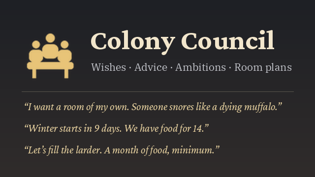

# Rimfolk

*Their wishes. Their bonds. Their council. Their story.*

A RimWorld 1.6 and 1.7 mod that turns your colonists into a society: people who want things, remember things, choose
sides, keep traditions and write it all down. You lead them through a council, and they let you know what they
think of it. (Formerly "Colony Council: Wishes & Plans". Existing saves and settings carry over.)



No other mods are required, and it works with any combination of DLCs (or none).

## Installing

**Recommended: install once with GitHub Desktop, then update with a double-click.**
1. Install [GitHub Desktop](https://desktop.github.com) (no account needed for this).
2. If you have an old `Rimfolk` (or `ColonyCouncil`) folder in your RimWorld `Mods` folder, delete it.
3. In GitHub Desktop: **File → Clone repository → URL**, enter `silvanalig95-cmd/Rimworld-Helper`, and set the
   **Local path** to your `Mods` folder plus `\Rimfolk`, for example
   `C:\Program Files (x86)\Steam\steamapps\common\RimWorld\Mods\Rimfolk`. Click **Clone**.
4. Start RimWorld, open **Mods**, enable **Rimfolk** and restart.

To update later, double-click **`Update Rimfolk.bat`** in the `Rimfolk` folder (or click **Fetch origin**, then
**Pull origin**, in GitHub Desktop). Restart RimWorld afterwards. Updating replaces anything changed by hand inside
the mod folder; your settings and saves are kept elsewhere and are safe.

**What changed?** [CHANGELOG.md](CHANGELOG.md) lists every update, newest first, and the same list is the "What's
new" page at the top of the in-game Almanac. The first save you load after an update brings one letter with the
newest round's highlights (the setting "A letter after each update" turns it off).

**Or: download a ZIP and run the installer.**
1. Download this repository as a ZIP (green **Code** button → **Download ZIP**; pick the branch you want in the
   branch menu first) and extract it anywhere, for example in Downloads.
2. Close RimWorld, then double-click **`Install Rimfolk.bat`** in the extracted folder. It removes the old version
   from `C:\Program Files (x86)\Steam\steamapps\common\RimWorld\Mods\Rimworld Helper` and copies the mod's
   files there (only what the game needs: `About`, `1.6`, `Defs`, `Languages`, `Patches`, `Textures`). If Windows asks for
   administrator rights, say yes. To install somewhere else, open the file in Notepad and change `MODS` and
   `FOLDER` at the top.
3. Start RimWorld, open **Mods**, enable **Rimfolk** and restart. Repeat steps 1 and 2 to update.

On a Mac, move the extracted folder into `Mods` yourself (right-click RimWorld.app → Show Package Contents →
`Mods/Rimfolk`).

The folder must contain `About/`, `1.6/`, `Defs/`, `Languages/` and `Textures/` directly (not nested
one level deeper). It is safe to add to an existing save. Removing it from a running save logs some
one-time errors about missing classes. They're harmless.

## What you get

A **Council** button at the right end of the bottom bar (you can move it in the settings) opens the council
window, organized in five sections:

| Section | Sub-tabs | What's there |
|---|---|---|
| **Colony** | This week · Overview · Priorities · Moods · World · Room plans · Defenses | what needs you, what's coming and how people are; the colony at a glance (numbers, how they moved this week, graphs of mood, trust, wealth and people over the last weeks); the advisor's ranked list of what the colony needs; every mood added up; what's coming and who's out there; ready-made rooms; where raiders come from and what to build against them |
| **People** | Roster · Everyone · Bonds · Wishes | every colonist at a glance with their full story; all colonists in one sortable table; friendships, rivalries, groups, vendettas, secrets; open wishes, promises kept and trust |
| **Council** | Decrees · Ambition · Our ways · Dilemmas | decrees, petitions and the council's offices (five, up to fourteen seats in a bigger colony); the current ambition and meetings; what the colony is known for; questions waiting and how the answers went |
| **History** | Chronicle · Calendar · Dreams · Journals | everything that happened (filter by wishes, council, people, strangers, world events, dreams, losses), the colony calendar, recent dreams, every colonist's journal |
| **Almanac** | | the knowledge base |

Section names show a count when something there wants your attention (urgent advice, open wishes, petitions).
Each colonist also has a **Story** and a **Culture** tab in their inspect panel and a Rimfolk column in the game's own
**Social** tab (see "Story, Culture and Social" below), and clicking a colonist's name in the council window opens
their page in the roster.

**This week** is the first page: one place for everything that wants you. Wishes and petitions (oldest first),
dilemmas and other letters waiting for an answer, and promises at risk (granted wishes gone missing, with the time
left before it's held against the council); gatherings and play-outs planned, the council meeting, calendar days,
fights, missions with their deadlines and a camp on the map; colonists under strain or near a break, serious illness
and convalescence, trust that moved this week, and the balance of Rimfolk's own good and bad moods. Each line opens its
page or goes to the colonist or the place on the map. Pin a colonist or a wish to keep it at the top (the pin shows on
hover there, in Everyone, on a wish card and on a colonist's roster page), and "Mark all read" puts the evenings'
colony news away from the letter stack. **Everyone** is the people overview: a table of every colonist with mood and
Rimfolk's share of it, trust and its week, strain and the feeling on top, the setbacks and pressures weighing on them
with what helps, their open wish, personal story, health and quirks, office and epithet; sort by any column, hover for
details, click to select. **Dilemmas** keeps every answer the council gives, with a "how it went" column (as answered,
went wrong, still to happen, took place, never came about). The pages remember their filters and sort orders, and
Options → Keyboard has optional shortcuts for the council's pages under "Rimfolk" (none set until you pick a key).

The window reopens on the page you last looked at, also after a restart (it's kept with the mod settings); the
"Council window opens on" setting can make it always open on This week instead. A colony's
first session with Rimfolk brings one quiet **welcome letter**: what Rimfolk does, where the council button is, and a
button to the Almanac's **Start here** page. Saves that already had Rimfolk never get it, and it needs no setting.
The **Mood**, **Story** and **Culture** tabs fit the room above the inspect pane: on a small screen, at a big interface
scale or above RimHUD's taller pane they get shorter and scroll instead of running off the top of the screen. A click
on a section's heading (the heart, what weighs on them, their bonds...) folds it away, and each tab (and the Social
tab's column) remembers that for the session.

### Priorities: what the colony needs
A ranked list of concerns (62 kinds of check), each with a short explanation, a rotating **"why it matters"** tip,
and buttons to jump to the problem, plan a fitting room, open the council page that deals with it, or read more in
the Almanac. Some take the first step for you: open the camp's letter or the mission's quest, open the Work tab, or
plan wall lamps and chairs where a room lacks them. It watches:
- food vs. the coming winter (forecast from your map's actual climate), spoiling food, blight, ripe crops before frost
- kitchen hygiene (butchering next to the stove, dirty kitchens), nobody cleaning, dirty hospitals
- cold or hot months ahead, and what to do during heat waves, cold snaps, toxic fallout, solar flares,
  volcanic winter, flashstorms, droughts, eclipses and psychic drones
- defenses vs. the raids your wealth attracts, fire risk from wooden walls around open flames, insects under
  overhead mountain
- beds and barracks, a place to eat, recreation variety, rooms without light, bodies lying around, mood breaks,
  expectations about to rise with your wealth
- rooms the colony has outgrown, gently: a dining room with fewer seats than people, a barracks that could become
  bedrooms now there's enough wall material in store, a hospital without the vitals monitor, hospital beds or sterile
  tile you've researched (with "Upgrade the room"), a rec room with too little to do for everyone; and rooms it
  could make better: a noble's bedroom short of the title (Royalty), a kitchen with one stove for too many, a full
  freezer with food spoiling outside, a dining room too cramped, a workshop with dark benches or no chairs at them,
  a prison cell without comfort
- doctor, medicine and medical beds, the only doctor with nobody to tend them; prisoners without a warden, food or
  bed; beds no light reaches; meals eaten without a table
- Rimfolk's own systems: a mission near its deadline with its goods not all there, a plague or famine in the region
  while the colony is short of what helps, a camp's question left waiting, a decree still costing moods after its
  reason has passed, an office empty when it matters (no physician with the sick in bed), a calendar day tomorrow
  with nothing laid by, a promise about to break
- a tribal or medieval colony before the cold: stores under the open sky, food that won't keep through a mild
  winter (smoke it, or make pemmican), firewood short of what the fires will burn by spring
- power shortages, jobs nobody is assigned to, items rotting outside, an idle research bench, ideas for what's next
- the quieter things, gently: a week without fruit or vegetables (before scurvy), someone with no friend here, a
  camp going hungry or growing tense, a calendar day coming round, graves left dirty or outside the home area,
  clothes worn to rags or taken from the dead, a schedule with no hour for recreation, strain near breaking,
  convalescents back at work, wishes about to lapse with nothing promised

Urgent ones also show up in the alerts on the right.

### Wishes: what your colonists want
Colonists voice wishes from who they are: their traits, passions, mood, relationships and what just happened
to them. A raid makes someone ask for defenses within hours; a cold night, a meal eaten off the floor, a
friend's death or food poisoning all set off matching wishes. Every wish arrives with a little scene and a line
in the colonist's own voice, chosen to fit the season, weather, time of day and their situation.

116 kinds of wish, most with variants (six kinds of work room, a dozen pieces of furniture, any
missing body part), so the same colony rarely hears the same request twice in a row: a wish the colony has
heard several times lately becomes much less likely, and one nobody here has ever made a little more likely.
Every wish asks only for what the colony can do now, in its era: a tribe hears about healroot and pemmican, an
industrial colony about a deep drill or a comms console. The Almanac page "what colonists wish for" lists them all.
Wishes follow the land's year: clothes are asked for by the season coming (what someone wears has to keep them
comfortable in its usual cold, or on hot land its heat, never a coat for the stores), hot country wants a freezer
(and, with nothing yet that can keep food frozen, food that keeps), and cold land a sauna, Dubs Bad Hygiene's or a
small hot room of the colony's own, where people sit on cold days and talk.

| Wish | Who asks |
|---|---|
| **Home:** a room of their own, a bigger, roomier or nicer bedroom, a piece of furniture, a light, a plant, art for the bedroom, a fire in their room for winter, a real floor instead of bare earth, a bed for their pet | barracks sleepers, the greedy and jealous, night owls, rising expectations, the cold, the tidy |
| **Love and family:** to share a bed with their partner, not to sleep next to someone, a wedding, a birthday treat, a crib for the little one, somewhere for children to learn and play | couples, feuding roommates, parents (Biotech) |
| **Children and the old:** lessons from the colony's best, a pet to look after, new stories to read; a soft chair, a biosculpter pod, a resting place for when the time comes | children (Biotech); colonists of 50, 60 or 65 and over |
| **Work:** a workshop, kitchen, laboratory, hospital, greenhouse or barn; to do the work they love; lessons from the colony's best, or an apprentice to teach; somewhere to train; a weapon rack; a smokehouse; a beehive; a tool cabinet; stone blocks put by; a deep drill; a pen for the animals; a fishing spot (Odyssey, or Vanilla Fishing Expanded) | passionate colonists, the old, fighters, cooks, keepers |
| **Stores:** better food, a freezer (in hot country, anyone), a brewery, a little something to drink, firewood for winter, fodder before winter, food that keeps, something fresh to eat, honey in the larder, more books, a stocked infirmary, healroot put by, a proper treasury | gourmands, cooks, the food-poisoned, keepers, readers, healers, the greedy |
| **Illness:** a bed for the sick, a pot of tea (Vanilla Brewing Expanded) | anyone down with a cold, flu or worse |
| **Gear:** new clothes, clothes warm enough for the season (or, on hot land, cool enough), a hat, something fine, a piece of jewelry, proper armor, a decent weapon, something a visiting trader has | tattered clothes, anyone dressed wrong for the season coming, the vain, fighters, anyone who saw the trader's wares |
| **Colony:** stronger defenses, a clean colony, music, art where people gather, another sculpture, flowers, a bath, a fountain, a banner, a place to pray, a bench to sit on outside, a fire to gather around, a table where everyone fits, a telescope, a cooler for the hottest days, a sauna for the cold months | anyone shaken by a raid, the tidy, artists, the devout, everyone in spring, the lonely, curious minds, anyone in the heat, the cold and the old |
| **People:** a proper burial for a friend, a party, a day off, time outside, help quitting a drug or a steady supply of it, a prisoner recruited, executed or set free, a kidnapped friend brought home, an evening at the campers' fire, a council meeting (promising it calls one), a comms console, a bed kept for guests (Hospitality) | grieving friends, the bored and overworked, addicts, the kind, the vengeful, the sociable |
| **Adventure:** to see something of the world (a caravan), a hunt, the beast that mauled someone hunted down | the restless, hunters, the beast's victims and their friends |
| **Body and status:** a prosthetic, an animal companion, a favourite kind of animal, a pack animal of their own, a hurt animal patched up, a room befitting their title | the maimed, animal lovers, haulers and the restless, Royalty nobles |

**Your answer matters:**
- **Grant it** and they're pleased and **motivated** (they work faster for a few days). The happier they already
  are, the likelier the wish turns into an **inspiration** that fits it: art, a work or shooting frenzy, recruiting.
  Some wishes do more: a burial eases everyone's grief, new defenses make the colony feel safer, a passion space
  gives a burst of practice, petitioners who stood together like each other more.
- **Promise** it: they wait half again as long and trust you a little more. Break the promise and it hurts far
  more than never promising.
- **Refuse** it: it stings now, but it's honest and over.
- **Not now**: set it aside quietly.
- **Let it slide**: they bring it up again halfway through, make a pointed last call near the end, and the
  hard-working ones may sort it out themselves (plan the lamp, switch their own work back on, mark out a
  grave, pick an animal to tame).

**Others are watching.** Friends are happy for the one who got their wish. The jealous, rivals and anyone who
has been waiting longer can feel passed over, and some will want the same thing.

**Beliefs and diets.** Nobody asks for what their faith or their own nature forbids, read from the game's Ideology,
Vanilla Ideology Expanded - Memes and Alpha Memes (all optional): no shared bed before the wedding under a faith that
keeps lovin for the married (an engaged couple asks for the wedding instead), no smokehouse or hunt for a vegetarian,
no beer or brewery for a teetotaler, a faith that keeps drugs to medicine or an addict being weaned off, no clothes
for a nudist, a dark torch rather than a lamp for a faith that prefers darklight, and so on. Food wishes count only
what the colonist may eat, and a wish that comes to clash with a changed faith is let go quietly. Feasts and toasts
serve each colonist only what their food or drug policy allows, what leaves no bad "ate ..." memory, and nothing
Alpha Memes would make them sick for (only fungus or insect for its two required diets together, no forbidden
paste); with nothing fit in the stores they sit at the table without eating. Life goals and council projects
follow the same rules. With Ideology, a "cook fungus meal" bill at any stove makes fungus meals: simple meals that
always have fungus in them, a kind of their own, so one colonist's food policy can take only these while everyone
else's leaves them out.

**Promises kept.** 67 kinds of wish give something that stays, and the council is watched on it for about 60 days
after granting it (90 for rooms): a bed kept for guests, a room of their own, a nicer or roomier bedroom, a bed shared,
a workshop, kitchen or other room for their passion, a telescope, a sauna, a pen for the animals, a real floor, a
stocked infirmary, a pet, the work they love switched on, hours of rest, a decree they asked for. Take it away and you
get a message at once ("Hector's guest bed is no longer kept for guests. If it isn't back within a day, he will take
it as the council going back on its word."), and a grace period starts: a day by default, or none, half a day or
three days in the settings. Moving it doesn't count: a building packed up to be carried, stored or reinstalled, a
plan or frame of the same thing being built (for up to a week), a bed lent to a patient. Back in time, nothing
happens. Still gone after it: "they took back what the council gave me" (-3 to -6 for 5 days, the bigger the sooner
it happened, scaled by their standards), the trust a broken promise costs, a line in their journal, a little less
trust from their partner and close friends, and they may soon ask for it again. Put it back within 5 days and the
council made it right: the mood ends, half the trust comes back, and they feel grateful. A fire, a raid or a
collapse isn't the council's doing, and for two days after a raid nothing counts as missing. One-offs (a party, a
hunt, a visit, a lesson) aren't watched, and neither are clothes, weapons or stores meant to be eaten. The Wishes
page lists everything watched: kept, missing (with the time left) or taken back.

**Trust.** Each colonist's trust in the council (bitter, doubtful, neutral, trusting, devoted) rises and falls
with all of this. Trust isn't only mood: loyal colonists work and learn faster and hold together better, while
a grudge slows them down and shortens their temper (both show in the health tab). Bitter colonists grumble, stop
asking, and on Demanding stakes may sulk, go on an insulting spree, or announce they're leaving and walk out
three days later unless you win them back. The Wishes tab shows everyone's trust and its history.

**Rising standards.** Comfort breeds expectations. While a colonist is happy, their standards creep up from
*modest* to *comfortable*, *particular* and finally *spoiled*. The council's mood rewards shrink for them, letdowns
sting more (and so do the colony's own frictions, everyday pressures and setbacks, up to 40% more), their patience runs shorter, and their wishes come more often and ask for more: the next impressiveness
level after that, fine meals instead of simple ones, luxuries. Hard times bring standards back down, and so does the
austerity decree.

High standards also take the shine off the game's own comforts. A comfortable colonist feels the good moods of the
base game and other mods (a fine meal, an impressive bedroom, a party, a joy activity) at 90%, a particular one at
80% and a spoiled one at 70%. Only the first 10 points of each count for less, so the big moments of a life, like a
wedding or a catharsis, still land almost in full; bad moods are never touched. Rimfolk's own good moods already
follow standards, so they aren't shrunk twice. Hover a good mood in the Needs tab to see what it would be without
standards. This works through one of the deeper game hooks, and the *standards cover the game's comforts* setting
turns it off.

**Good moods add up slowly.** Every good mood Rimfolk gives a colonist shares one budget: a wish granted, a wedding,
a dilemma that went their way, a reunion, a feast. The two biggest on a colonist's mind count in full, the third
60%, the fourth 45%, the fifth 35% and every one after that a quarter, so a small joy adds little on top of a
wish just granted, but it never disappears: every good mood stays on the Needs tab at what it counts for now (a +3
deep in the pile shows as +1), and its tooltip says so ("+0.8 instead of +3"). Bad moods aren't part of it, and
neither is anything the game and other mods give (high standards take their own share of those, see above). The
reward strength setting and rising standards apply to Rimfolk's good moods too. The *good moods add up slowly*
setting turns this off.

**Not every good moment is a good mood.** Rimfolk keeps mood for the moments that matter: weddings, wishes granted,
reunions, victories, recoveries, life goals reached, the end of a personal story, real celebrations and grief shared.
About half of its small good moments (248 of the 474 worth +3 or less) give something that fits instead:
- **opinion only** (58): a good talk, a friendly disagreement, a wound patched up. They think better of each other, and
  nobody's mood moves;
- **recreation** (44): a joke at work, dice with a traveler, snow falling, birdsong, music in the air;
- **rest or comfort** (17): a sweet dream, sleeping late, a friend covering a shift, a dry roof, a trick against the cold;
- **practice** (9): talking shop in a passion they share, a child learning from a grown-up, sparring forms, calming an
  animal in a storm;
- **a feeling** (37, with the heart on): awe at the lightning tree, pride in pilgrims fed, relief at the thaw,
  fellowship after having their say at a meeting, gratitude for a decree they asked for;
- **a rare inspiration** (5): a strange dream, a great beast at the tree line, a falling star, a little magic;
- **trust in the council** (5): a dilemma handled fairly, spoils shared out evenly, the council's precautions;
- **the road's gifts** (6): a little research from a traveler's star names or books, a little goodwill after tea
  with a trader or water for a wounded raider;
- **only the journal** (67): the smallest touches (lights over the marsh, a shape in the fog), and moments whose
  outcome already pays out in silver, skill or goodwill.

The moment itself still shows (a speech bubble, the social log, the news or the journal), and a small line over the
colonist says what they got ("+ recreation"). These follow reward strength and standards like the moods they replace,
and give nothing on *Advisor only*. The heart still feels them at their old size, so feelings, belonging and the
strain friends ease work as before. Four habits trade their mood for their knack, too (see Quirks). A settled
colonist now carries about 4 of Rimfolk's good moods instead of about 10, and their total from Rimfolk comes out a
little lower than before (roughly +10 instead of +11), lower still when nothing big has happened lately.

**Getting used to good times.** Someone whose life is already good gets used to good things faster. When a colonist's
mood is above 75%, a new good memory from Rimfolk (a wish granted, a good talk, a contest won, a dilemma that went
their way) fades sooner, smoothly down to half its usual time from 90% mood. It feels just as good while it lasts,
and in hard times good things last their full length. A good memory about someone (a friend who had their back)
keeps its effect on opinion for the full time; only the mood ends sooner. A good memory that comes back renews with
the time it would have now. Its tooltip says when it fades sooner. This works through one of the deeper game hooks, and a setting
turns it off.

None of these is a flat penalty, and nothing is taken away: a colony that lives well still feels it, it just doesn't
float at the top of the mood bar on a pile of small pleasures. A line in the Mood tab says what they take off right
now, for example "Good times: Rimfolk's good moods +11 of +18, 2 fading sooner · the game's comforts +14 of +19
(particular)".

**Everyday frictions.** People who live close together get on each other's nerves. Colonists argue about the dishes,
complain about a bunkmate's snoring, take the last good meal, keep a borrowed knife, correct each other at the table
and give each other the cold shoulder after a spat. Some natures grate: an annoying voice, creepy breathing, a
pyromaniac near the tinder, a nudist at supper, an ascetic lecturing a greedy one. So do the times: someone keeps
away from a sick colonist, two argue about a camp, a temper snaps. Some follow something that really happened: a cook
blamed by someone down with food poisoning, a bad day after a mental break turned into a joke, the proposer of a
finished council project taking all the credit, a shared tool handed back chipped. A messy or cramped home adds its
own (22 nuisances): a door that sticks, a leaking roof, smoke in a small room, a generator droning next to someone's
bed, a filthy room, a cold or stifling one, the dog asleep on the bed, building work right outside, vermin in the
stores, a bare earth floor, rotten food in the stockpile, work in the rain with no coat when the colony could make
one, junk left in a bedroom. Each costs a point or two of mood for half a day to a day and a half. In an ordinary colony they
come about as often as the warm moments; less in a happy, roomy one, more in barracks or between people who dislike
each other. Abrasive, volatile and jealous colonists start more of them, kind ones none. After a spat the two share
no warm moments until it wears off or they clear the air. A setting turns them off.

**Everyday pressures.** A colony that has everything still has its everyday wear. Five small, fixable pressures show
as moods while their cause lasts, each saying what caused it, with what helps in the Mood tab:
- **the same meal again**: 6 of the last 8 meals the same kind, more after 10 or 12 of 12 (-1 to -3). A colony that
  can cook only one kind feels it least; ascetics and anyone whose faith allows only one kind of food (a fungus diet)
  don't mind, gourmands mind it more, and fine or lavish meals never count. Three different foods in two
  days make **a varied table** (+2).
- **the same work for days**: most of each day on one kind of work, 4, 7 and 10 days running (-1 to -3). The
  industrious and hard-working, children and anyone with a burning passion for that work don't mind, and any passion
  for it makes it a step lighter.
- **missing someone**: a partner apart for 2, 5 and 10 days, or a close friend for 3 and 8 (-1 to -3). The
  homecoming is already celebrated when they're back.
- **a packed room**: a dining or rec room with too little space per person, or diners short of seats (-1 to -2, for
  half a day). Parties, rituals and meetings don't count.
- **half-built work**: frames left untouched for 2 days in the home area (-1 to -3). Plans (blueprints) never count;
  lazy colonists and slobs don't care.

None of them is a flat penalty: a second meal bill, a second job in the Work tab or a bigger dining room makes them go
away. They feed the heart's feelings (loneliness, restlessness, frustration, contentment). The **Life's ups and
downs** setting makes them gentle (half strength, no half-built work), normal (85%) or demanding (half again as
strong), and softens the colony's small frictions too (70% on gentle, 85% on normal). **Hard times**: as a colonist
nears breaking, Rimfolk's small letdowns weigh less (down to half at their minor-break line) and its pressures down to
three quarters, easing back to normal as they recover. Meals are noted through one of the deeper game hooks. The
Almanac's *everyday pressures* page has the details.

**Setbacks.** The other side of all the small rewards: about forty bad moods that come from what actually happens in
play, each naming its cause in its tooltip and, in the Mood tab, what helps. Most are -1 to -4 for a day or a few; the
few bigger ones (-5 to -6) are for real losses.
- **The council**: a wish still waiting while wishes voiced after it come true (-1 to -2), an idea turned down at a
  meeting (-2, -4 if the meeting backed it) or a vote lost (-1), a disliked decree dragging on past two days (-1 to
  -2), a promise broken to a close friend or someone they love (-3 to -5), a rival given a name or a council seat
  (-2), and answers that go against someone's nature: "not my choice" (-1 to -2), or "I said it would go wrong" (-2)
  when the answer's gamble failed. These follow the stakes' downsides.
- **Gatherings**: a gathering an answer called that went ahead without them (-1), a feast that ran out of meals before
  they ate (-2), a party or wedding rained on in the open (-1).
- **Work**: something they built torn down (-2) or wrecked (-4, -6 for their best work), a crop they sowed lost to
  blight or frost (-2, -4 for a whole field), a botched build, poor or awful work in their own passion, making do at a
  spot or campfire when a proper bench can be built, an operation that failed in their hands (-3 to -4), long hauls
  across the map, hours left hurt waiting for a doctor, and for keen researchers no research under way.
- **Home**: a meal eaten outside in the freezing cold or rain, their art or an animal they trained sold to a trader,
  envy of a room three grades better than theirs.
- **Between people and worries**: overtaken as the colony's best at their passion, a friendship gone cold, loud work
  through the wall at night, a partner, family member or close friend seriously ill, a loved one's caravan short of
  food, a nemesis still at large, a debt to a people unpaid (kind colonists), homesickness after a hard week, and long
  quiet days with less to do than they expect.

None comes from nowhere, and most can be ended or avoided: answer the wish, lift the decree, build the bench, put a
stockpile near the work, defend what matters. The colony's life follows "Life's ups and downs" (never less than a
whole point), what happens between people follows the frictions setting (and envy the jealousy setting), and all of
them sting up to 40% more for spoiled colonists. Events are noticed where they already happen, through the deeper game
hooks; the lasting ones are worked out once an hour. The Almanac's *setbacks* page has the full table.

### Decrees: spend the good mood
When the colony is doing well, put that goodwill to work. The Decrees tab lets you declare up to two policies at a
time for a few days: **long hours** (work faster), **rationing** (eat less), **drills** (everyone who can fight
trains shooting and melee), **study hours** (learn and research faster), **austerity** (no new wishes, standards
come back down) or, the other way round, **festival days** (better mood, much slower work). Everyone reacts according
to their nature: the industrious like long hours and the lazy hate them, ascetics love austerity, the bloodthirsty
love drills, gourmands suffer under rationing. The tab shows who will love or hate each one before you decide, and
living under a decree you hate wears down your trust in the council. With feelings and strain on, the hard ones
(long hours, drills, on guard...) also build a little strain in those who resent them, and **days of rest** lets the
colony recover: 10% slower work for three days, while strain drains about twice as fast.

The everyday ones each trade a little work for something else: **quiet hours** (deeper
sleep, far fewer quarrels; night owls hate it), **shared meals** (talk and goodwill at one table), **rest when ill**
(wounds and illnesses mend faster while the well cover for the sick), **banked fires** (fires, torches and fueled
heaters burn a quarter less fuel, in colder, darker rooms), **apprenticeships** (everyone practices building,
crafting, cooking and growing every hour) and **a feast day** (one day of eating well and working half). Colonists
petition for them when someone is ill, in winter, or when a newcomer joins.

Thirty-one decrees in all. The newest come from a village's own year and do something no stat can: **tithes** (a tenth
of the silver each morning to a people of the colony's faith or the nearest village, for goodwill and, with Ideology,
the faithful's certainty), **a curfew** (everyone's night hours turned to sleep and put back after; night owls keep
the watch), **militia drills** (twelve days of light practice for everyone who can fight), **alms for the poor** (a
little food at the gate each morning, and the neighbours remember it), **holy days** (with Ideology: three days for
the faith), **a market day** (a trade caravan comes that day), **a fast**, **a work song** (recreation while working,
slower research), and **open gates** (more visitors). Two answer the region's hard times and can only be declared
while they last: a **quarantine** while sickness goes round (illness passes between roommates a fifth as often, and
visitors are turned away) and **famine bread** while a famine lies over the region (the colony eats a little less
and sends bread to the hungry people). A decree for another era or faith isn't listed at all.

There's no hard limit on repeating a decree, but there is a price. Enact the same one again within a month, or
**force it through** before its cooldown is over, and those against it lose more trust and resent it more each
time. Someone may even snap: the hot-tempered throw a tantrum, others wander off in a daze. The tab warns you how
many times a decree was used lately and how likely trouble is.

### Our ways: the colony's character
The council's choices add up. Every dilemma answer, decree and many granted wishes nudge the colony's five ways:
**merciful or harsh**, **generous or thrifty**, **traditional or restless**, **open or guarded**, **hard-working or
easygoing**. Lean far enough and word spreads: a letter tells you the colony is now known (and later renowned) for
it. Colonists whose nature fits are proud of it (up to +4 mood, less for the spoiled); those it clashes with chafe
(up to -4): the kind
hate harshness, the greedy love thrift, the lazy love an easygoing colony, the old love tradition. Neighbors warm to
a generous or open colony and cool towards a thrifty or guarded one, and some encounters and dilemmas only happen
for a colony with a certain name. Old deeds fade (about half in a year), so a colony can change. The **Our ways**
page in the council window shows where you stand, who is proud, who chafes, and what shaped it.

A colony also grows into what its people keep doing. A season of steady work earns it a name of its own:
**green-fingered**, **builders**, **learned**, **craftsfolk**, **hunters** or **delvers**, counted from the
colonists' own records as a rolling average per head. Those with a passion for the work take a small, lasting pride
in it (+2), and the name fades if the work stops for long (a winter alone won't undo a farming colony).

Three more names grow out of how the colony lives, counted from Rimfolk's own records for the colony as a whole and
worth no mood at all: **good hosts** (camps that stayed their time and left on good terms, people taken in, with
Hospitality its guests' nights), **devout** (with Ideology: the faith's rituals held to their end, a chaplain, a moral
guide) and **long-memoried** (calendar days kept two years running, and traditions). What they change is what comes:
camps come sooner to good hosts, and refugees and exiles seek them out; pilgrims and processions find a devout colony;
players, minstrels and mourners a long-memoried one. Each has its own visitors on the road and lines in letters, and
each leans the colony's old hands when an answer goes against it.

### Dilemmas: hard choices
Every week or so (sooner while everyone is content) the council has to settle something, and every answer costs
someone. A thief caught in the stores: forgive, make them work it off, or make an example of them? Two colonists
at each other's throats: take a side, force them to work together, or stay out of it and risk a brawl? A forgotten
stash of beer, a cook who wants to spend the stores on one magnificent feast, a colonist who quietly admits they
can't cope. Kind, greedy, industrious and teetotal colonists all react differently. Leave a dilemma unanswered and
the council's silence decides for you.

There are 160 of them, and many grow out of everyday life: a sick colonist when the medicine is nearly gone,
whether to keep someone with a fever apart, a cook with a cold, an old family remedy, a visitor's strange cure, the
camp on the colony's land asking for medicine, food or searchers for a lost child, a council meeting someone missed,
a worn-out colonist asking for days off at the worst time, a doctor who just lost a patient, someone convalescing who
wants to be back at work, family who want a say before an operation, a squabble that turned into a feud, an elder who wants to
put down the tools, a child's question, a broken promise, the same meal every day. The young and the old have their
own: a broken window and nobody owning up, a child frightened after a fight or grieving a parent, lessons or play,
a youngster who wants to see the world, an elder who wants one last walk in the hills, won't see the doctor, has a
tale to tell or feels the cold in their bones. Many answers call on whoever is
best placed (the doctor, a forager, a tracker, the best talker), and their skill decides how it goes.

**Answers play out on the map.** When an answer describes something people do, they do it (413 answers of 131
dilemmas and 123 Rimfolk events, stories and world events, plus calendar days, six decrees and nine ambitions). A
victory feast is eaten at the dining table, each guest sent to eat a cooked meal from the stores, the finest first
they may eat. The midsummer bonfire is lit (a campfire laid for the evening if the colony has none, burned down to ash
after), a toast is raised, an apology or a reading is heard round the table, a friend sits with someone who is ill, a
colonist sits by a grave or at the camp's fire, an apprentice works at the teacher's side, a worn-out doctor is sent
to bed. A work party cleans, hauls, mends, builds, sows or brings in the harvest with the game's own jobs, on work the
colony really has; the colony walks out together to the graves or the gate and back; a few keep a vigil into the
night; searchers fan out over the land and bring back what was promised; real medicine, food or silver is carried out
of the stores to the visitor or the rider at the gate; the hunters go after the game an answer marked. Every answer
whose words say people do something has been read: the thief is punished in front of everyone at supper, the doctor
sits at the bedside with the last dose, the snow is shovelled, the bees are smoked out, and the tribute, the bounty
and the envoy's price go out to the gate by hand. The answer's own words are told once it's over. None of them
holds anyone in a gathering, so the game's own parties and rituals can always take them. Nobody is called from
danger, sleep, a meal or a sickbed, nothing starts with enemies about, and danger, drafting, hunger or exhaustion ends
it. The answer's good moods come to those who were there once it's over; if it never happens within a few hours,
everyone gets them anyway, as before. This week lists what's coming, the dilemmas page says how each went, and those
who took part write about it. A setting (Events & world) turns it off.

### Faith and the council
With Ideology, a colony of many faiths gives the council something to work with (all of it off in classic mode, and
with "Faith in the colony" off). Every move goes through the game's own certainty: Rimfolk takes some away or gives
some back, and when someone has none left the game converts them, with a message and a line in the chronicle.

- **An evening of faith.** The council calls a gathering where one faith is spoken for, by its moral guide or else
  its most devout believer with the best Social skill, at its altar or ideogram if one stands (else round a fire or at
  the dining table). Its believers come; the others choose for themselves, by how open they are, how sure of their own
  faith and what they think of the speaker, and those whose faith frowns on being preached to stay away and say so.
  How it went (the speaker's Social skill and warmth, how many came, the altar) decides what it does: listeners of
  other faiths are swayed toward it (6% to 12% to start with, then their own openness, pride and opinion of the
  speaker), believers steadied, everyone given recreation and fellowship (a fine evening, a small good mood); a poor
  one changes nothing but a line. One every five days at most, the same faith one every ten. Put it on the calendar
  as a day kept as an evening of faith, say yes when one of the devout asks the council for one, or call it from the
  faiths page.
- **A wavering colonist's wish.** Someone whose faith is shaken may ask for an evening with a devout believer of
  another faith they think well of. Promised, they walk over that evening and spend a couple of hours together;
  granted, they are swayed toward that faith and the two remember it together.
- **Faiths at odds.** When the colony is split (two faiths of two believers or more, or half of everyone apart), the
  council is asked how its faiths should live together, more often after a quarrel between them or while an altar
  stands: share the altar and take turns (the open-minded approve, the devout less so), give each faith its own
  corner (a letter suggests where; a little trust all round and everyone surer of their own), or name the largest
  faith the colony's (its believers pleased, everyone else trusting the council less and drawn a little toward it,
  the devout of other faiths taking it hard). Each answer plays out on the map.
- **One faith for the colony.** A decree for fifteen days, naming the faith you choose. Each day the wavering of other
  faiths are drawn a little toward it, its believers speak of it more and open the council's meetings with a word
  from it, and those of other faiths trust the council a little less (the open-minded least, the devout most); the
  devout of other faiths petition to lift it. Lifting it ends all of it.

None of it adds a bad mood: what faith costs is trust and certainty. The Almanac page "faith and the council" has
the numbers.

### Social: friends, rivals, comrades and mentors
Colonists form lasting bonds out of how they feel about each other and what they live through, and those bonds
grow, sour and end over time:
- **Friends** and **rivals** form when two people keep liking (or loathing) each other, then drift with how
  they feel.
- Everyone who fights in the same battle becomes **comrades**. That fades slowly between battles.
- A skilled, passionate colonist may take a keen learner on as a **student**, teaching them each day the two spend
  some time side by side, until they graduate at level 11 (and the student goes to find the mentor to thank them).

Most days something small happens between two people who are together at the time (79 kinds of social event): a
late talk, a shared joke, a prank that lands badly, a snub at dinner, a squabble over chores, war stories, a lesson,
a contest between rivals, a handmade gift, gossip that gets found out, an unexpected truce. Life brings its own: a
vigil at a friend's sickbed, an evening at a camp on the map, a quarrel over what the council decided, fears confided
in the night, grief carried together, a peace offering after a quarrel. Each one nudges their bond; most change how the two see each other
rather than anyone's mood (a shared joke is a little recreation, a lesson practice). In conversation they share smaller moments
too (about a hundred kinds, 44 of them frictions), shaped by who they are (night owls keeping each other company,
brawlers comparing scars, an iron-willed colonist steadying a nervous one) and by what's going on (visiting the sick,
talking over a council meeting, watching a camp's fires, confiding a worry). Moments, frictions and events keep to
one story between the same two: no compliment right after an insult, no warm evening the day after a falling-out.
Strong friendships hold people together in **groups** (see below), and people outside every group sometimes feel left
out.

Bonds change how people act. Friends and members of the same group back each other's wishes and petitions and vote for each
other; rivals object to each other's wishes and vote against each other. The council's own decisions feed back
into them: being passed over for a rival, losing an election, a fight, a grudge from a dilemma or arguing over a
decree can start a rivalry, while backing the same petition or making up after a quarrel builds a friendship. Some
dilemmas only come up between friends, rivals or comrades. When someone dies, the people closest to them (and their
rivals) write about it. The council's **Bonds** page shows every bond with its strength and history, and every group;
a colonist's own bonds, with the ones they lost, open Rimfolk's column in their **Social** tab, and hovering someone in
the game's list there says what is between the two of them (a bond, a group, memories, views they share or not).

### Personalities and social life
Colonists are people with a character of their own that changes with what happens to them, and they talk, gather and
talk about each other the way that character would. Four parts make one feature, under one setting ("Personalities
and social life", on by default; off, the colony goes back to the simpler circles of friends and nothing new is said):
- **Character** is the root: eight sides set by traits, the Social skill and age, and moved by what happens (a raid,
  a death, a kindness, a seat won); rarely, a long stretch of life changes a trait itself. It sets each colonist's
  voice, the tone of everything they say anywhere.
- **Conversations** are where one character meets another: what two people talk about, how it goes (they agree,
  debate, argue, tease or comfort) and the views each keeps. What they go through together becomes **shared
  memories** and in-jokes they bring up later.
- **Groups** grow out of those bonds, shared work, fights fought together and being alike, and the part someone plays
  in one follows from their character.
- **Reputation** is what everyone hears: what someone did spreads in gossip, coloured by who tells it, and becomes
  their name, which changes how the others treat them.

Each part feeds the others. A raid marks the bold and the timid differently, leaves a memory between those who fought
side by side, makes the brave's name and gives the colony something to argue about for days; a group's people speak
up for each other when stories go round; a newcomer finds a way in through talk and shared work. A happening is told
once: one journal line, one name for the fight in every part. Rimfolk's own talk stays a share of the colony's
conversation, about one exchange in four next to the game's own chitchat (the moments setting scales it), and nobody
starts two of them within an hour. The Almanac page "Social life: how it fits together" follows two colonists through
a year.

#### Character: who they are, and what shaped them
Every colonist has a character on eight sides (warmth, nerve, temper, humour, trust, pride, openness, outlook). Their
nature sets where they start: traits (the base game's and DLCs', and 74 from Vanilla Traits Expanded, RimTraits,
Medieval Overhaul, Vanilla Ideology Expanded - Memes, Alpha Memes and Alpha Genes), the Social skill, age and a small
lean of their own. Then life marks them, with 53 kinds of mark: downed in a raid, carried out of one, holding the
line or breaking under fire, a friend, lover, child or parent lost, nursed through an illness, forgiven after a
breakdown, a secret betrayed, a seat won or lost, a craft mastered, a child raised, a hungry season, an addiction
beaten, a new faith, a crisis of faith (with Ideology), a brush with what lies past the world. Their nature picks the mark and how deep it goes: the
bold harden where the timid are shaken, the cold close up where others grieve, raid after raid hardens some and
wears others down. Part of each change stays for good and the rest fades over years; marks are kept rare (one small
mark per few days, each turning point once in a long while), and a turning point goes into their journal in their
own voice. Character shows in what they say and do: the lines they get and their tone, more warm moments from the
warm and more frictions from the hot-tempered, secrets confided sooner by the trusting, students taken on sooner by
the warm. The Story tab opens with it: their character in words, eight bars with where their nature put them and
where they are now (hover for every trait and mark that moved it), and "what shaped them", turning points first.
The Almanac pages "character" and "what shapes a person" explain it.

#### Traits that change
Rarely, a long stretch of the same kind of life reaches the game's own traits. 36 rules: nerves steady to steadfast
and then iron-willed after raid after raid held, or fray to nervous and volatile after breaking under fire, captivity
and loss, and a volatile temper softens after two calm years; an optimist darkens after a year of graves and a
pessimist brightens after a good stretch; kindness appears after many kindnesses, abrasiveness, greed and a wimp's
weakness fade; an ascetic after hardship, jealousy after vote on lost vote, a brawler in a melee fighter, rare
bloodlust in a cold killer, an undergrounder who hardly sees the sky; harder work after two seasons of barely
stopping (by the game's record of time at recreation) and idleness after the opposite; an addiction beaten makes a
teetotaler; a recluse (Biotech), void fascination (Anomaly) and an ascetic of the faith (Ideology); six for Vanilla
Traits Expanded and RimTraits. A psychopath or a cannibal comes only from an extreme history (executions by their own
hand with warmth and trust driven down by loss and betrayal; human flesh eaten three separate times while starving),
once in a colony's life each. Every change brings a letter that tells what led to it, with the dates of the marks and
deeds behind it, a journal line in the colonist's voice and a chronicle entry, and it stays on the character page
under "Traits gained and lost". At most one change per colonist in 60 days and one in the colony in 10; sexuality,
the body and traits from genes or a backstory never change, and the game's trait conflicts always hold. Their
character doesn't jump: the trait takes the place of the change that earned it. A setting ("Traits can change")
turns it off; the Almanac page "traits that change" lists every rule.

#### Conversations: views that last, and memories they share
Two colonists who are together now and then talk about something real, in a short exchange over their heads (two to
four lines, taking turns): the last raid, the council and its decrees, the food, the work and who does too little, the
newest face in the colony, faith, the world outside and its traders, the animals, the weather, art, the future and
whether to stay, the dead, the prisoners, drink, new learning against the old ways, the children, the colony's project,
money, love (19 topics). What comes up follows the news (a raid yesterday, a death, a new decree, a wedding, a
newcomer, a harvest, a disaster), what each of them cares about and who they are, and their tie: friends talk about
anything, rivals find what they disagree on.

Everyone holds a **view** on each topic, from their character, traits, passions and faith (the bold want to fight back
and the timid want walls, the trusting back the council, the curious welcome newcomers), and it moves slowly with what
happens and with talk: a liked, trusted, self-assured speaker brings an open listener round a little. So two of them
**agree**, have a **friendly debate**, or a **heated argument** when tempers, opposed views and dislike meet; a joker
**teases**; someone low or grieving is **comforted**. Each sounds like themselves (a hothead snaps, a joker jokes, the
cold are curt, the gloomy see the worst), in about 2,500 lines. A talk leaves a small opinion of each other, not a
mood; arguing hardens a temper a little over time, and a long friendship warms.

Pairs also keep **shared memories** (17 kinds): fighting side by side (those really seen together in the fight), being patched up while down, a funeral, a feast,
a disaster come through, a caravan, something big built together, a long night shift, lessons, a quarrel made up, a
secret kept. Small mishaps become **in-jokes** ("the stew", "the boomalope", "the alpaca", the little fire, the mud, a
short binge) once everyone's fine, funnier the first few times and then worn thin. The character page lists their
**views** (with what each rests on; in the Culture tab) and their **shared memories** (in the Social tab's column). Almanac: "Conversations and views", "Shared memories
and in-jokes".

#### Groups: they form, quarrel, split and merge
Groups replace the old circles of friends (which come back, simpler, with "Personalities and social life" off). They grow out of something real (friendship,
the same work, a fight fought together, the night hours, faith, where people came from, age, being alike) and keep the
name they were given: **the hunters, the night shift, the old hands, the kitchen crowd, the faithful, the ones from the
ship, Hector's lot** (25 kinds, with names for a tribe or a keep). Each has:
- **roles** that come from character and settle slowly, and never against it (no cold anchor, no dour joker): the
  anchor, the joker, the peacemaker (who steps into its quarrels), the firebrand, the worrier, the quiet one, the newcomer;
- **ways** it shares and expects (18: loud and merry, keep to themselves, suspicious of outsiders, brave to a fault...),
  which its people drift towards over the weeks, and **views** most of them hold;
- **habits** kept together when they're really together (9: an evening at the fire, a shared table, a game night, the
  small hours...), which ease strain and count for belonging rather than mood; now and then the anchor calls them all to
  one on the map;
- **cohesion** that grows with habits and shared memories and falls with quarrels, losses and time apart, and a history.

Newcomers are outsiders until a group takes them in, sooner in a warm, trusting group, while a wary one closes ranks.
Groups fall out over feuds, opposed views and clashing ways (digs at the other lot, votes against them), and a loose
group with a rift splits; two that overlap merge; an empty one ends and someone remembers it. Twelve group moments run
in the game's own conversations, with about 600 lines in all. **People → Bonds** shows each group as a card (its people
and their parts, ways, habits, quarrels and history) and as a coloured band on the web; a bond's details list what the
two went through together, and the character page has a "Groups and role" section (in the Social tab's column). Almanac: "Groups" and "Roles in a
group".

#### Reputation and gossip: what people say about each other
Colonists notice what the others do (31 kinds of deed): who carried a wounded friend out of a fight and who ran, who
held the line or brought many down, who sat with the wounded for days, a tantrum, a berserk rage, the first punch, a
binge while the stores ran low, a secret kept or let out, a masterwork, a great work seen through, a botched
operation, a contest or an election won, a kindness to a stranger, a cruelty to a prisoner, an affair or a breakup,
a week of idling while everyone else worked, a council meeting someone didn't bother with. Those who saw it know.
Everyone else hears it in **gossip**, a conversation like any other, when the one it's about isn't there: the teller
colours it by what they think of them and who they are (a friend talks it up or excuses it, a rival runs it down, a
joker makes it a joke, the proud boast of their own), the story grows a little in the telling but never into
fiction, and the listener believes it as far as their nature lets them (the wary believe the bad, the trusting the
good) and makes of it what their character does (the bold admire courage, the warm condemn cruelty). It's said over
their heads, in about 480 lines by deed, slant and character, and the listener answers.

What the colony knows of someone is their **name**: brave or a coward, kind or cruel, reliable or idle, skilled,
trustworthy or a gossip, a hothead or level-headed. A name is a small opinion either way, steadies those beside the
brave in a fight, leans a vote, means fewer secrets for a gossip and a colony name a little sooner, and brings its
own moments (the cruel given a wide berth, the coward jibed at, the brave asked how they do it). It fades as the talk
dies down; newcomers pick it up over their first weeks. The character page shows it under "What people say about
them" (in the Social tab's column), with the deeds behind it, who told whom, and who thinks what of them for it.

#### Faith in the colony: who believes what, and what moves it
With Ideology, how firmly each colonist holds their faith (the game's own certainty) comes into their life, under its
own setting ("Faith in the colony", on by default). Conversions stay the game's own: someone takes up a new faith when
their certainty runs out, and it's told the same way whatever led to it.
- **People → Faiths** shows each faith in the colony as a card in its own colour and icon: its believers, each with a
  bar of how firmly they hold it, marked devout (from 85%) or wavering (under 60%); its leader and moral guide, or that
  the role is empty here; what it asks that weighs on someone right now (its believers' bad moods from its own
  precepts, with the mood and who feels it); and who is likely to sway whom (devout, well-liked speakers against
  wavering, open listeners). Under the cards, how to bring people together with the game's own tools: the moral
  guide's Convert ability, the conversion ritual, mood and certainty, roles. The advisor speaks up when half the colony
  or more is split between three faiths or more.
- **Talks about faith matter.** When two of different faiths agree, or have a friendly debate, the devout one who comes
  out of it well (by the game's conversion power, how devout and how liked) sways the other a little; the open and
  friends are moved more, the proud less. A heated argument sways nobody and both dig in; two of one faith steady each
  other. A believer whose faith frowns on preaching takes it badly: a small opinion of the preacher, not a mood. One
  move a pair in two days, a sway at most once a day per listener, and about a hundred lines that show it (the devout
  reaching out, the wavering giving ground or keeping it to themselves, both digging in).
- **A crisis of faith**, now and then, shakes someone's certainty for real (10 to 30%, by their nature): a loved one
  lost though their faith had a funeral or a prayer to offer, being saved by someone of another faith (who draws them a
  little toward theirs), the same demand of their faith weighing on them five days running, a brush with death. Each
  is a turning point on the character page with a journal line in their own voice, rare (a chance, a long wait before
  the same again, never two within 20 days) and never announced.

The **Culture** tab opens with their **Faith**: the faith's icon and name, a certainty bar, a role they hold, what it
asks of them now, what moved it lately and by how much, who is likeliest to sway them and the faiths they held before;
their view about faith keeps in step with their certainty. Almanac: "Faith in the colony".

#### The character page
The character page has one section for each part, each folding away: **Character** (in words and on eight bars),
**What shaped them** (six marks, turning points first, the rest on hover), **Traits gained and lost**, **Views**,
**Faith** (with Ideology), **Shared memories**, **Groups and role** and **What people say about them**. The council
window's People roster shows it whole. In the inspect pane each part sits where it belongs: who they are in the
**Story** tab (character, what shaped them, traits gained and lost), what they believe in the **Culture** tab (faith
and views), and their life among others in Rimfolk's column of the **Social** tab (shared memories, groups and role,
what people say).

### Story, Culture and Social: a colonist's pages
Select a colonist and three places in their inspect panel tell Rimfolk's side of them:
- **Story**: who they are and what they've lived. Their trust, office and earned names, their character and what
  shaped it, the traits life changed, their life goal and how close they are, their personal story and what it waits
  for next, their quirks, heirlooms, vendettas and nemeses, their last dreams and the latest lines of their journal.
- **Culture** (just left of Social): what they believe and where they come from. Their faith (with Ideology: its icon,
  how firmly they hold it, a role, what it asks of them, what moved it, who could sway them), the views they hold,
  how they sit with the colony's ways (a bar from ashamed to proud, and why), what they think of each decree in force
  and any decree they asked for, and their backstory, xenotype (Biotech), the people they came from and how long
  they've been here (a founder, born here, or won over while held here).
- **Social**: the game's own tab, a little wider, with a column of Rimfolk's on its right: their bonds (each with
  its strength, and the people they lost), their groups and role, what people say about them, the memories and
  in-jokes they share, their last few Rimfolk talks (from the game's own log) and the secrets the colony knows of.
  Hover someone in the game's list on the left for a line about the two of them. The column only widens the tab and
  draws beside the game's card; with another mod keeping the tab at a width of its own, or a screen too narrow, it
  stays out of the way, and the Story tab shows those parts again. **Rimfolk in the Social tab** (People & moods
  page) turns it off.

### Life goals
A few days after settling in, each colonist sets their heart on something to do before they die: master a craft,
marry for love, have a child, find three true friends, train a student until they can stand alone, make peace with
a rival, earn a seat on the council or a name the colony remembers, a bedroom fit for a noble, bring down twenty-five
enemies, raise a hundred and fifty structures, tend a hundred wounds, bring in four hundred harvests, or simply live
three more years. Children have goals of their own (Biotech): a best friend, getting good at a skill they love, and
for older children growing up, which comes true when they come of age, so a grown-up's goal follows. The old may
want a grandchild, one more year or two students who can stand alone; believers a role in their faith or the whole
colony sharing it (Ideology); some only want to feel at home or free again, the heart's need well met for ten days
in a row. Goals grow up with them: a child's dream of letters and numbers, a den of their own or an animal of their
very own becomes a grown-up's goal (a scholar's, a builder's, a tamer's) when they come of age, and a teenager wants
a grown-up's work, to be taken seriously, to see past the hills or a first love. The old have last wishes (to see a
young one grown, one last fine piece, no grudge to the grave, family set right) that a friend may finish after
them; the faithful want their faith found again or shared; a troubled heart wants to feel safe again, to let a grief
go, to forgive itself or to find a friend for life. Goals respect belief: nobody whose faith forbids books, pets,
travel or love sets their heart on them. 84 in all, listed on the Almanac page "every life goal". Goals fit the
person (their passions, traits and situation) and grow out of what happens to them: a battle makes a warrior, a
brush with death a healer, a wedding someone who wants to marry, a birth someone who wants a child, a lost election
someone who wants a seat, loneliness someone who wants friends, and seeing a friend reach their goal can make them
want the same. Something big can change their mind, and when someone dies before reaching theirs, the person who
loved them most may take it up and finish it for them. The Social tab shows everyone's progress and why. Achieving one is a big
moment: a letter, a long good mood, trust, often an inspiration, friends who are glad for them. Dying before it is
remembered: the chronicle notes what they never got to do, and their friends write about it.

### Personal stories
A few times a year, one colonist's own story begins, and plays out in three to five stages over days to a season.
There are 29 of them: the long way home (away for days, missing someone; home; the road told), somewhere to belong (a
homesick newcomer finds a friendly face, a room, roots), a companion (an animal that follows its master about, until
they bond), grudging respect (rivals who are good at the same thing), old wounds (former lovers, family at odds, a
friend who let a secret slip), an old debt (a rescue or a kindness repaid with something made by hand), second chances
(a colonist who gave up on the council), the apprentice's masterwork, a calling (a child or teenager taken with what a
grown-up does well), passing it on (an elder's craft handed down), a long grief, a secret told (to a friend first, then
everyone), a fear faced (an enemy who got away, a dread of the dark or of storms), the fear laid to rest (that enemy
in the cells or gone for good, and the fear not yet), the recurring dream, a grudge laid down, and within reach (halfway to a life goal and doubting it). Others grow out of the world and the colony's
offices: the road calls (a friend made at a camp, and the itch to go with them), the weight of office (a new seat on
the council that sits heavy) and word from far away (family out in the world when sickness, famine or war comes
there). The young and the old have their own: bad nights (a child's nightmares), not a child any more (a teenager
and a grown-up who won't see it), a new parent (Biotech), one more spring (an elder in poor health) and the last two
of us (two old rivals, the last of their generation). Four are **stories of three**: a rival in love (two people
fond of the same one, who chooses, or doesn't), torn between two students (a mentor with two learners), brothers and
sisters (a parent and two children at odds) and caught in the middle (someone between two friends who can't stand
each other). Their talks need the two people together, they can end with either one ahead, and the third keeps a
journal of it too. With A RimWorld of Magic there's a 29th, the long discipline (a mage or a fighter hits a wall in
their art and works through it). Each starts from what Rimfolk already knows about the
colonist (their losses, rivals, secrets, life goal, feelings, skills, animals, trust) and moves on only when something
happens in play: a skill reached, a talk between the two of them in the social log, a piece of excellent quality made,
a fight at home come through, days with a good mood or a room of their own. Every stage is written in their journal in
their own voice (and often in the other person's), and in the chronicle; the end brings a letter that tells it all,
modest earned moods, and sometimes something that lasts: a friendship, a mentorship, a rivalry ended, an inspiration, a
quirk or a name (the Wanderer, Steadyhand, the Unafraid). Stories can fizzle too, gently, and a death mid-story is
remembered by the one who shared it. At most one per colonist; how often is a setting (off, rare, normal, frequent).
The Almanac page "personal stories" lists them all.

### Secrets, vendettas and eulogies
Some colonists carry a **secret** (61 of them), often from the life their backstory hints at: a raider's past, noble
blood, a deserter's shame, a doctor's fatal mistake, a child left behind, a borrowed name, a pirate's debt, an old
illness, a lost caravan, a childhood in the camps, a broken vow, a banishment by vote, a hidden kindness. You don't
get told. You only see when they confide in a close friend, and the news of it hints without telling. A confidant who
later falls out with them is likely to let it slip; at rock bottom some blurt it out themselves. When it comes out,
everyone reacts according to their nature, betrayed confidences make enemies, and sometimes the council has to decide
what to do about it. A secret someone knew comes out at the graveside, each in its own way. A few are born of what
goes on beyond the walls and only come while it does: medicine slipped to a neighbor's sick in a plague year, a verse
given to the minstrels, bread left out for exiles, a debt at a caravan's dice.

When raiders kill or carry off someone, or kill a bonded animal in a fight, the people who loved them swear a
**vendetta** on that faction: a weight they carry, fury when those colours show up again, outrage if the council
makes peace with the killers. It ends when enough of them fall or are taken alive in the fights that come anyway,
when the one carried off comes home, when the avenger lays it down in time (sooner if kind, likelier once there's
peace, never if bloodthirsty), or when the killers send the **blood price** or, once there's peace, come to
**apologise** (the council can take it, refuse it, or leave it to the avenger). An avenger who dies with the oath
still open while the war goes on may pass it to an **heir**: their kin, their partner or a close friend.

When someone dies, the person closest to them speaks a **eulogy** at the grave, about who the dead really were:
the years they gave, the name they earned, the goal they never reached, who killed them.

### Heirlooms and coming of age
A dead colonist's weapon or hat passes to the person who loved them most. Carrying it is a comfort (to anyone,
more to the heir), and losing it hurts. When a child grows up (Biotech), the colony marks it, parents are proud, and
the council is asked to help choose a path: an apprenticeship in the workshop, the infirmary, the study or on the
wall (which starts a real mentorship with the colony's best), or letting them choose for themselves.

### Quirks and superstitions
Colonists pick up beliefs and habits from what they live through: a **lucky helmet** after surviving a raid in it
(happy wearing it, uneasy without), a dread of storms after a death, a ritual before every fight, prayers at night
after a dream came true, a fear of the dark after lying downed in the dirt, grief that comes back every winter, and
harmless habits like knocking on wood, counting steps or talking to the dead. Small moods at the right moments; most
fade after a season or two. A lucky thing says so: the helmet itself reads "Macy's lucky charm" in the inspector, its
info card and its tooltip in the gear tab, and once the quirk fades or Macy dies it remembers her: "Once Macy's lucky
charm", with how long and how it ended, for as long as the helmet lasts.

Others simply grow out of who someone is: a grower who talks to the plants, a handler who names every animal, a cook
who sings at the stove, an early riser, someone who hums at work, collects pretty stones, can't stand a mess, feeds
the birds or remembers every birthday, and after a night in the cold or under the stars, someone who is always cold
or goes out to watch the stars. Some bring a small knack while they last instead of a mood (slightly faster plant work,
fewer food poisonings from that cook, animals tamed and trained more easily, a hummer's work a little quicker). Some change how someone speaks and answers: one speaks in proverbs, one laughs
at the wrong moments, a worrier frets aloud at the council table and asks to keep watch, someone who writes
everything down reads back what was said; others tell the little ones stories, are first to volunteer, have a soft
spot for strays or sleep with a light burning after bad nights. Dilemmas and letters ask for them too: a worrier's
watch, the colony's record kept by the one who writes everything down. 37 quirks in all. Picking one up and letting it
fade are written in the journal in the colonist's own voice. Quirks show up between people too: a hummer grates on a
nervous neighbour or gets a duet, a sleep talker's words are repeated at breakfast, an early riser wakes a night owl,
the singing cook wins over the gourmand, a whittler carves a gift, two superstitious colonists compare precautions,
a proverb helps or grates, the storyteller gathers the children, a worrier is reassured, a night light keeps a
roommate up (21 social events and a handful of moments, which change the bond between the two rather than anyone's
mood).

### Dreams
Colonists who sleep (or lie unconscious) for a few hours sometimes wake from a dream (there are 184), and tell each
other about it. Dreams grow out of their lives: the raid two days ago, the friend they buried, the rival who insulted
them, the wish the council ignored, the leg they lost, the skill they're learning, the dead they miss, their partner,
their dog. They grow out of what they feel, too (an argument all night with the one they're angry at, a debt repaid
to the one they're grateful to, dreams of fear, shame, loneliness, pride or hope), out of what ails them (loose teeth
with a toothache, breathing underwater with a cold), and out of what's around them: a camp on the map, a council
meeting, sickness, famine, fighting or a fair in the region, and the seasons, and out of the colony's own days: the
dead visiting after a remembrance, a feast that goes on all night, a wish taken back, work lost. A nemesis comes back
in dreams (at the gate, behind the cell door, and gone once it's over); convalescents dream of running again, healers of
the patients they pulled through or lost; and a feeling that meets a camp or a world event dreams deepest (fellowship
by the camp's fire, worry about the fever at the door, hope on the open road). Every feeling has
dreams of its own, and so do many quirks, life goals and personal stories: the worrier dreams of checking one gate after
another, someone set on marrying dreams of a wedding, someone caught between two friends of a rope pulled both ways.
Most leave a line in their journal and
little else: a sweet dream a bit of rest, a strange one now and then an inspiration, a nightmare or a visit from the
dead a passing mood (hover it to read the dream). Now and then one changes something: an inspiration, a lesson, a
good night's rest, a nightmare that leaves them shaken, a dream of victory that steadies their aim, a softened
rivalry, a sudden wish. And rarely a dream is an **omen**: a few days after someone wakes up talking about bells and
pack animals on the hill, a caravan arrives; after torches in the dark, a raid. Recent dreams are listed in the
Social tab.

### Strangers, beasts and pets
Colonists meet everyone else on the map, too:
- **Visitors and traders** bring news from the road, swap recipes, admire someone's work, flirt, insult, haggle
  and cheat. Warm moments make them like your colonists and can raise goodwill; insults can end in a fistfight.
- **Guests and prisoners:** a noble's airs, a refugee's gratitude, kind words through a cell door that soften a
  prisoner, taunts that sour everyone.
- **Fallen enemies** lying downed after a fight beg, curse and pray; how your people react depends on who they are.
- **Pets and wildlife:** a pet's welcome after a hard day, stolen dinners, a dead rat as a gift, a thrumbo at the
  tree line, wolves at night, a small creature that follows someone home.
- **The land, the seasons and the weather:** shade shared with a wild animal at desert noon, tracks in the tundra
  snow, eyes in the jungle undergrowth, lights over the marsh, an animal on the mountain ridge, the tide line on the
  coast; a traveler's trick against the sand or the cold, the first green of spring, rain waited out with a pet, a
  shape in the fog, a pet frightened by thunder, other names for the stars on a clear night. Rimfolk reads the land
  from the biome and the tile, so other mods' biomes count too.
- **What their people remember:** a visitor whose people the colony once rescued thanks them, a trader of a grateful
  people gives a friend's price, one whose people hold a grudge charges double or won't haggle, and a visitor whose
  people helped the colony mentions it, and one whose people remember a colonist by name stops them to say thank
  you. 176 kinds of encounter in all. Most of these small
  moments give something other than mood: recreation for a herd going by or a clear night, comfort for a trick
  against the cold, practice, a little research, awe, and for the smallest only a line in the journal.
- **The council decides** when it gets harder: a visitor who wants to stay, a rude guest, a trader who wants an
  heirloom, beggars at the gate, a wounded raider who's still breathing, a predator's den, a child who wants to
  keep a wild animal, an old acquaintance who knows a secret.
- **Nemeses.** An enemy who strikes down, maims or kills a colonist and gets away is remembered. A raider who
  fled may ride with the next raid from their people; a wild animal that mauled someone gets a name and keeps
  prowling. The victim dreads it or burns for it, may make settling the score their life goal, and feels it
  when the nemesis is captured or finally brought down. One who gets away has a parting word and one who comes back
  shouts something across the field (a beast leaves signs); the story can also end with them joining, collared,
  tamed, let go from the cells, dying out in the world or vanishing. The one they hurt dreams of them, a fight at home
  can leave bad nights, two personal stories grow out of it (a fear faced, and the fear laid to rest once they're in the
  cells or gone), and the day a nemesis first came back goes on the calendar beside the day one fell.
- **Pets as companions:** an animal that fights beside its person is remembered for it, the more so if it stood
  over them when they fell, and a named animal that dies gets a farewell shaped by its years here, its size and how
  it died (an old animal and a Pokémon have farewells of their own).
- **From your other mods:** Hospitality's guests, visitors of the Empire and the Vanilla Expanded peoples, traveling
  mages of A RimWorld of Magic and Alpha Animals' creatures each have moments of their own, and with Medieval
  Overhaul visitors notice the colony's cheese, wine and hearth (see "Playing with other mods").

### The colony's animals
The herd and the pets are part of the colony's life, not only its larder and its guard:
- **Every day:** someone milking, shearing, taming or tending an animal in view talks to it, a child talks to the
  animal beside them, and a bonded animal with nothing to do follows its person about. A birth in the herd is news;
  the herdmaster goes down to name the newborn, brings word face to face to anyone whose animal is sick or hurt, and
  takes someone keen along for a day's work now and then. Keepers talk shop, two with bonded animals swap stories, a
  child asks about the animals, someone shows a child the pens or lends a hand with the herd. Two small habits: sitting
  out with the herd, and brushing down a horse.
- **Wishes and life goals:** an animal of one's own, a favourite kind of animal from those of the land (a favourite
  Pokémon with PokéWorld; bonded, it means more), a pack animal of one's own, a barn for a herd that sleeps out (with
  Giddy-Up 2, something to ride); a champion that fights at one's side, a great beast tamed, a herd worth the name, an animal that knows
  everything it can be taught.
- **Personal stories:** an old companion's last good days (its death ends the story with a farewell), an orphan raised
  by hand until the two may bond, a stray that comes in from the edge of the colony, a feud with an animal that ends in
  a grudging truce.
- **Hard choices:** the herd or the stores in a hungry week (a real cull, or lean days for everyone), a grazer in the
  crops, the good medicine for a sick animal, a predator at the pens (left alone, it may break in and take one), a bond
  the faith frowns on. Nobody's own animal, nothing bonded or named, is ever culled or lost.
- **The herd's year:** the lambing watch, shearing day and bringing the herd home (before the winter, in a cold snap
  or after a raid: a work party walks the animals into the barn or pen on ropes) can become traditions; the colony's first foal and a beloved
  animal's day are on the calendar.
- **Dreams** of the herd, of talking animals, of riding, of an old pet young again, and of a lost one coming back.

The Almanac page "the colony's animals" has the numbers.

### Offices and elections
Five council seats: **speaker** (chairs meetings, everyone's trust rises a little each day), **marshal** (drills
count for more, better aim), **quartermaster** (dilemmas cost less, better trade), **physician** (faster healing)
and **steward** (standards rise more slowly). Seven more offices open as the colony grows: the **reeve** (fuller
harvests, from four voters), the **peacemaker** (rivalries cool, and now and then the worst-feuding pair is sat down
together, from five), the **chaplain** (with Ideology: keeps the colony's faith, from five), the **warden of guests**
(looks after visitors and the camp on the colony's land, from five), the **keeper of days** (every kept custom and
calendar day a small occasion, from six), the **herdmaster** (more from the animals, from six) and, for a colony of
ten, a **council of elders** (three seats, where age counts, and a steadier colony while they sit). Colonists elect them every year, voting for the skilled, the
suited and the liked, friends and groups voting together, and the election letter has a word about each new
holder. You can appoint and dismiss from the Decrees tab, but whoever the colony actually voted for will remember
being overruled. A wish the council took back counts against those sitting on it at the next election, and the
names the colony gave someone count for them.

The offices also do their jobs in the colony's life: the keeper of days organises the calendar's feasts and games,
the peacemaker steps into spats nearby (they're over in half the time), the physician does the rounds of the
convalescents every morning and counts as a trusted doctor sooner, the reeve deals with neighbours who need goods
(and they remember it), the herdmaster sits with those whose animal died and minds the animals of those away, the
marshal has a word with everyone who fought beside them, and the steward's company at a gathering eases strain. The
chaplain sits with the grieving, has a word with whoever is losing faith (their certainty rises) and leads the
calendar's remembrances; the warden of guests spends an hour at the camp's fire (its tension eases) and sees visitors
welcomed (their people's goodwill rises); the elders sit with the young and pass on what they know best.

### Traditions
Choose the same answer to a seasonal dilemma two years running (a midsummer feast, a harvest celebration, a vigil
on the longest night) and it becomes a tradition. From then on it comes up first every year: keeping it pleases
everyone, breaking it disappoints them. Twenty-eight customs can become traditions, among them the **planting day** (asked
when the fields open after a cold season: the colony sows together, the grower says a few words at the field's edge,
and a crop sown in full is remembered as a good start) and the **remembrance walk** to the colony's graves in spring, the **midsummer swim** on a hot day by the water,
the **harvest dance**, **first-frost soup** on the first freezing day, and **lantern night** in winter. Some belong
to the land: **the sun's return** in the tundra, **the rain welcome** in the desert, **the blessing of the waters** by
the sea or a river, **the marsh lights** in a swamp or jungle, **the high watch** in the hills. Some to the faith,
with Ideology: **the night vigil**, **the tree-singing** and **the ancestors' supper**. Four are the
children's (Biotech): a **snow day** off when the snow comes, the **children's race** in summer, the children's
**gleaning** after the harvest, and **a tree for every child** planted in spring.

### The colony calendar
The days that matter to this colony, written down as its history happens: its **founding day**, its **first good
harvest**, **the first snow** (which comes with the first snow of each winter, not on a date), **a battle it
remembers** (a big raid seen off, ours who fell, a nemesis brought down or come back), **the death of someone it loved**,
**weddings**, the **arrivals** of its first members and the **birthdays** of its long-serving colonists, the **first
child** born here, **the day the walls went up**, a caravan's **homecoming** after a long journey, the first harvest of
a **new crop**, the **first trade**, a **great hunt**, the herd's **first foal** and a **beloved animal's day** (a
bonded animal long with the colony, or killed fighting for its person, kept as a remembrance by those who loved it), up
to a dozen of the most meaningful. On the **Calendar**
page under History you can also **name days of your own** (up to 8) as a feast, a day of remembrance, a rest day, a
day of games, a **bonfire**, a **day of gifts**, a **hunt**, a **planting day** or, with Ideology, an **evening of faith**
for one of the colony's faiths, rename any day, or change how it's kept. What people say
about a day knows the land and the faith: founding day in the desert is a jar of sand from where the first tent stood.

When a day comes round, a letter asks whether to keep it this year: a **feast** is a party at the gathering spot,
**games** an afternoon of recreation, a **rest day** turns the rest of the day's work hours to recreation (the
schedule goes back the next day), a **bonfire** is built at nightfall with music, a **day of gifts** warms every
friendship round the circle, a **hunt** sends the hunters out after the day's game, and a **planting day** sends
everyone out to sow the fields together, with a word at the field's edge after, an **evening of faith** gathers the
day's faith and whoever chooses to come to hear its speaker (Faith and the council, above); a **remembrance** is kept with
a quiet, bittersweet mood for those who knew the person. A birthday comes as a message and a small lift for the colonist. People write about the day in their
journals, talk about it in the social log, and mention it the evening before; the World page shows the days coming
up. All the moods are small and share the budget of good moods. Kept **three years running**, a day becomes a
**tradition**, with the same letter, moods, chronicle and annals as the council's seasonal traditions, and letting it
pass then disappoints everyone. With Ideology, the letter suggests the faith's own rite where one fits (a funeral rite,
a feast or festival), and holding it keeps the day. With Rimfolk events on, founding day is the founding event's to
keep. An older save fills its calendar in from the chronicle, its dead and its nemeses.

### Journals
Every colonist keeps a journal in their own voice: wishes granted and ignored, promises, decrees, raids, losses,
names earned, friendships made and lost, lessons learned. Ordinary days get written down too: now and then, something
that's really on their mind that day (a meal eaten off their knees, a cold night, a long talk with a friend, a
corpse nobody has buried yet) becomes the evening's entry. Read them on the Journals page under History, or from a
colonist's page in the Roster. The journals of the dead and departed are kept (the thirty written in most lately).
Every kind of entry has lines in each voice (plain, warm, blunt, cheerful, gloomy and cold), and the ones written
most often have many in each.

### Ambition: council meetings
About once a quadrum the council actually **meets**, and it's **announced first**: who called it, where (around
the dining table, in the rec room, by the campfire or in the open), when (six in the evening as a rule; an hour
or two from now when you call one from the Ambition page, or the next evening if that would be at night) and
what's on the table. The World page's coming-up list and the Ambition page count down to it, a reminder comes an
hour before, and the Ambition page can hold it now or put it off a day. No meeting starts at night.

At the set time the chair **calls everyone** with a say. Colonists put down ordinary work and walk over, like
party guests, and sleepers are woken by someone on the way (they come late and grumble a little). No colonist is
pulled from tending, rescues, surgery, firefighting or feeding someone, nobody is called while there's danger, and
children, the sick and the worn out are left to sleep. Drafting someone or giving them an order takes them out of
the meeting at once, and it doesn't call them back. Whoever is away (a caravan, an outpost, another map), drafted,
laid up, too far off to arrive before most of it is over, or too bitter to bother, misses it.

Three colonists pitch an ambition out loud; an idea whose proposer isn't there is read out for them and gets
less support. Others back them, doubt them or wander off topic, and when the meeting ends everyone who came
votes (only they do). The decision letter shows the votes and tells who came, who was late, who missed it and
why. Going with the room's favorite pleases its backers; overruling a clear majority costs a little trust.

- **Thin meetings:** with fewer than half there (and never fewer than two), the meeting is put off once to the
  next evening; if it's thin again it's decided anyway, by few, and earns less trust.
- **Missing it:** through work or travel, a small mood dip (-1 for a day). Having your own idea turned down while
  you were away stings more (-3 for two days, and a little trust). Those who stayed away on purpose shrug it off.
- **No calm evening:** if the council can't sit down for three evenings running (danger, nowhere to meet), the
  chair looks the proposals over alone, and everyone else trusts the council a little less for it.
- With only one colonist, the council "meets" in passing. The setting *Meetings call people from their work*
  (on by default) can be turned off; then colonists come only when they're free, and attendance is still kept.

65 ambitions, from *a full larder*, *hold the line* and *hold the way in* to *clean hands*, *law and order*, *the brewmasters*,
*stone and mortar*, *a master healer*, *a seat of power* and *school days*. Achieving one lifts everyone's mood
and trust; one that was already more than half done when the colony chose it counts for less (down to 60%).
Only those the colony can achieve now are pitched, and some fit a colony's size or era: *a home, not a camp* and
*nobody is the only one* for a small band, *the great feast* for a crowd, *the healing garden* before electricity,
*word from outside* after it. Some answer the newer systems (*a calm season*, *a healthy season*, *a proper
infirmary*, *friends at the camp*, *a table for everyone*). Eight come in stages (*a home, not a camp*, *a proper
infirmary*, *ready for every season*, *raise the walls*, *a market town*, *the winter cache*, *the starlight
archive*, *renowned hosts*): only the current stage counts, and a message says what comes next. Some take a season
(*a season of hot meals* and *a season of plenty*, where one lean day starts the count again, *keep the year's days*,
*a year of steady nerves*). A tribe has *the winter cache* and *the hunters' year*, a spacer colony *the starlight
archive* and *a hospital of the stars*, and with Hospitality the colony can set out to become *renowned hosts*. The
Almanac page "council projects" lists them all.

### Build: room plans
108 ready-made rooms, grouped by purpose. 28 kinds of room come in several sizes and kinds, picked in the
planner: a cozy, standard or roomy bedroom, or a sleeping hut for a tribe; a dining room for 4, 8 or 12; an
infirmary, two hospitals, a ward or a surgery; a prison cell, a furnished cell for a prisoner you hope to recruit, a
shared cell, or a cell block of three cells off a corridor; a kitchen with one stove, two, or a butchery behind an
inner door; a scholar's study, laboratory, large laboratory or research wing; a forge, smithy or armorer's
workshop; a study, library or reading hall; a games corner, rec room or recreation hall; a tomb, crypt or
catacomb; a weapons locker, armory or arsenal; and smaller and larger greenhouses, breweries, barns and kennels,
freezers, storerooms, workshops, tailor's shops, drug labs and galleries. The **council chamber** is a room for
the council's meetings: a council fire for a tribe, or a table for 6, 10 or 20 (the council meets in the biggest
dining room). Rooms of their own: tavern corner, butcher's room, heat shelter (no power needed), stonecutter's and
component workshops, art studio, crematorium, guard post, battery room, and a longhouse and a great hall for
tribal and medieval colonies. With the DLCs: throne rooms from an audience chamber to a grand throne room, and a
meditation room (Royalty); a shrine, chapel or temple (Ideology); a schoolroom, playroom, three sizes of nursery,
a mechanitor's bay and a gene lab (Biotech); a containment cell (Anomaly). With Dubs Bad Hygiene: a small,
standard or family bathroom and a shared washroom with stall doors, a bathhouse, sauna, laundry and a master
suite with its own bathroom; with Hospitality a guest room. A room shows up once your colony can build its main
piece; tribal and medieval colonies get sizes of their own (a council fire, a forge, a scholar's study), and the
research wing waits for the multi-analyzer. Benches people can sit at come with a chair on the work spot.

Pick one from this tab or from the **"rooms"** button in the bottom bar. A color-coded preview
follows the mouse, and a planner panel lets you:
- pick the **size**, and the **style**: *spartan* (the essentials, no floor), *comfortable* (the standard
  furnishing) or *lavish* (more plant pots, pedestals for sculptures and a rug where your mods have them, carpet
  or fine stone tiles; hospitals and kitchens keep their sterile floor)
- build it in a **theme**: *rustic* (wood, benches and stools, straw matting or planks), *stately* (marble or
  granite, polished stone or fine carpet, armchairs, candlelight), *spartan* (steel, simple beds, concrete), *cozy*
  (carpet, lamplight, soft seats, plant pots from the comfortable style on), *tribal* (fur beds or hide
  bedrolls, cushions, torchlight, straw matting, wood and sandstone), *spacer* (steel, sterile tiles, an autodoor,
  the most advanced furniture you've researched), *hall* (Medieval Overhaul's rustic beds, carved chairs, timber
  tables and candle stands on its own floors) or *garden* (lawn underfoot, plants along the walls, garden lamps). The
  style decides how much goes in, the theme what it looks like; the layout stays the same, since a piece is only
  swapped for one of the same purpose, size and work spot. A theme uses only what the colony can build and has
  enough of, and the furniture of Vanilla Furniture Expanded (with its Spacer, Art and Architect modules), Vanilla
  Factions Expanded Medieval 2 and Empire, Medieval Overhaul (its royal furniture in the stately theme too), Alpha
  Props: Parks and Gardens, Dubs Bad Hygiene and Alpha Prefabs when they're there
- **turn** the room (Q / E or buttons), **mirror** it and **move the door**
- choose **materials**, or let the planner do it: it picks from what you have, stored or lying around, something
  there's enough of with a little to spare. Stone blocks come first, then wood, bone (anything but walls) and
  steel; silver, gold, plasteel, uranium and jade only when nothing else will do. Walls get stone
  before wood when there's enough. The walls, door and floor take their share first, so the furniture doesn't
  count on the same blocks. Your own picks are remembered for that room while you still have enough of them, and
  **Use what we have** starts over. A material shows green with some to spare, amber when it only just covers
  the room.
- **swap** furniture for another piece the colony can build; the **cost** of the whole room is shown against what's
  stored and lying around, in green or red
- **lights by size**: a small or medium room (up to 48 floor cells) hangs **wall lamps**, or wall torches before
  electricity, in place of standing lamps. Each stands on the floor cell in front of its wall and faces it, never on
  or beside a door, on a cooler or vent, or where other furniture is planned, and there are as many as the room
  needs to be lit, spread round its walls. A large room keeps its standing lamps out in the middle. Click the lamps
  to swap them for a standing lamp, or the other way round
- **clear the site**: cut plants and trees, mine rock (inside, in the doorway and just outside the door),
  replace your own buildings in the way, smooth natural stone. Pieces blocked by rock go down by themselves
  once it's mined. A room reaching into **unexplored ground** is dug out as the colonists get there: rock in the
  walls stays as the wall, and walls on open ground, the door, furniture and floor follow as it comes to light.
- build on **uneven ground**: where part of a room is on water, marsh or mud, the cells that can't hold a wall,
  the door or a piece of furniture are outlined in amber and left out, and the rest goes down. The message says
  how many wall segments and pieces were left out, and whether the door was. Only when nothing at all could be
  built does the planner refuse.
- let the council **find a good spot** near your colony and the rooms it belongs next to, and place it there. It
  only suggests spots where all of the room can be built.
- **upgrade a built room**: hover a room you already have and click. The plan turns to the wall with its door,
  counts what's there and adds only the missing furniture; the floor goes only on bare ground. The panel shows
  the room's impressiveness as it is now.

**Your rooms:** "Save a built room as a plan" turns any enclosed, rectangular room with a door into a plan of
your own, with its furniture, wall material and floor. Saved rooms are kept with the mod's settings, so they're
there in every game, and you can delete them from the same list.

Every layout is checked in all four turns, mirrored and not: beds have their heads against a wall, chairs face
their table, every bench has its work spot free, nothing blocks the door, and every wall lamp hangs on a wall and
faces it, off any door. It's checked again in each of the six
themes, and without the DLC and mod furniture it doesn't need: a missing piece is left out, or the next one on the list is used, and a room
whose main piece is missing says what it waits for. If a modded bench is bigger or its work spot ends up in a
wall, the planner turns that piece or leaves it out and says so.

It places ordinary blueprints, so your builders handle the rest. Every plan comes with good-practice tips.

**The game's build menu** shows your stock too: when you pick a material for a wall, door or piece of furniture,
each one reads like "Steel wall    420 (+85 lying around), enough for 84". You can switch this off in the settings.

Colonists also sometimes add **personal touches**: a plant pot, an end table or a lamp planned for their own
bedroom (a wall lamp on a wall, where the colony can build one and the room isn't large).

### Defenses: where to meet them
**Colony → Defenses** reads the colony's defense from its map. It works out which map edges raiders can reach home
from and the ways they'd walk (from a sample of edge cells, along the easiest path, doors costing extra as raiders
would have to break them), the narrow places on those ways (a pass through the mountain, a gap between rock and
water, a bridge, the colony's own gate) with their width and the share of raids that would pass each, and whether the
home is walled in. It counts what stands already (walls and doors, how much of the outer wall is two thick, turrets,
traps, cover, embrasures, mortars, weapons kept by the beds), who fights (shooters and melee fighters, the best of
each, the longest reach), what the colony can build, and what it faces: the raid points its wealth buys, the hostile
peoples around and whether they can drop pods, lay sieges or send sappers and breachers, mechanoids, mechanoid
clusters (Royalty), insects under overhead mountain, Anomaly's threats and Biotech's wastepacks. The reading is made
when the page opens and kept until the colony's buildings change a lot (at most once a game hour, never per frame);
**Look again** makes it now.

The page shows the map in a few colors with the ways in and the gaps, the facts in short cards, a short **how it's
commonly done** for the colony's era and land, and **advice ranked by what matters most now**, each with its reasons:
"Raiders mostly come from the north: about 7 in 10 of their ways in pass here. The way in there is a gap between two
rock faces, 5 cells wide. A gate there with sandbags behind it holds them." Done advice is marked and moves to the
end. **Plan it here** opens the plan at the place the advice is about, turned to face the raiders; nothing is built
until you click. **Show on the map** draws the ways in (red), the gaps (yellow, blue where a gate holds one) and where a
gate's wall would cross (gold), also with the window closed.

**Fifteen defense plans**, placed like room plans with every turn and mirror, material choices from what you have,
rock mined and plants cut where you allow it, and a preview that shows what's ready, waiting or in the way: a gate
with sandbag lines, a sandbag or barricade line to put behind a gate you already have, a perimeter wall two thick
with a double gate, a second layer of wall that makes an existing line two thick, a small killbox for a narrow gap and
bows, a killbox (a narrow entrance with two turns, a deep open box with two traps, cover at the far end more than a
grenade's throw from the mouth, turrets on the flanks behind walls of their own), a tunnel killbox dug into a
mountain's entrance, a trap corridor (traps on one side, something to slow raiders on the other, for your people), a
turret nest, a sniper's or archers' post, a fallback line, a keep, a mortar pit, and with Medieval Overhaul a
palisade with a gatehouse and a castle gate (embrasures for the archers, a walled yard between two gates). They are
the pieces a defense line is built from, a step at a time. Each uses what the colony can build: barricades and log gates in a medieval colony,
sandbags, mini-turrets and autocannons once researched, and the defenses of Medieval Overhaul and Vanilla Furniture
Expanded - Security where they're there. A plan the colony can't build yet is greyed with what it lacks, research
included. A plan with a wall line can **close the gap**: the wall carries on to the rock, a wall or deep water on both
sides (up to 12 cells each way), and says where it had to stop. Plans that close a natural gap never dig into its
rock. **Find the spot** puts a plan on the gap most raids pass, in front of it, behind it, between it and the beds or
deep inside, as the plan needs. Every plan is checked in every turn and mirrored: no pieces on top of each other,
gates in wall lines with a way through, every firing position covered toward the threat with open ground in front,
traps on the raiders' way and never side by side or by a gate, turrets three cells apart.

**Defense lines** build one gap up a step at a time with the helper. Make a line from a gap's advice, from **New
defense line** (the gaps without one, busiest first, or a spot picked on the map), or by putting a gate on a gap; say
what it should become (hold a gate, a killbox, a turret line, an archers' wall), and it climbs an **eight-step
ladder**: close the gap, clear the field of fire, cover behind the gate, traps on the way in, guns that never sleep
(turrets, or an archers' post), the killbox (once raids reach about 700 points, at once for a killbox line: the small,
full or tunnel killbox as the place allows, tried at the gate first and, if it doesn't fit, where it would), harden the
line, a line to fall back to. Each step says why now, how it works and the common mistakes, and is ticked off by what
stands on the map, built by plan or by hand; **Plan this step** opens the planner already placed and turned for the
line, and plans placed for a line (or near its gate) join it. The helper's notes check the line the way a seasoned
player would, each with a fix where it can: the way round with the gate shut ("the wall stops 4 cells short of the
rock to the west", with **Wall it off**), which firing positions see the gate and from how far against the colony's
best weapon, trees and chunks raiders would shelter behind (**Cut and haul**), turrets that would blow each other up or
have no power, wood in the wall, a gate not held open, the dark for a belief that fights better in it, and upkeep
after a raid. A rough **strength** sets the line against today's raids ("should hold a raid of about 1,500 points with
everyone at their posts"), with its parts in the tooltip. While raiders are on the map the lines watch how they come
in, every few seconds and only then: through the gate, round it or through the walls, and where colonists fall; after
the raid each line keeps what it taught ("9 came through the gate, 3 went round to the west; Hana was downed at the
sandbags on the left") with a button to the check or step it points at. A setting reminds you once a raid when a
line's gate is shut. The defense planner now digs into unexplored ground the way the room planner does, so a killbox
can go into a mountain pass, and its suggested spots prefer those that close the gap, see the gate and leave raiders
nothing to hide behind.

The marshal, when there is one, points at the first piece of advice, and the council can take up **hold the way in**
as a project: a gate across the way most raids take with cover behind it, or the home walled in. The Almanac's
**Defending the colony** section explains it all (20 pages), from building a defense line step by step and how a
killbox really works (how raiders choose their way, why the way in stays open, the entrance, the kill zone and the
firing line) to where a killbox fits, the usual killbox mistakes, the field of fire with weapon reach by era, and
keeping a defense up after a raid.

### Almanac
An in-game knowledge base: good practice and the numbers behind it, by topic, searchable, linked from the
advisor's warnings and to room plans. The **Your mods** category explains the mods in your game (over 100 pages
covering a 216-mod medieval list): what each adds, how to get the most out of it in a medieval run, pitfalls and
conflicts, and how it works with Rimfolk. Each page only shows when its mod is active. **Start here** (the first
page) gives Rimfolk in a few lines with links to the main systems' pages, and **Checking that it works** is a short
checklist of where to look to see the newer features at work.

Pages read at four text sizes: the **Aa** buttons at the top of the Almanac (also on the Interface page of the mod
settings) pick Small, Normal, Large or Larger. The « button folds the categories and the page list into a thin strip,
with buttons for the previous and next page, so a page gets the whole width. Tables size their columns by their text
and never break a word; a table too wide for the page shows each row as a small card instead.

### Names, anniversaries and petitions
Whoever has done the most of something earns a name for it, until someone overtakes them: *the Healer*, *the
Surgeon*, *Deadeye*, *the Builder*, *Beastfriend*, *Silver-Tongue*, *the Sower*, *Tinker*, *the Warden*, and some
less flattering ones (*the Broom*, *the Mule*, *the Kindling* for whoever keeps catching fire, *the Storm*,
*Patchwork*, *the Bottomless*). Some come with time: *the Old Hand*, *Homegrown*, and *the Unshaken* and *Lucky*,
lost the day they break or take a scratch. Four come from deeds Rimfolk counts in the Records tab: *the Mender*
(quarrels mended), *the Haggler* (trade deals struck), *the Vault* (secrets kept) and *the Mourner* (eulogies
given). Out in the world, a colonist can be *Friend of the Road* (evenings at the camps' fires), *the Gatekeeper*
(camps met at the gate), *Daykeeper* (the colony's days kept) or *Good Neighbour* (world events' calls answered), and
for one deed *Roof-Raiser*, *Feud-Breaker*, *Bridge-Builder*, *the Finder* or *Road-Warden*. Years in a seat, in
the faith and in the colony bring more: *Old Doc* and *Old Iron* (two years as physician or marshal), *the Unbeaten*
(three terms as speaker without ever losing a vote), *the Celebrant* and *the Shepherd* (rituals led and years as
moral guide, with Ideology), *the Founder* (ten years since the first day), *the Last of the First*, *the Firstborn*
and *the Annalist*, who keeps the pen. They show in play: travellers ask for Old Doc or the Celebrant by name, the
founding day's letter names the last of the founders. 63 names in all. Each
year since a colonist joined, they
mark the anniversary in their own words, and their friends share it. And when the moment fits (food running low,
right after a raid, while people grieve, when everyone has grown spoiled) a colonist may petition the council for
the decree they'd like.

### Annals
When a new year begins, the colony's best reader or talker writes up the year that ended: how many you were and
are, who joined, who died and who walked out, how often trouble came, whether you grew richer or poorer, what the
council granted, declared and decided, the closest friends and the worst enemies, who trusts the council most and
least, and a last word in the author's own voice. Past years can be reread from the Chronicle tab.

### Chronicle
A running history of wishes, promises, petitions, meetings and ambitions. It keeps 300 lines; once it is full, the older
everyday ones make way first, so the colony's losses, ambitions and life events are still there years later.

## Fits your world (medieval runs too)

The council only suggests what your colony can actually do right now:
- **Research and tech level:** nothing that needs unresearched tech, and nothing electric before Electricity.
- **Purpose, not names:** buildings are recognized by what they do. A medieval colony gets torch lamps,
  campfires, spike traps and bedrolls; an industrial one gets standing lamps, heaters and turrets. Modded
  furniture that does the same job counts too.
- **Materials:** room plans pick what you have enough of, common stone and wood before anything precious, and
  you can change every material.
- **What's on the map:** animals to tame, a body to bury, a prosthetic you can make, winter that actually comes.
- **Ambitions:** only ones whose every goal is achievable for your colony are offered.
- **Era setting:** the mod works out your era from finished research and from what's built (a generator
  counts as electricity). If a modded tech tree confuses it, set **General → Era** to *Pre-industrial* or
  *Industrial or later*. In a pre-industrial colony, text about guns, turrets, freezers, power or
  spaceships is skipped whenever another line fits, solar flare advice and omens disappear, and defense
  advice suggests barricades and traps.

## Playing with other mods

Rimfolk needs **Harmony** (load it first; most modlists already have it). Almost everything Rimfolk does
adds its own things and reads the game; a few small, careful Harmony patches change how the game itself behaves
(for example Rimfolk's hints in the game's own Needs tab). Each patch switches itself off with one warning if it
can't work alongside your other mods, and the "Deeper game hooks" setting turns them all off at once. One vanilla
def gets an addition: the global work speed stat gains the strain part (feelings and strain), which does nothing
while that feature is off; nothing vanilla is changed or removed. A few things it does on purpose:
- **Medieval Overhaul, Vanilla Brewing Expanded and other barrel mods:** fermenting barrels, kegs and stills
  made with the Vanilla Expanded framework or Processor Framework (Medieval Overhaul's rustic fermenting barrel)
  count for brewing wishes and room plans, and a stock of social drinks (ale, mead, cider, wine) fulfils the
  brewery wish.
- **Alien races (Humanoid Alien Races):** every humanlike race gets the Story and Culture tabs, and ages are read against the
  race's lifespan, so a 300-year-old elf isn't treated as elderly.
- **Simple Sidearms:** an heirloom weapon carried as a sidearm still counts as carried.
- **No mechanoids:** mechanoid dreams and goals only show up in games where mechanoids are around and hostile
  (Rimedieval's default, which turns them friendly, counts as none).
- **Rimedieval:** events it removes stay removed (dream omens won't bring them back), and hidden buildings are
  never suggested.
- **Vanilla Skills Expanded, Alpha Skills:** their passions are judged by how fast they make a pawn learn, so
  apathy-type passions don't count as passions and natural/critical ones count as burning.
- **Vanilla Outposts, gravships, vehicles (Vehicle Framework):** someone away at an outpost, in flight or aboard a
  vehicle is still one of the colony: no grief, no "gone" in the annals, and their records are kept.
- **Anomaly ghouls, A RimWorld of Magic's raised undead and spirits:** not treated as people, so no life goals,
  quirks, dreams or friendships for them.
- **Vanilla Social Interactions Expanded:** works alongside, and feeds Rimfolk's bonds (see below). Its
  "aspirations" are short inspiration tasks, not life goals, so nothing doubles up.
- **Guests, prisoners and visitors** (Hospitality and the like) are left out of meetings, votes and council
  talk. Rimfolk's column in the Social tab is only for the colony's own people (colonists, prisoners, slaves), so a
  guest's Social tab stays the game's (and Hospitality's).
- **Removing a mod mid-game:** room plans that used a material from that mod fall back to a default material,
  and people who vanished with it are quietly forgotten.

### Home life mods
Each of these switches itself on only when its mod is there, and only asks for what the colony can build now:
- **Dubs Bad Hygiene:** bathroom, bathhouse, sauna, laundry and master suite room plans that pick the era's
  fixtures (a latrine and a water tub at first, a basin and a bathtub with Plumbing, a toilet and a shower with
  Modern Fixtures). The advisor
  counts toilets (about one for every six colonists) and notices when nobody can wash or people fall sick from dirty
  water. Colonists ask for a latrine, somewhere to wash, a real bath (a water tub or a sauna isn't one) or, once
  Heating is researched, hot water, and in fall and winter a sauna; their journals mention hot baths, cold water and
  the walk to the bushes. The burn pit and the sauna heater are never offered as a bedroom heater.
- **Hospitality:** guests are visitors with stories of their own: they praise a fine guest room or find fault with
  a poor one, get shown around, tell of home at supper, sit up at night with someone who can't sleep either, lend a
  hand, haggle and say thank you, and most of it goes in the colonist's journal. A guest whose visit goes well may ask
  the council to stay (taken in Hospitality's own way, as its join request does), and an unhappy one may bring a
  complaint. With no guest bed in the colony, a kind or sociable colonist may wish for one, most often while visitors
  are here; once there is one, they may wish for a guest room worth the name, with a guest room plan to build it.
  A guest bed never counts as a free bed for a colonist.
- **Medieval Overhaul:** its pies, stews, slop, cheese, wine, ale, smoked meat and library leave memories that become
  days in the journals, and visitors notice the colony's cheese, wine, hearth, oven, hives and books once it has them.
- **Vanilla Cooking and Brewing Expanded:** grills and gourmet dishes count as fine or lavish meals for birthday
  feasts, better-meal wishes and journals; grills ruined by the cold don't count. Tea, coffee and soda aren't
  "something to drink" for a brewer or a colonist with a taste for chemicals. Cooks may wish for a grill in summer,
  canned goods count as food that keeps, and someone ill may wish for a pot of tea.
- **Vanilla Outposts Expanded:** a wish waits while its colonist is posted at an outpost (up to five days, then it
  lapses and nobody is blamed), and people out there write home in their journals now and then.
- **RimHUD:** seven lines for its pawn panel (trust, open wish, office, life goal, strain, feelings, the heart's
  needs), with strain in its band's colour, each feeling in its own and the heart's needs green when all is well, plus
  five bars: strain (filling and reddening as it builds, marked where it becomes strained, worn down and near
  breaking) and belonging, purpose, safety and freedom (marked where each starts to be missed). Four more lines show
  Rimfolk's ailments (the doctor's notes in the tooltip), convalescence, the personal story under way and a doctor's
  or midwife's standing, and a recovery bar fills as strength comes back. In RimHUD's settings, Content tab, use
  "Add third-party". To keep the panel short, put them in the column under the skills.
- **Interaction Bubbles:** social events and encounters with visitors, traders and animals now go into the social
  log too, so they show as bubbles like Rimfolk's moments and wish talk. Everything else Rimfolk's colonists say
  shows as bubbles too (the setting **Colonists' speech shows as**), without filling the Log tab.

### People, beliefs and magic
Rimfolk reads these mods by name while the game runs: with one missing, its part simply never comes up.
- **Vanilla Social Interactions Expanded:** its lessons strengthen a mentorship, and three lessons within 15 days
  from a skilled colonist (10+) to a keen learner (8 or less, with a passion) become one. Venting to a friend,
  being saved in a fight, being tended back to health, childhood friendship and fistfights move the matching bond;
  new best friends are noted in the chronicle and both journals. Where both mods do the same thing (cheering
  someone up, plain lessons), Rimfolk's own version happens half as often, unless that feature is off in its
  options.
- **A RimWorld of Magic:** healers (priest, druid, paladin, shaman, apothecary) are favored for physician, fighters
  for marshal, the commander and entertainer for speaker, the entertainer and empath for steward. Mages like
  study hours, fighters like drills; a mage may ask for a magic circle once you can build one, and dream of
  magic. A mage and a fighter talk shop, two mages compare schools, two fighters compare forms and a healer eases an
  ache, and these become days in the journals. Life goals: grow ten levels in one's class, learn or deepen six
  workings or techniques, become a scholar of the art, or tend sixty wounds as a healer. Traveling mages and fighters
  visit and share a working or a form.
- **Vanilla Traits Expanded:** its traits have opinions on decrees (workaholics love long hours, rebels hate
  being told, the neat love a clean sweep), sway elections (brave marshals, no squeamish physicians), shape how
  people feel about the colony's ways, and voice wishes (academians want books, snobs fine clothes, tycoons
  silver, the wanderlust-struck a caravan). Some speak in their own tone.
- **Memes (Ideology, Vanilla Ideology Expanded, Alpha Memes):** a colony whose leader holds an aristocratic,
  royal or god-emperor creed doesn't vote: the leader names the officers. Collectivists accept rationing and long
  hours, pacifists hate drills, monastic creeds love austerity, party-lovers love festivals, and creeds shape how
  people feel about the colony's ways.
- **Xenotypes (Biotech, Alpha Genes):** people who never sleep don't ask for beds or bedrooms, people who never eat
  don't ask for meals, and long-lived genes no longer make a grown adult read as a teenager.
- **Vanilla Skills Expanded:** a life goal to earn an expertise in a skill they love.
- **Alpha Animals and other animal mods:** the hunting wish only picks ordinary game, nobody goes after a giant
  beast on their own, and the predator by the colony is a wolf or a bear, not a monster. Colonists meet Alpha
  Animals' creatures by name when one is calm and wild on the map (angel moths, the aves, the thunderox before a
  storm, bouldermits with their rocks, sky eels, the four-eyed dusk rat, a gallatross passing), and Alpha Biomes'
  lands have encounters of their own (the gallatross graveyard, idyllic meadows, the mycotic jungle, the ocular
  forest).
- **The Empire and Vanilla Expanded peoples:** world events about a particular people: the Empire's levy (Royalty),
  deserters on the roads (Vanilla Factions Expanded - Empire), the republic votes (Classical) and gold fever
  (Settlers). Their visitors talk about court, the senate and the frontier.
- **Which of these are in your game:** the Almanac's "What Rimfolk does with your mods" page is a table made when the
  game starts, from what Rimfolk finds: each mod it works with, whether it's here, how much is written for it, and
  what Rimfolk does with it. The self-check in the debug actions uses the same list.
- **PokéWorld (any version):** Rimfolk's animal events follow its wild Pokémon slider and generation switches, a
  Pokémon caught with a ball (or kept in the PC) counts as tamed, animal lovers may ask to catch a new species, and
  the first catch of a species goes in the catcher's journal. An evolution is a colony moment (news, the trainer's
  pride and journal, a word from whoever is beside them), and so are levels 25 to 100 and a friendship grown into a
  bond; a Pokémon that faints worries its trainer, and one that dies is mourned. Trainers spar (nobody hurt), talk
  moves and have a story with a new partner; colonists wish for a Pokémon of their own or ball belts on the rack, set
  out to catch them all or raise one to its best, and the council can make filling the Pokédex its project. Wild
  Pokémon watch, play with children and shine; a rare one may come onto the land for a couple of days. Rimfolk only
  reads the mod (by name, quietly skipping what a version lacks). Five Almanac pages explain it.
- **Giddy-Up 2:** a hunter, a restless soul or an animal lover may wish for a mount of their own.

### Your mods in Rimfolk's newer systems
The heart, health, personal stories, the world's memory, the lands and the calendar read the mods in the current
modlist too, each by name and only when the mod is there:
- **Feelings:** the moods of Dubs Bad Hygiene, A RimWorld of Magic, Vanilla Social Interactions Expanded, Vanilla
  Factions Expanded - Empire, Alpha Biomes, Alpha Animals, ReGrowth, Vanilla Events Expanded, Therapy, Gastronomy
  and Snap Out! feed Rimfolk's feelings: a best friend lost is grief, being walked in on in the bath shame, a ball
  fellowship, an art exhibit or the psychic aurora awe, a forsaken storm dread, a therapy session relief.
- **Strain and recovery:** a hot bath, shower or heated pool (Dubs Bad Hygiene), a hot spring (ReGrowth) or the
  healing spring (Alpha Biomes) eases strain a little and takes half a day off a convalescence, once a day; a
  therapy session or sharing the burden with a friend eases strain like a talk with a friend; A RimWorld of Magic's
  arcane weakness and mana sickness build strain like exhaustion, and its healing magic takes a day off a
  convalescence.
- **A personal story:** the long discipline, for A RimWorld of Magic's mages and fighters: a wall in the art, a talk
  with someone further along, practice until a class level comes.
- **The world's memory:** Hospitality's visits are remembered by the guests' people (a delighting one well, a
  disappointing one badly, and a raid letter can name a poor welcome), and a republic remembers the colony winning
  over its senate (Vanilla Factions Expanded - Classical).
- **Lands, sky and ailments:** Geological Landforms' landforms read as valleys, canyons, islands, caves, cliffs,
  oases and craters, with eight encounters for them; More Vanilla Biomes' crags, alpine meadows and oasis read as
  mountains and an oasis; Seasonal Weather's double rainbow, windy days and dust bring three encounters. Alpha
  Biomes' mycotic jungle and miasmic mangrove bring a spore cough, its tar pits and propane lakes a fume headache.
- **Feasts, toasts and the calendar:** a toast an answer calls is raised with a drink from the stores (beer and
  Vanilla Brewing Expanded's wines for those who may drink, its tea and coffee for teetotalers and the young); a
  feast never serves Vanilla Cooking Expanded's spoiled grills; a calendar feast or games day suggests Alpha Memes'
  and Vanilla Ideology Expanded - Memes' rites (tea ceremony, trading fair, wicker man, star-gazing).
- **Peoples:** Stoneborn, elves, merfolk, Det's venators, boglegs and avaloi, and Alpha Genes' nereids, efreet and
  drakonori have wishes, decree likes and a pull on the colony's ways of their own.
- **RimHUD:** four more lines (ailments, recovery, the personal story, a healer's standing) and a recovery bar.

### Your mods in the colony's everyday life
Twenty-three more ways the player's other mods show up, each only when the mod is there and each checked against
the mod's own def names (the tests hold the list):
- **Outland's peoples:** an Eastborn visitor makes tea and won't let it be drunk unlooked-at, a Motz sits with a
  colonist just past the lamplight, a goblin of the Redburn Pact haggles over a skull, a Vathun noble asks
  everyone's caste. **Medieval Total Rim's nations** visit in their own words (a knight on the road from France, the
  Empire, Poland, Iberia, Muscovy or Byzantium; a rider of the Mongol steppe; a learned traveller from the Ottomans,
  Byzantium or Iberia). Rimfolk knows Medieval Total Rim's nations by their mod (its def names aren't published), so
  every nation pack counts.
- **Two world events for them:** a lord's progress (a Vathun, Eastborn or Medieval Total Rim lord passes by: host the
  retinue for a night or send a gift, for their goodwill), and the clans gather (the Redburn Pact's moot or the
  khaganate's gathering: pay the envoy's token, refuse, or warn the neighbours, and watch the warbands go by).
- **Alpha Genes and Alpha Memes:** seven moments between colonists (a nereid talks of the deep, the warm-blooded warm
  frozen hands, a lapis reads the stone; an artist sketches a neighbour, a blessing with water, ranch talk, a
  monastic's silence), each giving practice, comfort, rest or a feeling instead of mood and coming back in the
  journal; and six social events (a helixan's smell, a wretch seen past the face, a mind devourer's stare, an
  iconoclast and a carved figure, a gladiator's scorn for a bow, a bulwark walking the walls).
- **Room themes:** a hall theme of Medieval Overhaul's rustic furniture and floors, its royal furniture in the
  stately theme, and a garden theme with Alpha Props: Parks and Gardens' lawns and street lights. The layout tests
  check every room in both.
- **Tents for camps:** camps pitch Vanilla Factions Expanded - Classical's one-person tents instead of bedrolls, and
  hunters, traders, healers and players raise a tent of Medieval Overhaul's hide or cloth walls (with Outland's tent
  flap for a door); refugees put up a cloth windbreak.
- **Hospitality's guests in the newer systems:** a lonely colonist may keep a guest company (a small habit), guests
  near a toast raise their cups, a guest on screen now and then says a word about their stay, and This week lists who
  is staying and how it's going. Guests always stay in Hospitality's own lord: only colonists go to them.
- **People who change mid-game** (Big & Small, Character Editor, Pawn Editor, a xenogerm): who they are is read again
  at once, wishes their new body can't use are set aside without blame, someone left without an inner life has theirs
  set aside, and a new race, xenotype or body size gets a line in their own journal. Their records carry over.

## Why am I feeling this?
Every mood Rimfolk gives says what caused it, under the description in its tooltip: whose wish came true (or
didn't), which council decision, which decree and how long it has left, which visitor, secret, nemesis or
moment, which setback (the building wrecked, the field lost, the friend who is ill). The trust mood lists what moved
it lately.

## Rimfolk events
Every few days, something happens to the colony from outside: Rimfolk's own events. They join your storyteller's own
random events with about the odds of one of the game's own (a setting scales this, and they never make up more than
half of its everyday events, so traders and travelers keep coming; they can also come on Rimfolk's own timer instead,
as often as you choose). Each is written for tribal, medieval, industrial and spacer colonies alike, and finds and
visitors fit your era (a medieval colony meets medieval folk and digs up
medieval things). Many ask the council what to do, with a day or so to answer.
- **Pasts catch up.** Who a colonist used to be (read from their backstory: soldier, outlaw, noble, trader...)
  decides what finds them: an **old comrade** or partner in crime asking to stay, **lost family** (a sibling, a
  parent, a grown child) who thought them dead, an **old flame** (with their current partner watching), a
  **creditor** with an old debt (pay, let them talk their way out, or refuse and maybe meet the thugs), **bounty
  hunters** for a colonist with a violent past (stand by them and fight, pay, or hand them over), an
  **inheritance**, a letter from an **old teacher**, good or bad **news from home**. Someone who **walked out or
  was banished** may come back one day and ask to be let in.
- **Challenges.** A **travelling champion** challenges your best at shooting targets, wrestling (no weapons),
  crafting, cooking, art, debate, animals, riddles or farming, and you can bet silver on them. A **great beast**
  with a name roams your land for a few days: bring it down or tame it for glory, or let it pass. A visitor sells a
  **treasure map** (maybe true). A hostile people **demands tribute**: pay, haggle, or refuse and fight.
- **Old enemies come back.** A **nemesis** who got away returns at the head of a raid. The people of a prisoner who
  **died in the colony's hands** come for revenge. A **deserter** from a hostile people asks for shelter, and
  their old comrades may come looking.
- **The land and the sky.** A **comet** for days (the cheerful call it a good omen, the gloomy and nervous a bad
  one), **firefly nights** in summer, **hail** that knocks back crops in open fields (roofs and greenhouses are
  safe), **vermin** in warm stores (food kept cold is safe, and a cat or dog may catch them first), a **wild
  harvest** of berries or healroot, a **buried cache** turned up by someone working outside.
- **Visitors with a purpose.** A **storyteller** for an evening of tales (who may already know a story about your
  colony), **mourners** at a colonist's grave, **hungry pilgrims**, a **scholar** who can push your current research
  along, a young **apprentice** who wants to learn from your master of a craft (a real mentorship), a **quiet
  stranger** with a secret, a **lost child** (Biotech), a **stray** that follows someone home.
- **A wider world.** **Lost cargo** lands on your land (send it back, or keep it and hope nobody checks), a
  **talent scout** wants to buy out your best colonist's contract (or a lord wants them in service), a
  **journalist** or **chronicler** writes about the colony (what they write depends on its character), a
  **travelling doctor** or **herbalist** sells a month of better resistance to sickness, **music** on the radio or
  minstrels on the hill, and a **famous visitor** stopping for the night.
- **Everyday things.** None of these ends in a fight. Merchants **stranded** on the road (send your best crafter to
  help, or sell them the materials), a neighbor's **order** for goods you keep in your stores (have the whole amount
  ready when they send for it in five days; the World page shows when), a **tinker** who mends every worn coat and
  weapon for silver, **neighbors in need** of medicine (give, sell or keep it), two neighbors asking you to settle a
  **quarrel** (take a side, or let your best talker find a middle way), **growing weather** that puts open fields
  days ahead, a **warm spell** in spring or fall, an **old grave** or a **box of old letters** turned up outside,
  **runaway lovers** asking to be taken in, a colonist's real **family** coming to visit (and maybe staying), and a
  **fortune teller** (the cheerful hear good news more often, the gloomy and nervous bad, the very clever none).
- **The colony's own story.** A colonist known by an **epithet** (the Healer, Greenhand, the Builder) is sought out by
  name for a day of help; a traveler who once did what a colonist has set their heart on (their **life goal**) stops
  for the night; a small band of the people someone swore **vengeance** on camps nearby and can be drawn into a fight
  at home (with battles on, and only if you choose it); and once a year, on **founding day**, an old friend among the
  neighbors comes to mark it, with a line on who has been here since the first days, who was lost, what the colony
  is known for and the customs it keeps.
- **With the seasons, and over days.** A **harvest fair** at a neighbor's town in the fall (send a cart of your crop;
  the silver comes back days later, and your best grower may take a prize), a **traveler on a winter night** who
  asks to share the fire (and leaves something in the morning), **the thaw** where winters are hard, and a **caravan
  to a far market** that takes your surplus and brings back what the colony is short of a week later. The World page
  shows each of these while it's on its way.
- **With your mods.** Only when the mod is active: **shards from the sky** that leave magicyte (A RimWorld of
  Magic), a **strange creature** your best handler can try to win over (Alpha Animals), travelers asking to use your
  **bath** or sauna (Dubs Bad Hygiene), and a **guest of note** who writes ahead and judges your guest room when they
  come (Hospitality).
- **More of the world (26 more).** A **rockslide** that closes a way through the hills and bares a seam of ore, a
  **warm spring** or steam vent after a tremor, a **lightning-struck tree**, **wild bees**, a **fallen star** to forge,
  driftwood after **high water**, a **sign at dawn** (tribal and medieval); an **old adventurer** selling their gear, a
  **mapmaker**, a **silent guest**, a **limb-maker**, a **merchant's venture** that pays back later (or never), a
  neighbor who wants your **prisoner**, a **wounded stranger**, an **envoy** offering peace at a price, the **lord's
  tithe** (medieval), a **crashed drone** and a **signal** (industrial and spacer); a past that knocks (**recognized**
  from a wanted poster, an **old commander**, a **former patient**, an **old map**), a **child's find**, a **pet's
  present**, a **sealed crate**, and an **arcane tome** for sale (A RimWorld of Magic). In many, who you send decides
  the odds: a skilled hand makes a gamble likelier to pay.
- **The land, the season, the era (26 more).** Events that only come where and when they fit: a **mushroom flush**
  after rain, **white nights** near the poles, a **desert in bloom**, the **long rains**, an **ice fair** on a frozen
  river, **birds returning** in spring, the **rut** in the fall, the **first snow**, the **longest night** (a fire kept
  all night, wood from the stores) and an **eclipse**. Callers fit the era: a **spirit singer** for a tribal colony, a
  **scribe** for a medieval one, a **photographer** or a **tourist** for an industrial or spacer one, and a
  **wandering cook** for anyone. Some come for the colony's own life: a **bonesetter** while someone nurses an everyday
  ailment, a **fiddler** while someone is strained, **guests who want to watch a council meeting**, a **peacemaker**
  for two colonists at odds, a peddler with a **taste of home**, an old acquaintance come to make **amends**,
  **headstones** for the colony's graves, a neighbor's **bridge** to rebuild, a **sick herd**, and a **feast** or a
  **quarrel** with a camp nearby. Many answers call on someone with the right skill or trait; when nobody fits, the
  answer says why.
- **Strangers who make camp.** Now and then a group that isn't hostile settles part of your map for days to a
  season: a **hunting party** following a herd, a **refugee family**, **prospectors**, **pilgrims** at rest,
  **traders** with a stall, a **traveling smith**, a **hermit** who builds a hut, **traveling healers** who ease an
  ailment, a **procession of the faithful** who bless the colony (naming their creed with Ideology), **traveling
  players** who put on a show, **surveyors** who may show you a seam of ore, a **salt caravan** or **merchants from
  afar** with a stall, **drovers** with a herd, barefoot **penitents**, **tree-singers** (Ideology, of a faith that
  holds trees sacred), a **travelling healer**, a band of **minstrels** whose music the colony walks over to hear, and
  **mourners** carrying their dead home. Refugees come more often while a famine, plague, war, flood, drought, hard
  winter or great fire runs in the region, and say what they fled; pilgrims follow a holy year, surveyors a new road
  or a rush, minstrels a season of songs, mourners a people's mourning. The newer camps can be asked for something
  from their page: an evening at their fire, a beast from the herd, the healer's care, a lesson at their side, a song
  about the colony, a vigil with the mourners. They build the camp themselves,
  cook at their fire, hunt and fell trees around it (never near your home area), trade, sometimes help, and may ask
  to join. Let them stay, set terms (a fee, a share of their meat, keeping to their side, a time limit), hire some of
  them, ask them to move on (a gift helps), or drive them off. Tension grows the longer they stay and the more they
  take; trade, gifts and friendships ease it. The World page shows the camp and lets you talk to them. One camp at a
  time, never in a colony's first twenty days, with its own switch.

Some events pick up where an earlier one left off: the **deserter**'s old unit tracks them down; the **lost child**
you walked home comes back years later, grown, with a gift; a **champion** you beat comes back for a rematch (or one
who beat you, to defend the title); the **great beast**'s young turns up a season after it fell; **pilgrims** you fed
send their thanks down the road. A neighbor whose **order** you filled comes back as a **regular buyer**; the
**runaway lovers'** family comes asking after them (talk, a gift, or a grudge, never a fight); a relative who
**visited** writes home news, and can be invited to come and live here; the colonist the **fortune teller** saw bad
things for has a fright that comes to nothing; and the neighbors whose **quarrel** you judged remember it.

**Stories** are longer: eight chains told in three to five stages over days and weeks, where your answer and some luck
decide what comes next and how it ends. **The door in the hill** (open it, study it first, or sell the way to it: an
empty vault with writing on the walls, a sleeper in an old casket who may stay, go or flee, or a hoard whose owners
come for it); **the fugitive's debt** (hide a stranger at night, then lie to their pursuers or give them up: the debt
repaid, a gift with a past, or revenge); **bad blood** between two families of a neighbor town (mediate, back one,
sell to both or stay out: a wedding at the colony, a blood feud, or hired blades on the road); **the preacher** (let
them preach, argue, or send them on: a colonist who follows them, a divided colony, or a pilgrims' hill with the
colony as its last stop); **the lost expedition** (outfit a rescue, send word, or let the explorer go back alone:
survivors and finds, a single survivor with a warning, or silence); **the lost letters** (a satchel of letters gone
astray: send them on, read them first, or burn them; a love letter, a buried cache or a note of credit may be among
them, and a thank-you, a share or a new colonist may come back); **the stranger's seeds** (plant them with care, out
of the way, or turn them down: a rare harvest, a weed that chokes the fields, cuttings to sell, and the stranger
coming back to see what grew); and **the play** a traveling writer makes of the colony (tell them everything, only the
best, or nothing: a hit along the road, an admirer who comes to visit, a flop or a scandal). Each ending gets its own
letter and a line in the chronicle; a path brings at most one fight, and only with battles on.

**Missions** are a neighbor's request with clear terms: goods for a **funeral or a wedding** by a set day (meals,
sculptures, stone blocks, beer), a prize animal that **bolted** onto your land to tame and hand back (or buy, or
keep), a **shrine** for their pilgrims (a sculpture of good enough quality under the open sky), materials to
**rebuild** a town after a fire, a storm or a flood (wood, stone blocks, cloth, and steel or components for an
industrial town), or **provisions** for a hard winter, a dry year or a sickhouse (raw food or pemmican, meals,
medicine, cloth, firewood). The peoples that think best of the colony offer more: an **invitation** to their feast, a
wedding or midwinter (send at least two of your people there by caravan, and come home with gifts), an
**apprenticeship** with one of their masters (a colonist stays at their town for a day and a half and comes back about
two levels better at the craft), a **dignitary** to host for a few days (a bedroom of a set impressiveness with one
bed nobody else uses, checked every hour of the stay), and **refugees** to see through (two meals each a day and a
roof for a few days; they come from a fire, or from whatever runs in the region). Friendly peoples also ask the
colony to **walk an old pilgrim home** by caravan, to **carry word** to a far town of another people, to **find a lost
child** of theirs somewhere on the colony's land, or to send **hands for their harvest**; each remembers the colonist
who did it, by name. Each shows up in the game's
**Quests** tab to accept or let expire (or as a letter, if you switch that off), runs against a deadline once
accepted, and pays a reward, or costs goodwill if it fails. One mission at a time.

The council window's **World** page (Colony section) shows what's coming (fights the colony knows about and how
soon, questions waiting for an answer, caravans, carts and relatives on their way, the next stage of a story),
missions under way with a bar for each thing to deliver and the time left, who's out there with the colony on their
mind (nemeses at large, people who left and might come back, peoples with a grudge, rivals, a great beast and how
long it'll stay), what each people remembers of the colony, and the latest Rimfolk events.

Answers shape the colony's character, and the events feed nemeses, secrets, mentorships, journals and the
chronicle. Fights come only with **battles** switched on in the settings, when the storyteller sends threats at
all, never on top of another fight, and at a share of the storyteller's own raid strength. In dev mode, every
event can be fired from **Debug actions → Incidents** (they're named `Council_Evt_...`; a story's first stage is
`Council_Story_...`, a mission's offer `Council_Mission_...`).

## World events
Now and then, something bigger than the colony happens in the region around it, and lasts: a plague among the
neighbors, a famine, a warlord's rise, a chief's death and the quarrel over the seat, a town founded or abandoned, a
great fair. These are **world events**, on Rimfolk's own slow rhythm, apart from the storyteller: about one every 30
to 60 days (you choose how often), at most two at a time and never two of one kind. Each lasts from about a week to a
month, names real places, peoples and people (the neighbors' towns, the warlord and his band, your own colonists),
and is written for every era and season.

While one lasts, it changes what the colony meets: Rimfolk events that fit it come more or less often (more traveling
doctors and neighbors asking for medicine in a plague year, more hungry pilgrims in a famine, more old enemies while a
warlord rises), and so do some of the game's own (more herds in a migration, more cold snaps in a hard winter, plague
likelier in a plague year; this needs the deeper game hooks, and only matters where your storyteller picks by
weight). It puts two or three questions to the council along the way, sends its own visitors and caravans, and ends in
a way that depends on what the colony did, with a letter that pays off what came before. The region remembers who
helped: a people the colony stood by in a plague says so when the next hard year comes, and a famous healer charges
the colony half.

- **A warlord rises** among a hostile people: a named war leader with a warband (a world pawn, like a nemesis). While
  he rises, his people's raids hit harder and come more often, he leads some of them himself, and his band raids the
  colony now and then (with battles on). It never needs you to storm his town:
  - **The neighbors can end him.** Peoples at war with his hunt him; the chance they bring him down grows every day
    and with their strength, and the letter says where ("riders of Ashwood brought him down at the ford below
    Kettleford"). Silver sent to the hunters, or a **bounty** on his head, makes it likelier (a bounty hunter may
    collect).
  - **Answers in his letter:** pay him off for a truce (it may not hold), post a bounty, send silver to the hunters,
    **ask an ally to march** (costs their goodwill; they may win, or be thrown back), or **wait him out**: a band that
    gets no plunder breaks up, sooner if the colony beats off his raids.
  - **At home:** kill him and it's over (the one who struck the blow, and anyone his raiders hurt, feel it); take him
    alive and choose: keep him, hand him to his enemies for trial, or let his people ransom him.
  - Every ending has its own letter and chronicle line. Colonists his raiders hurt are glad when he falls, and bitter if
    he simply rides away or is bought back.
- **Hard times:** a **plague** (medicine asked for, refugees, your best doctor sought out by name), a **famine** (food
  asked for, hungry families at the gate, famine prices if you want them, a desperate raid now and then), a **hard
  winter** (firewood, snowbound travelers), **locusts** that may strip the open fields (smudge fires and an early
  harvest help; a famine can follow), a **flood** downriver (only by a river), a **long drought** upriver (water for
  thirsty herds, a builder for a new well, food; a famine can follow if the rains fail), and **sickness in the herds**
  (pen your animals or risk it spreading home, lend a handler).
- **The powers:** a neighbor's **leader dies** and the next one takes over (kind, greedy, harsh or steady, and it
  shows), **two claimants** fight over a seat and the colony may back one, a **war of words** between two creeds
  (Ideology), **peace talks** the colony can host to end a war between two neighbors for good, a **mercenary company**
  for hire (against a rising warlord's people, if there is one), **bandits** on the road to a neighbor's town, a
  **bandit lord's fall** that scatters deserters, wounded stragglers and buried loot (a lieutenant may rise as a
  warlord, or the band turn sellswords), and a **holy year** with pilgrims on every road and fewer fights.
- **Places:** a **new town** founded nearby (a real settlement on the world map, with its first traders), a **town
  abandoned** (gone from the map when it ends, unless you have a caravan on its way or a quest there), a **trading
  season**, a **great fair** (send a cart of surplus, enter your best in a contest), a **pilgrimage**, a **silver
  rush**, a **new road** built past the colony (sell timber, lend a builder, have a say in its route; a trading season
  may follow).
- **The land:** a **famous healer** touring the region, who can mend a colonist's worst lasting condition (a lost
  limb, a chronic illness, an old scar) and teach your doctor; the **great herds**; and with your mods, **strange
  herds** (Alpha Animals) and a **season of wild magic** (A RimWorld of Magic). In an industrial or spacer world, a
  **ship comes down** in the hills: salvage going cheap, survivors, scavengers, and pirates who may come for the
  wreck.
- **Beyond the walls:** a **great fire** in a neighbor's town (timber, a builder for the roofs, a burned-out family
  to take in), a **blood feud** between two families of two peoples (hide the one who ran, sit a talker between them,
  pay the last of the blood price), a **comet** (a night watch, a stargazer), a **bumper harvest**, the **drove
  roads**, a people **in mourning**, a **season of songs** with a song about the colony going round, a **toll** on the
  roads, **iron gone scarce**, and **exiles** cast out by a neighbor. Two follow another's end with its people:
  **rebuilding** after a war, a fire or a flood, and **the road reopening** once the bandits, the snow or the toll are
  gone.
- **Particular peoples** (with their DLC or mod): **the Empire's levy** (Royalty: pay in full and be named in the
  dispatches, pay half, or decline), **deserters on the roads** (Vanilla Factions Expanded - Empire: shelter a
  deserter, hand them over for the reward, or feed them and send them on), **the republic votes** (Classical: back
  the old families or the reformers with silver) and **gold fever** (Settlers: prospectors on every road, one who
  wants to work the colony's stream for a share).

Some days or weeks after a world event ends, its people may come back about it, depending on how it ended: survivors
of a plague the colony helped with come to give thanks, the first harvest after a famine is shared, a flooded town
looks for what the water took, those sheltered through a hard winter bring seed in spring, old friends send seed grain
after locusts or a drought, and after a hard year the colony looked away from, an elder comes to say what it cost.

The **World** page shows what's going on at the top, under "In the world": each world event with the people it's
about, what it means for the colony, what the colony has done so far, and how long it may last (hover for what it
makes likelier or rarer). The chronicle records how each began and ended, and the colony's part in it. Settings →
**World events** turns them off or changes how often they come; in dev mode, **Debug actions → Rimfolk** can start,
hurry or end any of them. Modders can add more with a def and no code (see `WorldSituationDef` in
`Source/ColonyCouncil/World/`).

### What the world remembers
Every people out in the world keeps a memory of the colony over the years: a prisoner set free, a wounded guest tended
and sent home, gifts, fair trades, quests and missions done or failed, a camp helped or driven off, help in their hard
year, and on the other side traders robbed, caravans and towns attacked, their raiders killed on your land, their
people dead in your keeping. It remembers what it did in turn, too: fighters sent when you called, relief in a hard
time, raids, colonists killed. Most of it comes from the game's own goodwill reasons, so it works with any modlist.
Each memory fades over the years, the big ones slowest (a gift is mostly forgotten in a few years, a town burned in
a generation), and a people keeps a dozen at most.

What follows from it: an **envoy repays an old debt** (a gift; feast them, tell them they owe nothing, or let a good
talker bargain), a people **calls in a favor** the colony owes (silver, medicine, or a builder's plans), **old
friends send food or medicine** while times are hard (a plague, famine or hard winter in the region, or empty stores
and the sick at home), an **old enemy offers peace** once the feud has gone quiet for a year and a half (a talker can
ask weregild for a colonist they killed), and two peoples ask the colony to **settle their quarrel**. Raiders'
letters say what they remember ("Some of these raiders lost kin on the colony's land, last year."). The **World**
page shows what each people remembers, how it stands with the colony (grateful, owed, wary, holding a grudge), and
its biggest memories; hover for everything. Settings → **Peoples remember the colony** turns it off.

A people remembers **who**, too: the warden who let one of theirs go, the doctor who tended their wounded, the one
who found their lost child or walked their pilgrim home. Their visitors stop that colonist to thank them, their
traders give them a friend's price, their envoys and camps ask for them by name at the gate, and their letters say
so ("They've asked for Ana by name"). The World page shows it with the deed: "They remember Ana for it." Older saves
keep their memories; those deeds just name nobody.

## Scenarios with stakes
Seventeen scenarios, marked "(Rimfolk)" on the scenario page with how hard they are. Each starts the game with
something already in motion, and a few seconds in, a letter says how things stand.

**Small, gentle starts** (one or two colonists, no attacks of their own):
- **The Inheritance.** One colonist and a dog in a valley left to them by a great-aunt. Within a week or two someone
  from their past finds them and asks to stay; a few weeks later someone else may follow.
- **Master and Apprentice.** Two colonists: a master teaching the apprentice their best craft (a real mentorship
  from day one). A travelling scholar visits in a week or two, and later someone else comes wanting to learn.
- **Runaway Hearts.** Two lovers who ran away together. In a couple of weeks an old flame of one of them turns
  up asking to stay; later, family may come looking.
- **The Lone Hunter.** One hunter, a rifle and a dog, on the trail of a legendary beast that passes through in a
  couple of weeks (hunt it, tame it, or let it go: it only fights if provoked). Someone may join them before that.

**Gentle starts for a small company** (three or four colonists, no attacks of their own):
- **The Players' Cart.** Four players, old friends, whose cart broke down for good, with a stubborn muffalo.
  Performers come to find an audience within a couple of weeks, and later a talent scout or a fair. One of the
  company travels under a borrowed name.
- **The Quiet House.** Three of a quiet order founding a new house, a mentor and a novice among them, known from the
  start as merciful, generous and traditional. Pilgrims and wandering holy folk come soon, then a scribe, a scholar or
  mourners. One of the three once broke a vow.
- **The Homestead.** A married couple and an old friend, with two cows, chickens and seed potatoes. Family visits or
  writes within the month, and a buyer or a fair comes after the first harvest.
- **The Orphanage** (Biotech). Two carers and the three or four children they got out of a burning town, all fond of
  each other from the start; one carer has set their heart on seeing a child grown. A storyteller, players or a lost
  child come before long. Without Biotech the scenario isn't offered.

**With stakes** (fights come later, smaller and a limited number of times; your storyteller's difficulty scales them):
- **Hot Money** (moderate). Four thieves with 2,500 silver that belongs to a pirate boss, who asks for it back in
  about two weeks: pay it back (and it's over), pay half and ask for time, or keep it and fend off the boss's
  people a few times. One of the four skimmed from the take.
- **Marooned** (moderate). A loyal few thrown off their ship by mutineers, whose pirate friends come three times,
  a month or so apart, starting in about three weeks (sooner over if the ringleader falls). One of them was in on
  the mutiny.
- **Deserters** (moderate). Five well-armed, badly fed soldiers who walked away from a war. In a month or so their
  old unit comes for one of them: hand them over, buy their freedom, or fight.
- **Bad Blood** (gentle fights, social drama). Six survivors from two families who have never got on. Each family
  takes one name, stands by its own, and doesn't think much of the other (the grudge fades over a month or two).
- **Borrowed Time** (moderate). The best start money can buy, bought with a 3,000-silver loan due in about a month
  and a half. Refusing to pay brings the collectors twice.
- **The Fallen Tyrant** (challenging). Five servants who drugged their warlord at a feast. The warlord starts as your
  prisoner, out cold for a few hours (build a cell fast), and every colonist loathes them. Their loyalists come in
  a week or so, and twice more after that unless the warlord is dead or one of you by then.
- **The Elders' Fire** (moderate). Five of a tribe: the eldest sits as the colony's elder from day one, two of the
  tribe's days are traditions from the first year, and a neighbouring people's war band comes twice for an old feud.
  One of you has sworn vengeance on them, and set their heart on it.
- **What the Ship Carried** (moderate). Three survivors of a ship that broke up in orbit, sharing one secret only those
  who join later can learn, and only if one of the three lets it slip. The wreck comes down as a world event two or
  three weeks in.
- **The Land Grant** (moderate). Five settlers of a medieval holding on land granted by a lord: a council named in
  the charter, a reeve come for the tithe, and a debt the lord's people remember and later call in as a favour.

The pieces are **scenario parts** you can add to any scenario in the scenario editor: *a sworn enemy* (who hunts,
was robbed by, betrayed or held the colonists in chains, can start as your prisoner, and attacks a set number of
times or until they fall), *a debt*, *deserters*, *two feuding families*, *a bond from the start* (a couple, old
friends, or a master and apprentice), *an event around a set day* (someone from the past, a visitor, a great
beast...), *a reputation*, *a secret* (one the whole company can share), *a council already formed*, *days the colony
keeps*, *a life goal from before*, *beholden to a people*, *children in the colony's care* and *a world event set in
motion*. Enemies are nemeses from the first day; debts and hunts show on the
**World** page. A hunt ends when its attacks run out, or when the one leading it dies, joins you, is sold off, or
their people make peace or are wiped out, and the colony gets to feel that. Settings → **Fights in Rimfolk's
scenarios** makes those attacks weaker or stronger (25% to 200%). They come even with battles in Rimfolk events
switched off (you chose the scenario for them), but only when your storyteller sends threats at all.

## The colony notices what happens
The moment it happens: a **wedding** is written into the chronicle and the journals of the couple and their friends
(and nudges the colony a little toward tradition); a **birth** is recorded by the parents; colonists **coming
home** from a journey of two days or more are glad to be home, their friends are glad to see them, and long
journeys make the chronicle; when someone **breaks down** from their mood, their close friends worry in their
journals, and the worst breaks are remembered. When a real fight at home is over, the colony tells itself the story
of its **victory**: how many of them fell, who of ours didn't make it, and who brought down the most (a small
"we held" mood for everyone, a little pride for the hero, and journal lines). **Quests** the colony took on are
noted in the chronicle when they end, with a small "job well done" when they went well. Nemeses are now caught the instant someone is downed or killed.

Rimfolk also adds a line to some of the game's own letters when it knows something true to add. A raid letter names
the nemesis riding with it (they now arrive with the raid instead of an hour later), or the colonist sworn to make
these people pay. A mood break's letter says what was weighing on them from the council's side: a wish that came to
nothing, a promise broken, a decree they hate, trust long gone. A death letter ends with how long they'd been with
the colony, the life goal they never reached, and the council seat or name they held. A setting under "Deeper game
hooks" turns these notes off.

## How the systems talk to each other
Rimfolk's parts reach into each other, so the colony reads as one life rather than a dozen separate mechanics. Each
link is small, rides on something that already happens, and follows the settings of both parts it joins (and its own
switch, **Systems talk to each other**, on the first settings page):
- **Offices at work**: the keeper of days, the peacemaker, the physician, the reeve, the herdmaster, the marshal and
  the steward do their jobs in the colony's life (see *Offices and elections*).
- **Grief and strain in people's choices**: someone deep in grief sits out a feast or games day without minding,
  and isn't hurt to have missed a gathering; their own animal keeps them calmer company; the worn out wish for rest,
  a bath or a day off.
- **Personal stories hear the world**: a day kept on the calendar, an old favour repaid by a people, a friend made
  at a camp, being back on their feet after convalescing all move a waiting story on; a fear of a nemesis ends when
  they go for that very enemy in a fight.
- **The world remembers**: peoples the colony did good turns for camp nearby more often, those with a grudge less;
  their traders and visitors greet the colony accordingly (a friend's price, a rescue thanked, a cold shoulder).
- **Setbacks that keep coming** turn into wishes and stories: work wrecked twice makes a workshop wish likelier and
  a story of mastering the craft; kept awake twice, a room of their own.
- **Health and gatherings**: convalescents who come to a gathering mend a little faster; a feast table with fruit or
  vegetables in the stores counts against scurvy.
- **Traditions and the ways**: keeping, founding or breaking a council tradition makes the colony more traditional or
  restless, a feast tradition more generous; an old hand of a merciful colony minds a harsh answer more.
- **Secrets at the council table**: someone who was told a secret and has turned against its owner may say
  something pointed at the meeting, and a rival may say too much.
- **Quirks** count as who someone is, for social events, dilemma roles and lines.
- **The news**: when three or more of the day's lines are about one colonist, the evening news tells them as their day.

## Colonists who help themselves
Now and then a colonist fixes a small thing that hurts their mood, on their own and in their own time:
- tidies their own room when it's filthy, or visits a grave while they grieve
- takes a short break when they're starved of recreation (even in work hours, but never from fighting fires or
  tending the sick)
- places a **plan** for one cheap thing in their own room: a light when it's too dark, a plant pot when it's ugly, a
  passive cooler when it's too hot to sleep, or a free sleeping spot when there's no bed at all

Only things the colony can already build, with the materials in stock, and cheap; at most two such plans at a time.
Never during a raid, never anything that harms or bothers anyone else. The industrious do it more, the lazy less.
You get a message each time, and a plan is only a plan: cancel it if you'd rather not. Both parts have their own
switch in the settings.

## Mood tab and Moods page: what to do about it
Select a colonist and open their **Mood** tab: every mood weighing on them or lifting them, with its size, why it's
there, when it fades, which mod it comes from, and **what you can do about it**. The mood bar shows where they are,
where they're heading and the lines where breaks begin.

The tab opens **compact**, sorted by what you can do. Chips under the bar give each group's total ("You can fix -15",
"Will pass -11 · 2 days", "Faith -4", "Lifting +22"); click one to jump to its group.
- **You can fix**: moods you can do something about now, biggest first, each with a short action in gold ("Build a
  dining table", "Vary the meals", "Light where they work and walk").
- **Will pass**: memories fading on their own, with when each is gone, and when the last of them is.
- **Faith and who they are**: moods from their beliefs, their traits or genes, and moods that never fade.
- **Lifting**: the good moods, folded to one line ("+22 from 9: Fine meal +5, ...") until you click it.

Each mood is one line with a faint bar for its size. Hover it for everything its card says (the game's description,
why, when it fades, what helps); click it to open the card in place, with buttons to the advisor's matching warning,
the council page that deals with it, or an Almanac page. The heart section (strain, feelings, the heart's needs)
comes after the moods, folded. **Details** in the tab's header brings back every mood as a card; the choice is kept.

The council window's **Moods** page (Colony section) adds it up for the whole colony, grouped the same way: what
weighs on everyone, who feels it, who is closest to breaking, and how much comes from the base game, Rimfolk and each
of your mods. Every "Go to" button leads to a real page, and to the one its hint names (dilemmas and traditions to
Dilemmas, names to the roster, strangers and world events to World, a missed gathering to This week); the game checks
this on load. Hints cover the base game, the DLCs and Rimfolk (202 groups of them, down to the calendar's days,
convalescence and personal stories), and every one with a fix has its short action; moods from other mods are sorted
by kind ("While it lasts", "Fades in 2 days", "Their faith", "Lasting") and get general advice and their mod's name.

The game's own **Needs** tab gets a line above its mood list with the same totals ("You can fix -15 · Will pass -11
· Faith -4 · Lifting +22"; click it to open the Mood tab), and hovering a mood there ends its usual tooltip with
which mod it comes from and what to do about it (a setting turns both off).

## On-screen panels and the hover card
What you keep checking, on the map, so you don't click through every colonist. Eight small panels, painted as a
background layer: above the map and its pawn labels, beneath everything of the game's own, so the resource list, the
colonist bar, the inspect pane's tabs, the letters, a tab, a planner or a dialog all draw over them, and a panel stays
in view wherever nothing covers it. Clicks on them don't reach the map; where the game's own interface sits over a
panel, it gets the click and the tooltip:
- **Mood board**: a row for each colonist at home with their portrait, a mood bar with their own minor and major break
  lines, an arrow and the number for where it's heading, and, faint under it, what drags them down most with its size
  ("-8 No bedroom"; with the option on, "→ Give them a bedroom" too). Marks for a mental break, high strain, an open
  wish and wavering faith. Most at risk first, or the colonist bar's order; rows go orange and red under their break
  lines, with a soft pulse under the major one. Click to go to them, Shift-click for their Mood tab, hover for their
  five biggest moods. **Compact**: thin bars with initials in a grid, like raid frames.
- **Mood trend**: the colony's average mood and its lowest colonist's over the last 3 or 7 days, with the 35% line;
  one point an in-game hour, kept with the save. Hover for the values at a point.
- **Colony vitals**: days of food (orange under 10, red under 4, the advisor's line; both in the settings), medicine
  (the advisor's two per colonist), the power grid's balance, the temperature outside and the next season, days since
  the last raid, the research under way. Clicks go to the advisor, the temperature overlay, the defenses, the research tab.
- **Council at a glance**: open wishes and whose has waited longest, petitions, promises coming due, questions
  waiting, decrees in force with their days left, the next calendar day or meeting, the colony's trust. Only what has
  something to say shows; each line opens the right page.
- **Alerts**: the game's alerts, its own and every mod's, in a panel you can move: red, orange or plain by priority,
  in the game's order (or the newest first), a count where an alert is about several things, the game's explanation
  on hover, and a click that does what clicking the game's alert does. New urgent ones flash. It starts in the game's
  alert place above the letters, and while it shows the game's own list steps aside (a setting; the alerts keep
  updating, and the list is back whenever the panel isn't there). Right-click an alert to hide it in the panel (the
  options list the hidden ones to show again); Rimfolk's "Colonist wishes" is hidden there while the council panel
  shows the wishes.
- **Health**: one row per colonist with something that will pass or needs seeing to: wounds, bleeding with the time
  it leaves, what waits to be tended, illnesses with their immunity race ("will recover" or "losing"), anything
  deadly while it moves, Rimfolk's everyday ailments. Never lost parts, implants, scars, lasting conditions like a bad
  back, pregnancy, or buffs, auras and other mods' magic. Bleeding or close to dying first, then untended, then losing,
  then healing; a click opens their Health tab. A calm colony: "Everyone is well." With **details** (on by default),
  each condition says how it stands: tended and how well, and when the tending wears off, or untended in orange; how
  much of a wound has healed and roughly when it's healed, from the game's own healing; an illness's immunity against
  its severity and when it will be over, or "losing"; how long an ailment has left; the bleeding a day. As a summary
  line under each name, or one line per condition.
- **Work and idle**: one row per colonist with what they're doing, a mark when idle and for how long, three small bars
  for food, rest and recreation (red when low), and drafted, down or in a break; starving or exhausted first, then
  idle, then busy. Above it, only when it matters: how many are idle, who needs food or sleep, and work waiting that
  nobody has switched on (a fire with no firefighter, someone to tend with no doctor).
- **Inventory**: the colony's stock as the game counts it, with the game's item icons, in four looks to switch between
  on its bar or menu: **classic** (icon and count, in the game's resource list's place on the far left), **grouped**
  (the game's categories as folding headers with their totals), an **icon grid** (tiles that wrap, for a strip along an
  edge) and **essentials** (meals and days of food, medicine, silver, steel, components, wood and what you pin, large
  and calm). Pin items to the top, search, show or hide what's at zero, order by category, name, count or change, and
  see the change since about this time yesterday as a small +/-. Hover an item for its description and where its
  stacks are; click it to go to them one after another. While it shows, the game's own resource list steps aside (a
  setting).

**The hover card**: rest the mouse on a colonist on the map and a small card shows their mood bar, the two or three
things that matter most right now (what would help on a line of its own when it doesn't fit) and what they're doing.
While it shows, the game's own tooltip for that colonist steps aside (a setting). It keeps out of the way: not while
a mouse button is held, something is being placed or targeted, a menu or window is under the mouse, or the world map
is up, and it never covers a window.

**What comes first.** One ranking (`Hud/HudRank.cs`) orders the board, picks the card's lines and colours the
vitals: life and limb first (bleeding, a condition that can kill, starving, a mental break, right at the break line),
then what will soon be a problem (falling towards a break, food running out, a wish about to lapse), then what's
worth knowing (the moods dragging someone down, biggest and most fixable first). A calm colony shows short, quiet
panels. When rows are cut for space the least important go and the panel says "and 3 more"; nothing critical is cut.

**Show, move, fit.** The button among the play settings (bottom right) shows or hides them, a right-click there gives
each panel, the hover card, **Arrange the panels** and putting them back; a key can be set under Options, Keyboard,
Rimfolk. A thin bar on hover drags the panel (it snaps to the screen's edges and the other panels; its place is kept
as part of the screen, so it survives a new resolution), switches compact and full, fades the background, opens its
options and hides it. Each panel's options: which rows or columns show, order, whom it lists (home, everywhere,
with prisoners), the graph's range, the health panel's rows, the inventory's look and pins, the alerts hidden in the
panel, rows before "and more", size 75% to 150%, background. Where they start is laid
out so nothing overlaps at 1080p and nothing sits under the game's readouts: the inventory in the resource list's place,
the board and the trend beside it, the vitals, the council and the alerts on the right, work and health in a column
beside them. The settings (Interface, **On-screen panels** and **Hover card**) have all of it, plus a lock, hiding
under big windows (off: they stay, beneath the window) and on the world map, the game's own alert and resource lists,
a darker or clearer look, small or normal text, the food and mood lines, and the hover card's wait, key, people,
place, parts, size and background. Each panel gathers its data at most twice a second, and one that fails hides
itself for the session with one line in the log. It complements RimHUD (the selected colonist in the inspect pane).

## Feelings and strain
Mood says how a colonist feels today. **Strain** says how worn down they are, and a fine meal or a nice room can't buy
it off in an afternoon. It's a layer under mood, kept in Rimfolk's own save data: the game still decides mental breaks
from vanilla mood alone, exactly as before, and every other mod sees the same mood it always did.

**How strain builds** (0 to 100, looked at every hour): fighting with enemies on the map (4 an hour, up to 12 a day),
pain and serious injuries, lying downed, deaths and losses (4 when a colonist dies, 5 for seeing an ally die, 8 for
family, each memory once), long days without sleep or free time, bad nights (cold, heat, noise, outside, on the
ground, each once a night), a dark home (not the night sky), hunger, very low mood, decrees they resent and dilemma
outcomes that hurt, and lingering fear, grief, worry and despair. Each source has its own daily limit, and all of them
together add at most about 25 a day. Iron-willed and steadfast colonists shrug off part of it, nervous and volatile
ones take more; psychopaths take nothing from deaths, the bloodthirsty little from fighting, masochists nothing from
pain.

**How it drains:** slowly by itself in quiet hours, faster asleep in a warm bed and during recreation, faster still
when their mood is high or they feel joy, pride, hope or calm. Parties, concerts, weddings, feasts and celebrations
take a chunk off, and so do deep talks and good moments with friends; a good cry (catharsis) takes off 30. A colonist
with a warm bed, free time and a decent mood sheds about 10 a day, so one hard day takes two or three to undo.

| Strain | Band | What it does |
|---|---|---|
| 0 to 29 | steady | nothing |
| 30 to 54 | strained | -3 mood, darker dreams |
| 55 to 74 | worn down | -5 mood, 5% slower work, more nightmares |
| 75 to 100 | near breaking | -8 mood, 10% slower work, many nightmares; from 85, a day off may come |

**A day off.** At 85 or more, a colonist may stop and keep to their room for six to twelve hours ("worn out, needs a
day"): they eat and sleep but don't work, and a letter says what wore them down and what would help. Never in danger,
while drafted or asleep, while hurt or sick, in the middle of caring for or carrying someone or fighting a fire, for
children, nursing mothers, slaves, prisoners or guests, or when fewer than two others could keep working; at most once
in 2 days in the colony and once in 10 days for each colonist. A threat ends it early, and so does needing a doctor or a room getting
too cold or too hot. Afterwards strain drops by about 40 and they feel lighter for a day and a half. To head it off,
declare **days of rest**: everyone works 10% slower for three days, and strain drains about twice as fast.

**Feelings.** Each colonist has one or two feelings that stand out, out of twenty-six: grief, fear, dread (worry about
what's coming), anger, shame, envy, disgust, loneliness, homesickness, frustration, despair and worry (for someone they
love who is downed, ill, carried off or away); joy, pride, love, gratitude, hope, awe, contentment, curiosity,
restlessness, nostalgia, relief, tenderness, fellowship and resolve. They come from the moods a colonist has right now (the
game's, Rimfolk's and other mods') and from what they can see: enemies on the map, a fight the World page says is
coming, a newcomer, quiet days. Feelings add no mood, since that would count the same thing twice. They nudge
instead: a wish that fits becomes up to half again as likely (fear asks for defenses, grief for a grave,
restlessness for a journey, pride for art), moments between colonists go warmer or pricklier, dreams change color,
fear, grief and despair add a little strain, and joy, pride and hope help it drain. The world beyond the walls feeds
them too: friends made at a camp (fellowship), a camp driven off (shame), a camp's good turn (gratitude), a sickness in
the region for parents and healers or hunger for growers (worry), good news from the region (hope), a prize at the
region's fair (pride); and a feeling that meets a camp or a world event brings dreams and moments of its own.

**The heart's needs.** Four values from 0 to 100: **belonging** (friends, a partner, family, good moments, not being
left out), **purpose** (work they love, a life goal, a seat, learning), **safety** (no danger, food, medicine,
defenses, their own health) and **freedom** (time outdoors, free time, varied work, travel, few restrictions). They
give no mood. The one a colonist lacks most makes the wishes and life goals that answer it up to 35% likelier (goals
up to half again); below 35 a need deepens its feeling (little belonging makes them lonelier, little freedom more
restless); below 25 for about three days it adds 1 to 2 strain a day (3 at most) until it recovers; and when all four
are at 60 or more, strain drains 20% faster. Hover a need anywhere it shows for what its value means, what raised it
and held it down, what follows and what would help.

**Where to see it:** the Heart section of the Mood tab (strain and its band, what built it, what would help, every
feeling with its causes, the four needs), the strain list on the council's Moods page, a line in the inspector
("Strain: worn down · restless, proud · lacks belonging", with a tooltip), the strain mood's tooltip and RimHUD. Settings (Heart & health page): feelings and
strain on or off, the day off, the inspector line, and how quickly strain builds (50% to 150%). Switched off,
everything stops and the strain mood and slowdown are gone.

**Safe to add and remove.** The strain mood and the work speed part store nothing, and strain itself is in
Rimfolk's own save data. The only trace in a save is a colonist in the middle of a day off: with Rimfolk removed,
the game can't load that mental state, logs it once and lets them go back to work.

## Ailments and illnesses
Colony life wears on the body too. **Everyday ailments** (44 of them) are small and temporary: they never kill, never
leave a mark, last from a night to two weeks, and say in their description what helps. Doctors tend them like any
illness.

- **Going round** (the game's own disease events, so immunity, genes and the medical tab work as usual; never babies):
  a head cold, a stomach bug, a chest cold in cold weather, hay fever in spring and summer (back to the same people
  each year), pinkeye, and dreamfever, an invented rim fever of vivid dreams. About one every 35 days, more where the
  game's diseases are common, less on gentle storyteller settings.
- **From the day's work**, once a colonist's day holds enough hours of the cause: a strained back after long hauling,
  mining or building, sore hands after long bench work, blisters after a day's walking or a caravan trip, chilblains
  after cold outdoor work, sunburn working bareheaded in the heat, a smoke cough from a wood fire in a small room,
  toothache from sweets and the years, a stiff neck after a night on the ground, a sprained ankle on marsh, mud or
  snow, eye strain from bench work in the dark, a rimrot cough from sleeping in a damp room and ash lung after fighting
  a fire. Also a splinter from felling trees, a rash from a plant's sap, insect bites in swamps and jungles, heat rash
  in sticky weather, frostnip and nosebleeds in bitter cold, athlete's foot from wading, motion sickness on a caravan,
  lice in dirty crowded rooms (they go round, and make typhus likelier), insomnia from worry or late nights, migraines
  after missed meals or worry, cold sores, and heartburn and hiccups after a rich meal or a drink. With Alpha Biomes,
  two of its lands have their own: a spore cough in the mycotic jungle and the miasmic mangrove, a fume headache at
  the tar pits and the propane lakes. Snow blindness on bright snow or ice with nothing over the eyes, leeches from
  wading in a swamp, a pollution cough on polluted ground or under the acid haze (Biotech, not with a gas mask), and
  orbit sickness in the first days aloft (Odyssey). Never more than two at once, never the same one again within days,
  and never on guests, prisoners or babies.
- **After what happened**, once it's over: a cough after the flu, swellings after the plague, a limp once a broken leg
  bone has knit, an itching burn once a bad burn has healed, bad nights after a fight at home (likelier for those hurt
  in it), and with Anomaly, unease after a horror (an entity's wound, a chimera, the labyrinth, a psychic ritual).

**Serious illnesses** (15 of them) are rare, behind their own switch, and most can kill: tetanus from a wound left
untended, pneumonia after a cold in someone old, frail or starving, tuberculosis, typhus in dirty crowded quarters,
meningitis, scurvy after weeks without fruit or vegetables, cholera in hot weather, appendicitis, rabies from an
animal's bite, swamp fever (leptospirosis) from wading in swamps and bogs, and two invented ones: glassblood from the
dust of ancient ruins and hive fever from insectoid stings.
Measles in children, kidney stones, and shingles in people over fifty are hard going but never kill. One kind at a
time in the colony, none within 30 days of the last, and each comes with a letter and a doctor's note saying what it
is and what helps. They follow the real diseases: a quiet incubation where there is one, a course of days to weeks,
after-effects like a lingering cough, nerve pain or some days of weakness, and treatment that counts the medicine the
way the real illness would (industrial medicine matters far more than herbs against tetanus, pneumonia, typhus,
meningitis and rabies; cholera needs someone to keep the patient drinking more than any medicine; tuberculosis needs
weeks of daily treatment and comes back if it stops early; rabies can only be stopped before its symptoms show; only
fresh food cures scurvy). Appendicitis can be cut out with a "remove appendix" operation. Steady tending beats every
one of them. The Almanac's **ailments and illnesses** page has the tables.

With Rimfolk: ailments feed the heart's frustration and serious illnesses its fear (and so a little strain); doctors
and patients write about them in their journals; dreamfever, serious illnesses and many everyday ailments color their
dreams; friends visit the sick; a doctor with a serious case is more likely to ask for a stocked infirmary when
medicine is short, and pulling a patient through lifts both. Settings (Heart & health page): everyday ailments on or off,
serious illnesses on or off, and how often (25% to 200%). Off, nothing new starts; what's running finishes its
course.

### Recovery, doctors and midwives
Getting better takes a while. After a dangerous illness that got serious (the game's own flu, plague or wound
infection as well as Rimfolk's, tended or not), a major operation (an organ, a limb, the brain), four days or more laid
up in bed, losing an arm or a leg, going hungry as far as malnutrition, or serious hypothermia or heatstroke, a colonist
is **convalescing** for a few days to two weeks: a little slower at work and on
their feet, less in bed. Most are glad to be alive (a good mood that fades); the industrious and hard workers are weak
and frustrated instead. A friend who sits by the sickbed (the game's own visit) lifts both their moods, friends walk
slowly with a convalescent or take the load out of their hands, and someone laid up may wish for a visit from a
particular friend (promising it sends them over). Back at work while still weak, a setback can come now and then, and
a setback only makes the recovery longer.

Each **doctor** builds a record: patients pulled through (dangerous illnesses, major operations done well) and
patients lost, shown on their Story tab and in the game's Records. A doctor the colony trusts puts patients in bed at
ease (a small good mood when they tend them) and others write "I'd trust no one else with a knife" in their journals; a
run of losses weighs on the doctor (the heart's grief and shame) and can cost them the trust. The best is called
**Goodhands**. With Biotech, whoever attends a birth as the doctor is its **midwife**: a good mood, the mother's
lasting good opinion and, for the one with the most births, the name **the Midwife**. The **hospital** has a name of
its own, from everyone it pulled through, operated on, delivered or saw from outside, against those it lost: well
spoken of, it eases patients in its medical beds (comfort and rest, not a mood) and draws the sick, from a camp on the
map or from the road, who come to ask for its doctor (a dose of medicine, their people's memory of the doctor, and a
bigger name); known across the region, they come twice as often. It shows on the Story tab of doctors, midwives and
its patients. Convalescents dream of running again and healers of the patients they pulled through or lost. Two life goals (pull ten patients
through, deliver five babies), a wish (a visit from a friend) and four dilemmas (a doctor's day away after a loss, back
to work too soon, family who want a say in an operation, a midwife's apprentice) come with it. Two switches on the
Heart & health page: convalescence and sickbed visits, and doctors' and midwives' reputations.

## Seen and heard
Rimfolk adds no art of its own, so it uses the game's own effects, sky and sounds to show what its events say is
happening. Under a **comet** the night sky takes a faint cool cast, and a **warm spell** warms the daylight a little
(only the colors: the light level, and everything that depends on it, stays the same). On **firefly nights** small
green-gold blinks drift around colonists outside after dark; **hail** pings off open ground and the crops it hits; a
**camp's fire** sends up a thin line of smoke, with sparks at night; a **warlord's band** raises dust as it marches
in. A **wedding** gets hearts over the couple and the friends nearby, a kept **tradition** a few notes of song, a
clean **victory** a word or two from those who fought, a **council meeting** opens with a small bell, and so does a
**calendar day** when its letter comes. A **camp arriving** raises a little dust on the road and gets a word from
whoever sees them come; in the first hours of the **first snow** a few flakes catch on the colonists out in it; the
morning after a **dream**, the dreamer tells it at breakfast, over the bowl; a **wedding the council promised** (or of
one of its officers) is rung in with the council's bell, a few notes over the guests and a word from a councillor;
and with Hospitality, a **guest** now and then says something about their stay. Now and then a content colonist hums at work, someone outside says something
about the comet or the weather, and on a comet night an idle colonist in good spirits may lie down to watch the sky.

**What they say about themselves.** Now and then a colonist on screen says a short line about how they really are,
from what Rimfolk knows of them: a **feeling** running strong ("I still look for Ana at supper"), an **ailment** ("Mind
my back, it's still out"), **getting back on their feet**, the stage their **personal story** has reached, a
**calendar day tomorrow**, a **setback** they've just had, a **promise** the council took back, a **nemesis** still out
there, a **wish** still waiting. About 400 lines across nine kinds, in the speaker's own voice, each tagged for the
particular feeling, ailment, story stage, setback or kind of day; one line an hour at most, and the same colonist about
once a day at most. The **first snow** of a winter, a **heat wave**, a **cold snap** and a **storm** rolling in get a
word from whoever is out in them, and now and then a line in someone's journal.

**Gatherings that look alive.** Round a **bonfire** the fire smokes and, after dark, sparks; a song has its notes and a
wedding its hearts; at a **toast**, a while in, the cups go up together (a small warm glint over each head) with a
word from whoever leads it; at a **remembrance** by a grave, and whenever someone stands at a grave after dark, a low
warm glow shows there like a candle; at a **feast**, those eating are the ones most often heard.

All of this happens only on the map you're looking at and only on screen, a handful at a time, and one setting
(**Visual and sound touches**) turns it off; the lines show the way all speech does (below).

**One way of speaking.** Everything Rimfolk's colonists say goes one way, set by **Colonists' speech shows as** (on
the Interface page): a wish voiced, backed or granted, a word about the weather, how someone really is, a meeting's
back and forth, the line of a moment between two people. **Bubbles if available** (the default) makes all of it speech
bubbles with Interaction Bubbles, like the game's own chats, and floating text without it; **Floating text** always
floats; **Off** shows nothing. A line one person says never goes into the Log tab; a moment between two (a social
event, an encounter, a secret confided) is kept in both their logs whatever the setting, and shows over their heads
once. The small "+ recreation" note over someone who got something other than a mood stays floating text.

**Only when they're together.** Every moment Rimfolk makes between two colonists happens where they both are: on the
same map, awake, not drafted, downed or in a mental break, and within talking range (about 10 steps, in the same room
or in sight). Social events and encounters happen at an hour when two such people are together. Moments that can wait
do, looked at again each hour for a day or two: a mentor's lesson for the day, thanks for an animal minded, a friend
glad to see someone home, a friend's life goal talked over, the peacemaker sitting a feuding pair down (all three in
one place), a secret let slip or confessed (with someone there to hear it). The ones that matter more aren't left to
chance: a secret confided, a student's thanks, the physician's rounds, the herdmaster sitting with someone whose animal
died, the marshal's word after a fight and a champion's contest send one of the two over to the other in their free
time, only when it is safe and nothing is more pressing ("going to have a word with..."), and the moment comes when
they get there. A camp's evening show is a gathering at the camp's fire when answers play out on the map. For modders,
`Tools/interaction_audit.py` lists every place in the code where two people interact and how each is held to this.

**Small habits** (a setting of its own, on the People & moods page): free time spent the way people really would. A
**grieving** colonist visits the grave; a **homesick** one sits a while alone just outside the colony, looking out; a
**convalescent** takes slow walks; after a **hard fight**, those who fought sit round the colony's fire if one is lit;
someone whose **friend left** finds a person at their leisure and talks about them; and in the two days after the
**first snow**, children go out to build snowmen. Six more come from the heart's feelings and from quirks: the
**awed**, or one who watches the stars, goes out under a clear night sky; one who **talks to the plants** stands by the
crops doing just that; the **tender**, or one who names every animal, sits a while with one of the colony's animals;
the **worried**, or one who counts everything, goes over the food stores; the **lonely** keep someone company, a
Hospitality guest among them; and the **nostalgic** tell old stories by the evening fire. Two more are about the
animals: someone who loves animals, or a child, **sits out with the herd** for a while by day, and one who loves animals
or is bonded to a big one **brushes down a horse** (a little handling practice). Each is recreation the game's
own joy system picks, so it only comes up in free time, after danger, sleep, food and medical care have had their
turn; never while drafted, ill, exhausted or under orders; any order ends it, each claims a spot of its own beside
what it's about, and each comes round at most about once a day for the same colonist. Fourteen habits.

## Colony news
Rimfolk's many systems each have small news to tell: a quirk picked up, a personal story moving on, a birthday, a
doctor's good name, a tradition broken, a dream, a day at the camp, an encounter, a name earned. Rather than a
message in the corner for each, the day's smaller news waits for the evening: around six a quiet **Colony news**
letter brings it all, a line each under **people**, **health**, **the colony**, **the world** and **the land**, with a
**Go there** button on every line that has a place. When three or more lines are about the same colonist, they come
together as that colonist's day ("Hector's day: ..."). A day with a single piece of news brings a message instead, and
what's waiting is saved with the game. Letters and messages that ask you to decide something (dilemmas, wishes,
petitions, decree requests, meetings) and serious news (a death and its remembrance, raids and battles, nemeses, a
serious illness, a camp arriving) still come at once. Rimfolk's questions keep a little distance from each other: a
dilemma, an event that asks something or a world event's first question waits until twelve hours have passed since
Rimfolk's last question (a calendar day, a meeting's vote or a camp at the gate comes when it comes), so they arrive
about one every two days and seldom two at once. The **Colony news** setting can bring back a message for each,
**as it happens**, or turn it **off**, so the smaller news goes only to the message log in the History tab; how much
of it there is at all is still set by **How many messages**.

## Slow speeds
Two speeds slower than normal, **½×** and **¼×**, for planning without pausing: the colony keeps living, gently.
Small buttons sit next to the time controls (drag them by their grip to put them wherever you like; on a
Steam Deck too). The game's own "slower" and "faster" keys also step below normal speed. Picking normal or any
faster speed ends it; pausing and unpausing keeps it. Hide the buttons in the settings if you only want the keys.

## Badges on the colonist bar
The portraits along the top of the screen show who needs you, without clicking into each colonist: a soft ring that
turns from amber to deep red as someone nears a mental break (or a dot, or nothing), and up to two small badges (one
to three in the settings) for someone about to leave, a wish that has waited past half its time, strain near
breaking, wavering faith (with Ideology) or a promise at risk. A calm colonist shows nothing; when more apply, the most
pressing win. Hover a badge for what it means, how big it is and what helps; click it for the Mood tab, the council's
Wishes page or the Culture tab. Dragging and selecting work as before anywhere but a badge. Each kind, the ring's
early warning, the wish badge's threshold, the size, the corner and how many show are all in the settings
(Interface, "Colonist bar"); it is one of the deeper game hooks.

## Settings

**Options → Mod options → Rimfolk.** A search box sits at the top: type a word (dreams, raids, letters, illness)
and every matching setting from every page shows under its page and heading, ready to change; click the heading to
open that page there. The list on the left has the seven pages, each with a small number when some of its settings
differ from the defaults. Every switch has a grey line under it saying what you'll notice with it on (hover it for
the full tooltip and its default), and a setting that only matters with another one on is grayed out, with the
reason, until it does. Everything scrolls, and on a small screen at a big interface scale the window shrinks to fit.

**Presets**, under the page list. One click shows the list of what would change, and nothing changes until you
apply it. Each sets only the values listed here and leaves everything else as you set it:
- **Light touch**: Rimfolk in the background. Gentle stakes and everyday pressures, strain builds at 75%; a wish
  about every 4 days (3 open at most), a dilemma about every 15 days, a meeting every 20, rare personal stories;
  moments at 75%, encounters, social events and dreams at 50%; Rimfolk's events half as likely (every 8 days on its
  own timer), world events about every 75 days; important messages only, and new wishes as messages; no frictions,
  no colonist leaving or taking a day off, no serious illnesses, ailments at 50%, no fights from Rimfolk's events.
- **Story-rich**: every system that tells a story switched on (the council's, the people systems but frictions,
  the colony's memory, camps, wishes after events, wishes for others, petitions, speech and visual touches, small
  habits), frequent
  personal stories, a dilemma about every 5 days, moments, social events, dreams and encounters at 150%, Rimfolk's
  events at 150% (every 3 days on its own timer), world events about every 30 days, and a message for everything.
  Moods, pressures and stakes are left alone.
- **Demanding**: harder moods, more frictions and pressures, rarer rewards. Demanding stakes, downsides at 115% and
  rewards at 80%, wishes and ambitions with 75% of the time, demanding everyday pressures, frictions on and moments
  between colonists (frictions among them) at 125%, jealousy, leaving, rising standards (also over the game's
  comforts), good moods adding up slowly and fading sooner in good times, feelings and strain with the day off, and
  strain building at 125%.
- **Default**: everything the three presets above can change, back to how Rimfolk ships. Nothing else.

Each preset aims at its own balance (DESIGN.md, "Balance targets"; `Tools/Balance` measures it, `docs/balance-report.md`
has the numbers). What Rimfolk adds to a colonist's mood, in a well-run, an ordinary and a neglected colony: about +3,
0 and -10 by default (and with Story-rich, which asks a little more often); about +5, +4 and 0 with Light touch; about
0, -4 and -18 with Demanding. By default it asks about one question every two days, fewer with Light touch.

The pages:
- **Council & wishes**: a quick setup (*Everything on*, *Council only*, *Advisor only*, also with a list of what
  changes); the advisor, wishes and council meetings on or off; **Stakes**:
  - **Gentle**: only upsides (decrees still cost some mood, at half strength, because you chose them)
  - **Balanced** (default): upsides and downsides in proportion
  - **Demanding**: downsides 50% stronger; bitter colonists may sulk
  - **Advisor only**: no mood effects at all

  whether Rimfolk's systems talk to each other (see below); with the strength of downsides and of rewards; wish frequency, how many can be open at once and how long they
  last, jealousy and favoritism, wishes after events, reminders, self-help, granted wishes taken back (and the grace
  before they mind), leaving, wishes for others and
  petitions; dilemmas (and how often), decree requests, the colony's character and offices; the meeting interval,
  ambition deadlines, and whether meetings call people from their work.
- **People & moods**: **life's ups and downs** (how hard the everyday pressures and setbacks press: **gentle**, half
  strength, no half-built work or the fussiest setbacks, and high standards don't make frictions sting more; **normal**, the default, a little under written strength; or **demanding**,
  half again as strong), rising standards (and whether they also cover the game's comforts), whether Rimfolk's good
  moods add up slowly, getting used to good times, everyday frictions; the social web and social events,
  Rimfolk's column in the game's Social tab, personalities and social life, traits that change, faith in the colony (with Ideology), secrets, vendettas; life goals, personal stories (off, rare, normal or frequent), quirks, heirlooms, coming of age,
  colonists fixing what bothers them (and placing small plans), dreams and dream omens; moments between colonists,
  the colony noticing what happens, and small habits in free time; journals, names, anniversaries, annals and eulogies; and how often moments,
  social events and dreams come (a quarter as often to three times as often).
- **Heart & health**: feelings and strain, the day off at the end of one's rope, the inspector line, how quickly
  strain builds (50% to 150%); everyday ailments, the serious (possibly fatal) illnesses on their own switch, how
  often ailments come (25% to 200%); convalescence and sickbed visits, and doctors' and midwives' reputations.
- **Events & world**: encounters with strangers and animals (and how often), nemeses (and whether they return),
  pets as companions; **Rimfolk events** on or off, whether they may bring fights, camps on the map, missions in the
  Quests tab, and whether the storyteller draws them (and how likely each is) or Rimfolk's own timer does (and how
  often); the strength of fights in Rimfolk's scenarios; **world events** on or off and how often (about one every
  45 days by default); whether the world's **peoples remember the colony**; the colony calendar's days; and whether
  answers play out on the map (feasts eaten, fires lit, visits paid, work parties, vigils and errands).
- **Building**: personal touches and how often; what the room planner does by default (plan the furniture, cut
  plants, mine rock, replace your own buildings, smooth stone; the planner shows the same switches); and **material
  counts in build menus** (the game's own material list shows what the colony has; one of the deeper game hooks).
- **Interface & integrations**: how chatty Rimfolk is: **Everything**, **Notable only** (default: messages for what
  changes something; small moments stay in the journals, the Story tab and History) or **Important only**; where the
  smaller news goes (**Colony news**: one letter each evening by default, as it happens, or off, to the History tab
  only); a message for every dream, letters or messages for new and granted wishes, a letter after each update (on
  by default; see CHANGELOG.md), how colonists' speech shows
  (bubbles with Interaction Bubbles, floating text, or off), the visual and sound touches; the two alerts; mood insight (and its hints in the Needs tab), the slow speed buttons (and putting them
  back), where the council button sits in the bottom bar, the rooms button, which page the council window opens on
  (**This week** by default, or the last page), the Almanac's text size; the **on-screen panels** (each panel's
  options, lock, hiding, the game's own alert list, look, text size, the food and mood lines, putting them back) and
  the **hover card** (the game's tooltip under it too); the
  **badges on the colonist bar** (each kind, the break ring or dot and its early warning, the wish badge's threshold,
  size, corner and how many show); the deeper game hooks and the notes in the game's letters.
- **Advanced**: this colony's era (detected, pre-industrial or industrial; set per colony, so it needs a loaded game),
  **Check what's on and working** (the same report as the dev action "Rimfolk: check myself"), and a full reset to
  the defaults (with the list of what changes; saved rooms are kept).

Saved settings carry over unchanged: every setting keeps its name in the settings file. For modders: the window is
drawn from one list, `Source/ColonyCouncil/UI/SettingsCatalog.cs` (each setting's page, heading, label, tooltip, line
and what it needs), and `Tools/Tests` checks that every public field of `CouncilSettings` is on exactly one page, so a
new setting needs a row there.

## Optional mods that go well with it

- **Interaction Bubbles** by Jaxe (search the Steam Workshop): shows social-log conversations as speech
  bubbles, and with it everything Rimfolk's colonists say is a bubble too: wishes, moments, social events, a word
  about the weather, a meeting's back and forth.
- **RimHUD** by Jaxe: can show trust, the open wish, office, life goal, strain, feelings and the heart's needs in
  its pawn panel, with bars for strain and the heart's needs (see above).

## Status and feedback

**A safety net for the wind.** Seasonal Weather (Continued) gives its Windy weather a wind factor of a trillion to
force strong wind. When the weather moves on from Windy, the game blends the two, and at the very end of the blend
rounding turns that factor into 0; on 1.7 the wind then becomes NaN (not a number) until the weather changes again.
Every wind turbine shows "NaN W", and a wind-driven sound silences the game's audio until it is reloaded from the main
menu. Rimfolk now finishes each change of weather cleanly once it is over (the game already counts only the new
weather by then, so nothing else changes), which stops this before it starts, and should the wind still come out as
NaN for any other reason, it settles the weather, keeps the wind at the map's strength and writes one `[Rimfolk]`
warning to the log listing the weather and conditions. A valid wind is never touched. If the
sound already went before you updated, go to the main menu and load the save once.

Version 0.4. It compiles against RimWorld 1.6 and is checked against 1.7 (the same DLL runs on both), and all XML
is checked against the real game types by the included validator. It runs in a live game with a 200+ mod medieval
list. If something misbehaves, open the debug log (Options → Development mode, then the log button): lines starting
with `[Rimfolk]` are from this mod.
Please share them so they can be fixed. Quicker still: with development mode on, open the debug actions and pick
**Rimfolk: check myself** (under Rimfolk). One window shows the game, Rimfolk and Harmony versions, which game hooks
applied and which didn't (and why), which parts are switched off or changed from their defaults, which of the mods
Rimfolk works with it found, and its own errors and warnings this session; a screenshot of it (or the "Copy to
clipboard" button) says most of what a bug report needs.

## For modders

- `Source/ColonyCouncil/`: the C# code. Build with `dotnet build -c Release` (needs the .NET SDK;
  the RimWorld reference assemblies come from NuGet).
- `Tools/DefValidator/`: checks every XML def and translation key against the compiled game types:
  ```
  dotnet run --project Tools/DefValidator -- . ~/.nuget/packages/krafs.rimworld.ref/<version>/ref/net472 1.6/Assemblies/ColonyCouncil.dll
  ```
- `Tools/ApiDiff/`: checks that the built DLL still runs on another game version (every game member, override,
  constant, Harmony target and by-name lookup it uses). `-p:RimRef=1.7` builds against the 1.7 references. See
  "Checking a new game version" in [DESIGN.md](DESIGN.md).
- `Tools/Tests/`: tests for the room rotation and mirroring math (`dotnet run --project Tools/Tests`).
- `Tools/Balance/`: a colony-year simulator for balance. It plays a settled colony of 6 and of 12 through one year,
  well run, average and neglected, from the defs, the code's rates and the mod's own mood arithmetic, and writes
  `docs/balance-report.md` (moods, trust, letters per day by system, ailments, the presets), against the targets in
  DESIGN.md ("Balance targets"): `dotnet run -c Release --project Tools/Balance -- .`
- `Source/ColonyCouncil/Lean/`: on which tick of the hour each periodic pass runs (`Sched.cs`, so none share a tick;
  per-colonist passes take a tenth of the colony every 250 ticks) and how much history each part keeps in the save
  (`Caps.cs`); the map facts many passes share (`MapFacts.cs`), tagged lines taken apart once (`LineTags.cs`), defs by
  name kept (`DefRef.cs`) and how long a kept answer holds (`Fresh.cs`). DESIGN.md lists them all under "Ticking" and
  "Save size"; a new hourly pass gets its own tick there.
- `python3 Tools/perf_audit.py` ranks the code's hot spots without the game (`docs/perf-audit.md`; `--compare` beside
  an earlier run), and `python3 Tools/save_estimate.py` shows how each saved collection grows over five in-game years
  (`docs/save-size.md`; `--strict` fails on a new saved collection with no rule written down).
- People on the map: a moment between two colonists goes through `Together.When` (Social/Together.cs: now if they're
  together, else waiting a day or two, optionally with a walk over for a word), and every line a colonist says through
  `Speech.Say` (Immersion/Speech.cs), never `MoteMaker.ThrowText` or the play log directly; `Tools/Tests` checks the
  latter. `python3 Tools/interaction_audit.py` (`--open`, `--summary`) lists every place two people interact and how
  each is held to it; a place that rightly happens apart says so in a `// apart:` comment. What is said when two meet
  (a secret confided, a mentor thanked, the physician's rounds, the marshal's word) comes from a pool in the speaker's
  voice (`Defs/FlavorPoolDefs/Rimfolk_Pools_Together.xml`), with a keyed line as the fallback.
- `Source/ColonyCouncil/UI/UiKit.cs`: the small interface kit every council page is drawn with (colors, spacing,
  page headers, cards, tags, meters, portraits). New pages should use it so they look like the rest.
- `Tools/make_icons.py`: draws the interface icons into `Textures/ColonyCouncil/Icons/` and a contact sheet of
  them, `Tools/icons_preview.png` (needs Pillow: `pip install pillow`).
- Feelings are data-driven too (`Defs/HeartDefs/Council_Feelings.xml`): each lists the thoughts that feed it and what
  it nudges. Another mod's thought can join a feeling with a `ColonyCouncil.HeartTags` mod extension.
- Wishes, advice checks, ambitions, room templates, flavor pools and almanac pages are all data-driven XML.
  Lines can carry tags (`[winter,trigger:raid]`) so they're used when they fit. See [DESIGN.md](DESIGN.md).
  `python3 Tools/variety_report.py` ranks the pools by how often a line comes round in a year of an eight-colonist
  colony (`--top N`, `--filter REGEX`, `--all`); new lines do most good at the top of that list. A tagged line wins
  most picks for whoever it fits, so give a common tag (a season, trust, the night) a few lines rather than one.
